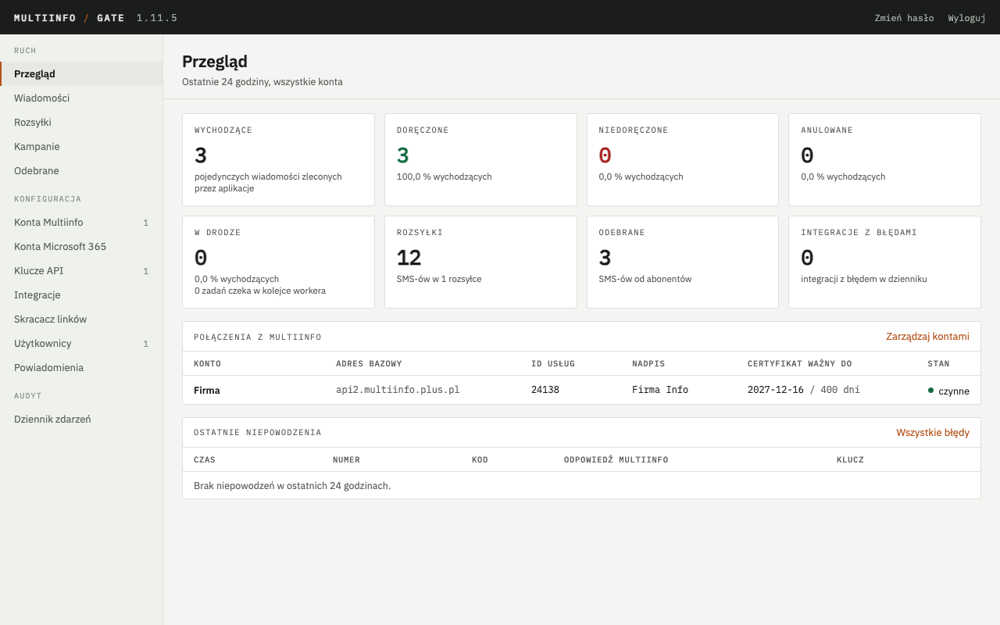
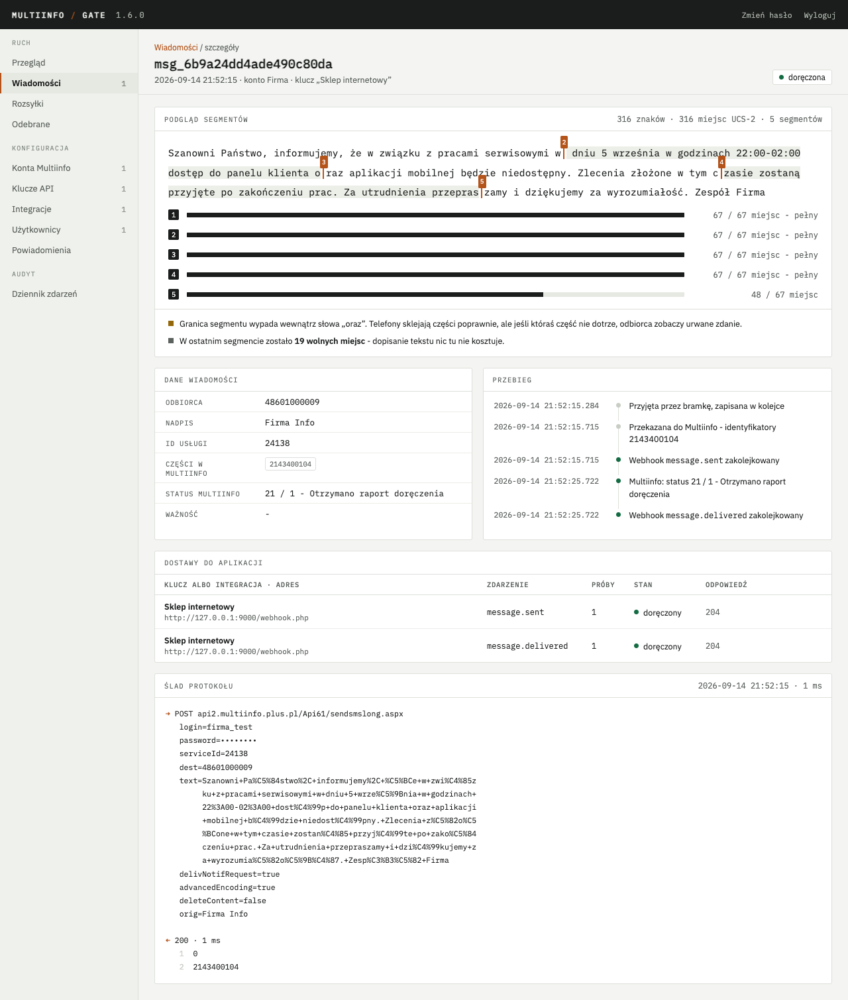

# Multiinfo Gate

Bramka SMS między Twoimi aplikacjami a API Multiinfo (Plus, Polkomtel). Przechowuje certyfikat
kliencki, login i hasło do Multiinfo w jednym miejscu. Aplikacjom wystawia proste HTTP API
z kluczem w nagłówku. Aplikacja wysyłająca SMS-y nie instaluje certyfikatów i nie zna ASPX.

## Dla kogo

Dla firmy z kontem Multiinfo, która chce dać własnym systemom albo agencji zewnętrznej jedno
API zamiast certyfikatów. Do tego otrzymuje panel do zarządzania kontami i kluczami oraz do
podglądu doręczeń.

Od wersji 1.3 bramka odbiera też SMS-y od abonentów. Przekazuje je aplikacji powiadomieniem
`message.received`, udostępnia do odczytu przez `GET /v1/inbound` i pozwala odpowiedzieć
w wątku (`inReplyTo`). Od wersji 1.5 integruje się z aplikacjami o narzuconym formacie: Uptime
Kuma, Grafana, Zabbix, FreeScout, Freshdesk, ntfy. Służy do tego adres wejściowy `/hooks/`
i szablony Liquid. Administratora bramka powiadamia mailem o błędach i certyfikatach.

Wersja 1.6 dokłada do katalogu pięć gotowych ustawień: n8n, WooCommerce w wariancie „nowe
zamówienie” oraz w wariancie „status do klienta”, Home Assistanta i Slacka. Sklep zawiadamia
SMS-em obsługę o nowym zamówieniu albo kupującego o zmianie statusu. Do tego dochodzi opis API
w formacie OpenAPI, plik `docs/openapi.json`. Plik odczytują Make oraz generatory bibliotek
klienckich, co eliminuje ręczne przepisywanie pól z dokumentacji.

Wersja 1.7 dokłada trzy gotowe ustawienia: Fakturownię w wariancie „powiadomienie obsługi” oraz
w wariancie „powiadomienie klienta”, a także Bitrix24. Fakturownia zawiadamia SMS-em o nowej
fakturze, a Bitrix24 zakłada zadanie z odebranego SMS-a przy kartotece klienta. Bramka potrafi
teraz dopytać aplikację o dane, których nie ma w powiadomieniu. Dzięki temu SMS trafia do
nabywcy faktury, choć numeru telefonu w samym powiadomieniu nie ma.

Wersja 1.8 wprowadza Mail2SMS. Bramka odczytuje wskazaną skrzynkę IMAP i zamienia wiadomości
e-mail od dozwolonych nadawców na SMS-y: alarm z zasilacza UPS, raport z serwera NAS albo
wiadomość pracownika docierają na telefon bez żadnych zmian po stronie urządzenia czy
aplikacji. Z wiadomości o stałej budowie bramka potrafi wyodrębnić wybrane pola i złożyć z nich
krótki SMS.

Wersja 1.8.5 dodaje SMS do grupy. Uprawniony numer wysyła SMS na numer bramki, a bramka rozsyła
treść do stałej listy numerów: ekipy serwisowej, brygady albo zespołu handlowego. Słowo na początku SMS-a wybiera
grupę, a nadawca może otrzymać potwierdzenie z liczbą odbiorców.

Od wersji 1.8.7 bramka sama zapisuje kopię bazy przed aktualizacją. Bramka, która nie może rozpocząć
pracy, pokazuje w panelu przyczynę i sposób naprawy zamiast zerwanego połączenia. Błąd panelu
kończy się stroną z identyfikatorem zdarzenia, a wpis z tym identyfikatorem trafia do dziennika.
Typowe problemy opisuje nowy dokument „Rozwiązywanie problemów”.

Wersja 1.9 wprowadza integrację z Power Automate. Przepływy Microsoft Power Automate wysyłają SMS-y
za pomocą konektora bramki: do jednego numeru, w formie rozsyłki do listy przygotowanej
w przepływie albo do listy odbiorców prowadzonej w bramce. Listę rozsyłki przepływ może zbudować
na przykład na podstawie tabeli Excela. Konektor pobiera się z panelu i importuje w Power Automate
jako łącznik niestandardowy.
Każda wysyłka przechodzi przez integrację z limitem części, ochroną przed burzą i dziennikiem,
który wskazuje również osobę zlecającą wysyłkę.

Wersja 1.10 wprowadza obsługę skrzynek Microsoft 365. Mail2SMS odczytuje skrzynkę w Exchange
Online przez skrzynkę przeznaczoną dla bramki. Skrzynka loguje się w przeglądarce, dlatego bramka
nie przechowuje jej hasła. Przez tę samą skrzynkę bramka wysyła maile powiadomień, ponieważ Microsoft wycofuje
logowanie hasłem do SMTP. Nowe ustawienie pomija wiadomości starsze niż wybrany limit, dzięki
czemu po przerwie w dostępie do skrzynki nieaktualny alarm nie trafia na telefon. Administrator
otrzymuje powiadomienia także SMS-em, również wtedy, gdy poczta nie działa.

Wersja 1.11 wprowadza wbudowany skracacz linków i kampanie. Bramka zamienia linki w SMS-ach na
krótkie linki własnej domeny firmy, na przykład `https://l.firma.pl/aB3xK9q`. Każdy odbiorca
otrzymuje własny kod, dzięki czemu bramka liczy otwarcia dokładnie, także przy linku wspólnym dla
całej kampanii. Wyniki kampanii przedstawia nowy ekran „Kampanie” w panelu, API oraz zdarzenie
„link otwarty”. Do adresu docelowego bramka dopisuje parametry UTM, dlatego ruch z kampanii jest
widoczny w Google Analytics, Matomo albo Umami. Skracanie włącza się przy kluczu API, a lista
dozwolonych domen docelowych chroni domenę skracacza przed wpisem na listę ostrzeżeń CERT Polska.

## Co trzeba mieć

- Konto Multiinfo z użytkownikiem API i certyfikatem (`.pfx` z hasłem)
- ID usługi (z panelu Multiinfo albo od opiekuna technicznego Polkomtel) i, jeżeli mają być
  używane, nadpisy nadawcy uruchomione przez Polkomtel na wniosek z panelu Multiinfo
- Serwer Linux (Ubuntu 24.04) z Dockerem albo własny Proxmox VE. Wystarczy najmniejsza maszyna
  w chmurze, x86-64 albo ARM64. Na Proxmoxie skrypt tworzy gotowy kontener LXC bez Dockera

## Instalacja

Bramka działa z gotowego obrazu `ghcr.io/sqlik/multiinfo-gate`, publikowanego przy każdym
wydaniu. Do uruchomienia wystarczą pliki z katalogu `docker/`, klucz główny w `docker/.env`
i polecenie `docker compose up -d`. HTTPS pod własną domeną daje Caddy, nginx albo Traefik,
według wyboru. Na Proxmox VE jedno polecenie w powłoce hosta tworzy kontener LXC
z zainstalowaną bramką (rozdział 9 instrukcji). O nowym wydaniu bramka sama informuje paskiem
na ekranie przeglądu i mailem do administratora. Kolejne kroki, od konta Multiinfo po
wystawienie API na świat, opisuje instrukcja poniżej.

## Dokumentacja

Strona dokumentacji: [sqlik.github.io/multiinfo-gate](https://sqlik.github.io/multiinfo-gate/)

- [Uruchomienie krok po kroku](https://sqlik.github.io/multiinfo-gate/uruchomienie/) - od konta Multiinfo do pierwszego SMS-a i wystawienia API na świat
- [API dla aplikacji](https://sqlik.github.io/multiinfo-gate/api/) - każde wywołanie z przykładem w siedmiu wariantach (curl, HTTP, PHP, Python, Node.js, PowerShell, C#), webhooki, błędy, limity
- [Integracje z aplikacjami](https://sqlik.github.io/multiinfo-gate/integracje/) - adres wejściowy dla aplikacji z własnym formatem, Mail2SMS, szablony Liquid, gotowe ustawienia, powiadomienia administratora mailem i SMS-em
- [Power Automate](https://sqlik.github.io/multiinfo-gate/power-automate/) - konektor do Microsoft Power Automate: integracja w panelu, import pliku, pierwszy przepływ, rozsyłka z Excela, rozwiązywanie problemów
- [Skracacz linków i kampanie](https://sqlik.github.io/multiinfo-gate/skracacz/) - krótkie linki własnej domeny, obowiązkowa lista domen docelowych, wyniki kampanii, parametry UTM, ważność linków i przechowywanie danych
- [Rozwiązywanie problemów](https://sqlik.github.io/multiinfo-gate/problemy/) - objaw, sprawdzenie i naprawa: panel, logowanie, tryb awaryjny, aktualizacja, Microsoft 365, skracacz linków, zgłaszanie problemów
- [Przykład w PHP](examples/php/) - strona testowa i kod do skopiowania

Źródłem strony są pliki w katalogu [`docs/`](docs/). Przykłady z zakładkami czytają się w nich
gorzej niż na stronie, ponieważ GitHub nie wyświetla zakładek.

## Licencja

MIT, patrz [LICENSE](LICENSE).
