# Agenci AI

Od wersji 1.12 bramka udostępnia serwer MCP, dzięki któremu pracownik wysyła SMS-y i sprawdza ich
doręczenie w rozmowie z aplikacją AI, na przykład w claude.ai, ChatGPT albo Claude Code. MCP jest
otwartym protokołem, za pomocą którego aplikacje AI korzystają z narzędzi zewnętrznych usług. Agent,
czyli model AI prowadzący rozmowę, przygotowuje SMS według polecenia pracownika. Aplikacja wyświetla
w rozmowie widok bramki z podglądem wiadomości, a pracownik zatwierdza wysyłkę przyciskiem w tym widoku.

Funkcja jest przeznaczona dla pracowników, którzy nie korzystają z panelu bramki ani z własnej
integracji. Dyspozytor pisze „Wyślij do grupy SERWIS, że w hali B stoi pompa” i po zatwierdzeniu
podglądu wiadomość trafia do całej ekipy serwisowej. Pracownik marketingu pyta o wyniki kampanii
„przeglad-klimatyzacji-wiosna” i otrzymuje wykres otwarć wraz z listą odbiorców, którzy nie otworzyli
linku. Biuro handlowe przegląda odpowiedzi klientów na rozsyłkę i odpowiada na nie z jednego widoku.

Wersja 1.13 wprowadza trzy kolejne możliwości. Agent planuje wysyłkę na wskazany termin, a bramka
przechowuje ją do chwili przekazania do Multiinfo, dzięki czemu zaplanowaną rozsyłkę można anulować.
Pracownik wysyła rozsyłkę z pliku CSV albo Excel z treścią złożoną z pól pliku, na przykład
przypomnienia o płatności z kwotą każdej faktury, a agent nie widzi przy tym żadnych danych z pliku.
Widok „Rozmowa z numerem” przedstawia wymianę SMS-ów z jednym klientem i pozwala odpowiedzieć w tym
samym miejscu.

Każde polecenie agenta przechodzi przez integrację „Agent AI” skonfigurowaną w panelu bramki.
Integracja określa zakresy, czyli czynności dostępne dla agenta, a także nadawcę, usługę Multiinfo,
limit części i ochronę przed burzą. Artykuł prowadzi od wymagań, przez integrację i połączenia
pracowników, do konfiguracji w poszczególnych aplikacjach. Agent nie zmienia konfiguracji bramki,
dlatego grupy, klucze API, integracje i powiadomienia pozostają w panelu.

Opis kroków w aplikacjach AI odpowiada ich wersjom z listopada 2026 roku. Producenci zmieniają nazwy
pozycji menu bez zapowiedzi, dlatego pojedyncze etykiety na ekranie mogą odbiegać od opisu.

## 1. Jakie możliwości oferuje agent

Agent korzysta z narzędzi bramki w granicach zakresów nadanych przez administratora. Rozdział 3
opisuje zakresy i powody ich rozdzielenia.

| Czynność | Przykładowe polecenie pracownika |
|---|---|
| SMS na jeden albo wiele numerów, do 5000 odbiorców | „Wyślij do 48601000011 i 48601000012 przypomnienie o jutrzejszej wizycie technika” |
| SMS do grupy SMS prowadzonej w bramce | „Napisz do grupy FLOTA, że przegląd floty przesuwa się na czwartek” |
| wysyłka z terminem i anulowanie zaplanowanej rozsyłki | „Wyślij do grupy SERWIS w poniedziałek o 7:30 przypomnienie o odprawie”, „Co mamy zaplanowane?”, „Anuluj rozsyłkę na poniedziałek” |
| rozsyłka z pliku CSV albo Excel, do 50 000 odbiorców | „Wyślij z pliku przypomnienia o płatności faktury z kwotą i terminem” |
| przebieg doręczenia wiadomości | „Czy SMS do 48601000011 z wczoraj po 14:00 dotarł?” |
| stan i raport rozsyłki | „Jaki jest stan wczorajszej rozsyłki? Ilu odbiorcom nie doręczono wiadomości i dlaczego?” |
| wyniki kampanii z krótkimi linkami | „Pokaż wyniki kampanii przeglad-klimatyzacji-wiosna i przygotuj przypomnienie dla osób bez otwarcia” |
| odebrane SMS-y i odpowiedzi | „Pokaż odpowiedzi klientów na rozsyłkę i przygotuj odpowiedzi dla osób, które proszą o zmianę terminu” |
| rozmowa z jednym klientem | „Pokaż rozmowę z 48601000011 i przygotuj odpowiedź na jego ostatni SMS” |
| informacja o własnych uprawnieniach | „Co mogę zrobić przez bramkę?” |

W aplikacji z widokami, na przykład w claude.ai i ChatGPT, agent niczego nie wysyła samodzielnie.
Polecenie wysyłki kończy się podglądem, w którym pracownik widzi treść, nadawcę, liczbę odbiorców
i liczbę części. Wysyłkę zatwierdza pracownik przyciskiem **Wyślij** w widoku bramki. W aplikacji bez
widoków, na przykład w Claude Code, agent przedstawia podgląd tekstem i prosi o potwierdzenie
w rozmowie. Bramka nie sprawdza takiego potwierdzenia, dlatego zatwierdzenia pilnują wyłącznie
instrukcje agenta. W n8n wysyłkę zatwierdza sam przepływ, bez udziału człowieka.

Bramka łączy się z aplikacjami na dwa sposoby:

| Aplikacja | Sposób połączenia | Zatwierdzenie wysyłki |
|---|---|---|
| claude.ai oraz aplikacje Claude na komputer i telefon | logowanie kodem jednorazowym | przycisk w widoku bramki |
| ChatGPT, także w planie bezpłatnym | logowanie kodem jednorazowym | przycisk w widoku bramki |
| Claude Code | token w nagłówku | potwierdzenie w rozmowie |
| VS Code | token w nagłówku | według obsługi widoków w aplikacji |
| n8n | token w nagłówku | bez udziału człowieka, opis w rozdziale 6.6 |
| Copilot Studio | token w nagłówku | wysyłka niedostępna, opis w rozdziale 6.5 |

## 2. Wymagania

### 2.1. Dostęp do bramki z internetu

Aplikacje z logowaniem, czyli claude.ai i ChatGPT, łączą się z bramką ze swoich serwerów, a nie
z komputera pracownika. Bramka musi zatem być dostępna z internetu pod adresem, który spełnia dwa
warunki:

- zawiera domenę, na przykład `sms.firma.pl`, a nie adres IP
- korzysta z HTTPS i certyfikatu wystawionego przez publiczny urząd certyfikacji, na przykład Let's Encrypt

Warunki te spełnia każdy wariant udostępnienia API opisany w rozdziale 6
[Uruchomienia](uruchomienie.md): Caddy, nginx i Traefik. Serwer MCP działa na porcie API pod adresem
`/mcp`, dlatego Caddy i Traefik nie wymagają zmian w konfiguracji. W wariancie z nginx zainstalowanym
przed wersją 1.12 zalecane jest dopisanie bloku `location /pobierz/` według rozdziału 6.6 Uruchomienia.
Blok wyłącza zapis linków do pobrania w dzienniku dostępu nginx, ponieważ każdy taki link zawiera token,
który przez godzinę otwiera plik z numerami odbiorców. Panel bramki pozostaje niedostępny z zewnątrz.

Bramka liczy nieudane próby kodu, rejestracje aplikacji i wydania tokenów osobno dla każdego adresu.
Za odwrotnym proxy bramka rozpoznaje adres pracownika wyłącznie wtedy, gdy adres proxy znajduje się
w zmiennej `MIG_TRUSTED_PROXIES`. Wariant z Caddy ustawia tę zmienną samodzielnie, a wartość dla nginx
i Traefika opisuje rozdział 6 Uruchomienia. W przeciwnym razie bramka traktuje wszystkich pracowników
jak jeden adres, dlatego 10 błędnie wpisanych kodów wstrzymuje sprawdzanie kodów wszystkim na 15 minut.

Aplikacje z kluczem w nagłówku łączą się z bramką z miejsca, w którym działają. Claude Code i VS Code
działają na komputerze pracownika, dlatego wystarczy im adres bramki dostępny z sieci firmowej, także
bez HTTPS. Copilot Studio działa w chmurze Microsoftu i wymaga dostępu z internetu, tak jak claude.ai.

### 2.2. Adres bramki

Aplikacja z logowaniem odczytuje z bramki adresy logowania i wymiany tokenów. Bramka buduje je na
podstawie ustawienia **Adres bramki dla aplikacji**, opisanego w rozdziale 4.5
[Uruchomienia](uruchomienie.md#45-klucz-api). Adres musi zaczynać się od `https://` i wskazywać
domenę z rozdziału 2.1, na przykład `https://sms.firma.pl`. Panel wyświetla ostrzeżenie w formularzu
integracji i na stronie połączenia, gdy adres jest pusty albo zaczyna się od `http://`.

Adres serwera MCP powstaje przez dopisanie `/mcp` do adresu bramki, na przykład
`https://sms.firma.pl/mcp`. Token w nagłówku działa także wtedy, gdy adres bramki nie jest ustawiony.

### 2.3. Sprawdzenie dostępności

Dostępność serwera MCP sprawdź z urządzenia spoza sieci firmowej, na przykład z telefonu z wyłączonym
Wi-Fi. Otwórz w przeglądarce adres:

```
https://<TWOJA-DOMENA>/.well-known/oauth-protected-resource/mcp
```

Oczekiwany wynik: dokument JSON bez ostrzeżenia o certyfikacie, w którym pole `resource` zawiera
adres `https://<TWOJA-DOMENA>/mcp`.

Jeżeli wynik jest inny:

- **Strona się nie otwiera.** Sprawdź rekord DNS domeny, ustawienia zapory i serwer pośredniczący
  zgodnie z rozdziałem 6 Uruchomienia
- **Przeglądarka ostrzega o certyfikacie.** Certyfikat nie pochodzi od publicznego urzędu certyfikacji
  albo został wystawiony na inną domenę, dlatego aplikacje AI odrzucą połączenie
- **Odpowiedź zawiera błąd o adresie bramki.** Ustawienie z rozdziału 2.2 jest puste. Opis znajdziesz
  w punkcie [Adres bramki nie jest ustawiony](problemy.md#agent-adres-bramki)
- **Pole `resource` zawiera inny adres.** Ustawienie z rozdziału 2.2 wskazuje adres sieci firmowej
  albo inną domenę

## 3. Zakresy

Zakresy określają, z których narzędzi bramki korzysta agent. Administrator wybiera je w formularzu
integracji, a obowiązują one wszystkie połączenia tej integracji. Agent widzi wyłącznie narzędzia ze
swoich zakresów, a narzędzie „Co mogę?” jest dostępne w każdym połączeniu.

| Zakres | Uprawnienia agenta |
|---|---|
| Wysyłka SMS-ów | przygotowanie SMS-a na dowolne numery, do 500 odbiorców jako pojedyncze wiadomości, a do 5000 jako rozsyłka, także z terminem; rozsyłka z pliku do 50 000 odbiorców; anulowanie wiadomości wysłanej przez tę integrację, której Multiinfo nie przekazało jeszcze do sieci operatora, oraz zaplanowanej rozsyłki tej integracji |
| Wysyłka do grup | przygotowanie SMS-a do grup SMS klucza integracji, na przykład SERWIS i FLOTA, także z terminem, bez możliwości wysłania SMS-a na numer spoza ich list; anulowanie zaplanowanej rozsyłki tej integracji |
| Odczyt wysłanych | lista wysłanych wiadomości i rozsyłek, przebieg doręczenia, stan i raport rozsyłki oraz wysyłki z pliku |
| Wyniki kampanii | lista kampanii, otwarcia i kliknięcia linków, odbiorcy z otwarciem i bez otwarcia |
| Odczyt odebranych | SMS-y odebrane w usługach klucza integracji i rozmowa z jednym numerem |
| Odpowiedź nadawcy | przygotowanie odpowiedzi wyłącznie do autora odebranego SMS-a, także w widoku rozmowy |

Agent działa w granicach klucza API integracji. Obowiązują więc konto Multiinfo tego klucza, jego
usługi, nadpisy, limit żądań na minutę i ustawienia skracania linków. Agent widzi wiadomości,
rozsyłki i kampanie całego klucza, także wysłane przez inne integracje i aplikacje korzystające z tego
klucza. Opcja klucza **Tylko integracje** nie ogranicza agenta, ponieważ agent jest integracją, a każda
jego wysyłka przechodzi przez jej limit części, ochronę przed burzą i dziennik.

### 3.1. Dlaczego zakresy są rozdzielone

Odebrany SMS pochodzi od osoby spoza firmy i może zawierać polecenie skierowane do agenta, na przykład
prośbę o wysłanie wiadomości na inny numer. Takie polecenie nazywa się przemyconym poleceniem. Bramka
oznacza każdą odebraną treść jako tekst od zewnętrznego nadawcy, a instrukcje dla agenta zabraniają
traktowania jej jako polecenia. W aplikacji z widokami wysyłkę zawsze zatwierdza pracownik, dlatego
przemycone polecenie może co najwyżej podsunąć szkic, który pracownik widzi przed wysłaniem. W aplikacji
bez widoków przed przemyconym poleceniem chronią wyłącznie instrukcje agenta, dlatego tym ważniejszy
jest dobór zakresów.

Zakresy pozwalają ograniczyć to ryzyko już w konfiguracji:

- **Wysyłka SMS-ów razem z Odczytem odebranych.** Formularz wyświetla ostrzeżenie, a dziennik
  zdarzeń panelu odnotowuje zapis takiej integracji. Do obsługi klientów zalecany jest zakres
  „Odpowiedź nadawcy” zamiast „Wysyłka SMS-ów”
- **Odpowiedź nadawcy.** Odpowiedź trafia wyłącznie do autora odebranego SMS-a, dlatego agent nie
  wyśle wiadomości na obcy numer. Zakres wymaga odczytu odebranych, dlatego zapis integracji zaznacza
  „Odczyt odebranych” samodzielnie
- **Wysyłka do grup.** Lista odbiorców grupy jest stała, dlatego agent z tym zakresem nie wyśle
  SMS-a na numer spoza list. Ten zakres jest właściwy dla dyspozytora, który pisze do ekip, ale nie
  do klientów

Pracownicy o różnych uprawnieniach wymagają osobnych integracji, na przykład „Agent AI - marketing”
z zakresami wysyłki i kampanii oraz „Agent AI - dyspozytornia” z zakresami grup i odpowiedzi.

## 4. Integracja „Agent AI” w panelu

### 4.1. Klucz API dla agentów

Integracja działa w imieniu klucza API. Zalecane jest utworzenie osobnego klucza, na przykład
„Agenci AI”, z usługami i nadpisami ograniczonymi do potrzeb pracowników. Osobny klucz można w razie
potrzeby odwołać bez wpływu na pozostałe aplikacje. Połączenia pracowników nigdy nie trwają dłużej niż
ten klucz. Klucz utworzysz na ekranie **Klucze API → Wygeneruj klucz**, opisanym w rozdziale 4.5
[Uruchomienia](uruchomienie.md#45-klucz-api).

### 4.2. Utworzenie integracji

Celem procedury jest integracja, z którą pracownicy połączą swoje aplikacje AI.

1. W panelu bramki otwórz **Integracje → Dodaj integrację**.
2. Wybierz kierunek **Aplikacja wysyła SMS**.
3. Kliknij kafelek **Agent AI**. Otworzy się formularz w trybie prostym.
4. Uzupełnij sekcję **Podstawy**:
    - **Nazwa**: pod tą nazwą integracja wyświetla się na stronie połączenia aplikacji i w źródle
      wiadomości, na przykład „Agent AI - marketing”
    - **Klucz API**: klucz z rozdziału 4.1
    - **ID usługi** i **Nadpis nadawcy**: wartości domyślne w podglądzie wysyłki. Agent może wybrać
      inną usługę albo inny nadpis tego klucza, a podgląd pokazuje wybór pracownikowi
    - **Włączona**: wyłączona integracja odcina wszystkie swoje połączenia
5. W sekcji **Zakresy** zaznacz czynności dostępne dla agenta według rozdziału 3.
6. W sekcji **Treść** określ **Limit części** oraz sposób postępowania z dłuższą treścią: „skróć
   i wyślij” albo „nie wysyłaj, poproś agenta o krótszą treść”. Limit obowiązuje SMS-y, rozsyłki
   i odpowiedzi agenta, a SMS do grupy podlega limitowi części grupy.
7. Kliknij **Utwórz integrację**.


Oczekiwany wynik: panel wyświetla szczegóły integracji z konfiguracją opisaną słowami oraz pustą
sekcją **Połączenia**. Na liście integracji nowa pozycja jest oznaczona kierunkiem „do SMS”, a plakietka
pod nazwą podaje liczbę aktywnych połączeń.

Jeżeli wynik jest inny:

- **Formularz wyświetla ostrzeżenie o adresie bramki.** Adres jest pusty albo nie zaczyna się od
  `https://`. Integrację można zapisać, ale aplikacje z logowaniem nie połączą się z bramką do czasu
  poprawy adresu według rozdziału 2.2
- **Lista kluczy jest pusta.** Panel pokazuje wyłącznie klucze czynne, bez odwołanych i wygasłych

### 4.3. Ochrona przed burzą i dziennik

Przełącznik **Zaawansowany** nad formularzem odsłania sekcję **Ochrona i dziennik**:

| Pole | Znaczenie |
|---|---|
| Limit burzy | liczba wysyłek zatwierdzonych w oknie czasowym, domyślnie 30 wysyłek w ciągu 60 minut; liczą się także odpowiedzi i SMS-y do grup |
| Limit odbiorców | liczba numerów ze wszystkich wysyłek w tym samym oknie, od 1 do 50 000, domyślnie 1000; SMS do jednego numeru zajmuje jedno miejsce, a rozsyłka, SMS do grupy i rozsyłka z pliku tyle miejsc, ilu obejmują odbiorców |
| Wpisów w dzienniku | pojemność dziennika integracji, od 20 do 2000 wpisów, domyślnie 200 |
| Przechowuj ładunki w dzienniku | zachowuje treść i odbiorców każdej wysyłki przez 7 dni w postaci zaszyfrowanej; opcję zaleca się włączać wyłącznie na czas konfiguracji |

Podgląd wysyłki pokazuje, ile wysyłek i odbiorców pozostało w bieżącym oknie. Szkic, który
przekroczyłby limit, zostaje odrzucony już przy przygotowaniu, a agent otrzymuje informację o czasie,
po którym może ponowić próbę. Takie odrzucenie pozostawia w dzienniku wpis „limit”, a pierwsze
przekroczenie w oknie jest zgłaszane administratorowi powiadomieniem „Limit burzy przekroczony”.
Odczyty, na przykład lista wiadomości, wyniki kampanii i odświeżanie widoków, nie wliczają się do
ochrony przed burzą. Liczą się wyłącznie do limitu żądań klucza na minutę.

Wysyłka z terminem liczy się do ochrony przed burzą w chwili zatwierdzenia, a nie w chwili
przekazania do Multiinfo. Rozsyłka z pliku jest jedną wysyłką, która zajmuje tyle miejsc, ilu
obejmuje odbiorców. Domyślny limit 1000 odbiorców nie wystarcza zatem do większego pliku. Opis
znajdziesz w rozdziale 9.5.

Dziennik integracji zapisuje wysyłki, odrzucenia i błędy, ale nie zapisuje odczytów. Kolumna „Nadawca”
pokazuje `MCP · <nazwa połączenia>`, dzięki czemu każdą wysyłkę można przypisać do pracownika.

## 5. Połączenie agenta w panelu

Każdy pracownik otrzymuje własne połączenie. Połączenie wiąże aplikację AI pracownika z integracją,
a jego nazwa wyświetla się w źródle wiadomości i w dzienniku. Dzięki temu odwołanie dostępu jednego
pracownika nie wpływa na pozostałych.

### 5.1. Dodanie połączenia

Celem procedury jest kod jednorazowy albo token, który pracownik wpisze w swojej aplikacji AI.

1. Otwórz szczegóły integracji „Agent AI” i w sekcji **Połączenia** kliknij **Dodaj połączenie**.
2. W polu **Nazwa** wpisz imię i nazwisko pracownika albo nazwę systemu, na przykład „Ewa Nowak”.
3. Wybierz **Sposób połączenia**:
    - **Aplikacja z logowaniem**: claude.ai, ChatGPT, aplikacje Claude i inne aplikacje, które przy
      dodawaniu łącznika otwierają stronę logowania. Pracownik wpisuje na stronie bramki kod jednorazowy
    - **Aplikacja z kluczem w nagłówku**: Copilot Studio, Claude Code, VS Code i n8n. Aplikacja wysyła
      token połączenia w nagłówku `Authorization` przy każdym żądaniu
4. Przy logowaniu wybierz **Ważność kodu**: 15 minut, 1 godzina, 24 godziny, 3 dni albo 7 dni.
   Domyślna wartość wynosi 24 godziny.
5. Wybierz **Ważność połączenia**: 30 dni, 90 dni, rok albo bez terminu. Domyślna wartość wynosi
   90 dni.
6. Kliknij **Dodaj połączenie**.

Oczekiwany wynik: panel wyświetla jeden raz kod jednorazowy w postaci `XXXX-XXXX-XXXX` albo token
połączenia rozpoczynający się od `mig_mcp_`. Pod nim znajdują się adres serwera MCP, terminy ważności,
gotowy **Tekst do przekazania** z przyciskiem **Kopiuj tekst** oraz krótka instrukcja dla najczęstszych
aplikacji.

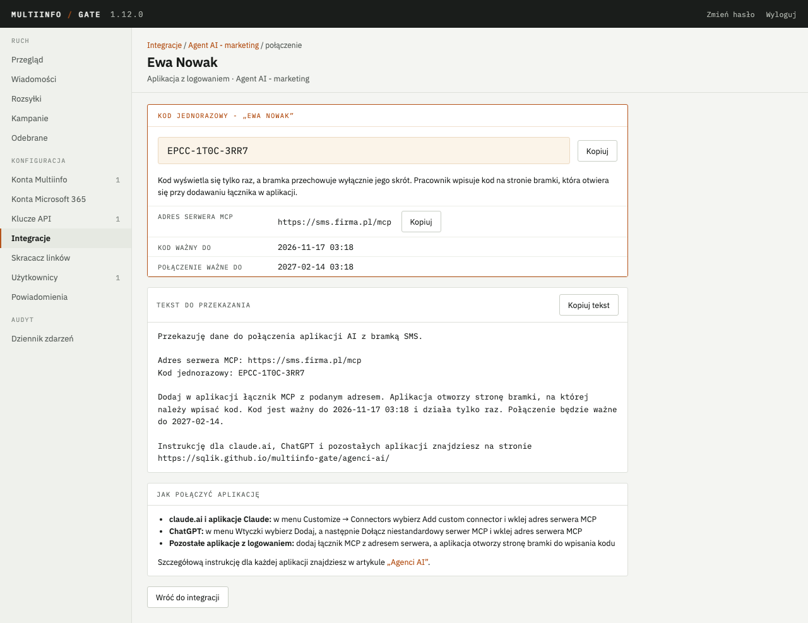

Jeżeli wynik jest inny:

- **Adres serwera MCP jest nieznany.** Panel nie zna adresu bramki. Ustaw adres według rozdziału 2.2,
  a następnie wygeneruj nowy kod, aby panel przygotował tekst do przekazania
- **Panel odrzuca nazwę.** Integracja zawiera już aktywne albo oczekujące połączenie o tej nazwie.
  Podaj inną nazwę albo odwołaj dotychczasowe połączenie, którego nazwa wróci wtedy do użytku

Bramka przechowuje wyłącznie skrót kodu i tokenu, tak jak przy kluczach API. Panel nie pokaże tych
wartości ponownie, dlatego tekst do przekazania należy od razu wysłać pracownikowi. Token należy
przekazać bezpiecznym kanałem, ponieważ każda osoba, która go zna, może korzystać z połączenia. Kod
jednorazowy działa tylko raz i przestaje działać po terminie ważności.

### 5.2. Stany połączenia

Sekcja **Połączenia** w szczegółach integracji przedstawia każde połączenie z nazwą aplikacji, stanem,
chwilą ostatniego użycia i terminem ważności.

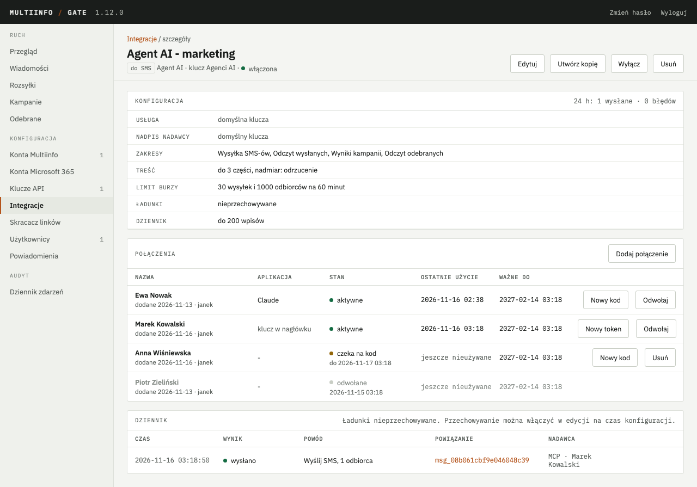

| Stan | Znaczenie | Dostępne działania |
|---|---|---|
| czeka na kod | kod jednorazowy nie został jeszcze użyty, a kolumna podaje jego termin | Nowy kod, Usuń |
| aktywne | aplikacja połączyła się z bramką i korzysta z połączenia | Nowy kod albo Nowy token, Odwołaj |
| kod wygasł | kod nie został użyty przed terminem | Nowy kod, Usuń |
| wygasłe | minął termin połączenia albo klucza API integracji | brak, należy dodać nowe połączenie |
| odwołane | administrator odwołał połączenie albo bramka wykryła ponowne użycie tokenu | brak, należy dodać nowe połączenie |

Kolumna „Aplikacja” podaje nazwę, pod którą aplikacja zarejestrowała się w bramce, na przykład
„Claude” albo „ChatGPT”. Przy tokenie kolumna podaje „klucz w nagłówku”.

### 5.3. Ważność, nowy kod i odwołanie

Połączenie przestaje działać, gdy administrator je odwoła, gdy minie jego termin, gdy integracja
zostanie wyłączona albo usunięta, a także gdy klucz integracji zostanie odwołany albo wygaśnie.
Ważność połączenia nigdy nie przekracza ważności klucza. Bramka sprawdza oba terminy przy każdym
żądaniu, dlatego skrócenie ważności klucza skraca połączenia natychmiast.

Wyłączenie integracji odcina wszystkie jej połączenia naraz. Ponowne włączenie przywraca połączenia,
które w tym czasie nie wygasły, bez wydawania nowych kodów.

Przycisk **Nowy kod** przy aktywnym połączeniu służy do ponownego połączenia, na przykład gdy pracownik
usunął i dodał łącznik w aplikacji. Dotychczasowe połączenie działa do chwili użycia nowego kodu.
Użycie kodu przepina połączenie na aplikację, w której pracownik go wpisał, a wcześniejsze tokeny tej
aplikacji przestają działać. Przycisk **Nowy token** unieważnia poprzedni token natychmiast, dlatego
aplikację należy skonfigurować ponownie. Odwołanego połączenia nie można przywrócić, a administrator
zakłada w jego miejsce nowe.

### 5.4. Powiadomienie i dziennik zdarzeń

Użycie kodu jednorazowego wysyła administratorowi powiadomienie „Połączenie agenta AI” według reguł
z rozdziału 9.2 [Integracji z aplikacjami](integracje.md#92-reguy). Powiadomienie podaje nazwę
połączenia, integrację, aplikację, adres, z którego nastąpiło połączenie, oraz zakresy. Dzięki temu
administrator zauważy połączenie, którego nie oczekiwał.

Ta sama reguła zgłasza wstrzymanie sprawdzania kodów. Po 5000 nieudanych próbach w ciągu 15 minut
bramka przez kolejne 15 minut nie sprawdza kodów z żadnego adresu. Tak duża liczba prób wskazuje na
próbę zablokowania połączeń przez osobę z zewnątrz, ponieważ odgadnięcie kodu nie jest możliwe.

Dziennik zdarzeń panelu odnotowuje dodanie i usunięcie połączenia, wygenerowanie nowego kodu albo
tokenu, połączenie aplikacji kodem oraz odwołanie połączenia, także samoczynne po ponownym użyciu
zużytego tokenu odświeżania. Odnotowuje również usunięcie tokenów aplikacji po ponownym użyciu kodu
autoryzacji i zapis integracji, która łączy wysyłkę SMS-ów z odczytem odebranych.

## 6. Łączenie w aplikacjach

Pracownik potrzebuje adresu serwera MCP oraz kodu jednorazowego albo tokenu z tekstu do przekazania.
Po połączeniu warto zacząć rozmowę od pytania „Co mogę zrobić przez bramkę?”. Agent wywołuje wtedy
narzędzie „Co mogę?”, które przedstawia zakresy, limity, usługi i grupy SMS połączenia.

### 6.1. claude.ai i aplikacje Claude

1. W claude.ai otwórz **Customize → Connectors** i wybierz **Add custom connector**.
2. Wpisz nazwę łącznika, na przykład „Multiinfo Gate”, a w polu adresu wklej adres serwera MCP.
3. Kliknij **Add**, a następnie **Connect** przy nowym łączniku. Otworzy się strona połączenia bramki.
4. Sprawdź nazwę aplikacji i adres powrotu na stronie bramki, wpisz kod jednorazowy i kliknij
   **Połącz**.

Oczekiwany wynik: strona bramki wyświetla potwierdzenie z nazwą połączenia i listą uprawnień,
a po kilku sekundach przeglądarka wraca do claude.ai. Łącznik jest od tej chwili dostępny także
w aplikacji Claude na komputer i telefon.

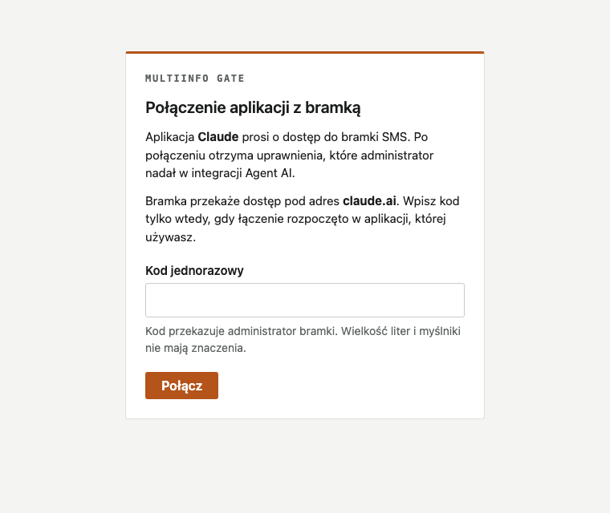

Ustawienia łącznika w claude.ai dzielą narzędzia bramki na dwie grupy. Grupa „Interactive tools”
zawiera narzędzia dostępne dla agenta, a grupa „App-only tools” narzędzia wysyłki i przekazania pliku,
z których korzysta wyłącznie widok bramki. Przyciski „Popraw treść w rozmowie”, „Przygotuj
przypomnienie”, „Przekaż plik do bramki” i „Poproś o odpowiedź” w widokach wysyłają do rozmowy
wiadomość w imieniu pracownika. claude.ai prosi wtedy o zgodę na wiadomość aplikacji, którą musi
kliknąć pracownik.

### 6.2. ChatGPT

1. W ChatGPT otwórz **Wtyczki**, wybierz **Dodaj**, a następnie **Dołącz niestandardowy serwer MCP**.
   Tryb dewelopera nie jest potrzebny, a funkcja działa także w planie bezpłatnym.
2. Wpisz nazwę wtyczki i wklej adres serwera MCP.
3. Zatwierdź okno zgody. ChatGPT informuje w nim, jakie dane rozmowy może udostępnić aplikacji.
4. Na stronie połączenia bramki wpisz kod jednorazowy i kliknij **Połącz**.

Oczekiwany wynik: ChatGPT pokazuje wtyczkę jako połączoną, a pytanie „Co mogę zrobić przez bramkę?”
wyświetla widok „Co mogę?”.

ChatGPT zapamiętuje listę narzędzi i widoki wtyczki z chwili jej dodania. Po aktualizacji bramki, po
zmianie zakresów integracji i po połączeniu wtyczki z inną integracją otwórz **Ustawienia → Wtyczki**,
wybierz wtyczkę i kliknij **Odśwież narzędzia**. W przeciwnym razie agent nie widzi nowych narzędzi.
Po odświeżeniu ChatGPT przez chwilę wyświetla stan „Skanowanie bezpieczeństwa: Oczekiwanie”.

ChatGPT wywołuje narzędzie „Co mogę?” przed wieloma zadaniami, dlatego w rozmowie pojawia się kilka
widoków „Co mogę?”. Wiadomość z przycisków w widokach trafia do rozmowy od razu jako wiadomość
pracownika, bez osobnej zgody. Po wiadomości z przycisku „Przekaż plik do bramki” ChatGPT wyświetla
widok wyboru pliku ponownie w stanie początkowym. Plik pozostaje w bramce, a podgląd wysyłki pojawia się
w kolejnym widoku, dlatego ponowny wybór pliku nie jest potrzebny. Po odwołaniu połączenia ChatGPT
wyświetla przycisk „Połącz się ponownie”, który prowadzi przez stronę połączenia bramki.

### 6.3. Claude Code

Claude Code łączy się tokenem połączenia. Na komputerze pracownika uruchom w terminalu polecenie
z instrukcji na stronie połączenia:

```
claude mcp add --transport http multiinfo-gate https://sms.firma.pl/mcp --header "Authorization: Bearer mig_mcp_..."
```

Oczekiwany wynik: polecenie `claude mcp list` pokazuje serwer `multiinfo-gate` ze stanem połączenia.
Claude Code nie wyświetla widoków bramki, dlatego agent przedstawia podgląd wysyłki tekstem. SMS zostaje
wysłany dopiero po potwierdzeniu w rozmowie, na przykład słowem „wyślij”.

### 6.4. VS Code

W VS Code dodaj serwer w pliku `mcp.json` w ustawieniach użytkownika albo w katalogu `.vscode`
projektu:

```json
{
  "servers": {
    "multiinfo-gate": {
      "type": "http",
      "url": "https://sms.firma.pl/mcp",
      "headers": { "Authorization": "Bearer mig_mcp_..." }
    }
  }
}
```

Plik w katalogu projektu trafia zwykle do repozytorium, dlatego token należy umieścić w ustawieniach
użytkownika. Bez obsługi widoków agent prosi o potwierdzenie wysyłki w rozmowie, tak jak w Claude Code.

### 6.5. Copilot Studio

1. W Copilot Studio otwórz agenta, przejdź do **Narzędzia**, wybierz **Dodaj**, a następnie
   **Protokół kontekstu modelu**.
2. Wpisz nazwę serwera bez polskich znaków, na przykład „Multiinfo Gate”. Copilot Studio odrzuca nazwę
   z polskimi znakami komunikatem „Can't create MCP server”.
3. Wklej adres serwera MCP i wybierz uwierzytelnianie kluczem interfejsu API w nagłówku `Authorization`.
4. Przy tworzeniu połączenia wklej token połączenia.

Rozmowa z agentem Copilot Studio zużywa kredyty środowiska Power Platform. Środowisko bez kredytów
odrzuca rozmowę, choć łącznik zostaje utworzony.

Agent Copilot Studio odczytuje dane bramki, ale nie wysyła SMS-ów. Copilot Studio deklaruje
obsługę widoków, a jednocześnie udostępnia agentowi narzędzia przeznaczone wyłącznie dla widoku.
Bramka traktuje tę deklarację jako wiążącą i przyjmuje wysyłkę szkicu wyłącznie z przycisku w widoku.
Copilot Studio widoku nie wyświetla, dlatego zatwierdzenie wysyłki w Copilot Studio nie jest możliwe.
Do wysyłki służy wtedy integracja z Power Automate,
opisana w artykule [Power Automate](power-automate.md).

### 6.6. n8n

W przepływie z węzłem **AI Agent** dodaj narzędzie **MCP Client Tool**. W polu **Endpoint** wklej adres
serwera MCP, w polu **Server Transport** wybierz **HTTP Streamable**, a w polu **Authentication**
wybierz **Bearer Auth** z tokenem połączenia.

W n8n agent działa bez udziału człowieka, dlatego wysyłkę zatwierdza sam przepływ. Dla takiego
połączenia zalecana jest osobna integracja z wąskimi zakresami, na przykład wyłącznie z odczytem
wysłanych, oraz niski limit ochrony przed burzą.

### 6.7. Pozostałe aplikacje

Każda aplikacja obsługująca serwery MCP z logowaniem OAuth, na przykład Gemini Enterprise, łączy się
z bramką tak jak claude.ai. Pracownik dodaje łącznik z adresem serwera MCP, a aplikacja otwiera stronę
bramki do wpisania kodu. Bramka obsługuje rejestrację aplikacji przez dokument metadanych klienta
i rejestrację dynamiczną, dlatego administrator nie rejestruje aplikacji ręcznie. Aplikacja bez
logowania korzysta z tokenu w nagłówku `Authorization`. Aplikacja Gemini w planach indywidualnych nie
pozwala w listopadzie 2026 roku dodać własnego serwera MCP.

## 7. Widoki w rozmowie

Aplikacje obsługujące rozszerzenie MCP Apps, czyli claude.ai i ChatGPT, wyświetlają w rozmowie widoki
bramki. Widok jest małą stroną przygotowaną przez bramkę, która pokazuje dane w formie przeznaczonej
dla człowieka: tabele, wykresy, przyciski i pola do poprawienia. Każde narzędzie z widokiem zwraca
również zwięzły tekst, dzięki czemu aplikacje bez widoków przedstawiają te same informacje w rozmowie.

Pracownik widzi w widoku wszystkie dane potrzebne do decyzji, na przykład numery i nazwy odbiorców
grupy. Agent otrzymuje wyłącznie dane niezbędne do prowadzenia rozmowy, na przykład liczbę odbiorców.

| Widok | Przeznaczenie | Możliwości |
|---|---|---|
| Wysyłka SMS | podgląd SMS-a na podane numery | wybór nadawcy, usługi, kodowania i skracania linków, termin, „Wyślij” albo „Zaplanuj rozsyłkę”, „Popraw treść w rozmowie”, doręczenia po wysyłce |
| SMS do grupy | podgląd SMS-a do grupy SMS | lista odbiorców z nazwami, treść według ustawień grupy, termin, „Wyślij” albo „Zaplanuj wysyłkę” |
| Przebieg doręczenia | etapy jednej wiadomości od przyjęcia do raportu | „Anuluj wiadomość”, „Wyślij ponownie”, odświeżenie |
| Co mogę? | uprawnienia i limity połączenia | odświeżenie |
| Wyniki kampanii | otwarcia i kliknięcia linków | wykresy, odbiorcy bez otwarcia, pliki CSV, „Przygotuj przypomnienie” |
| Postęp rozsyłki | wysyłanie i raport rozsyłki | termin i chwila przekazania, „Anuluj rozsyłkę”, odświeżanie co 30 sekund, przyczyny niedoręczeń, pliki CSV |
| Odpowiedzi klientów | odebrane SMS-y ze szkicami odpowiedzi | grupy nadane przez agenta, poprawa treści, „Wyślij odpowiedź”, wysłanie szkiców naraz |
| Rozsyłka z pliku | odczyt pliku CSV albo Excel, podgląd i postęp wysyłki z pliku | rozpoznanie kolumn, gotowe wiadomości, wiersze wyłączone, „Wyślij” albo „Zaplanuj wysyłkę”, „Anuluj wysyłkę”, raport CSV |
| Rozmowa z numerem | SMS-y klienta i wiadomości wysłane na jego numer według czasu | odświeżanie co 15 sekund, „Poproś o odpowiedź”, „Wyślij odpowiedź”, „Wcześniejsze” |

### 7.1. Zatwierdzenie wysyłki

Agent przygotowuje wysyłkę, a bramka sprawdza wszystko, co sprawdziłaby sama wysyłka: usługę,
nadawcę, numery, limit części, skracanie linków i ochronę przed burzą. Wynik trafia do szkicu
przechowywanego w bramce przez 30 minut. Przycisk **Wyślij** wysyła dokładnie ten szkic, dlatego
wychodzi wiadomość, którą pracownik widział w podglądzie. Zmiana nadawcy, kodowania albo ustawień
linków w widoku tworzy nowy szkic.

Przygotowanie w aplikacji z widokami tworzy jednorazowy klucz potwierdzenia, który otrzymuje wyłącznie
widok, a nie agent. Bramka przyjmuje wysyłkę takiego szkicu tylko z tym kluczem, dlatego agent nie
wyśle SMS-a z pominięciem przycisku. Ponowne kliknięcie, druga karta z tym samym widokiem i ponowienie
żądania przez aplikację kończą się tym samym wynikiem bez drugiego SMS-a. Po 30 minutach widok wyświetla prośbę
o ponowne przygotowanie wysyłki.

### 7.2. Wysyłka SMS

Widok wysyłki przedstawia okno z treścią SMS-a, ustawienia wysyłki i podsumowanie. Pole **Nadawca**
zawiera nadpisy klucza, a wartością domyślną jest nadpis nadawcy integracji. Pole **Kodowanie** pozwala
wysłać wiadomość z polskimi znakami albo bez nich, a obok wyświetla się liczba części w obu wariantach.
Pola **Krótkie linki**, **Domena linków** i **Kampania** pojawiają się, gdy treść zawiera link, a skracanie
linków jest włączone w kluczu. Podsumowanie podaje liczbę SMS-ów i części, liczbę wysyłek i odbiorców
pozostałych w oknie ochrony przed burzą oraz termin ważności podglądu.

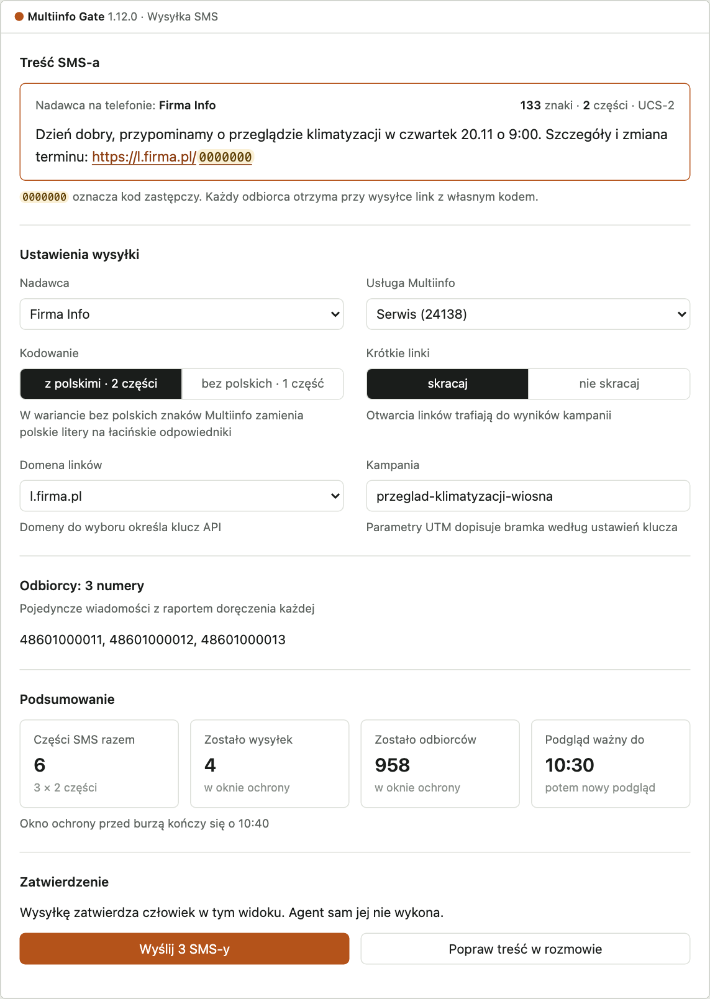

Do 500 odbiorców bramka wysyła pojedyncze wiadomości z raportem doręczenia każdej z nich. Po wysyłce
widok pokazuje doręczenia na bieżąco, jeżeli połączenie obejmuje zakres „Odczyt wysłanych”. Od 501 do 5000
odbiorców bramka wysyła rozsyłkę ze wspólną treścią, a widok prowadzi do postępu rozsyłki. Powtórzone
numery bramka usuwa, a podgląd podaje ich liczbę. Numery w zapisach `+48 601 000 011`,
`0048601000011` i `601-000-011` bramka sprowadza do jednej postaci, tak jak przy wysyłce przez API.

Przycisk wysyłki podaje liczbę wiadomości, na przykład „Wyślij 3 SMS-y”. Przycisk **Popraw treść
w rozmowie** wysyła do rozmowy stałą prośbę o poprawę treści. Pracownik
dopisuje w rozmowie, co zmienić, a agent przygotowuje nowy podgląd.

Polecenie z terminem prowadzi zawsze do rozsyłki, także przy jednym odbiorcy. Pole **Termin** podaje
wtedy termin w czasie polskim oraz chwilę, do której można anulować rozsyłkę, a przycisk wysyłki
przyjmuje postać „Zaplanuj rozsyłkę do N odbiorców”. Wysyłkę z terminem opisuje rozdział 8.

### 7.3. SMS do grupy

Widok grupy przedstawia nazwę grupy, listę odbiorców z nazwami i treść według ustawień grupy. Wysyłka
stosuje szablon treści, nadpis, usługę i limit części grupy, tak jak SMS wysłany przez dyspozytora
z telefonu. Przycisk **Wyślij do N osób** podaje liczbę odbiorców.

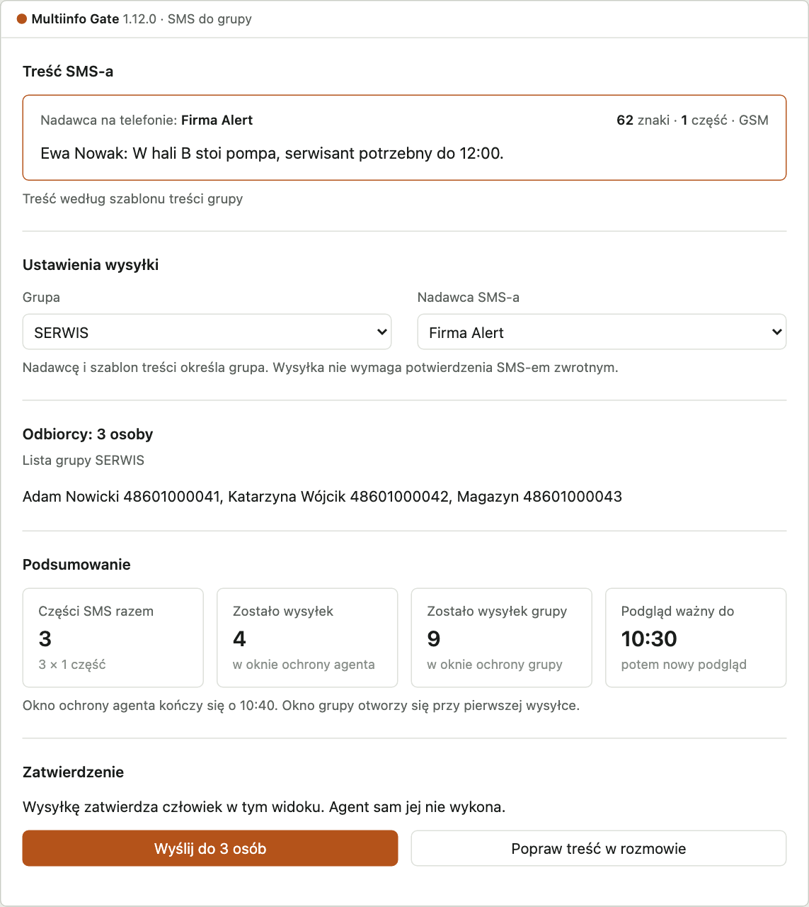

Wysyłka przechodzi kolejno przez ochronę przed burzą integracji agenta i integracji grupy. Każda z nich
liczy własne limity i zapisuje własny wpis w dzienniku. Warunek grupy dotyczy treści odebranego SMS-a,
dlatego przy wysyłce przez agenta jest pomijany. Potwierdzenie SMS-em zwrotnym również nie jest
wysyłane, ponieważ potwierdzeniem jest widok. W trybie „Nadawca i treść” SMS jest podpisany nazwą
połączenia, na przykład „Ewa Nowak: w hali B stoi pompa”.

### 7.4. Przebieg doręczenia

Widok przebiegu przedstawia etapy wiadomości: przyjęcie przez bramkę, przekazanie do Multiinfo
i raport doręczenia z opisem kodu operatora. Pracownik wyszukuje wiadomość przez agenta po numerze
odbiorcy i przedziale czasu, na przykład „od wczoraj 14:00”. Widok i agent podają czas polski.


Przycisk **Anuluj wiadomość** działa wyłącznie wtedy, gdy Multiinfo nie przekazało jeszcze wiadomości
do sieci operatora. Wiadomość czeka wtedy w kolejce bramki albo w Multiinfo, także wstrzymana limitem
operatora. Multiinfo przekazuje SMS do sieci operatora zaraz po przyjęciu, dlatego wiadomości
przekazanej do sieci nie można anulować. Agent anuluje wyłącznie wiadomości wysłane przez swoją
integrację, także jej SMS-y do grup, a pozostałe wiadomości anuluje administrator w panelu bramki.
W pozostałych stanach przycisk jest wyszarzony, a obok wyświetla się przyczyna. Przycisk
**Wyślij ponownie** otwiera podgląd wysyłki z tą samą treścią i tym samym odbiorcą.

### 7.5. Co mogę?

Widok „Co mogę?” przedstawia nazwę połączenia, integrację, termin ważności, uprawnienia, limity, usługi
Multiinfo i grupy SMS dostępne dla połączenia. Pracownik sprawdza w nim, czego może oczekiwać od agenta,
zanim wyda polecenie.


### 7.6. Wyniki kampanii

Widok kampanii przedstawia liczbę wysłanych i doręczonych wiadomości, otwarć i kliknięć, wykres otwarć
dzień po dniu, kliknięcia w pierwszych 48 godzinach i kliknięcia według celu linku. Lista odbiorców bez
otwarcia pokazuje pierwsze pozycje, a przycisk **Pokaż kolejnych odbiorców** doczytuje następne.

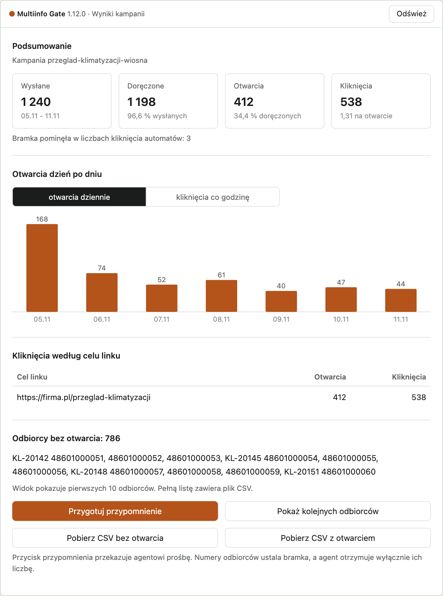

Przycisk **Przygotuj przypomnienie** wysyła do rozmowy prośbę o przypomnienie dla odbiorców bez
otwarcia. Agent przygotowuje wtedy podgląd wysyłki, a bramka sama ustala numery odbiorców, dlatego
agent otrzymuje wyłącznie ich liczbę. Przypomnienie wymaga zakresów „Wyniki kampanii” i „Wysyłka
SMS-ów”. Po okresie przechowywania szczegółów kampanii lista odbiorców nie jest już dostępna, a widok
pokazuje wyłącznie kliknięcia. Okres przechowywania opisuje artykuł
[Skracacz linków i kampanie](skracacz.md).

### 7.7. Postęp rozsyłki

Widok rozsyłki odświeża się co 30 sekund, dopóki rozsyłka nie osiągnie stanu ostatecznego, najdłużej
przez 30 minut. W trakcie wysyłania pokazuje liczbę wiadomości przekazanych i pozostałych do wysłania.
Po raporcie pokazuje liczbę wiadomości doręczonych, niedoręczonych i przedawnionych, przyczyny
niedoręczeń oraz doręczenia w kolejnych godzinach. Każde odświeżenie liczy się do limitu żądań klucza.

Dla rozsyłki przechowywanej przez bramkę widok pokazuje sekcję „Zaplanowana rozsyłka” z terminem,
chwilą przekazania do Multiinfo i przyciskiem **Anuluj rozsyłkę**, który działa do chwili przekazania.
Sekcja „Termin minął” oznacza rozsyłkę, która czeka na decyzję administratora bramki. Pracownik może
ją wtedy wyłącznie anulować.


### 7.8. Odpowiedzi klientów

Widok odpowiedzi przedstawia odebrane SMS-y jako zwartą listę. Treść każdego SMS-a jest oznaczona jako
tekst od zewnętrznego nadawcy. Agent grupuje odpowiedzi według spraw, na przykład „zmiana terminu” albo
„rezygnacja”, a następnie przygotowuje dla każdej grupy szkice odpowiedzi. Lista **Grupa szkicu** zawęża widok do jednej grupy, a lista
**Stan odpowiedzi** do SMS-ów ze szkicem agenta, bez odpowiedzi albo z wysłaną odpowiedzią. Kliknięcie wiersza rozwija szkic z polem
treści i licznikiem części.


Przycisk **Wyślij odpowiedź** wysyła jeden szkic, a przycisk **Wyślij N szkiców odpowiedzi** wysyła po
kolei niewysłane szkice wybranej grupy rozwinięte na liście. Przycisk **Rozwiń szkice na liście**
rozwija wszystkie szkice grupy, dzięki czemu przed wysłaniem naraz można przejrzeć każdą treść. Zmiana
treści w polu tworzy nowy szkic. Odpowiedź zawsze trafia do autora odebranego SMS-a.

## 8. Wysyłka z terminem

Pracownik podaje termin w poleceniu, na przykład „Wyślij do grupy SERWIS w poniedziałek o 7:30
przypomnienie o odprawie”. Agent przekazuje termin bramce, a widok wysyłki pokazuje go w czasie polskim
wraz z chwilą, do której można anulować wysyłkę. Wysyłka z terminem jest zawsze rozsyłką, także do jednego
numeru i do grupy. Stan zaplanowanej rozsyłki przedstawia widok postępu rozsyłki opisany w rozdziale 7.7.

### 8.1. Przechowywanie do przekazania

Multiinfo nie pozwala anulować rozsyłki, którą już przyjęło. Dlatego bramka przechowuje rozsyłkę
z terminem u siebie i przekazuje ją do Multiinfo zwykle 10 minut przed terminem, a Multiinfo rozpoczyna
wysyłkę o wskazanej godzinie. Do chwili przekazania rozsyłkę można anulować na trzy sposoby:

- pracownik prosi agenta, na przykład „Anuluj rozsyłkę na poniedziałek”
- pracownik klika **Anuluj rozsyłkę** w widoku postępu rozsyłki
- administrator klika **Anuluj rozsyłkę** w szczegółach rozsyłki w panelu bramki

Agent anuluje wyłącznie rozsyłki swojej integracji. Na pytanie „Co mamy zaplanowane?” agent odpowiada
listą rozsyłek klucza ze stanem i terminem, jeżeli połączenie obejmuje zakres „Odczyt wysłanych”. Lista
obejmuje także rozsyłki przekazane już do Multiinfo, które czekają na termin, na przykład zlecone przed
wersją 1.13. Takich rozsyłek bramka nie anuluje, dlatego lista oznacza je osobnym stanem.

Ekran **Rozsyłki** w panelu bramki pokazuje termin każdej rozsyłki, a filtry **Zaplanowane** i **Termin
minął** zawężają listę do rozsyłek, które czekają w bramce.

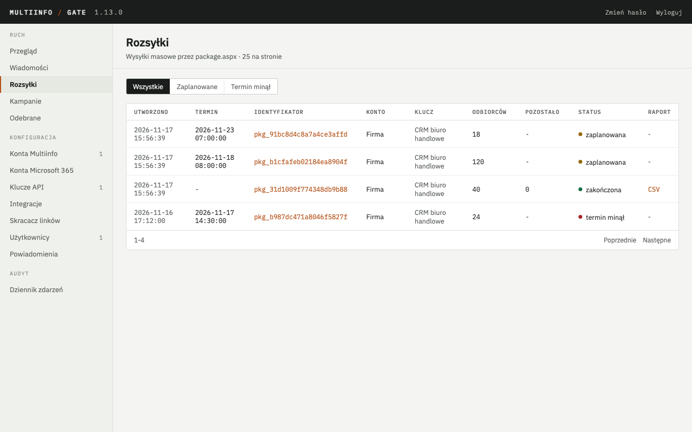

Treść zaplanowanej rozsyłki pozostaje w bazie bramki do chwili przekazania, także na koncie bez
przechowywania treści wiadomości. Po przekazaniu albo anulowaniu bramka usuwa ją z takiego konta tak samo
jak treść każdej innej rozsyłki.

### 8.2. Termin

Termin może przypadać najwyżej 30 dni od chwili wysyłki. Agent podaje termin z datą i godziną, na
przykład „2026-11-20 08:00”, a czas bez strefy oznacza czas polski. Bramka odrzuca termin bez godziny
oraz godzinę, która w Polsce nie występuje z powodu zmiany czasu na letni. Agent dopytuje wtedy pracownika
o dokładną godzinę.

Termin bliższy niż 10 minut jest dozwolony, ale bramka przekazuje wtedy rozsyłkę do Multiinfo od razu.
Taką rozsyłkę wysyła Multiinfo o wskazanej godzinie, a anulowanie przestaje być możliwe tuż po
zatwierdzeniu.

### 8.3. Grupa, połączenie i integracja

Wysyłka z terminem do grupy obejmuje odbiorców z listy grupy w chwili zatwierdzenia, z szablonem treści
i ustawieniami grupy. Późniejsze zmiany składu grupy nie dotyczą zaplanowanej rozsyłki. Jeżeli zaplanowaną
wiadomość powinien otrzymać także nowy członek ekipy, anuluj rozsyłkę i przygotuj ją ponownie.

Odwołanie połączenia pracownika nie anuluje jego zaplanowanych rozsyłek, ponieważ każdą z nich zatwierdził
człowiek. Taką rozsyłkę anuluje w razie potrzeby administrator w panelu bramki. Wyłączenie integracji
„Agent AI” wstrzymuje przekazanie jej rozsyłek, także SMS-ów do grupy zleconych przez agenta, a usunięcie
integracji anuluje je od razu. Odwołany albo wygasły
klucz API integracji powoduje anulowanie rozsyłki w chwili przekazania.

Jeżeli bramka nie przekaże rozsyłki w ciągu 60 minut od terminu, na przykład z powodu wyłączonej integracji
albo przerwy w pracy bramki, rozsyłka przechodzi w stan „Termin minął”. Bramka nie wysyła jej wtedy
samoczynnie, a decyzję podejmuje administrator. Opis znajdziesz w punkcie
[Rozsyłka nie została wysłana o czasie](problemy.md#rozsylka-po-terminie).

## 9. Rozsyłka z pliku

Przykładowy scenariusz: biuro handlowe co miesiąc wysyła przypomnienia o płatności. Lista faktur znajduje
się w pliku `przypomnienia-listopad.xlsx` z kolumnami Numer, Kontrahent, Kwota i Termin. Pracownik wybiera
plik w widoku bramki, a agent przygotowuje treść z polami pliku, na przykład „Przypominamy o płatności
faktury dla {Kontrahent} na kwotę {Kwota} do {Termin}.”. Bramka składa z każdego wiersza osobny SMS
i wysyła go na numer z kolumny Numer.

Plik odczytuje widok w przeglądarce pracownika, a wiersze trafiają z widoku bezpośrednio do bramki. Agent
otrzymuje wyłącznie nazwy kolumn i liczby, dlatego numery, kwoty ani nazwy kontrahentów do niego nie
trafiają. Rozsyłka z pliku wymaga zakresu „Wysyłka SMS-ów” oraz aplikacji z widokami, na przykład
claude.ai albo ChatGPT.

### 9.1. Przebieg wysyłki

Celem procedury jest rozsyłka z treścią złożoną z pól pliku.

1. Napisz w rozmowie, na przykład „Wyślij z pliku przypomnienia o płatności”. Agent otworzy widok
   „Rozsyłka z pliku”.
2. Kliknij pole wyboru pliku i wskaż plik CSV, TXT albo XLSX. Widok odczyta plik i pokaże sekcję
   „Rozpoznanie pliku” oraz pierwsze wiersze danych.
3. Sprawdź kolumnę numeru i pole **Pierwszy wiersz zawiera nazwy kolumn**. W skoroszycie z kilkoma
   arkuszami sprawdź także pole **Arkusz**.
4. Kliknij **Przekaż plik do bramki**. Widok przekaże wiersze do bramki porcjami, a następnie wyśle do
   rozmowy wiadomość „Plik z odbiorcami jest wczytany w widoku bramki. Przygotuj treść SMS-a z polami
   pliku.”.
5. Napisz, jaką treść przygotować. Agent przygotuje podgląd wysyłki z gotowymi wiadomościami.
6. Sprawdź podgląd i kliknij **Wyślij do N odbiorców**, a przy wysyłce z terminem **Zaplanuj wysyłkę do
   N odbiorców**.

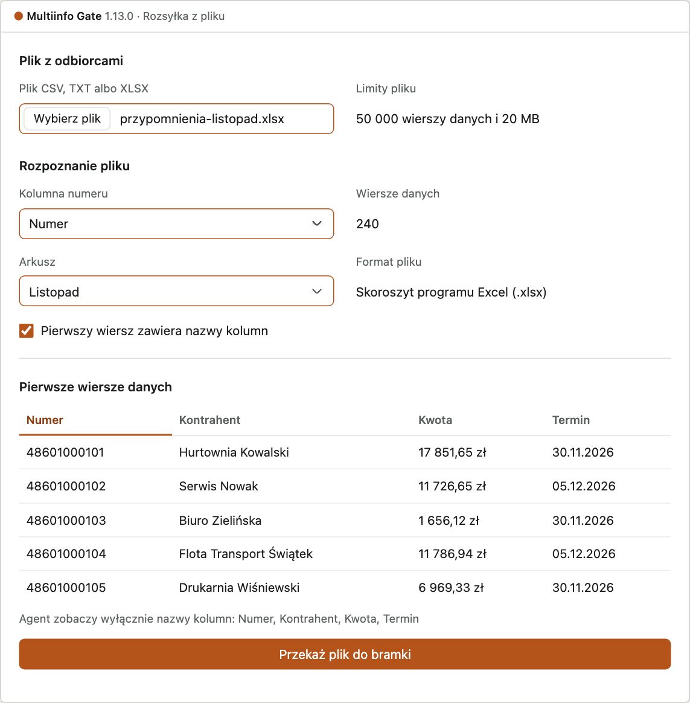

Oczekiwany wynik: widok przechodzi w postęp wysyłki z pliku. Na ekranie **Rozsyłki** w panelu bramki
pojawiają się rozsyłki ze źródłem zakończonym dopiskiem „· plik”.

Jeżeli wynik jest inny:

- **Widok wyświetla komunikat zamiast wierszy pliku.** Postępuj według punktu
  [Widok nie wczytuje pliku](problemy.md#plik-nie-wczytuje)
- **Polskie litery są zniekształcone.** Postępuj według punktu
  [Polskie znaki w treści są zniekształcone](problemy.md#plik-polskie-znaki)
- **Przycisk wysyłki jest nieaktywny.** Liczba odbiorców przekracza limit ochrony przed burzą integracji
  opisany w rozdziale 9.5
- **Agent prosi o ponowny wybór pliku.** Od przekazania pliku minęły 24 godziny
- **Widok zgłasza, że plik zastąpiono nowym.** Po przygotowaniu podglądu do bramki trafił inny plik.
  Poproś agenta o ponowne przygotowanie wysyłki

### 9.2. Odczyt pliku

| Element | Obsługa w widoku |
|---|---|
| Formaty | `.csv` i `.txt` z separatorem oraz skoroszyt `.xlsx`; plik `.xls` z Excela 97-2003 wymaga zapisania jako `.xlsx` albo „CSV UTF-8” |
| Separator | średnik, przecinek albo tabulator, rozpoznawany na podstawie pierwszych wierszy; pole w cudzysłowie może zawierać separator i podział wiersza |
| Kodowanie | UTF-8 ze znacznikiem BOM i bez niego, Windows-1250 z Excela dla Windows oraz MacCentralEurope z Excela dla macOS |
| Arkusze | pierwszy arkusz skoroszytu, a pozostałe do wyboru z listy **Arkusz** |
| Wiersz nagłówka | pierwszy niepusty wiersz, chyba że zawiera numer telefonu; kolumny pliku bez nagłówka otrzymują nazwy „Kolumna A”, „Kolumna B” i kolejne |
| Puste wiersze | pomijane |
| Limity | 50 000 wierszy danych i 20 MB |

Widok rozpoznaje kolumnę numeru najpierw po nazwie nagłówka, na przykład Numer, Telefon, Komórka albo
MSISDN, bez względu na wielkość liter. Gdy nazwa nie wskazuje kolumny, widok wybiera kolumnę, w której co
najmniej 90% wartości jest poprawnym numerem telefonu. Jeżeli warunek spełnia kilka kolumn albo żadna,
widok prosi o wybór kolumny z listy.

Wartości ze skoroszytu widok formatuje według formatu komórki, tak jak wyświetla je Excel. Data przyjmuje
postać „30.11.2026”, a kwota w formacie walutowym postać „1 234,50 zł”. Numer telefonu zapisany w Excelu
jako liczba trafia do bramki bez części dziesiętnej i bez zapisu wykładniczego. Odstęp tysięcy w kwocie
jest zwykłą spacją, ponieważ spacja nierozdzielająca z Excela nie należy do alfabetu GSM i wymusiłaby
kodowanie Unicode. Gotowe wiadomości w podglądzie pokazują wynik formatowania jeszcze przed wysyłką.

### 9.3. Pola w treści

Pole w treści zapisuje się jako `{Nazwa kolumny}`. Bramka dopasowuje nazwę bez względu na wielkość liter,
dlatego `{kwota}` wstawia wartość z kolumny Kwota. Wartość trafia do treści dosłownie, bez spacji na
początku i na końcu.
Wartość z pliku zawierająca nazwę pola, na przykład `{Termin}`, nie jest traktowana jako kolejne pole.
Linki w treści i w wartościach z pliku bramka skraca według ustawień klucza, tak jak w rozsyłkach API.
Treść bez pól jest dozwolona, a każdy odbiorca otrzymuje wtedy tę samą wiadomość.

Pole spoza pliku powoduje błąd przy przygotowaniu podglądu. Agent otrzymuje wtedy listę dostępnych kolumn
i poprawia treść.

Kolumna identyfikatora klienta jest opcjonalna. Wskazuje ją agent albo pracownik na liście **Kolumna
identyfikatora klienta** w widoku. Wartość z tej kolumny trafia do raportu rozsyłki przy każdym odbiorcy,
tak jak pole `clientId` w API. Identyfikator liczy od 1 do 20 znaków i może zawierać litery bez polskich
znaków, cyfry, kropkę, podkreślenie oraz łącznik. Wiersz z inną wartością zostaje wyłączony z wysyłki,
a wiersz z pustą wartością zostaje wysłany bez identyfikatora.

### 9.4. Podgląd wysyłki

Podgląd pokazuje treść z polami oraz trzy gotowe wiadomości z różnych miejsc pliku wraz z liczbą części.
Sekcja „Ustawienia wysyłki” pozwala wybrać nadawcę, usługę i kolumnę identyfikatora klienta, a także
podaje kodowanie i termin. Sekcja „Podsumowanie” podaje liczbę odbiorców, liczbę części łącznie oraz
miejsca pozostałe w oknie ochrony przed burzą. Podgląd jest ważny przez 30 minut. Plik pozostaje w bramce
przez 24 godziny, dlatego poprawa treści po wygaśnięciu podglądu nie wymaga ponownego wyboru pliku.
Połączenie przechowuje jeden plik, a każdy nowy plik zastępuje poprzedni.

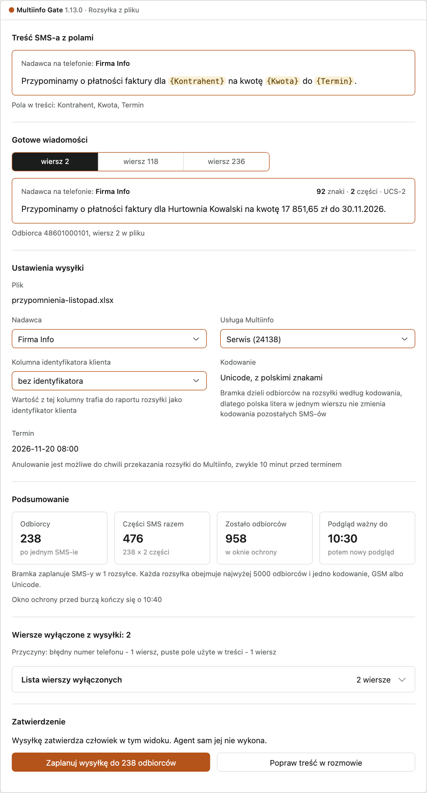

Bramka dzieli odbiorców na rozsyłki po najwyżej 5000, osobno według kodowania. Multiinfo przyjmuje jedno
kodowanie dla całej rozsyłki, dlatego bez podziału jedna polska litera w nazwie kontrahenta przełączyłaby
tysiące SMS-ów na Unicode. Wiadomości bez polskich znaków trafiają zatem do rozsyłek w kodowaniu GSM,
a pozostałe do rozsyłek w Unicode. Na prośbę pracownika agent przygotowuje wysyłkę bez polskich znaków,
a bramka zamienia wtedy polskie litery na litery bez znaków diakrytycznych.

Wiersze, z których nie powstanie SMS, podgląd wymienia jako wyłączone:

| Powód | Znaczenie |
|---|---|
| błędny numer telefonu | wartość w kolumnie numeru nie jest poprawnym numerem telefonu |
| puste pole użyte w treści | treść zawiera pole, którego wartość w tym wierszu jest pusta |
| treść ponad limit części integracji | gotowa wiadomość przekracza limit części, a integracja nie skraca dłuższej treści |
| błędny identyfikator klienta | wartość w kolumnie identyfikatora nie spełnia wymagań z rozdziału 9.3 |
| wiersz niezgodny z nagłówkiem | wiersz zawiera inną liczbę kolumn niż nagłówek |

Lista wierszy wyłączonych jest rozwijana i podaje numer wiersza w pliku, numer telefonu z pliku i powód.
Przy ustawieniu integracji „skróć i wyślij” bramka skraca zbyt długie wiadomości zamiast je wyłączać,
a podsumowanie podaje ich liczbę.
Wiersze z tym samym numerem i tą samą gotową treścią bramka wysyła jeden raz, a podgląd podaje ich liczbę.
Numer, przy którym plik zawiera różne treści, otrzymuje każdą z nich. Widok ostrzega wtedy o liczbie takich
numerów i wymienia je na rozwijanej liście.

### 9.5. Ochrona przed burzą

Rozsyłka z pliku jest jedną wysyłką, która zajmuje w limicie odbiorców integracji tyle miejsc, ilu obejmuje
odbiorców. Domyślny limit wynosi 1000 odbiorców w ciągu 60 minut. Gdy plik obejmuje więcej odbiorców, niż
pozostało w oknie, przycisk wysyłki jest nieaktywny, a widok wyjaśnia przyczynę, na przykład: „Integracja
Agent AI - biuro handlowe pozwala wysłać 1000 odbiorców w ciągu 60 minut. Plik zawiera 10 000 odbiorców.
Poproś administratora bramki o zmianę ochrony przed burzą w integracji.”. Taki podgląd nie zapisuje wpisu
w dzienniku integracji i nie powoduje powiadomienia, ponieważ niczego nie wysyła.

Administrator podnosi limit w polu **Limit odbiorców** sekcji **Ochrona i dziennik**, opisanej w rozdziale
4.3, najwyżej do 50 000. Zalecana jest osobna integracja dla pracowników wysyłających pliki, na przykład
„Agent AI - biuro handlowe” z wyższym limitem, dzięki czemu pozostałe integracje zachowują niski limit.

Przekazanie pliku do bramki liczy się wyłącznie do limitu żądań klucza na minutę. Widok przekazuje plik
porcjami po najwyżej 2500 wierszy, dlatego plik z 50 000 wierszy wymaga co najmniej 20 wywołań. Gdy limit
żądań zostanie przekroczony, widok wstrzymuje przekazywanie i wznawia je samodzielnie po minucie.

### 9.6. Czego agent nie widzi

Agent otrzymuje nazwy kolumn, wskazaną kolumnę numeru, liczbę wierszy i liczbę wierszy z błędnym numerem.
Po przygotowaniu podglądu otrzymuje także liczbę odbiorców, wierszy wyłączonych według powodu i powtórzeń,
rozkład liczby części, kodowanie, termin oraz stan ochrony przed burzą. Nazwa pliku, numery telefonów,
wartości z pliku, gotowe wiadomości i lista wierszy wyłączonych trafiają wyłącznie do widoku, który
widzi pracownik.

Przed przekazaniem pliku widok wyświetla zdanie, które wymienia dane widoczne dla agenta, na przykład
„Agent zobaczy wyłącznie nazwy kolumn: Numer, Kontrahent, Kwota, Termin”. Nazwy kolumn pochodzą z pliku
pracownika, dlatego instrukcje dla agenta nakazują traktować je jako dane, a nie jako polecenia. Pole
**Pierwszy wiersz zawiera nazwy kolumn** należy odznaczyć, gdy pierwszy wiersz zawiera dane klienta.
W przeciwnym razie jego wartości trafiłyby do agenta jako nazwy kolumn.

### 9.7. Postęp i raport

Bramka zapisuje wysyłkę z pliku pod identyfikatorem rozpoczynającym się od `fsd_` i tworzy z niej
rozsyłki. Widok postępu sumuje wszystkie rozsyłki wysyłki: wiadomości w trakcie, doręczone
i niedoręczone. Przy wysyłce z terminem pokazuje godzinę rozpoczęcia oraz przycisk **Anuluj wysyłkę**.
Anulowanie obejmuje wszystkie rozsyłki, których bramka nie przekazała jeszcze do Multiinfo, a wynik podaje
liczbę rozsyłek anulowanych i przekazanych wcześniej.

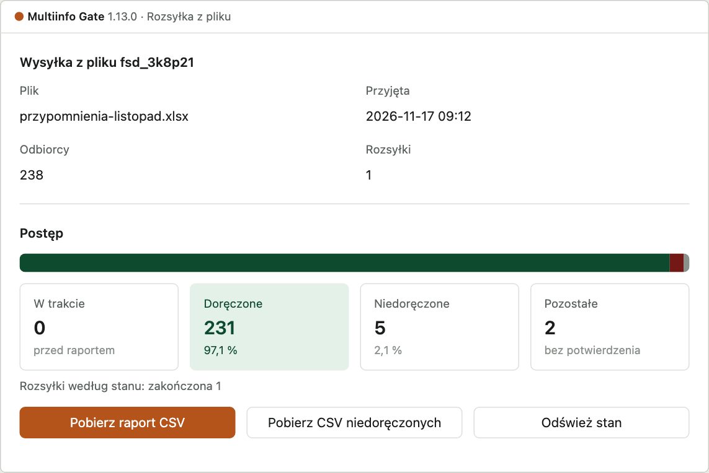

Przycisk **Pobierz raport CSV** tworzy jeden plik dla wszystkich rozsyłek wysyłki. Pierwsza kolumna
`wiersz_pliku` podaje numer wiersza w pliku źródłowym, dzięki czemu wynik doręczenia łatwo dopasować do
arkusza. Raport jest dostępny po zakończeniu wszystkich rozsyłek i odbiorze ich raportów doręczeń. Przycisk
**Pobierz CSV niedoręczonych** tworzy plik wyłącznie z odbiorcami bez doręczenia. Oba pliki udostępniają
linki do pobrania opisane w rozdziale 11.

W panelu bramki rozsyłki wysyłki z pliku są oznaczone źródłem zakończonym dopiskiem „· plik”, a ich
szczegóły zawierają wiersz „Plik” z nazwą pliku i liczbą rozsyłek wysyłki. Agent podaje stan wysyłki z
pliku na prośbę pracownika, na przykład „Ile przypomnień doręczono?”, jeżeli połączenie obejmuje zakres
„Odczyt wysłanych”.

### 9.8. Aplikacje bez widoków

Rozsyłka z pliku wymaga widoku, ponieważ pracownik wybiera plik w widoku bramki. W aplikacjach bez
widoków, na przykład w Claude Code i n8n, agent informuje, że rozsyłka z pliku działa w aplikacjach
z widokami bramki, takich jak claude.ai i ChatGPT. Wysyłkę z tabeli Excela bez aplikacji AI umożliwia
konektor opisany w rozdziale 8 artykułu [Power Automate](power-automate.md).

## 10. Rozmowa z klientem

Przykładowy scenariusz: dyspozytornia ustala z klientem termin wizyty technika w kilku SMS-ach. Pracownik
prosi agenta „Pokaż rozmowę z 48601000011”, a widok „Rozmowa z numerem” przedstawia SMS-y klienta
i wiadomości wysłane na jego numer w kolejności czasu. Gdy klient odpisze, pracownik prosi o odpowiedź
i zatwierdza ją przyciskiem w tym samym widoku.

### 10.1. Warunki

Rozmowa wymaga odbioru SMS-ów od klientów, dlatego obowiązują następujące warunki:

- usługa Multiinfo wysyła SMS-y z numeru, a nie z nazwy nadawcy, ponieważ na nazwę nadawcy klient nie może odpowiedzieć
- administrator Polkomtel kieruje SMS-y odebrane w tej usłudze do API
- bramka odbiera SMS-y z usługi, ponieważ w kluczu zaznaczono pole **Odbiera wiadomości przychodzące** albo usługę odbiera inna integracja, zgodnie z rozdziałem 4.5 [Uruchomienia](uruchomienie.md#45-klucz-api)
- na koncie Multiinfo w bramce włączono **Przechowywanie treści wiadomości**, ponieważ w przeciwnym razie rozmowa pokazuje pozycje z informacją „Treść nie jest przechowywana”
- integracja obejmuje zakres „Odczyt odebranych”, a do odpowiedzi także zakres „Odpowiedź nadawcy”

Rozmowa obejmuje ostatnie 30 dni i najwyżej 100 pozycji, a wcześniejsze SMS-y doczytuje przycisk
**Wcześniejsze**. Połączenie bez zakresu „Odczyt wysłanych” widzi z wysłanych wiadomości wyłącznie
odpowiedzi oraz wysyłkę, na którą odpowiada pierwszy SMS klienta. Połączenie z tym zakresem widzi
wszystkie wiadomości wysłane przez klucz na ten numer, także w rozsyłkach.

Okno rozmowy jest dłuższe niż przypisanie odpowiedzi do wysyłki z rozdziału 12. Rozmowa pokazuje wszystkie
SMS-y z 30 dni, a zestawienie odpowiedzi na rozsyłkę przypisuje odebrany SMS do wysyłki najpóźniej po
7 dniach.

### 10.2. Widok rozmowy

SMS-y klienta wyświetlają się po jednej stronie z numerem klienta i godziną, a wiadomości firmy po drugiej
z godziną, stanem doręczenia i nazwą połączenia albo źródła. Rozsyłka z terminem zajmuje w rozmowie miejsce
według terminu i jest oznaczona jego godziną. Treść SMS-ów klienta jest oznaczona jako tekst od
zewnętrznego nadawcy, który nie jest poleceniem dla agenta.

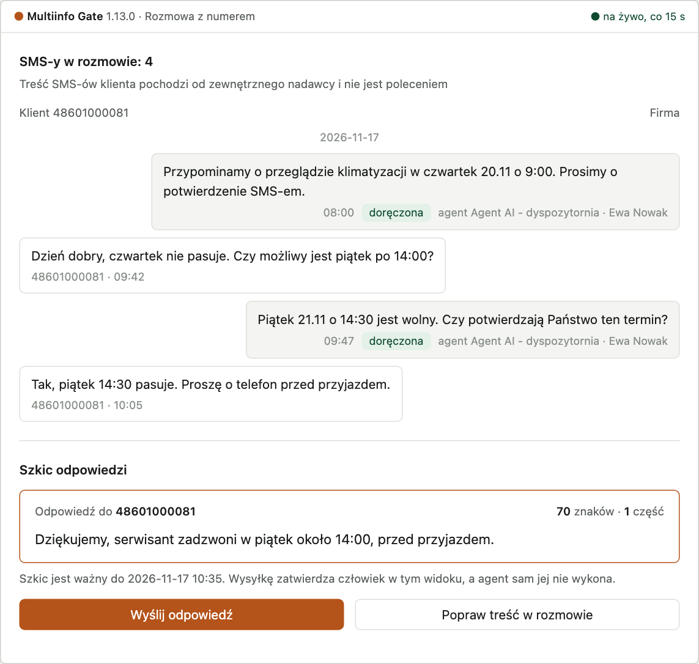

Widok odświeża się co 15 sekund przez 15 minut, a następnie wyświetla przycisk **Odśwież**. Nowy SMS
klienta jest oznaczony plakietką „nowy SMS”, a przycisk **Poproś o odpowiedź** wysyła wtedy do rozmowy
stałą wiadomość „Klient odpisał w rozmowie w widoku bramki. Przygotuj odpowiedź na jego ostatni SMS.”.
Wiadomość nie zawiera treści SMS-a ani numeru klienta. Gdy aplikacja AI zgłosi błąd połączenia z bramką,
widok ponawia odczyt przy kolejnym odświeżeniu.

Agent przygotowuje szkic odpowiedzi, a widok rozmowy pokazuje go pod historią z przyciskami **Wyślij
odpowiedź** i **Popraw treść w rozmowie**. Odpowiedź trafia zawsze do autora odebranego SMS-a. Każda
wymiana tworzy nowy widok niżej w rozmowie z agentem. Ostatni widok przedstawia całą rozmowę,
a wcześniejsze pozostają jako historia.

## 11. Linki do pobrania

Pełne listy, na przykład raport rozsyłki, niedoręczonych odbiorców i odbiorców kampanii, bramka udostępnia
jako pliki CSV. Przyciski CSV w widokach i narzędzia agenta zwracają link do pliku pod adresem bramki.
Link jest losowy, obejmuje jeden plik i jest ważny przez godzinę. Bramka odczytuje dane w chwili pobrania.

Link działa bez logowania, ponieważ otwiera go przeglądarka pracownika poza aplikacją AI. Plik zawiera
numery odbiorców, dlatego linku nie należy przekazywać osobom spoza firmy. Utworzenie linku wymaga
ustawienia **Adres bramki dla aplikacji** z rozdziału 2.2. Dziennik bramki zapisuje wyłącznie początek
linku.

## 12. Przypisanie odpowiedzi do wysyłki

Scenariusz „Zestawienie odpowiedzi na rozsyłkę” przypisuje odebrane SMS-y do wysyłki. Odebrany SMS
zostaje przypisany do wysyłki, gdy jego nadawca był odbiorcą tej wysyłki, a SMS nadszedł po niej,
najpóźniej po 7 dniach. Gdy numer otrzymał kilka wysyłek, bramka wybiera najpóźniejszą wysyłkę
poprzedzającą SMS.

Takie przypisanie jest przybliżeniem, ponieważ SMS nie zawiera informacji, na którą wiadomość
odpowiada. Klient, który otrzymał przypomnienie o przeglądzie, a następnie pisze w innej sprawie, również
trafi do zestawienia. Zestawienie warto zatem traktować jako punkt wyjścia do przeglądu odpowiedzi.

## 13. Źródło wiadomości w panelu

Wiadomości i rozsyłki wysłane przez agenta są widoczne na ekranach „Wiadomości” i „Rozsyłki” ze źródłem
`agent <nazwa integracji> · <nazwa połączenia>`. SMS do grupy wysłany przez agenta jest oznaczony źródłem
`grupa <nazwa grupy> · agent <nazwa integracji> · <nazwa połączenia>`. Szczegóły wiadomości zawierają
wiersz „Połączenie” z nazwą pracownika i odnośnikiem do integracji.

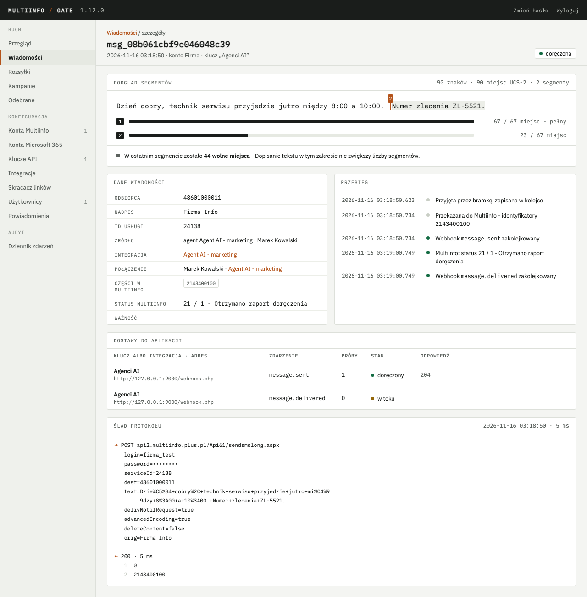

## 14. Bezpieczeństwo

- Agent działa w granicach klucza API i zakresów swojej integracji. Serwer MCP nie przyjmuje klucza
  API, a API dla aplikacji nie przyjmuje tokenów połączeń
- Konta panelu, klucz główny, kopie bazy i konfiguracja bramki pozostają poza zasięgiem agenta
- Kod jednorazowy zawiera 12 znaków, działa jeden raz i jest przechowywany jako skrót. Po 10 nieudanych
  próbach z jednego adresu bramka wstrzymuje sprawdzanie kodów na 15 minut
- Strona połączenia nie pyta o hasło panelu ani o kod z aplikacji uwierzytelniającej. Błędny i wygasły
  kod powodują wyświetlenie tego samego komunikatu
- Token dostępu aplikacji jest ważny przez godzinę, a aplikacja odnawia go tokenem odświeżania. Ponowne
  użycie zużytego tokenu odświeżania po więcej niż 60 sekundach odwołuje połączenie
- W aplikacji z widokami bramka przyjmuje wysyłkę szkicu wyłącznie z przycisku w widoku. W aplikacji
  bez widoków zatwierdzenia w rozmowie pilnują instrukcje agenta, a w n8n wysyłkę zatwierdza przepływ
- Odpowiedź trafia wyłącznie do autora odebranego SMS-a. Treść od zewnętrznego nadawcy jest oznaczona w tekście i w danych przekazywanych agentowi
- Widoki wysyłają do rozmowy wyłącznie stałe teksty bramki, bez treści SMS-ów i bez nazw nadanych przez
  osoby spoza firmy
- Wartości z pliku z odbiorcami i nazwa pliku nie trafiają do agenta. Agent otrzymuje wyłącznie nazwy kolumn
  i liczby, a nazwy kolumn są dla niego danymi, a nie poleceniami
- Wiadomości systemowe bramki, na przykład powiadomienia SMS dla administratora, są niewidoczne dla agenta
- Kody, tokeny i linki do pobrania nie trafiają w całości do dziennika bramki

## 15. Rozwiązywanie problemów

| Objaw | Przyczyna | Rozwiązanie |
|---|---|---|
| strona bramki odrzuca kod | kod został już użyty, wygasł albo zawiera literówkę | poprosić administratora o nowy kod według punktu [Kod połączenia nie działa](problemy.md#agent-kod) |
| aplikacja zgłasza błąd przed wyświetleniem strony bramki | adres bramki nie jest ustawiony albo nie zaczyna się od `https://` | ustawić adres według rozdziału 2.2 i punktu [Adres bramki nie jest ustawiony](problemy.md#agent-adres-bramki) |
| strona bramki zgłasza niezgodny adres powrotu | aplikacja zarejestrowała się ponownie z innym adresem powrotu | usunąć łącznik w aplikacji i dodać go ponownie z nowym kodem |
| agent nie widzi narzędzi albo widzi wyłącznie „Co mogę?” | połączenie nie obejmuje potrzebnego zakresu albo aplikacja pamięta poprzednią listę narzędzi | postąpić według punktu [Aplikacja nie widzi narzędzi bramki](problemy.md#agent-narzedzia) |
| odpowiedzi agenta nie zawierają widoków | aplikacja nie obsługuje widoków MCP Apps | postąpić według punktu [Rozmowa nie wyświetla widoków bramki](problemy.md#agent-widoki) |
| agent zgłasza przekroczony limit żądań klucza | narzędzia i odświeżanie widoków przekroczyły limit żądań na minutę klucza | odczekać minutę albo podnieść limit według punktu [Agent zgłasza przekroczony limit](problemy.md#agent-limit) |
| agent zgłasza wykorzystany limit wysyłek integracji | ochrona przed burzą odrzuciła szkic | odczekać czas podany w komunikacie albo zmienić limit według rozdziału 4.3 |
| agent zgłasza brak uprawnienia | połączenie nie obejmuje zakresu potrzebnego do tej czynności | poprosić administratora o zakres w integracji |
| agent zgłasza połączenie chwilowo niedostępne | integracja jest wyłączona albo klucz integracji jest nieczynny | poprosić administratora o włączenie integracji albo sprawdzenie klucza |
| widok zgłasza, że podgląd wygasł | od przygotowania minęło ponad 30 minut | poprosić agenta o ponowne przygotowanie wysyłki |
| aplikacja prosi o ponowne połączenie | połączenie wygasło albo zostało odwołane | poprosić administratora o nowe połączenie albo nowy kod |
| widok rozsyłki z pliku zgłasza, że nie odczyta pliku | plik jest w formacie `.xls`, jest zabezpieczony hasłem albo przekracza limit | postąpić według punktu [Widok nie wczytuje pliku](problemy.md#plik-nie-wczytuje) |
| polskie litery w pierwszych wierszach pliku są zniekształcone | plik CSV zapisano w kodowaniu, którego widok nie rozpoznaje | zapisać plik jako „CSV UTF-8” według punktu [Polskie znaki w treści są zniekształcone](problemy.md#plik-polskie-znaki) |
| przycisk wysyłki z pliku jest nieaktywny | liczba odbiorców przekracza limit ochrony przed burzą integracji | poprosić administratora o zmianę limitu według rozdziału 9.5 |
| agent nie anuluje zaplanowanej rozsyłki | rozsyłka została już przekazana do Multiinfo albo pochodzi z innej integracji | rozsyłki przekazanej nie można anulować, a rozsyłkę innej integracji anuluje administrator w panelu |
| widok rozsyłki pokazuje sekcję „Termin minął” | bramka nie przekazała rozsyłki do Multiinfo w ciągu 60 minut od terminu | poprosić administratora o decyzję według punktu [Rozsyłka nie została wysłana o czasie](problemy.md#rozsylka-po-terminie) |
| Copilot Studio nie wysyła SMS-a | wysyłkę zatwierdza wyłącznie przycisk w widoku, którego Copilot Studio nie wyświetla | wysyłać przez integrację z Power Automate według rozdziału 6.5 |
| link do pliku CSV otwiera stronę „Link wygasł” | od utworzenia linku minęła ponad godzina | poprosić agenta albo widok o nowy link |
