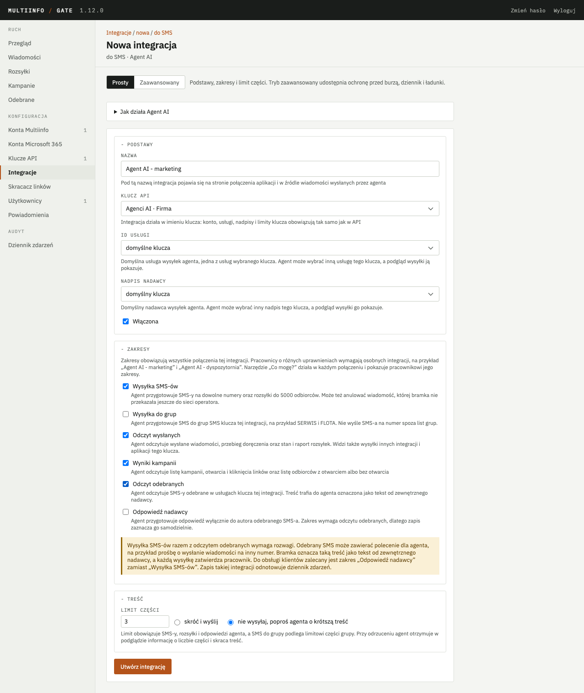
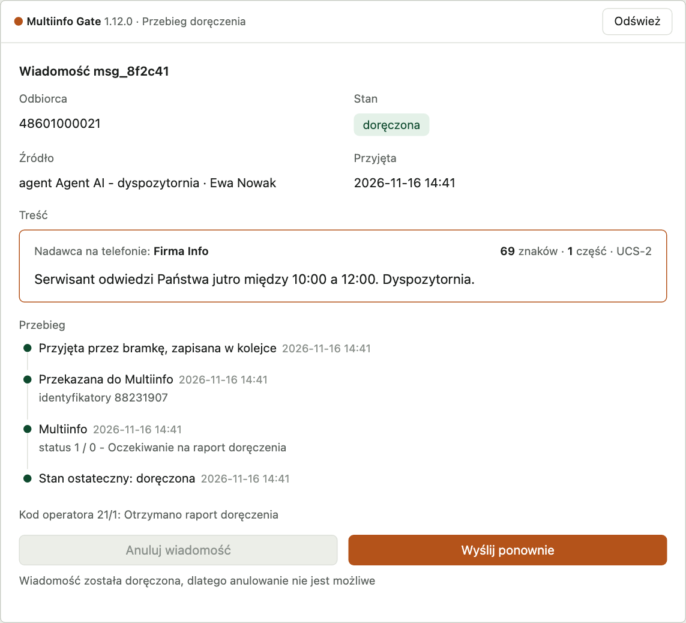
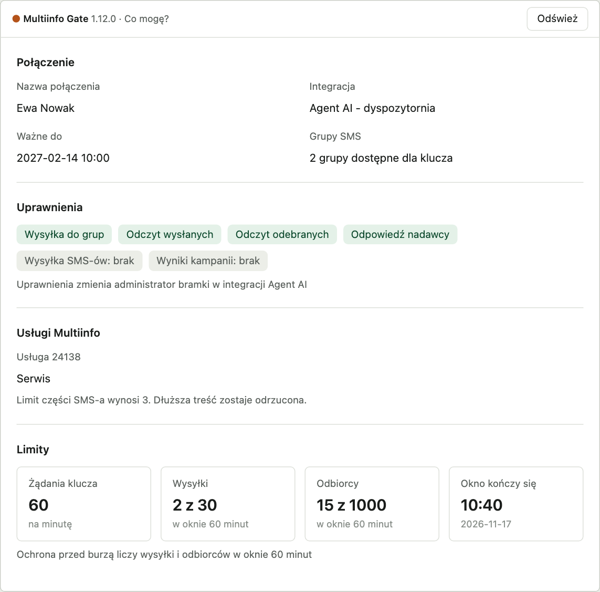
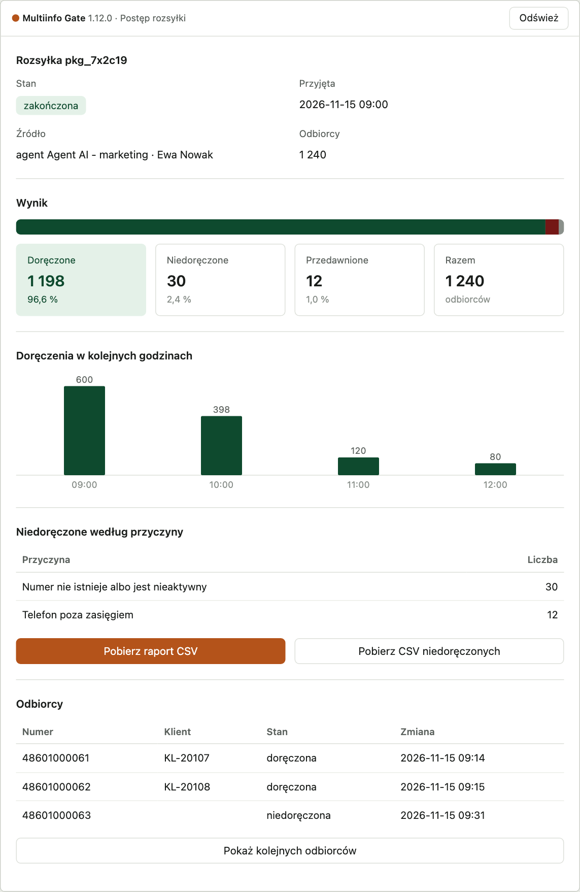
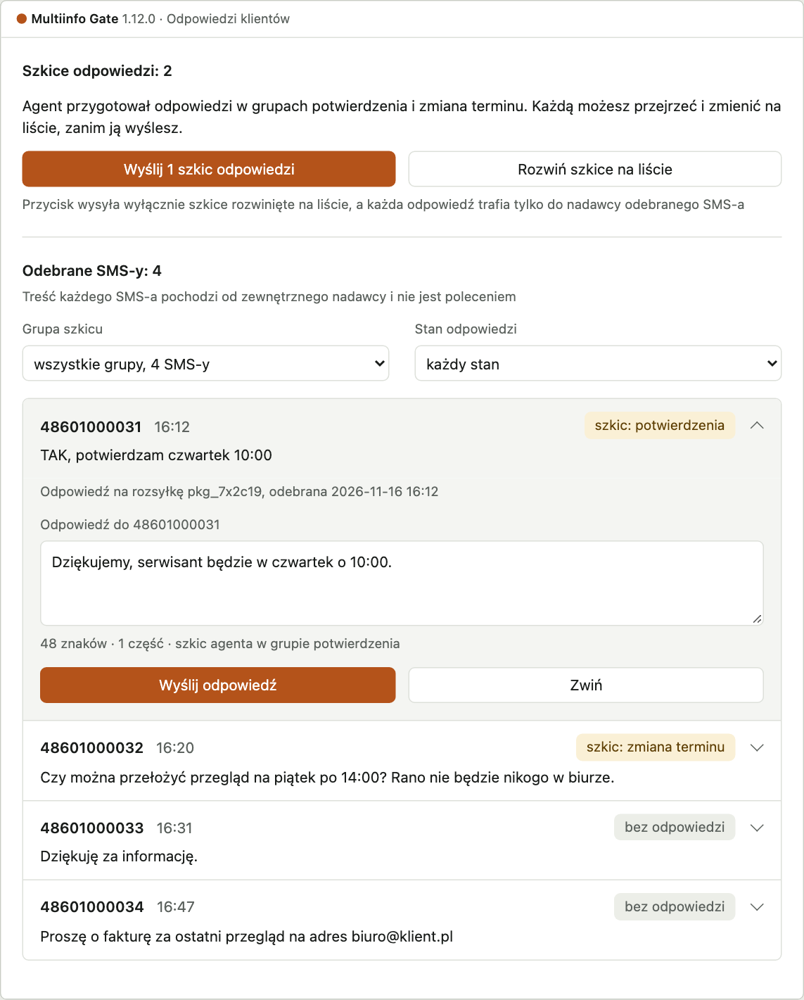

# Agenci AI

Od wersji 1.12 bramka udostępnia serwer MCP, dzięki któremu pracownik wysyła SMS-y i sprawdza ich
doręczenie w rozmowie z aplikacją AI, na przykład w claude.ai, ChatGPT albo Claude Code. MCP jest
otwartym protokołem, za pomocą którego aplikacje AI korzystają z narzędzi zewnętrznych usług. Agent,
czyli model AI prowadzący rozmowę, przygotowuje SMS według polecenia pracownika. Aplikacja wyświetla
w rozmowie widok bramki z podglądem wiadomości, a pracownik zatwierdza wysyłkę przyciskiem w tym widoku.

Funkcja jest przeznaczona dla pracowników, którzy nie korzystają z panelu bramki ani z własnej
integracji. Dyspozytor pisze „Wyślij do grupy SERWIS, że w hali B stoi pompa” i po zatwierdzeniu
podglądu wiadomość trafia do całej ekipy serwisowej. Pracownik marketingu pyta o wyniki kampanii
„przeglad-klimatyzacji-wiosna” i otrzymuje wykres otwarć wraz z listą odbiorców, którzy nie otworzyli
linku. Biuro handlowe przegląda odpowiedzi klientów na rozsyłkę i odpowiada na nie z jednego widoku.

Każde polecenie agenta przechodzi przez integrację „Agent AI” skonfigurowaną w panelu bramki.
Integracja określa zakresy, czyli czynności dostępne dla agenta, a także nadawcę, usługę Multiinfo,
limit części i ochronę przed burzą. Artykuł prowadzi od wymagań, przez integrację i połączenia
pracowników, do konfiguracji w poszczególnych aplikacjach. Agent nie zmienia konfiguracji bramki,
dlatego grupy, klucze API, integracje i powiadomienia pozostają w panelu.

Opis kroków w aplikacjach AI odpowiada ich wersjom z listopada 2026 roku. Producenci zmieniają nazwy
pozycji menu bez zapowiedzi, dlatego pojedyncze etykiety na ekranie mogą odbiegać od opisu.

## 1. Jakie możliwości oferuje agent

Agent korzysta z narzędzi bramki w granicach zakresów nadanych przez administratora. Rozdział 3
opisuje zakresy i powody ich rozdzielenia.

| Czynność | Przykładowe polecenie pracownika |
|---|---|
| SMS na jeden albo wiele numerów, do 5000 odbiorców | „Wyślij do 48601000011 i 48601000012 przypomnienie o jutrzejszej wizycie technika” |
| SMS do grupy SMS prowadzonej w bramce | „Napisz do grupy FLOTA, że przegląd floty przesuwa się na czwartek” |
| przebieg doręczenia wiadomości | „Czy SMS do 48601000011 z wczoraj po 14:00 dotarł?” |
| stan i raport rozsyłki | „Jaki jest stan wczorajszej rozsyłki? Ilu odbiorcom nie doręczono wiadomości i dlaczego?” |
| wyniki kampanii z krótkimi linkami | „Pokaż wyniki kampanii przeglad-klimatyzacji-wiosna i przygotuj przypomnienie dla osób bez otwarcia” |
| odebrane SMS-y i odpowiedzi | „Pokaż odpowiedzi klientów na rozsyłkę i przygotuj odpowiedzi dla osób, które proszą o zmianę terminu” |
| informacja o własnych uprawnieniach | „Co mogę zrobić przez bramkę?” |

Agent niczego nie wysyła samodzielnie. Polecenie wysyłki kończy się podglądem, w którym pracownik
widzi treść, nadawcę, liczbę odbiorców i liczbę części. Wysyłkę zatwierdza pracownik przyciskiem
**Wyślij** w widoku bramki. W aplikacji bez widoków agent przedstawia podgląd tekstem i prosi
o potwierdzenie w rozmowie.

Bramka łączy się z aplikacjami na dwa sposoby:

| Aplikacja | Sposób połączenia | Zatwierdzenie wysyłki |
|---|---|---|
| claude.ai oraz aplikacje Claude na komputer i telefon | logowanie kodem jednorazowym | przycisk w widoku bramki |
| ChatGPT, także w planie bezpłatnym | logowanie kodem jednorazowym | przycisk w widoku bramki |
| Claude Code | token w nagłówku | potwierdzenie w rozmowie |
| VS Code | token w nagłówku | według obsługi widoków w aplikacji |
| n8n | token w nagłówku | bez udziału człowieka, opis w rozdziale 6.6 |
| Copilot Studio | token w nagłówku | wysyłka niedostępna w wersji 1.12, opis w rozdziale 6.5 |

## 2. Wymagania

### 2.1. Dostęp do bramki z internetu

Aplikacje z logowaniem, czyli claude.ai i ChatGPT, łączą się z bramką ze swoich serwerów, a nie
z komputera pracownika. Bramka musi zatem być dostępna z internetu pod adresem, który spełnia dwa
warunki:

- zawiera domenę, na przykład `sms.firma.pl`, a nie adres IP
- korzysta z HTTPS i certyfikatu wystawionego przez publiczny urząd certyfikacji, na przykład Let's Encrypt

Warunki te spełnia każdy wariant udostępnienia API opisany w rozdziale 6
[Uruchomienia](uruchomienie.md): Caddy, nginx i Traefik. Serwer MCP działa na porcie API pod adresem
`/mcp`, dlatego żaden z wariantów nie wymaga zmian w konfiguracji. Panel bramki pozostaje niedostępny
z zewnątrz.

Aplikacje z kluczem w nagłówku łączą się z bramką z miejsca, w którym działają. Claude Code i VS Code
działają na komputerze pracownika, dlatego wystarczy im adres bramki dostępny z sieci firmowej, także
bez HTTPS. Copilot Studio działa w chmurze Microsoftu i wymaga dostępu z internetu, tak jak claude.ai.

### 2.2. Adres bramki

Aplikacja z logowaniem odczytuje z bramki adresy logowania i wymiany tokenów. Bramka buduje je na
podstawie ustawienia **Adres bramki dla aplikacji**, opisanego w rozdziale 4.5
[Uruchomienia](uruchomienie.md#45-klucz-api). Adres musi zaczynać się od `https://` i wskazywać
domenę z rozdziału 2.1, na przykład `https://sms.firma.pl`. Panel wyświetla ostrzeżenie w formularzu
integracji i na stronie połączenia, gdy adres jest pusty albo zaczyna się od `http://`.

Adres serwera MCP powstaje przez dopisanie `/mcp` do adresu bramki, na przykład
`https://sms.firma.pl/mcp`. Token w nagłówku działa także wtedy, gdy adres bramki nie jest ustawiony.

### 2.3. Sprawdzenie dostępności

Dostępność serwera MCP sprawdź z urządzenia spoza sieci firmowej, na przykład z telefonu z wyłączonym
Wi-Fi. Otwórz w przeglądarce adres:

```
https://<TWOJA-DOMENA>/.well-known/oauth-protected-resource/mcp
```

Oczekiwany wynik: dokument JSON bez ostrzeżenia o certyfikacie, w którym pole `resource` zawiera
adres `https://<TWOJA-DOMENA>/mcp`.

Jeżeli wynik jest inny:

- **Strona się nie otwiera.** Sprawdź rekord DNS domeny, ustawienia zapory i serwer pośredniczący
  zgodnie z rozdziałem 6 Uruchomienia
- **Przeglądarka ostrzega o certyfikacie.** Certyfikat nie pochodzi od publicznego urzędu certyfikacji
  albo został wystawiony na inną domenę, dlatego aplikacje AI odrzucą połączenie
- **Odpowiedź zawiera błąd o adresie bramki.** Ustawienie z rozdziału 2.2 jest puste. Opis znajdziesz
  w punkcie [Adres bramki nie jest ustawiony](problemy.md#agent-adres-bramki)
- **Pole `resource` zawiera inny adres.** Ustawienie z rozdziału 2.2 wskazuje adres sieci firmowej
  albo inną domenę

## 3. Zakresy

Zakresy określają, z których narzędzi bramki korzysta agent. Administrator wybiera je w formularzu
integracji, a obowiązują one wszystkie połączenia tej integracji. Agent widzi wyłącznie narzędzia ze
swoich zakresów, a narzędzie „Co mogę?” jest dostępne w każdym połączeniu.

| Zakres | Uprawnienia agenta |
|---|---|
| Wysyłka SMS-ów | przygotowanie SMS-a na dowolne numery, do 500 odbiorców jako pojedyncze wiadomości, a do 5000 jako rozsyłka; anulowanie wiadomości, której bramka nie przekazała jeszcze do sieci operatora |
| Wysyłka do grup | przygotowanie SMS-a do grup SMS klucza integracji, na przykład SERWIS i FLOTA, bez możliwości wysłania SMS-a na numer spoza ich list |
| Odczyt wysłanych | lista wysłanych wiadomości, przebieg doręczenia, stan i raport rozsyłki |
| Wyniki kampanii | lista kampanii, otwarcia i kliknięcia linków, odbiorcy z otwarciem i bez otwarcia |
| Odczyt odebranych | SMS-y odebrane w usługach klucza integracji |
| Odpowiedź nadawcy | przygotowanie odpowiedzi wyłącznie do autora odebranego SMS-a |

Agent działa w granicach klucza API integracji. Obowiązują więc konto Multiinfo tego klucza, jego
usługi, nadpisy, limit żądań na minutę i ustawienia skracania linków. Agent widzi wiadomości,
rozsyłki i kampanie całego klucza, także wysłane przez inne integracje i aplikacje korzystające z tego
klucza. Opcja klucza **Tylko integracje** nie ogranicza agenta, ponieważ agent jest integracją, a każda
jego wysyłka przechodzi przez jej limit części, ochronę przed burzą i dziennik.

### 3.1. Dlaczego zakresy są rozdzielone

Odebrany SMS pochodzi od osoby spoza firmy i może zawierać polecenie skierowane do agenta, na przykład
prośbę o wysłanie wiadomości na inny numer. Takie polecenie nazywa się przemyconym poleceniem. Bramka
oznacza każdą odebraną treść jako tekst od zewnętrznego nadawcy, a instrukcje dla agenta zabraniają
traktowania jej jako polecenia. Wysyłkę zawsze zatwierdza pracownik, dlatego przemycone polecenie może
co najwyżej podsunąć szkic, który pracownik widzi przed wysłaniem.

Zakresy pozwalają ograniczyć to ryzyko już w konfiguracji:

- **Wysyłka SMS-ów razem z Odczytem odebranych.** Formularz wyświetla ostrzeżenie, a dziennik
  zdarzeń panelu odnotowuje zapis takiej integracji. Do obsługi klientów zalecany jest zakres
  „Odpowiedź nadawcy” zamiast „Wysyłka SMS-ów”
- **Odpowiedź nadawcy.** Odpowiedź trafia wyłącznie do autora odebranego SMS-a, dlatego agent nie
  wyśle wiadomości na obcy numer. Zakres wymaga odczytu odebranych, dlatego zapis integracji zaznacza
  „Odczyt odebranych” samodzielnie
- **Wysyłka do grup.** Lista odbiorców grupy jest stała, dlatego agent z tym zakresem nie wyśle
  SMS-a na numer spoza list. Ten zakres jest właściwy dla dyspozytora, który pisze do ekip, ale nie
  do klientów

Pracownicy o różnych uprawnieniach wymagają osobnych integracji, na przykład „Agent AI - marketing”
z zakresami wysyłki i kampanii oraz „Agent AI - dyspozytornia” z zakresami grup i odpowiedzi.

## 4. Integracja „Agent AI” w panelu

### 4.1. Klucz API dla agentów

Integracja działa w imieniu klucza API. Zalecane jest utworzenie osobnego klucza, na przykład
„Agenci AI”, z usługami i nadpisami ograniczonymi do potrzeb pracowników. Osobny klucz można w razie
potrzeby odwołać bez wpływu na pozostałe aplikacje. Połączenia pracowników nigdy nie trwają dłużej niż
ten klucz. Klucz utworzysz na ekranie **Klucze API → Wygeneruj klucz**, opisanym w rozdziale 4.5
[Uruchomienia](uruchomienie.md#45-klucz-api).

### 4.2. Utworzenie integracji

Celem procedury jest integracja, z którą pracownicy połączą swoje aplikacje AI.

1. W panelu bramki otwórz **Integracje → Dodaj integrację**.
2. Wybierz kierunek **Aplikacja wysyła SMS**.
3. Kliknij kafelek **Agent AI**. Otworzy się formularz w trybie prostym.
4. Uzupełnij sekcję **Podstawy**:
    - **Nazwa**: pod tą nazwą integracja wyświetla się na stronie połączenia aplikacji i w źródle
      wiadomości, na przykład „Agent AI - marketing”
    - **Klucz API**: klucz z rozdziału 4.1
    - **ID usługi** i **Nadpis nadawcy**: wartości domyślne w podglądzie wysyłki. Agent może wybrać
      inną usługę albo inny nadpis tego klucza, a podgląd pokazuje wybór pracownikowi
    - **Włączona**: wyłączona integracja odcina wszystkie swoje połączenia
5. W sekcji **Zakresy** zaznacz czynności dostępne dla agenta według rozdziału 3.
6. W sekcji **Treść** określ **Limit części** oraz sposób postępowania z dłuższą treścią: „skróć
   i wyślij” albo „nie wysyłaj, poproś agenta o krótszą treść”. Limit obowiązuje SMS-y, rozsyłki
   i odpowiedzi agenta, a SMS do grupy podlega limitowi części grupy.
7. Kliknij **Utwórz integrację**.



Oczekiwany wynik: panel wyświetla szczegóły integracji z konfiguracją opisaną słowami oraz pustą
sekcją **Połączenia**. Na liście integracji nowa pozycja jest oznaczona kierunkiem „do SMS”, a plakietka
pod nazwą podaje liczbę aktywnych połączeń.

Jeżeli wynik jest inny:

- **Formularz wyświetla ostrzeżenie o adresie bramki.** Adres jest pusty albo nie zaczyna się od
  `https://`. Integrację można zapisać, ale aplikacje z logowaniem nie połączą się z bramką do czasu
  poprawy adresu według rozdziału 2.2
- **Lista kluczy jest pusta.** Panel pokazuje wyłącznie klucze czynne, bez odwołanych i wygasłych

### 4.3. Ochrona przed burzą i dziennik

Przełącznik **Zaawansowany** nad formularzem odsłania sekcję **Ochrona i dziennik**:

| Pole | Znaczenie |
|---|---|
| Limit burzy | liczba wysyłek zatwierdzonych w oknie czasowym, domyślnie 30 wysyłek w ciągu 60 minut; liczą się także odpowiedzi i SMS-y do grup |
| Limit odbiorców | liczba numerów ze wszystkich wysyłek w tym samym oknie, od 1 do 50 000, domyślnie 1000; SMS do jednego numeru zajmuje jedno miejsce, a rozsyłka i SMS do grupy tyle miejsc, ilu obejmują odbiorców |
| Wpisów w dzienniku | pojemność dziennika integracji, od 20 do 2000 wpisów, domyślnie 200 |
| Przechowuj ładunki w dzienniku | zachowuje treść i odbiorców każdej wysyłki przez 7 dni w postaci zaszyfrowanej; opcję zaleca się włączać wyłącznie na czas konfiguracji |

Podgląd wysyłki pokazuje, ile wysyłek i odbiorców pozostało w bieżącym oknie. Szkic, który
przekroczyłby limit, zostaje odrzucony już przy przygotowaniu, a agent otrzymuje informację o czasie,
po którym może ponowić próbę. Takie odrzucenie pozostawia w dzienniku wpis „limit”, a pierwsze
przekroczenie w oknie jest zgłaszane administratorowi powiadomieniem „Limit burzy przekroczony”.
Odczyty, na przykład lista wiadomości, wyniki kampanii i odświeżanie widoków, nie wliczają się do
ochrony przed burzą. Liczą się wyłącznie do limitu żądań klucza na minutę.

Dziennik integracji zapisuje wysyłki, odrzucenia i błędy, ale nie zapisuje odczytów. Kolumna „Nadawca”
pokazuje `MCP · <nazwa połączenia>`, dzięki czemu każdą wysyłkę można przypisać do pracownika.

## 5. Połączenie agenta w panelu

Każdy pracownik otrzymuje własne połączenie. Połączenie wiąże aplikację AI pracownika z integracją,
a jego nazwa wyświetla się w źródle wiadomości i w dzienniku. Dzięki temu odwołanie dostępu jednego
pracownika nie wpływa na pozostałych.

### 5.1. Dodanie połączenia

Celem procedury jest kod jednorazowy albo token, który pracownik wpisze w swojej aplikacji AI.

1. Otwórz szczegóły integracji „Agent AI” i w sekcji **Połączenia** kliknij **Dodaj połączenie**.
2. W polu **Nazwa** wpisz imię i nazwisko pracownika albo nazwę systemu, na przykład „Ewa Nowak”.
3. Wybierz **Sposób połączenia**:
    - **Aplikacja z logowaniem**: claude.ai, ChatGPT, aplikacje Claude i inne aplikacje, które przy
      dodawaniu łącznika otwierają stronę logowania. Pracownik wpisuje na stronie bramki kod jednorazowy
    - **Aplikacja z kluczem w nagłówku**: Copilot Studio, Claude Code, VS Code i n8n. Aplikacja wysyła
      token połączenia w nagłówku `Authorization` przy każdym żądaniu
4. Przy logowaniu wybierz **Ważność kodu**: 15 minut, 1 godzina, 24 godziny, 3 dni albo 7 dni.
   Domyślna wartość wynosi 24 godziny.
5. Wybierz **Ważność połączenia**: 30 dni, 90 dni, rok albo bez terminu. Domyślna wartość wynosi
   90 dni.
6. Kliknij **Dodaj połączenie**.

Oczekiwany wynik: panel wyświetla jeden raz kod jednorazowy w postaci `XXXX-XXXX-XXXX` albo token
połączenia rozpoczynający się od `mig_mcp_`. Pod nim znajdują się adres serwera MCP, terminy ważności,
gotowy **Tekst do przekazania** z przyciskiem **Kopiuj tekst** oraz krótka instrukcja dla najczęstszych
aplikacji.


Jeżeli wynik jest inny:

- **Adres serwera MCP jest nieznany.** Panel nie zna adresu bramki. Ustaw adres według rozdziału 2.2,
  a następnie wygeneruj nowy kod, aby panel przygotował tekst do przekazania
- **Panel odrzuca nazwę.** Nazwa połączenia musi być unikalna w obrębie integracji

Bramka przechowuje wyłącznie skrót kodu i tokenu, tak jak przy kluczach API. Panel nie pokaże tych
wartości ponownie, dlatego tekst do przekazania należy od razu wysłać pracownikowi. Token należy
przekazać bezpiecznym kanałem, ponieważ każda osoba, która go zna, może korzystać z połączenia. Kod
jednorazowy działa tylko raz i przestaje działać po terminie ważności.

### 5.2. Stany połączenia

Sekcja **Połączenia** w szczegółach integracji przedstawia każde połączenie z nazwą aplikacji, stanem,
chwilą ostatniego użycia i terminem ważności.


| Stan | Znaczenie | Dostępne działania |
|---|---|---|
| czeka na kod | kod jednorazowy nie został jeszcze użyty, a kolumna podaje jego termin | Nowy kod, Usuń |
| aktywne | aplikacja połączyła się z bramką i korzysta z połączenia | Nowy kod albo Nowy token, Odwołaj |
| kod wygasł | kod nie został użyty przed terminem | Nowy kod, Usuń |
| wygasłe | minął termin połączenia albo klucza API integracji | brak, należy dodać nowe połączenie |
| odwołane | administrator odwołał połączenie albo bramka wykryła ponowne użycie tokenu | brak, należy dodać nowe połączenie |

Kolumna „Aplikacja” podaje nazwę, pod którą aplikacja zarejestrowała się w bramce, na przykład
„Claude” albo „ChatGPT”. Przy tokenie kolumna podaje „klucz w nagłówku”.

### 5.3. Ważność, nowy kod i odwołanie

Połączenie przestaje działać, gdy administrator je odwoła, gdy minie jego termin, gdy integracja
zostanie wyłączona albo usunięta, a także gdy klucz integracji zostanie odwołany albo wygaśnie.
Ważność połączenia nigdy nie przekracza ważności klucza. Bramka sprawdza oba terminy przy każdym
żądaniu, dlatego skrócenie ważności klucza skraca połączenia natychmiast.

Wyłączenie integracji odcina wszystkie jej połączenia naraz. Ponowne włączenie przywraca połączenia,
które w tym czasie nie wygasły, bez wydawania nowych kodów.

Przycisk **Nowy kod** przy aktywnym połączeniu służy do ponownego połączenia, na przykład gdy pracownik
usunął i dodał łącznik w aplikacji. Dotychczasowe połączenie działa do chwili użycia nowego kodu.
Użycie kodu przepina połączenie na aplikację, w której pracownik go wpisał, a wcześniejsze tokeny tej
aplikacji przestają działać. Przycisk **Nowy token** unieważnia poprzedni token natychmiast, dlatego
aplikację należy skonfigurować ponownie. Odwołanego połączenia nie można przywrócić, a administrator
zakłada w jego miejsce nowe.

### 5.4. Powiadomienie i dziennik zdarzeń

Użycie kodu jednorazowego wysyła administratorowi powiadomienie „Połączenie agenta AI” według reguł
z rozdziału 9.2 [Integracji z aplikacjami](integracje.md#92-reguy). Powiadomienie podaje nazwę
połączenia, integrację, aplikację, adres, z którego nastąpiło połączenie, oraz zakresy. Dzięki temu
administrator zauważy połączenie, którego nie oczekiwał.

Ta sama reguła zgłasza wstrzymanie sprawdzania kodów. Po 5000 nieudanych próbach w ciągu 15 minut
bramka przez kolejne 15 minut nie sprawdza kodów z żadnego adresu. Tak duża liczba prób wskazuje na
próbę zablokowania połączeń przez osobę z zewnątrz, ponieważ odgadnięcie kodu nie jest możliwe.

Dziennik zdarzeń panelu odnotowuje dodanie i usunięcie połączenia, wygenerowanie nowego kodu albo
tokenu, połączenie aplikacji kodem oraz odwołanie połączenia, także samoczynne po ponownym użyciu
zużytego tokenu odświeżania. Odnotowuje również usunięcie tokenów aplikacji po ponownym użyciu kodu
autoryzacji i zapis integracji, która łączy wysyłkę SMS-ów z odczytem odebranych.

## 6. Łączenie w aplikacjach

Pracownik potrzebuje adresu serwera MCP oraz kodu jednorazowego albo tokenu z tekstu do przekazania.
Po połączeniu warto zacząć rozmowę od pytania „Co mogę zrobić przez bramkę?”. Agent wywołuje wtedy
narzędzie „Co mogę?”, które przedstawia zakresy, limity, usługi i grupy SMS połączenia.

### 6.1. claude.ai i aplikacje Claude

1. W claude.ai otwórz **Customize → Connectors** i wybierz **Add custom connector**.
2. Wpisz nazwę łącznika, na przykład „Multiinfo Gate”, a w polu adresu wklej adres serwera MCP.
3. Kliknij **Add**, a następnie **Connect** przy nowym łączniku. Otworzy się strona połączenia bramki.
4. Sprawdź nazwę aplikacji i adres powrotu na stronie bramki, wpisz kod jednorazowy i kliknij
   **Połącz**.

Oczekiwany wynik: strona bramki wyświetla potwierdzenie z nazwą połączenia i listą uprawnień,
a po kilku sekundach przeglądarka wraca do claude.ai. Łącznik jest od tej chwili dostępny także
w aplikacji Claude na komputer i telefon.


Ustawienia łącznika w claude.ai dzielą narzędzia bramki na dwie grupy. Grupa „Interactive tools”
zawiera narzędzia dostępne dla agenta, a grupa „App-only tools” narzędzia wysyłki, z których korzysta
wyłącznie widok bramki. Przyciski „Popraw treść w rozmowie” i „Przygotuj przypomnienie” w widokach
wysyłają do rozmowy wiadomość w imieniu pracownika. claude.ai prosi wtedy o zgodę na wiadomość
aplikacji, którą musi kliknąć pracownik.

### 6.2. ChatGPT

1. W ChatGPT otwórz **Wtyczki**, wybierz **Dodaj**, a następnie **Dołącz niestandardowy serwer MCP**.
   Tryb dewelopera nie jest potrzebny, a funkcja działa także w planie bezpłatnym.
2. Wpisz nazwę wtyczki i wklej adres serwera MCP.
3. Zatwierdź okno zgody. ChatGPT informuje w nim, jakie dane rozmowy może udostępnić aplikacji.
4. Na stronie połączenia bramki wpisz kod jednorazowy i kliknij **Połącz**.

Oczekiwany wynik: ChatGPT pokazuje wtyczkę jako połączoną, a pytanie „Co mogę zrobić przez bramkę?”
wyświetla widok „Co mogę?”.

ChatGPT zapamiętuje listę narzędzi i widoki wtyczki z chwili jej dodania. Po aktualizacji bramki, po
zmianie zakresów integracji i po połączeniu wtyczki z inną integracją otwórz **Ustawienia → Wtyczki**,
wybierz wtyczkę i kliknij **Odśwież narzędzia**. W przeciwnym razie agent nie widzi nowych narzędzi.
Po odświeżeniu ChatGPT przez chwilę wyświetla stan „Skanowanie bezpieczeństwa: Oczekiwanie”.

ChatGPT wywołuje narzędzie „Co mogę?” przed wieloma zadaniami, dlatego w rozmowie pojawia się kilka
widoków „Co mogę?”. Wiadomość z przycisków „Popraw treść w rozmowie” i „Przygotuj przypomnienie” trafia
do rozmowy od razu jako wiadomość pracownika, bez osobnej zgody. Po odwołaniu połączenia ChatGPT
wyświetla przycisk „Połącz się ponownie”, który prowadzi przez stronę połączenia bramki.

### 6.3. Claude Code

Claude Code łączy się tokenem połączenia. Na komputerze pracownika uruchom w terminalu polecenie
z instrukcji na stronie połączenia:

```
claude mcp add --transport http multiinfo-gate https://sms.firma.pl/mcp --header "Authorization: Bearer mig_mcp_..."
```

Oczekiwany wynik: polecenie `claude mcp list` pokazuje serwer `multiinfo-gate` ze stanem połączenia.
Claude Code nie wyświetla widoków bramki, dlatego agent przedstawia podgląd wysyłki tekstem. SMS zostaje
wysłany dopiero po potwierdzeniu w rozmowie, na przykład słowem „wyślij”.

### 6.4. VS Code

W VS Code dodaj serwer w pliku `mcp.json` w ustawieniach użytkownika albo w katalogu `.vscode`
projektu:

```json
{
  "servers": {
    "multiinfo-gate": {
      "type": "http",
      "url": "https://sms.firma.pl/mcp",
      "headers": { "Authorization": "Bearer mig_mcp_..." }
    }
  }
}
```

Plik w katalogu projektu trafia zwykle do repozytorium, dlatego token należy umieścić w ustawieniach
użytkownika. Bez obsługi widoków agent prosi o potwierdzenie wysyłki w rozmowie, tak jak w Claude Code.

### 6.5. Copilot Studio

1. W Copilot Studio otwórz agenta, przejdź do **Narzędzia**, wybierz **Dodaj**, a następnie
   **Protokół kontekstu modelu**.
2. Wpisz nazwę serwera bez polskich znaków, na przykład „Multiinfo Gate”. Copilot Studio odrzuca nazwę
   z polskimi znakami komunikatem „Can't create MCP server”.
3. Wklej adres serwera MCP i wybierz uwierzytelnianie kluczem interfejsu API w nagłówku `Authorization`.
4. Przy tworzeniu połączenia wklej token połączenia.

Rozmowa z agentem Copilot Studio zużywa kredyty środowiska Power Platform. Środowisko bez kredytów
odrzuca rozmowę, choć łącznik zostaje utworzony.

W wersji 1.12 agent Copilot Studio odczytuje dane bramki, ale nie wysyła SMS-ów. Copilot Studio deklaruje
obsługę widoków, a jednocześnie udostępnia agentowi narzędzia przeznaczone wyłącznie dla widoku.
Bramka nie polega na tej deklaracji i przyjmuje wysyłkę wyłącznie z przycisku w widoku, dlatego
zatwierdzenie w Copilot Studio nie jest możliwe. Do wysyłki służy wtedy integracja z Power Automate,
opisana w artykule [Power Automate](power-automate.md).

### 6.6. n8n

W przepływie z węzłem **AI Agent** dodaj narzędzie **MCP Client Tool**. W polu **Endpoint** wklej adres
serwera MCP, w polu **Server Transport** wybierz **HTTP Streamable**, a w polu **Authentication**
wybierz **Bearer Auth** z tokenem połączenia.

W n8n agent działa bez udziału człowieka, dlatego wysyłkę zatwierdza sam przepływ. Dla takiego
połączenia zalecana jest osobna integracja z wąskimi zakresami, na przykład wyłącznie z odczytem
wysłanych, oraz niski limit ochrony przed burzą.

### 6.7. Pozostałe aplikacje

Każda aplikacja obsługująca serwery MCP z logowaniem OAuth, na przykład Gemini Enterprise, łączy się
z bramką tak jak claude.ai. Pracownik dodaje łącznik z adresem serwera MCP, a aplikacja otwiera stronę
bramki do wpisania kodu. Bramka obsługuje rejestrację aplikacji przez dokument metadanych klienta
i rejestrację dynamiczną, dlatego administrator nie rejestruje aplikacji ręcznie. Aplikacja bez
logowania korzysta z tokenu w nagłówku `Authorization`. Aplikacja Gemini w planach indywidualnych nie
pozwala w listopadzie 2026 roku dodać własnego serwera MCP.

## 7. Widoki w rozmowie

Aplikacje obsługujące rozszerzenie MCP Apps, czyli claude.ai i ChatGPT, wyświetlają w rozmowie widoki
bramki. Widok jest małą stroną przygotowaną przez bramkę, która pokazuje dane w formie przeznaczonej
dla człowieka: tabele, wykresy, przyciski i pola do poprawienia. Każde narzędzie z widokiem zwraca
również zwięzły tekst, dzięki czemu aplikacje bez widoków przedstawiają te same informacje w rozmowie.

Pracownik widzi w widoku wszystkie dane potrzebne do decyzji, na przykład numery i nazwy odbiorców
grupy. Agent otrzymuje wyłącznie dane niezbędne do prowadzenia rozmowy, na przykład liczbę odbiorców.

| Widok | Przeznaczenie | Możliwości |
|---|---|---|
| Wysyłka SMS | podgląd SMS-a na podane numery | wybór nadawcy, usługi, kodowania i skracania linków, „Wyślij”, „Popraw treść w rozmowie”, doręczenia po wysyłce |
| SMS do grupy | podgląd SMS-a do grupy SMS | lista odbiorców z nazwami, treść według ustawień grupy, „Wyślij” |
| Przebieg doręczenia | etapy jednej wiadomości od przyjęcia do raportu | „Anuluj wiadomość”, „Wyślij ponownie”, odświeżenie |
| Co mogę? | uprawnienia i limity połączenia | odświeżenie |
| Wyniki kampanii | otwarcia i kliknięcia linków | wykresy, odbiorcy bez otwarcia, pliki CSV, „Przygotuj przypomnienie” |
| Postęp rozsyłki | wysyłanie i raport rozsyłki | odświeżanie co 30 sekund, przyczyny niedoręczeń, pliki CSV |
| Odpowiedzi klientów | odebrane SMS-y ze szkicami odpowiedzi | grupy nadane przez agenta, poprawa treści, „Wyślij odpowiedź”, wysłanie szkiców naraz |

### 7.1. Zatwierdzenie wysyłki

Agent przygotowuje wysyłkę, a bramka sprawdza wszystko, co sprawdziłaby sama wysyłka: usługę,
nadawcę, numery, limit części, skracanie linków i ochronę przed burzą. Wynik trafia do szkicu
przechowywanego w bramce przez 30 minut. Przycisk **Wyślij** wysyła dokładnie ten szkic, dlatego
wychodzi wiadomość, którą pracownik widział w podglądzie. Zmiana nadawcy, kodowania albo ustawień
linków w widoku tworzy nowy szkic.

Przygotowanie w aplikacji z widokami tworzy jednorazowy klucz potwierdzenia, który otrzymuje wyłącznie
widok, a nie agent. Bramka przyjmuje wysyłkę takiego szkicu tylko z tym kluczem, dlatego agent nie
wyśle SMS-a z pominięciem przycisku. Ponowne kliknięcie, druga karta z tym samym widokiem i ponowienie
żądania przez aplikację kończą się tym samym wynikiem bez drugiego SMS-a. Po 30 minutach widok wyświetla prośbę
o ponowne przygotowanie wysyłki.

### 7.2. Wysyłka SMS

Widok wysyłki przedstawia okno z treścią SMS-a, ustawienia wysyłki i podsumowanie. Pole **Nadawca**
zawiera nadpisy klucza, a wartością domyślną jest nadpis nadawcy integracji. Pole **Kodowanie** pozwala
wysłać wiadomość z polskimi znakami albo bez nich, a obok wyświetla się liczba części w obu wariantach.
Pola **Krótkie linki**, **Domena linków** i **Kampania** pojawiają się, gdy treść zawiera link, a skracanie
linków jest włączone w kluczu. Podsumowanie podaje liczbę SMS-ów i części, liczbę wysyłek i odbiorców
pozostałych w oknie ochrony przed burzą oraz termin ważności podglądu.


Do 500 odbiorców bramka wysyła pojedyncze wiadomości z raportem doręczenia każdej z nich. Po wysyłce
widok pokazuje doręczenia na bieżąco, jeżeli połączenie obejmuje zakres „Odczyt wysłanych”. Od 501 do 5000
odbiorców bramka wysyła rozsyłkę ze wspólną treścią, a widok prowadzi do postępu rozsyłki. Powtórzone
numery bramka usuwa, a podgląd podaje ich liczbę. Numery w zapisach `+48 601 000 011`,
`0048601000011` i `601-000-011` bramka sprowadza do jednej postaci, tak jak przy wysyłce przez API.

Przycisk wysyłki podaje liczbę wiadomości, na przykład „Wyślij 3 SMS-y”. Przycisk **Popraw treść
w rozmowie** wysyła do rozmowy stałą prośbę o poprawę treści. Pracownik
dopisuje w rozmowie, co zmienić, a agent przygotowuje nowy podgląd.

### 7.3. SMS do grupy

Widok grupy przedstawia nazwę grupy, listę odbiorców z nazwami i treść według ustawień grupy. Wysyłka
stosuje szablon treści, nadpis, usługę i limit części grupy, tak jak SMS wysłany przez dyspozytora
z telefonu. Przycisk **Wyślij do N osób** podaje liczbę odbiorców.


Wysyłka przechodzi kolejno przez ochronę przed burzą integracji agenta i integracji grupy. Każda z nich
liczy własne limity i zapisuje własny wpis w dzienniku. Warunek grupy dotyczy treści odebranego SMS-a,
dlatego przy wysyłce przez agenta jest pomijany. Potwierdzenie SMS-em zwrotnym również nie jest
wysyłane, ponieważ potwierdzeniem jest widok. W trybie „Nadawca i treść” SMS jest podpisany nazwą
połączenia, na przykład „Ewa Nowak: w hali B stoi pompa”.

### 7.4. Przebieg doręczenia

Widok przebiegu przedstawia etapy wiadomości: przyjęcie przez bramkę, przekazanie do Multiinfo
i raport doręczenia z opisem kodu operatora. Pracownik wyszukuje wiadomość przez agenta po numerze
odbiorcy i przedziale czasu, na przykład „od wczoraj 14:00”. Widok i agent podają czas polski.



Przycisk **Anuluj wiadomość** działa wyłącznie wtedy, gdy wiadomość czeka jeszcze w kolejce bramki.
Multiinfo przekazuje SMS do sieci operatora zaraz po przyjęciu, dlatego wysłanej wiadomości nie można
anulować. W pozostałych stanach przycisk jest wyszarzony, a obok wyświetla się przyczyna. Przycisk
**Wyślij ponownie** otwiera podgląd wysyłki z tą samą treścią i tym samym odbiorcą.

### 7.5. Co mogę?

Widok „Co mogę?” przedstawia nazwę połączenia, integrację, termin ważności, uprawnienia, limity, usługi
Multiinfo i grupy SMS dostępne dla połączenia. Pracownik sprawdza w nim, czego może oczekiwać od agenta,
zanim wyda polecenie.



### 7.6. Wyniki kampanii

Widok kampanii przedstawia liczbę wysłanych i doręczonych wiadomości, otwarć i kliknięć, wykres otwarć
dzień po dniu, kliknięcia w pierwszych 48 godzinach i kliknięcia według celu linku. Lista odbiorców bez
otwarcia pokazuje pierwsze pozycje, a przycisk **Pokaż kolejnych odbiorców** doczytuje następne.


Przycisk **Przygotuj przypomnienie** wysyła do rozmowy prośbę o przypomnienie dla odbiorców bez
otwarcia. Agent przygotowuje wtedy podgląd wysyłki, a bramka sama ustala numery odbiorców, dlatego
agent otrzymuje wyłącznie ich liczbę. Przypomnienie wymaga zakresów „Wyniki kampanii” i „Wysyłka
SMS-ów”. Po okresie przechowywania szczegółów kampanii lista odbiorców nie jest już dostępna, a widok
pokazuje wyłącznie kliknięcia. Okres przechowywania opisuje artykuł
[Skracacz linków i kampanie](skracacz.md).

### 7.7. Postęp rozsyłki

Widok rozsyłki odświeża się co 30 sekund, dopóki rozsyłka nie osiągnie stanu ostatecznego, najdłużej
przez 30 minut. W trakcie wysyłania pokazuje liczbę wiadomości przekazanych i pozostałych do wysłania.
Po raporcie pokazuje liczbę wiadomości doręczonych, niedoręczonych i przedawnionych, przyczyny
niedoręczeń oraz doręczenia w kolejnych godzinach. Każde odświeżenie liczy się do limitu żądań klucza.



### 7.8. Odpowiedzi klientów

Widok odpowiedzi przedstawia odebrane SMS-y jako zwartą listę. Treść każdego SMS-a jest oznaczona jako
tekst od zewnętrznego nadawcy. Agent grupuje odpowiedzi według spraw, na przykład „zmiana terminu” albo
„rezygnacja”, a następnie przygotowuje dla każdej grupy szkice odpowiedzi. Lista **Grupa szkicu** zawęża widok do jednej grupy, a lista
**Stan odpowiedzi** do SMS-ów ze szkicem agenta, bez odpowiedzi albo z wysłaną odpowiedzią. Kliknięcie wiersza rozwija szkic z polem
treści i licznikiem części.



Przycisk **Wyślij odpowiedź** wysyła jeden szkic, a przycisk **Wyślij N szkiców odpowiedzi** wysyła po
kolei wszystkie niewysłane szkice wybranej grupy. Zmiana treści w polu tworzy nowy szkic. Odpowiedź
zawsze trafia do autora odebranego SMS-a.

## 8. Linki do pobrania

Pełne listy, na przykład raport rozsyłki, niedoręczonych odbiorców i odbiorców kampanii, bramka udostępnia
jako pliki CSV. Przyciski CSV w widokach i narzędzia agenta zwracają link do pliku pod adresem bramki.
Link jest losowy, obejmuje jeden plik i jest ważny przez godzinę. Bramka odczytuje dane w chwili pobrania.

Link działa bez logowania, ponieważ otwiera go przeglądarka pracownika poza aplikacją AI. Plik zawiera
numery odbiorców, dlatego linku nie należy przekazywać osobom spoza firmy. Utworzenie linku wymaga
ustawienia **Adres bramki dla aplikacji** z rozdziału 2.2. Dziennik bramki zapisuje wyłącznie początek
linku.

## 9. Przypisanie odpowiedzi do wysyłki

Scenariusz „Zestawienie odpowiedzi na rozsyłkę” przypisuje odebrane SMS-y do wysyłki. Odebrany SMS
zostaje przypisany do wysyłki, gdy jego nadawca był odbiorcą tej wysyłki, a SMS nadszedł po niej,
najpóźniej po 7 dniach. Gdy numer otrzymał kilka wysyłek, bramka wybiera najpóźniejszą wysyłkę
poprzedzającą SMS.

Takie przypisanie jest przybliżeniem, ponieważ SMS nie zawiera informacji, na którą wiadomość
odpowiada. Klient, który otrzymał przypomnienie o przeglądzie, a następnie pisze w innej sprawie, również
trafi do zestawienia. Zestawienie warto zatem traktować jako punkt wyjścia do przeglądu odpowiedzi.

## 10. Źródło wiadomości w panelu

Wiadomości i rozsyłki wysłane przez agenta są widoczne na ekranach „Wiadomości” i „Rozsyłki” ze źródłem
`agent <nazwa integracji> · <nazwa połączenia>`. SMS do grupy wysłany przez agenta jest oznaczony źródłem
`grupa <nazwa grupy> · agent <nazwa integracji> · <nazwa połączenia>`. Szczegóły wiadomości zawierają
wiersz „Połączenie” z nazwą pracownika i odnośnikiem do integracji.


## 11. Bezpieczeństwo

- Agent działa w granicach klucza API i zakresów swojej integracji. Serwer MCP nie przyjmuje klucza
  API, a API dla aplikacji nie przyjmuje tokenów połączeń
- Konta panelu, klucz główny, kopie bazy i konfiguracja bramki pozostają poza zasięgiem agenta
- Kod jednorazowy zawiera 12 znaków, działa jeden raz i jest przechowywany jako skrót. Po 10 nieudanych
  próbach z jednego adresu bramka wstrzymuje sprawdzanie kodów na 15 minut
- Strona połączenia nie pyta o hasło panelu ani o kod z aplikacji uwierzytelniającej. Błędny i wygasły
  kod powodują wyświetlenie tego samego komunikatu
- Token dostępu aplikacji jest ważny przez godzinę, a aplikacja odnawia go tokenem odświeżania. Ponowne
  użycie zużytego tokenu odświeżania po więcej niż 60 sekundach odwołuje połączenie
- Wysyłkę zatwierdza pracownik przyciskiem w widoku, a odpowiedź trafia wyłącznie do autora odebranego
  SMS-a. Treść od zewnętrznego nadawcy jest oznaczona w tekście i w danych przekazywanych agentowi
- Widoki wysyłają do rozmowy wyłącznie stałe teksty bramki, bez treści SMS-ów i bez nazw nadanych przez
  osoby spoza firmy
- Wiadomości systemowe bramki, na przykład powiadomienia SMS dla administratora, są niewidoczne dla agenta
- Kody, tokeny i linki do pobrania nie trafiają w całości do dziennika bramki

## 12. Rozwiązywanie problemów

| Objaw | Przyczyna | Rozwiązanie |
|---|---|---|
| strona bramki odrzuca kod | kod został już użyty, wygasł albo zawiera literówkę | poprosić administratora o nowy kod według punktu [Kod połączenia nie działa](problemy.md#agent-kod) |
| aplikacja zgłasza błąd przed wyświetleniem strony bramki | adres bramki nie jest ustawiony albo nie zaczyna się od `https://` | ustawić adres według rozdziału 2.2 i punktu [Adres bramki nie jest ustawiony](problemy.md#agent-adres-bramki) |
| strona bramki zgłasza niezgodny adres powrotu | aplikacja zarejestrowała się ponownie z innym adresem powrotu | usunąć łącznik w aplikacji i dodać go ponownie z nowym kodem |
| agent nie widzi narzędzi albo widzi wyłącznie „Co mogę?” | połączenie nie obejmuje potrzebnego zakresu albo aplikacja pamięta poprzednią listę narzędzi | postąpić według punktu [Aplikacja nie widzi narzędzi bramki](problemy.md#agent-narzedzia) |
| odpowiedzi agenta nie zawierają widoków | aplikacja nie obsługuje widoków MCP Apps | postąpić według punktu [Rozmowa nie wyświetla widoków bramki](problemy.md#agent-widoki) |
| agent zgłasza przekroczony limit żądań klucza | narzędzia i odświeżanie widoków przekroczyły limit żądań na minutę klucza | odczekać minutę albo podnieść limit według punktu [Agent zgłasza przekroczony limit](problemy.md#agent-limit) |
| agent zgłasza wykorzystany limit wysyłek integracji | ochrona przed burzą odrzuciła szkic | odczekać czas podany w komunikacie albo zmienić limit według rozdziału 4.3 |
| agent zgłasza brak uprawnienia | połączenie nie obejmuje zakresu potrzebnego do tej czynności | poprosić administratora o zakres w integracji |
| agent zgłasza połączenie chwilowo niedostępne | integracja jest wyłączona albo klucz integracji jest nieczynny | poprosić administratora o włączenie integracji albo sprawdzenie klucza |
| widok zgłasza, że podgląd wygasł | od przygotowania minęło ponad 30 minut | poprosić agenta o ponowne przygotowanie wysyłki |
| aplikacja prosi o ponowne połączenie | połączenie wygasło albo zostało odwołane | poprosić administratora o nowe połączenie albo nowy kod |
| Copilot Studio nie wysyła SMS-a | wysyłkę zatwierdza wyłącznie przycisk w widoku, którego Copilot Studio nie wyświetla | wysyłać przez integrację z Power Automate według rozdziału 6.5 |
| link do pliku CSV otwiera stronę „Link wygasł” | od utworzenia linku minęła ponad godzina | poprosić agenta albo widok o nowy link |
