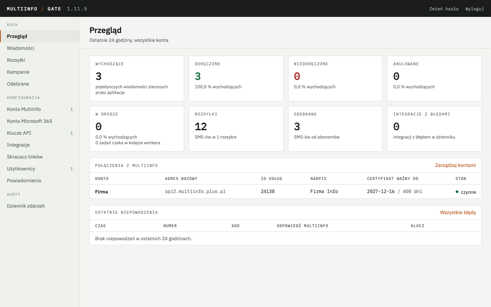

# Multiinfo Gate

Bramka SMS między Twoimi aplikacjami a API Multiinfo (Plus, Polkomtel). Przechowuje certyfikat
kliencki, login i hasło do Multiinfo w jednym miejscu, a aplikacjom wystawia proste HTTP API
z kluczem w nagłówku. Aplikacja wysyłająca SMS-y nie instaluje certyfikatów i nie zna ASPX.
Od wersji 1.3 bramka odbiera też SMS-y od abonentów i przekazuje je aplikacji powiadomieniem
webhook. Od wersji 1.5 integruje się z aplikacjami, których formatu nie można zmienić: monitoring
i helpdesk wysyłają SMS-y własnym ładunkiem na adres wejściowy bramki, a odebrane SMS-y i statusy
trafiają do helpdesku albo na telefon przez ntfy w ich formacie; administrator otrzymuje mailem
powiadomienia o błędach i certyfikatach. Od wersji 1.7 bramka potrafi też dopytać aplikację
o dane, których nie ma w powiadomieniu. Dzięki temu Fakturownia powiadamia SMS-em nabywcę
faktury, choć numeru telefonu w samym powiadomieniu nie ma. Od wersji 1.8 bramka odczytuje
również skrzynkę pocztową (Mail2SMS): alarm z zasilacza UPS, raport z serwera NAS albo wiadomość
pracownika docierają na telefon jako SMS bez zmian po stronie urządzenia. Od wersji 1.8.5 jeden
SMS wysłany na numer bramki trafia do stałej grupy numerów (SMS do grupy): ekipy serwisowej, brygady
albo zespołu handlowego. Od wersji 1.8.7 bramka sama zapisuje kopię bazy przed aktualizacją. Gdy
nie może rozpocząć pracy, pokazuje w panelu przyczynę i sposób naprawy. Od wersji 1.9 bramka
wprowadza konektor do Microsoft Power Automate, który umożliwia wysyłkę SMS-ów z przepływów: do
jednego numeru, w formie rozsyłki albo do listy odbiorców prowadzonej w bramce. Od wersji 1.10
Mail2SMS odczytuje także skrzynki Microsoft 365 przez skrzynkę przeznaczoną dla bramki, a bramka
powiadamia administratora również SMS-em. Od wersji 1.11 bramka zamienia linki w SMS-ach na krótkie
linki własnej domeny firmy, liczy ich otwarcia i przedstawia wyniki kampanii w panelu, w API
i w zdarzeniu „link otwarty”.

## Dla kogo

Dla firmy z kontem Multiinfo, która chce dać własnym systemom albo agencji zewnętrznej jedno API
zamiast certyfikatów, oraz panel do zarządzania kontami, kluczami i podglądu doręczeń.

## Dokumentacja

- [Uruchomienie krok po kroku](uruchomienie.md) - od konta Multiinfo, przez serwer z Dockerem albo
  kontener LXC na Proxmox VE, do pierwszego SMS-a i wystawienia API pod własną domeną
- [API dla aplikacji](api.md) - każde wywołanie z przykładem w siedmiu wariantach (curl, HTTP, PHP,
  Python, Node.js, PowerShell, C#), webhooki, błędy, limity
- [Integracje z aplikacjami](integracje.md) - adres wejściowy dla aplikacji z własnym formatem,
  Mail2SMS ze skrzynki IMAP i Microsoft 365, SMS do grupy, szablony Liquid, gotowe ustawienia (Uptime Kuma,
  Grafana, Zabbix, WooCommerce, Fakturownia, FreeScout, Freshdesk, Bitrix24, Slack, ntfy, Gmail, home.pl, OVH,
  Microsoft 365), powiadomienia administratora mailem i SMS-em
- [Power Automate](power-automate.md) - konektor do Microsoft Power Automate: integracja w panelu,
  import pliku, pierwszy przepływ, rozsyłka z Excela, rozwiązywanie problemów
- [Skracacz linków i kampanie](skracacz.md) - krótkie linki własnej domeny, obowiązkowa lista
  domen docelowych, wyniki kampanii, parametry UTM, ważność linków i przechowywanie danych
- [Rozwiązywanie problemów](problemy.md) - objaw, sprawdzenie i naprawa: panel, logowanie, tryb
  awaryjny, aktualizacja, Microsoft 365, skracacz linków, zgłaszanie problemów
- [Przykład w PHP](https://github.com/sqlik/multiinfo-gate/tree/main/examples/php) - strona
  testowa i kod do skopiowania, w repozytorium

## Filmy instruktażowe

Seria filmów z polskim lektorem przedstawia konfigurację bramki, od przygotowań po stronie Polkomtel
do kampanii z krótkimi linkami. Każdy film jest osadzony w rozdziale dokumentacji, którego dotyczy.
Napisy w języku polskim włącza przycisk napisów w odtwarzaczu. Pierwszy film wyjaśnia, czym są
Multiinfo i Multiinfo Gate oraz co należy przygotować przed instalacją bramki.

<iframe src="https://iframe.mediadelivery.net/embed/802837/8dcd9b92-76b1-48be-aba7-9c8d8b9f0eb0" title="Film „Multiinfo i Multiinfo Gate”" loading="lazy" allow="encrypted-media; picture-in-picture" allowfullscreen></iframe>

| Nr | Film | Zakres |
|---|---|---|
| 1 | [Multiinfo i Multiinfo Gate](uruchomienie.md#1-przygotowanie-po-stronie-multiinfo) | platforma Multiinfo, bramka i przygotowania po stronie Polkomtel |
| 2 | [Instalacja bramki](uruchomienie.md#2-serwer) | Docker, uruchomienie bramki i certyfikat dla własnej domeny |
| 3 | [Konto Multiinfo](uruchomienie.md#4-panel) | pierwsze logowanie, konto Multiinfo z certyfikatem i sprawdzenie połączenia |
| 4 | [Klucze API i nadpisy](uruchomienie.md#44-nadpisy-dozwolone-dla-konta) | nadpisy dozwolone dla konta i klucz API dla aplikacji |
| 5 | [Pierwsza wysyłka i dziennik](uruchomienie.md#5-pierwsza-wysyka) | pierwszy SMS, stan doręczenia i dziennik wiadomości |
| 6 | [Integracja z aplikacją przez webhook](integracje.md#2-dodanie-integracji-w-panelu) | adres wejściowy dla aplikacji, tryb prosty i dziennik integracji |
| 7 | [Odbiór SMS-ów od abonentów](uruchomienie.md#55-pierwsza-wiadomosc-przychodzaca) | odbiór na numer usługi i przekazanie SMS-a do aplikacji |
| 8 | [Mail2SMS z własną skrzynką IMAP](integracje.md#5-mail2sms) | skrzynka u dostawcy poczty, dozwoleni nadawcy i treść SMS-a |
| 9 | [SMS do grupy](integracje.md#5a-sms-do-grupy) | grupa numerów, prefiks i potwierdzenie do nadawcy |
| 10 | [Powiadomienia administratora](integracje.md#9-powiadomienia-administratora) | serwer SMTP, kanał SMS i reguły powiadomień |
| 11 | [Power Automate](power-automate.md) | integracja w panelu, import konektora i pierwszy przepływ |
| 12a | [Konto Microsoft 365](uruchomienie.md#48-konto-microsoft-365) | skrzynka bramki, rejestracja aplikacji w Microsoft Entra i połączenie konta |
| 12b | [Mail2SMS i powiadomienia przez Microsoft 365](integracje.md#51-skrzynka) | Mail2SMS w Exchange Online i maile powiadomień przez skrzynkę bramki |
| 13 | [Skracacz linków i kampanie](skracacz.md) | domena skracacza, ustawienia klucza API i wyniki kampanii |

## Co trzeba mieć

- Konto Multiinfo z użytkownikiem API i certyfikatem (`.pfx` z hasłem)
- ID usługi (z panelu Multiinfo albo od opiekuna technicznego Polkomtel) i, jeżeli mają być
  używane, nadpisy nadawcy uruchomione przez Polkomtel na wniosek z panelu Multiinfo
- Serwer Linux (Ubuntu 24.04) z Dockerem (wystarczy najmniejsza maszyna w chmurze, x86-64 albo
  ARM64) albo własny Proxmox VE, na którym skrypt tworzy gotowy kontener LXC bez Dockera

Kod, zgłoszenia i wydania: [github.com/sqlik/multiinfo-gate](https://github.com/sqlik/multiinfo-gate).
Licencja MIT.
