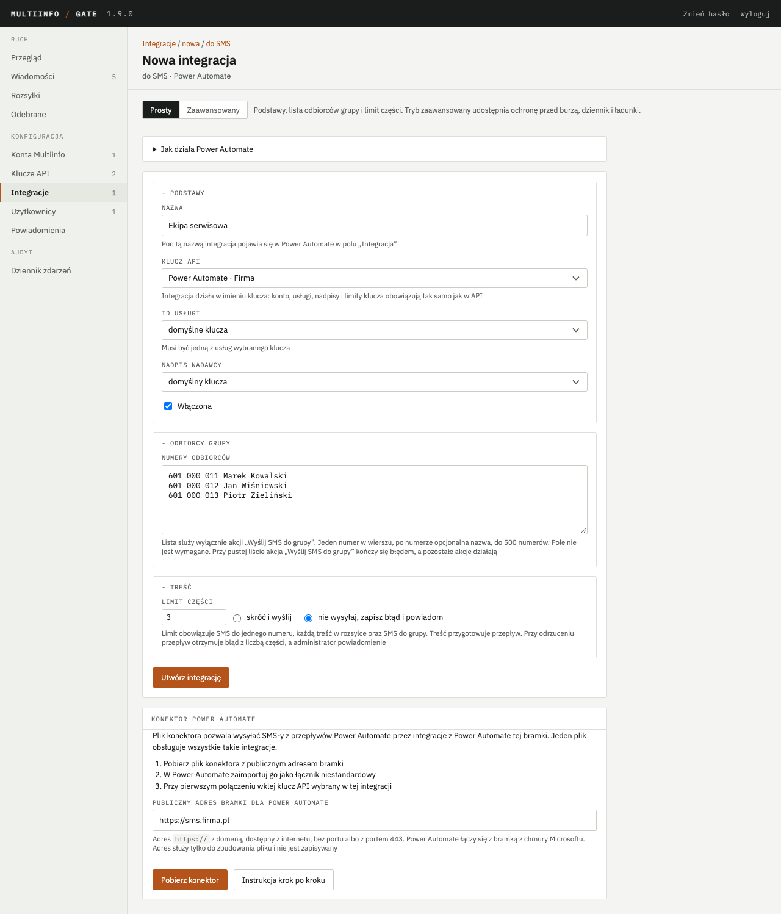
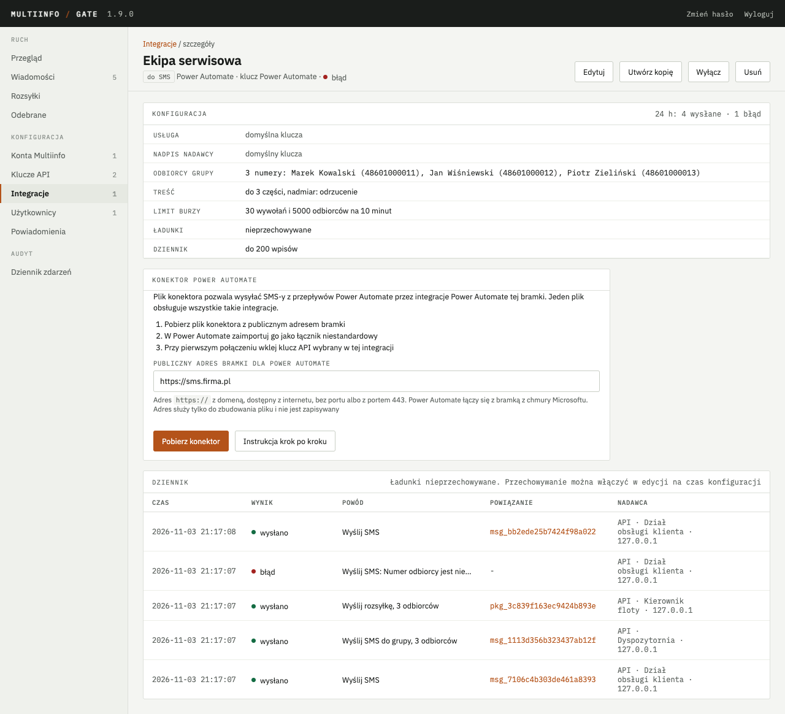
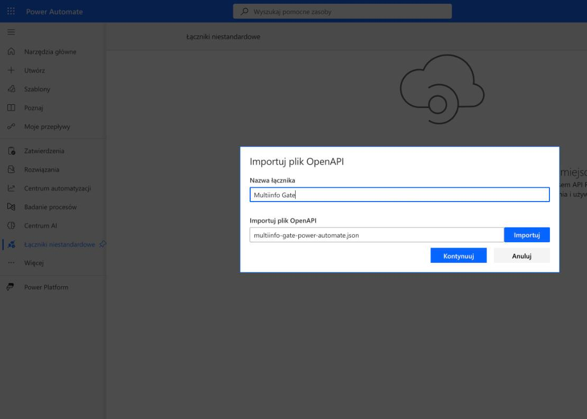
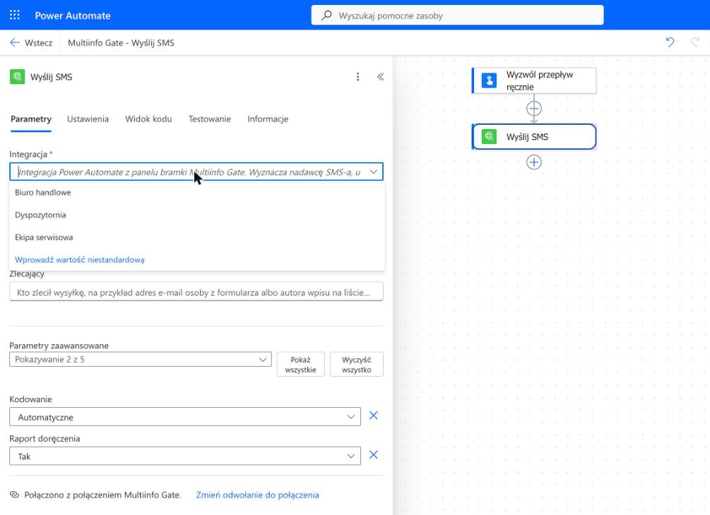
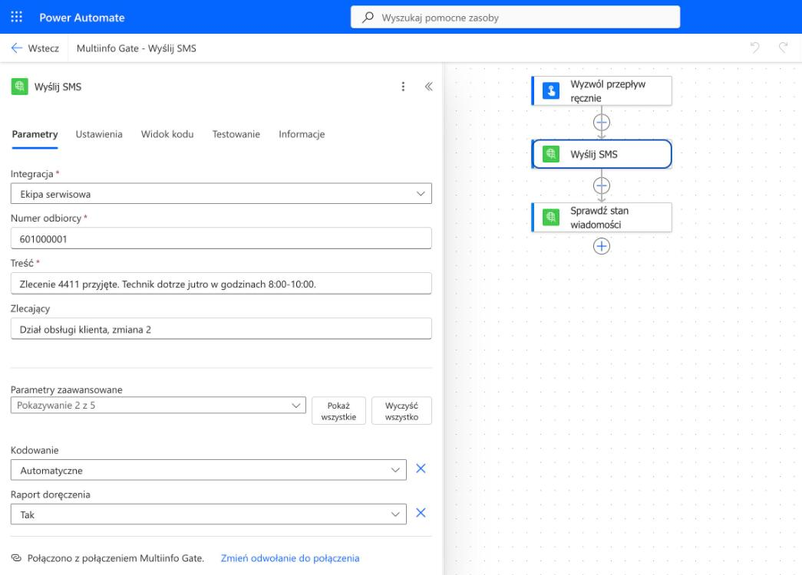
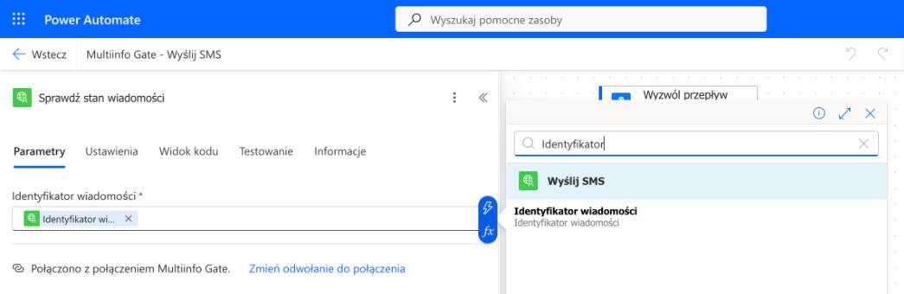
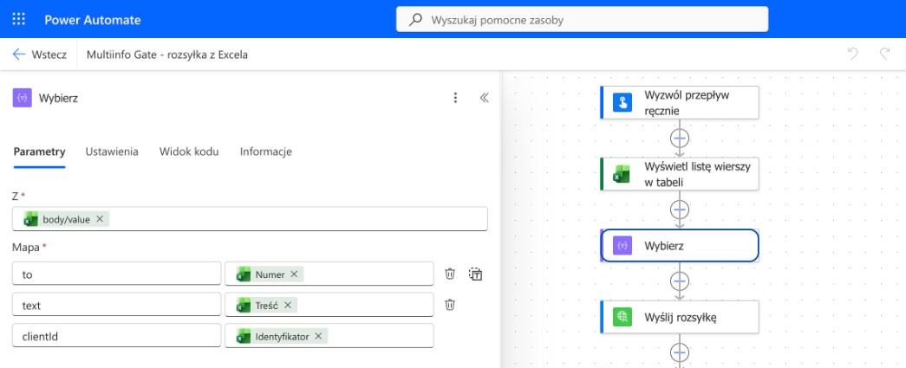
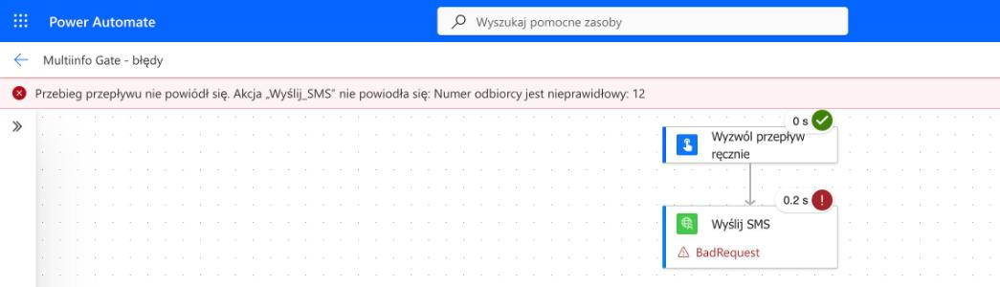

# Power Automate

Od wersji 1.9 bramka wprowadza konektor do Microsoft Power Automate. Dzięki niemu wysyłka SMS-a
z przepływu przebiega tak samo jak każda inna akcja: autor przepływu wybiera akcję, uzupełnia pola
i zapisuje przepływ. Konektor jest plikiem, który pobierasz z panelu bramki i importujesz
w Power Automate jako łącznik niestandardowy.

Każda wysyłka zlecona przez konektor przechodzi przez integrację Power Automate skonfigurowaną
w panelu bramki. Integracja określa nadawcę SMS-a, usługę Multiinfo i limit długości wiadomości.
Chroni konto przed skutkami zapętlonego przepływu i rejestruje każde wywołanie w dzienniku.
Administrator bramki widzi zatem wysyłki z Power Automate w tym samym miejscu co wysyłki
z pozostałych integracji.

Artykuł prowadzi krok po kroku od wymagań, przez konfigurację integracji, pobranie i import
pliku, aż po pierwsze przepływy. Opis kroków w Power Automate odpowiada polskiej wersji serwisu
z listopada 2026 roku. Microsoft zmienia nazwy pozycji menu bez zapowiedzi, dlatego pojedyncze
etykiety na ekranie mogą odbiegać od opisu.

W wersji 1.9 konektor obsługuje wysyłkę SMS-ów i sprawdzanie ich stanu. Odbieranie SMS-ów
w przepływie nie jest jeszcze dostępne.

## 1. Jakie możliwości oferuje konektor

Konektor udostępnia sześć akcji:

| Akcja | Zastosowanie |
|---|---|
| Wyślij SMS | jeden SMS na jeden numer, na przykład potwierdzenie zlecenia dla klienta |
| Wyślij rozsyłkę | SMS-y do najwyżej 5000 odbiorców w jednym wywołaniu; listę odbiorców przygotowuje przepływ, na przykład na podstawie tabeli Excela, a każdy odbiorca może otrzymać własną treść |
| Wyślij SMS do grupy | ta sama treść do każdego numeru z listy odbiorców zapisanej w integracji, na przykład do ekipy serwisowej |
| Sprawdź stan wiadomości | bieżący stan wiadomości: oczekująca w kolejce, wysłana, doręczona albo niedoręczona |
| Sprawdź stan rozsyłki | stan rozsyłki i jej raportu |
| Pobierz raport rozsyłki | stan doręczenia każdej wiadomości z rozsyłki wraz z identyfikatorem odbiorcy |

Wybór akcji zależy od źródła odbiorców:

- **Jeden adresat zdarzenia.** Służy do tego akcja „Wyślij SMS”. Na przykład klient, który
  zgłosił zlecenie w formularzu, otrzymuje SMS z potwierdzeniem
- **Lista pochodząca z danych przepływu.** Służy do tego akcja „Wyślij rozsyłkę”. Na przykład
  dyspozytor prowadzi w Excelu listę jutrzejszych wizyt, a każdy klient otrzymuje SMS z godziną
  przyjazdu technika. Jedno wywołanie zastępuje pętlę „Zastosuj do każdego”, która wysyła SMS-y
  pojedynczo, działa wolno i szybko wyczerpuje limit ochrony przed burzą (rozdział 10)
- **Stały zespół.** Służy do tego akcja „Wyślij SMS do grupy”. Na przykład zgłoszenie awarii
  trafia jednocześnie do całej ekipy serwisowej. Listę numerów prowadzi administrator bramki
  w panelu, dlatego zmiana składu ekipy nie wymaga modyfikacji przepływu

Każda akcja wysyłająca rozpoczyna się od pola **Integracja**, w którym wybierasz integrację Power
Automate skonfigurowaną w panelu bramki. Pole **Zlecający** służy do wskazania osoby zlecającej
wysyłkę, na przykład przez adres e-mail autora wpisu na liście. Bramka zapisuje tę informację
w dzienniku integracji oraz przy wiadomości albo rozsyłce. Zlecający nie jest dołączany do treści
SMS-a. Wartość pola podaje sam przepływ, dlatego dziennik zapisuje obok niej adres IP, z którego
nadeszło wywołanie.

## 2. Wymagania

### 2.1. Licencja Power Automate

Łącznik niestandardowy należy do płatnych funkcji Power Automate. Zgodnie z informacjami
Microsoftu przepływ korzystający z łącznika niestandardowego wymaga licencji Power Automate
Premium albo Process. Licencje dołączone do Microsoft 365 obejmują wyłącznie łączniki
standardowe. Opis licencji znajdziesz na stronie
[Typy licencji Power Automate](https://learn.microsoft.com/pl-pl/power-platform/admin/power-automate-licensing/types).

Do prób wystarczy środowisko próbne albo licencja próbna Premium. Plan deweloperski nie jest
zalecany, ponieważ Microsoft wycofuje go z oferty. Od 15 listopada 2026 roku zapis do planu nie
tworzy już nowego środowiska, a od 15 grudnia 2026 roku istniejące środowiska deweloperskie bez
zarządzania są wstrzymywane. Szczegóły znajdziesz na stronie
[Ważne zmiany w Power Platform](https://learn.microsoft.com/pl-pl/power-platform/important-changes-coming).

Firma bez licencji Premium może wysyłać SMS-y z przepływu za pośrednictwem poczty e-mail
i funkcji Mail2SMS. Tę metodę przedstawia rozdział 13.

### 2.2. Dostęp do bramki z internetu

Power Automate łączy się z bramką z centrów danych Microsoftu, a nie z sieci firmowej. Bramka
musi zatem być dostępna z internetu pod adresem, który spełnia trzy warunki:

- zawiera domenę, na przykład `sms.firma.pl`, a nie adres IP
- korzysta z HTTPS i certyfikatu wystawionego przez publiczny urząd certyfikacji, na przykład
  Let's Encrypt
- wskazuje port 443, czyli nie zawiera numeru portu

Warunki te spełnia każdy wariant udostępnienia API opisany w rozdziale 6
[Uruchomienia](uruchomienie.md): Caddy, nginx i Traefik. Kontener LXC na Proxmoxie działający
w sieci firmowej wymaga dodatkowo serwera pośredniczącego HTTPS z publiczną domeną, opisanego
w punkcie 9.6 Uruchomienia. Panel bramki pozostaje niedostępny z zewnątrz, ponieważ konektor
korzysta wyłącznie z portu API.

Jeżeli zapora przepuszcza ruch tylko z wybranych adresów, musi dopuszczać adresy łączników
Microsoftu. Microsoft publikuje je jako grupę adresów `AzureConnectors`. Szczegóły znajdziesz na
stronie [Konfiguracja adresów IP](https://learn.microsoft.com/pl-pl/power-automate/ip-address-configuration).

Brama danych lokalnych Microsoftu nie zastąpi dostępu z internetu, ponieważ nie obsługuje
uwierzytelniania kluczem API, z którego korzysta konektor bramki.

### 2.3. Sprawdzenie dostępności

Dostępność bramki sprawdź z urządzenia spoza sieci firmowej, na przykład z telefonu z wyłączonym
Wi-Fi. Otwórz w przeglądarce adres:

```
https://<TWOJA-DOMENA>/healthz
```

Oczekiwany wynik: tekst `{"status":"ok"}` bez ostrzeżenia o certyfikacie. Odpowiedź
`{"status":"degraded"}` również potwierdza dostępność bramki, a przyczynę tego stanu wskazuje
panel ([API](api.md), rozdział 10).

Jeżeli wynik jest inny:

- **Strona się nie otwiera.** Sprawdź rekord DNS domeny, ustawienia zapory i serwer
  pośredniczący zgodnie z rozdziałem 6 Uruchomienia
- **Przeglądarka ostrzega o certyfikacie.** Certyfikat nie pochodzi od publicznego urzędu
  certyfikacji albo został wystawiony na inną domenę. Power Automate odrzuci takie połączenie
- **Adres odpowiada wyłącznie w sieci firmowej.** Bramka nie jest udostępniona w internecie

## 3. Integracja w panelu bramki

### 3.1. Klucz API dla Power Automate

Integracja działa w imieniu klucza API. Zalecane jest utworzenie osobnego klucza o nazwie „Power
Automate”. Klucz wklejony w Power Automate zostaje zapisany w połączeniu, dlatego osobny klucz
można w razie potrzeby odwołać bez wpływu na pozostałe aplikacje. Jego usługi, nadpisy i limit
żądań można też ograniczyć do potrzeb przepływów.

Klucz utworzysz na ekranie **Klucze API → Wygeneruj klucz**, opisanym w rozdziale 4.5
[Uruchomienia](uruchomienie.md). Panel wyświetla klucz tylko raz, dlatego od razu zapisz go
w menedżerze haseł. Klucz wklejasz później w oknie połączenia w Power Automate (rozdział 6.1).

Przy tworzeniu klucza zaznacz opcję **Tylko integracje**. Klucz z tą opcją działa wyłącznie
w integracjach, dlatego przepływ nie może nim wysłać SMS-a z pominięciem limitu części, ochrony
przed burzą i dziennika, na przykład akcją HTTP wywołującą bezpośrednio API bramki. Takie
wywołanie kończy się błędem `403` z kodem `integrations_only_key`. Akcje konektora, w tym
sprawdzanie stanu wiadomości i rozsyłek, działają bez ograniczeń.

### 3.2. Utworzenie integracji

1. W panelu bramki otwórz **Integracje → Dodaj integrację**.
2. Wybierz kierunek **Aplikacja wysyła SMS**.
3. Kliknij kafelek **Power Automate**. Otworzy się formularz w trybie prostym.
4. Uzupełnij sekcję **Podstawy**:
    - **Nazwa**: pod tą nazwą integracja wyświetla się w Power Automate w polu „Integracja”.
      Dobra nazwa wskazuje adresatów albo sprawę, na przykład „Ekipa serwisowa” lub „Biuro
      handlowe”
    - **Klucz API**: klucz utworzony zgodnie z rozdziałem 3.1
    - **ID usługi** i **Nadpis nadawcy**: pozycja z listy uprawnień klucza. Pierwsza pozycja
      oznacza ustawienie domyślne klucza
    - **Włączona**: wyłączona integracja nie wysyła żadnych wiadomości i nie pojawia się na
      liście w Power Automate
5. W sekcji **Odbiorcy grupy** wpisz numery dla akcji „Wyślij SMS do grupy”, po jednym
   w wierszu. Po numerze możesz dopisać nazwę, na przykład `601 000 011 Marek Kowalski`. Pole
   jest opcjonalne, a pozostałe akcje nie korzystają z tej listy.
6. W sekcji **Treść** określ **Limit części** oraz sposób postępowania z dłuższą treścią:
   „skróć i wyślij” albo „nie wysyłaj, zapisz błąd i powiadom”. Skutki obu ustawień opisuje
   rozdział 10.1.
7. Kliknij **Utwórz integrację**.



Oczekiwany wynik: panel wyświetla szczegóły integracji z konfiguracją opisaną słowami oraz panel
**Konektor Power Automate**. Na liście integracji nowa pozycja jest oznaczona kierunkiem „do SMS”
i podpisem „Power Automate”.



Przełącznik **Zaawansowany** nad formularzem odsłania dodatkowo sekcję **Ochrona i dziennik**
z limitem burzy, limitem odbiorców, pojemnością dziennika i przechowywaniem ładunków. Opis tych
ustawień znajdziesz w rozdziale 5b [Integracji z aplikacjami](integracje.md). Jeżeli ochronę przed
burzą zmieniono w trybie zaawansowanym, tryb prosty wyświetla jej bieżące wartości.

Każda integracja Power Automate prowadzi własną listę odbiorców i własny dziennik oraz stosuje
własny limit części. Dla różnych zespołów lub spraw warto utworzyć osobne integracje, także
w ramach tego samego klucza. Jeden plik konektora obsługuje je wszystkie.

## 4. Pobranie pliku konektora

Plik konektora pobierzesz w panelu **Konektor Power Automate**, umieszczonym pod formularzem
integracji i w jej szczegółach.

1. Sprawdź pole **Publiczny adres bramki dla Power Automate**. Panel uzupełnia je automatycznie,
   jeżeli adres bramki zaczyna się od `https://` i zawiera domenę. W przeciwnym razie wpisz adres
   spełniający warunki z rozdziału 2.2, na przykład `https://sms.firma.pl`.
2. Kliknij **Pobierz konektor**.

Oczekiwany wynik: przeglądarka zapisuje plik `multiinfo-gate-power-automate.json`.

Jeżeli zamiast pliku pojawia się komunikat, podany adres nie spełnia warunków z rozdziału 2.2.
Dotyczy to adresu rozpoczynającego się od `http://`, adresu IP zamiast domeny, adresu ze ścieżką
oraz adresu z portem innym niż 443. Popraw adres i ponownie pobierz plik.

Adres z pola służy wyłącznie do przygotowania pliku i nie jest zapisywany w bramce. Plik nie
zawiera klucza API ani innych poufnych danych, ponieważ klucz podaje się dopiero przy tworzeniu
połączenia. Jeden plik obsługuje wszystkie integracje Power Automate danej bramki.

Plik pobiera się wyłącznie przyciskiem **Pobierz konektor** w panelu. Odnośnik do pobrania
otwarty w pasku przeglądarki nie zwraca pliku. Plik konektora otrzymany z innego źródła, na
przykład w wiadomości e-mail, mógłby kierować klucz API na obcy serwer, dlatego przed importem
należy pobrać plik samodzielnie z panelu bramki.

## 5. Import łącznika w Power Automate

1. Zaloguj się w [make.powerautomate.com](https://make.powerautomate.com). W prawym górnym rogu,
   w polu **Środowiska**, wybierz środowisko, w którym będą działać przepływy.
2. W menu po lewej stronie kliknij **Więcej → Odkryj wszystkie**, a następnie w grupie **Dane**
   wybierz **Łączniki niestandardowe**. Ikona pinezki przy tej pozycji przypina ją na stałe do
   menu.
3. Kliknij **Nowy łącznik niestandardowy → Importuj plik OpenAPI**.
4. W oknie **Importuj plik OpenAPI** wpisz w polu **Nazwa łącznika** `Multiinfo Gate`.
   Przyciskiem **Importuj** wskaż pobrany plik, a następnie kliknij **Kontynuuj**.
5. Otworzy się kreator z krokami **1. Ogólne**, **2. Zabezpieczenia**, **3. Definicja**,
   **4. Kod** i **5. Przetestuj**. Plik uzupełnia wszystkie pola, dlatego nie wprowadzaj w nich
   zmian. Pole wyboru **Połącz za pomocą lokalnej bramy danych** pozostaw niezaznaczone.
6. Kliknij **Utwórz łącznik**.



Oczekiwany wynik: komunikat „Pomyślnie utworzono łącznik niestandardowy.” W kroku
**3. Definicja** widnieje siedem akcji bez ostrzeżeń. Akcja „Lista integracji” pełni funkcję
wewnętrzną: na jej podstawie konektor buduje listę w polu „Integracja”. W przepływie dostępnych
jest pozostałych sześć akcji.

W kroku **1. Ogólne** możesz dodać własną ikonę łącznika w formacie PNG albo JPG o rozmiarze
poniżej 1 MB. Ikona nie wpływa na działanie konektora.

Jeżeli kreator odrzuca plik, upewnij się, że importujesz plik pobrany z panelu bramki. Plik
`openapi.json` z dokumentacji API nie nadaje się do importu, ponieważ został zapisany w formacie
OpenAPI 3.0, a Power Automate przyjmuje wyłącznie wersję 2.0. Szczegóły znajdziesz na stronie
[Tworzenie łącznika niestandardowego z definicji OpenAPI](https://learn.microsoft.com/pl-pl/connectors/custom-connectors/define-openapi-definition).

## 6. Pierwszy przepływ: SMS do jednego numeru

Przykładowy scenariusz: dział obsługi klienta przyjmuje zlecenie serwisowe, a klient otrzymuje
SMS z potwierdzeniem. Przepływ opisany w tym rozdziale uruchamia się ręcznie. Tę samą akcję można
zastosować w przepływie uruchamianym zdarzeniem, na przykład nowym wpisem na liście SharePoint
albo odpowiedzią w Microsoft Forms. Numer i treść pochodzą wówczas z pól wyzwalacza.

### 6.1. Dodanie akcji i utworzenie połączenia

1. W menu po lewej stronie kliknij **Utwórz → Błyskawiczny przepływ w chmurze**. Wpisz nazwę
   przepływu, wybierz wyzwalacz **Wyzwól przepływ ręcznie** i kliknij **Utwórz**.
2. Pod wyzwalaczem kliknij **+**, aby dodać akcję. W polu wyszukiwania wpisz `Multiinfo Gate`.
3. Kliknij filtr **Niestandardowe** nad wynikami wyszukiwania. Bez włączonego filtra łącznik
   niestandardowy nie pojawia się na początku listy.
4. Wybierz akcję **Wyślij SMS**.
5. Przy pierwszej akcji Multiinfo Gate otworzy się okno **Utwórz połączenie**. W polu **Nazwa
   połączenia** wpisz nazwę wskazującą klucz, na przykład `Multiinfo Gate - Power Automate`.
   W polu **Klucz interfejsu API** wklej klucz z rozdziału 3.1, a następnie zatwierdź utworzenie
   połączenia przyciskiem pod polami.

Klucz możesz wkleić bez przedrostka albo z przedrostkiem `Bearer` i spacją. Oba zapisy są
poprawne. Kolejne akcje Multiinfo Gate w tym przepływie korzystają z utworzonego połączenia. Pod
polami akcji wyświetla się wówczas informacja „Połączono z połączeniem” wraz z nazwą połączenia
oraz odnośnik **Zmień odwołanie do połączenia**.



### 6.2. Pola akcji „Wyślij SMS”

| Pole | Zawartość |
|---|---|
| Integracja | integracja Power Automate wybrana z listy; lista obejmuje włączone integracje klucza przypisanego do połączenia |
| Numer odbiorcy | jeden numer, na przykład `48601000001`; numer bez kodu kraju otrzymuje kod domyślny konta, a spacje i łączniki są pomijane |
| Treść | treść SMS-a: tekst wpisany na stałe, pola z wcześniejszych kroków przepływu albo ich połączenie |
| Zlecający | pole opcjonalne wskazujące osobę zlecającą wysyłkę, na przykład `Dział obsługi klienta` albo adres e-mail z formularza |

Pusty numer odbiorcy powoduje błąd akcji. W takiej sytuacji akcja nigdy nie wysyła SMS-a do
listy odbiorców integracji.



Przycisk **Pokaż wszystkie** przy **Parametrach zaawansowanych** odsłania pozostałe pola:

| Pole | Znaczenie |
|---|---|
| Kodowanie | „Automatyczne” wybiera GSM-7, a dla treści z polskimi znakami Unicode; „GSM, bez polskich znaków” zastępuje polskie znaki łacińskimi; „Unicode” zawsze koduje treść w UCS-2 |
| Raport doręczenia | wartość „Nie” oznacza rezygnację z raportu doręczenia, a stan wiadomości kończy się wówczas na `sent` |
| Ważna do | termin, po którym niedoręczona wiadomość otrzymuje stan `expired`; najpóźniej 72 godziny od przyjęcia |
| Znacznik rozliczeń | dowolny tekst na potrzeby rozliczeń, zwracany wraz ze stanem wiadomości |
| Klucz idempotencji | ponowne wywołanie z tym samym kluczem i tymi samymi danymi zwraca pierwotną odpowiedź zamiast wysyłać drugi SMS, nie jest liczone do ochrony przed burzą, a dziennik otrzymuje wpis „duplikat” ([API](api.md), rozdział 3.1) |

Usługi Multiinfo ani nadawcy nie wybiera się w akcji, ponieważ określa je integracja.

### 6.3. Test przepływu

1. Kliknij **Zapisz** nad projektantem.
2. Kliknij **Przetestuj** i uruchom przepływ ręcznie.

Oczekiwany wynik:

- akcja „Wyślij SMS” od razu kończy się powodzeniem, oznaczonym zielonym znacznikiem. Bramka
  przyjmuje wiadomość do kolejki i natychmiast odpowiada, a doręczenie następuje później
- dane wyjściowe akcji zawierają pola **Identyfikator wiadomości** i **Stan wiadomości**
  z wartością `queued`
- SMS dociera na numer odbiorcy
- dziennik w szczegółach integracji zawiera wpis „wysłano” z powodem „Wyślij SMS”, a kolumna
  „Nadawca” pokazuje zlecającego i adres IP wywołania, na przykład `API · Dział obsługi klienta
  · 203.0.113.7`. Jeżeli przepływ nie podał zlecającego, kolumna pokazuje sam adres IP
- wiadomość jest widoczna na ekranie **Wiadomości**, a jej szczegóły zawierają wiersze
  „Integracja” i „Zlecający”

Jeżeli akcja zakończy się błędem, nad przebiegiem pojawi się czerwony pasek z komunikatem bramki
w języku polskim. Znaczenie komunikatów wyjaśnia rozdział 12.

### 6.4. Zmiana klucza w połączeniu

Nowy klucz, na przykład po odwołaniu poprzedniego, wprowadza się w istniejącym połączeniu.
Przepływy nie wymagają wówczas żadnych zmian.

1. W menu po lewej stronie kliknij **Więcej → Odkryj wszystkie**, a następnie w grupie **Dane**
   wybierz **Połączenia**.
2. Przy połączeniu Multiinfo Gate kliknij **⋮ → Edytuj**.
3. W polu **Klucz interfejsu API** wklej nowy klucz i kliknij **Aktualizuj**.

Zawartość listy w polu „Integracja” zależy od klucza przypisanego do połączenia. Jeżeli do klucza
nie jest przypisana żadna włączona integracja Power Automate, lista pozostaje pusta.

## 7. Sprawdzenie stanu wiadomości

Akcja „Wyślij SMS” kończy się w chwili przyjęcia wiadomości przez bramkę. Stan doręczenia
sprawdza osobna akcja.

1. Pod akcją „Wyślij SMS” dodaj akcję **Opóźnienie** z czasem oczekiwania, na przykład 5 minut.
2. Dodaj akcję **Sprawdź stan wiadomości**. W polu **Identyfikator wiadomości** wstaw
   z zawartości dynamicznej pole **Identyfikator wiadomości** akcji „Wyślij SMS”.
3. Kolejne kroki przepływu mogą zależeć od pola **Stan wiadomości**. Na przykład akcja
   **Warunek** może przy stanie `failed` wysłać wiadomość e-mail do dyspozytora.



Oczekiwany wynik: dane wyjściowe akcji zawierają pola wiadomości, w tym **Stan wiadomości**
i **Błąd**.

| Stan | Znaczenie |
|---|---|
| `queued` | wiadomość oczekuje w kolejce bramki |
| `sent` | wiadomość przekazana do sieci; bez raportu doręczenia jest to stan końcowy |
| `delivered` | wiadomość doręczona |
| `failed` | wiadomość niedoręczona; przyczynę podaje pole **Błąd** |
| `expired` | termin z pola „Ważna do” upłynął przed doręczeniem |
| `cancelled`, `blocked`, `throttled`, `unknown` | rzadziej występujące stany, opisane w rozdziale 7 [API](api.md) |

Stany `delivered`, `failed`, `expired`, `cancelled` i `blocked` są ostateczne. Stan `queued` albo
`sent` oznacza, że doręczenie jeszcze trwa. W takim przypadku sprawdzenie można powtórzyć po
kolejnym opóźnieniu.

## 8. Rozsyłka na podstawie tabeli Excela

Przykładowy scenariusz: dyspozytor prowadzi w Excelu listę jutrzejszych wizyt. Każdy klient
otrzymuje SMS z godziną przyjazdu technika, a raport rozsyłki wraca z numerami zleceń.

### 8.1. Przygotowanie tabeli

Plik znajduje się w OneDrive for Business. Dane są sformatowane jako tabela o nazwie `Odbiorcy`,
złożona z trzech kolumn:

| Numer | Treść | Identyfikator |
|---|---|---|
| 48601000011 | Wizyta technika jutro w godzinach 8:00-10:00. Zlecenie 4411 | ZL-4411 |
| 48601000012 | Wizyta technika jutro w godzinach 10:00-12:00. Zlecenie 4412 | ZL-4412 |
| 48601000013 | Wizyta technika jutro w godzinach 12:00-14:00. Zlecenie 4413 | ZL-4413 |

Kolumna z identyfikatorem jest opcjonalna. Identyfikator liczy od 1 do 20 znaków i może zawierać
litery bez polskich znaków, cyfry, kropkę, podkreślenie oraz łącznik. Bramka zwraca go
w raporcie rozsyłki przy każdym odbiorcy. Odbiorca z pustą treścią otrzymuje treść wspólną
rozsyłki.

### 8.2. Budowa przepływu

1. Dodaj akcję **Wyświetl listę wierszy w tabeli** łącznika Excel Online (Business). W polu
   **Lokalizacja** wybierz `OneDrive for Business`, w polu **Biblioteka dokumentów** `Dokumenty`,
   w polu **Plik** przygotowany plik, a w polu **Tabela** tabelę `Odbiorcy`.
2. Dodaj akcję **Wybierz**. W polu **Z** wstaw z zawartości dynamicznej wartość `value` akcji
   Excela. W polu **Mapa** wpisz w lewej kolumnie trzy klucze: `to`, `text` i `clientId`,
   a w prawej przypisz im kolumny tabeli **Numer**, **Treść** i **Identyfikator**. Klucze należy
   wpisać dokładnie w tej postaci, z wielką literą wyłącznie w `clientId`.
3. Dodaj akcję **Wyślij rozsyłkę** i wybierz **Integrację**. Przycisk w prawym górnym rogu pola
   **Odbiorcy** przełącza je z wprowadzania pojedynczych odbiorców na przekazanie całej listy. Po
   przełączeniu wstaw z zawartości dynamicznej **Dane wyjściowe** akcji „Wybierz”.
4. W polu **Treść wspólna** wpisz treść dla odbiorców bez własnej treści. Pole jest wymagane,
   jeżeli którykolwiek odbiorca nie otrzymał treści w tabeli.
5. W polu **Zlecający** wskaż osobę zlecającą rozsyłkę, na przykład `Kierownik floty`.



Oczekiwany wynik: akcja „Wyślij rozsyłkę” kończy się od razu i zwraca **Identyfikator
rozsyłki**. Dziennik integracji zawiera wpis „wysłano” z powodem „Wyślij rozsyłkę, 3 odbiorców”,
a rozsyłka jest widoczna w panelu bramki na ekranie **Rozsyłki**.

Akcja **Wyświetl listę wierszy w tabeli** domyślnie zwraca najwyżej 256 wierszy. Aby odczytać
większą tabelę, włącz **Podział na strony** na zakładce **Ustawienia** tej akcji, w sekcji
**Sieć**. Szczegóły znajdziesz w opisie łącznika
[Excel Online (Business)](https://learn.microsoft.com/pl-pl/connectors/excelonlinebusiness/).
Pojedyncza rozsyłka obejmuje najwyżej 5000 odbiorców.

Kodowanie jest wspólne dla całej rozsyłki, ponieważ tak przyjmuje ją Multiinfo. Jeżeli choć jedna
treść zawiera polskie znaki, wszystkie treści rozsyłki są wysyłane w Unicode, a limit części
integracji obowiązuje każdą treść w tym kodowaniu. Treść bez polskich znaków o długości 160 znaków
zajmuje wtedy trzy części zamiast jednej. Treść wspólna liczy się zawsze, gdy jest podana, nawet
jeżeli każdy odbiorca ma własną treść.

Pole **Klucz idempotencji** w parametrach zaawansowanych akcji „Wyślij rozsyłkę” chroni przed
powtórną rozsyłką, gdy Power Automate ponawia akcję po zerwanym połączeniu. Wpisz w nim wartość
niepowtarzalną dla danej rozsyłki, na przykład tekst `wizyty-` połączony z datą jutrzejszych wizyt,
czyli `wizyty-2026-11-04`. Ponowienie z tym samym kluczem i tymi samymi odbiorcami zwraca pierwotną
rozsyłkę, a dziennik otrzymuje wpis „duplikat”.

### 8.3. Stan i raport rozsyłki

1. Dodaj akcję **Opóźnienie**, na przykład 10 minut.
2. Dodaj akcję **Sprawdź stan rozsyłki**. W polu **Identyfikator rozsyłki** wstaw **Identyfikator
   rozsyłki** z akcji „Wyślij rozsyłkę”. Dane wyjściowe zawierają **Stan rozsyłki** i **Stan
   raportu**.
3. Dodaj akcję **Pobierz raport rozsyłki** z tym samym identyfikatorem. Raport zawiera wiersz dla
   każdego odbiorcy z numerem, identyfikatorem odbiorcy i stanem wiadomości.

Bramka zamawia raport w Multiinfo po zakończeniu rozsyłki. Wcześniej akcja „Pobierz raport
rozsyłki” kończy się błędem `409` z kodem `report_not_ready`. Czas
przygotowania raportu zależy od liczby odbiorców i od Multiinfo. Jeżeli raport nie jest jeszcze
gotowy, uruchom akcję ponownie po dłuższym opóźnieniu.

## 9. SMS do grupy

Przykładowy scenariusz: zgłoszenie awarii trafia jednym SMS-em do wszystkich techników ekipy
serwisowej.

1. W panelu bramki uzupełnij w integracji Power Automate sekcję **Odbiorcy grupy** (rozdział 3.2,
   krok 5).
2. W przepływie dodaj akcję **Wyślij SMS do grupy**.
3. Wybierz **Integrację**, wpisz **Treść** i opcjonalnie **Zlecającego**. Akcja nie zawiera pola
   numeru, ponieważ odbiorców wyznacza lista zapisana w integracji.

Oczekiwany wynik: każdy numer z listy otrzymuje osobny SMS. Dane wyjściowe akcji zawierają
identyfikator i stan każdej wiadomości, ale nie zawierają numerów. Lista odbiorców pozostaje w
bramce i nie trafia do historii przebiegów w chmurze Microsoftu. Dziennik integracji zawiera wpis
„wysłano” z powodem obejmującym liczbę odbiorców, na przykład „Wyślij SMS do grupy, 3 odbiorców”.

Zmiana listy w panelu obowiązuje od następnego wywołania i nie wymaga modyfikacji przepływu.
Każdy odbiorca otrzymuje osobną wiadomość rozliczaną na koncie Multiinfo, dlatego SMS do grupy
20 osób oznacza 20 wiadomości.

Jeżeli lista odbiorców jest pusta, akcja kończy się błędem `Conflict`, a bramka nie wysyła żadnej
wiadomości. Pasek nad przebiegiem wyświetla komunikat bramki, na przykład: „Integracja Biuro
handlowe nie ma odbiorców grupy. Listę uzupełnia administrator w panelu bramki.”

## 10. Limit części i ochrona przed burzą

### 10.1. Limit części

Limit części określa administrator bramki w sekcji **Treść** integracji. Obowiązuje on każdą
akcję wysyłającą: SMS do jednego numeru, każdą treść w rozsyłce oraz SMS do grupy.

- **„skróć i wyślij”.** Bramka skraca dłuższą treść do limitu i wysyła SMS, a akcja w przepływie
  kończy się powodzeniem. Skrócona treść bez polskich znaków kończy się trzema kropkami, a treść
  z polskimi znakami znakiem „…”. Wpis w dzienniku zawiera dopisek „skrócono do 1 części”
- **„nie wysyłaj, zapisz błąd i powiadom”.** Akcja kończy się błędem `BadRequest` z komunikatem,
  na przykład „Treść wymaga 3 części, a limit integracji to 1.” W rozsyłce jedna zbyt długa treść
  powoduje odrzucenie całej rozsyłki, a komunikat rozpoczyna się od pozycji odbiorcy na liście,
  liczonej od zera, na przykład `recipients.4:`. Dziennik otrzymuje wpis „błąd”, a administrator
  powiadomienie

### 10.2. Ochrona przed burzą

Ochrona przed burzą zlicza w jednym oknie czasowym wywołania akcji wysyłających oraz ich
odbiorców. Domyślnie przepuszcza 30 wywołań i 5000 odbiorców w ciągu 10 minut. SMS do jednego
numeru liczy się jako jeden odbiorca, a rozsyłka i SMS do grupy jako tylu odbiorców, ilu
obejmują. Pełna rozsyłka do 5000 odbiorców wyczerpuje zatem limit odbiorców okna, dzięki czemu
zapętlony przepływ zostaje zatrzymany przy drugim wywołaniu, zanim wygeneruje znaczne koszty.

Wywołanie ponad którykolwiek z limitów otrzymuje odpowiedź `429` z kodem `integration_throttled`,
a bramka nie wysyła SMS-a. Komunikat podaje limit, który został przekroczony. Dziennik integracji
otrzymuje wpis „limit”, na przykład z powodem „ponad 5000 odbiorców w 10 min”, a administrator
jedno powiadomienie na okno, niezależnie od liczby odrzuconych wywołań. Odrzucone wywołanie nie
zużywa żadnego z limitów.

Po odpowiedzi `429` Power Automate ponawia akcję zgodnie z domyślnymi zasadami ponawiania.
W trakcie prób akcja była ponawiana do czterech razy, a przebieg trwał kilka minut, zanim
zakończył się błędem. Każde ponowienie stanowi osobne wywołanie i otrzymuje osobny wpis „limit”.
Ponowienie, które przypada już w nowym oknie, wysyła SMS w zwykły sposób. Ponowienie z tym samym
kluczem idempotencji niczego nie wysyła, dlatego nie jest liczone do limitów.

Aby akcja kończyła się błędem natychmiast, bez ponawiania, zmień jej ustawienia:

1. Kliknij akcję w projektancie i otwórz zakładkę **Ustawienia**.
2. W sekcji **Sieć**, w polu **Zasady ponawiania**, wybierz **Brak**.
3. Zapisz przepływ.

Oba limity zmienia administrator bramki w trybie zaawansowanym formularza integracji, w sekcji
**Ochrona i dziennik**, w polach **Limit burzy** i **Limit odbiorców**. Wysyłkę do wielu
odbiorców zaleca się realizować jednym wywołaniem „Wyślij rozsyłkę” albo „Wyślij SMS do grupy”
zamiast pętli wywołań „Wyślij SMS”.

### 10.3. Wyłączona integracja

Wyłączona integracja znika z listy w polu „Integracja”. Zapisany przepływ, który ją wskazuje,
kończy akcję błędem `Conflict` z kodem `integration_disabled`. Bramka nie wysyła wówczas SMS-a
i nie zapisuje wpisu w dzienniku. Po ponownym włączeniu integracji przepływ działa bez żadnych
zmian.

## 11. Aktualizacja łącznika

Nowy plik konektora należy pobrać po aktualizacji bramki, jeżeli opis wydania wymienia zmiany
w konektorze. Aktualizacja łącznika zachowuje zapisane przepływy, ponieważ akcje konektora
zachowują stałe nazwy wewnętrzne.

1. Pobierz nowy plik z panelu bramki (rozdział 4).
2. W Power Automate otwórz listę **Łączniki niestandardowe** (rozdział 5, krok 2).
3. Przy łączniku Multiinfo Gate kliknij **…** i wybierz **Aktualizuj na podstawie pliku
   interfejsu OpenAPI**.
4. Wskaż nowy plik i kliknij **Kontynuuj**.
5. W kreatorze kliknij **Zaktualizuj łącznik**.

Oczekiwany wynik: po około 20 sekundach łącznik zostaje zaktualizowany, a zapisane przepływy
działają nadal.

Projektant przepływu uwzględnia zmiany natychmiast. Uruchamiane przepływy korzystają jednak
jeszcze przez pewien czas z poprzedniego opisu łącznika. W trakcie prób trwało to od pół godziny
do półtorej godziny. Przed sprawdzeniem zmiany w przebiegu przepływu odczekaj ten czas.

## 12. Rozwiązywanie problemów

Nieudana akcja Multiinfo Gate wyświetla nad przebiegiem czerwony pasek z komunikatem bramki
w języku polskim. Kod odpowiedzi HTTP, na przykład `BadRequest` albo `Conflict`, widnieje przy
akcji, a kod błędu bramki (`error.code`) znajduje się w danych wyjściowych akcji. Pełny wykaz
kodów wraz z ich znaczeniem znajdziesz w rozdziale 5b.6 [API](api.md).



| Objaw | Przyczyna | Rozwiązanie |
|---|---|---|
| kreator odrzuca plik | importowany plik nie pochodzi z panelu bramki, na przykład jest to `openapi.json` z dokumentacji API | pobrać plik z panelu bramki (rozdział 4) |
| akcji Multiinfo Gate brakuje w wynikach wyszukiwania | wyszukiwarka wyświetla w pierwszej kolejności łączniki Microsoftu | włączyć filtr **Niestandardowe** nad wynikami |
| lista w polu „Integracja” jest pusta | do klucza połączenia nie jest przypisana żadna włączona integracja Power Automate | sprawdzić w panelu bramki klucz i stan integracji, a w razie potrzeby wprowadzić w połączeniu inny klucz (rozdział 6.4) |
| błąd `401` z kodem `invalid_api_key`, `revoked_api_key` albo `expired_api_key` | klucz zapisany w połączeniu jest nieprawidłowy, odwołany albo wygasł | wprowadzić w połączeniu ważny klucz (rozdział 6.4) |
| błąd `404` z kodem `integration_not_found` | integracja wskazana w akcji została usunięta albo należy do innego klucza niż klucz połączenia | ponownie wybrać integrację z listy |
| błąd `409` z kodem `integration_disabled` | integracja jest wyłączona w panelu bramki | poprosić administratora o włączenie integracji |
| błąd `409` z kodem `group_empty` | lista odbiorców grupy w integracji jest pusta | poprosić administratora o uzupełnienie listy (rozdział 9) |
| błąd `400` z kodem `too_many_parts` | treść przekracza limit części integracji przy ustawieniu „nie wysyłaj” | skrócić treść albo poprosić administratora o zmianę limitu (rozdział 10.1) |
| błąd `400` z kodem `invalid_phone` | numeru nie można sprowadzić do poprawnej postaci; komunikat podaje przyczynę | poprawić numer w danych przepływu |
| błąd `400` z kodem `invalid_body` | brak numeru lub treści albo pole w niepoprawnym formacie; komunikat wymienia pola | uzupełnić albo poprawić wskazane pola akcji |
| błąd `413` z kodem `body_too_large` | lista odbiorców rozsyłki z treściami przekracza 4 MB | podzielić listę na kilka rozsyłek |
| błąd `403` z kodem `service_not_allowed` albo `orig_not_allowed` | usługa albo nadpis integracji wykracza poza uprawnienia klucza | poprosić administratora o korektę integracji albo uprawnień klucza |
| błąd `403` z kodem `integrations_only_key` w akcji HTTP | klucz z opcją **Tylko integracje** nie pozwala wysyłać przez API z pominięciem integracji | użyć akcji konektora zamiast akcji HTTP |
| błąd `409` z kodem `idempotency_conflict` | ten sam klucz idempotencji użyto wcześniej z innymi danymi albo w innej integracji | podać inny klucz idempotencji |
| akcja jest ponawiana przez kilka minut i kończy się błędem `429` z kodem `integration_throttled` | przekroczono limit wywołań albo limit odbiorców ochrony przed burzą integracji | postąpić zgodnie z rozdziałem 10.2 |
| błąd `429` z kodem `rate_limited` | przekroczono limit żądań klucza na minutę | zastąpić pętlę rozsyłką albo poprosić administratora o podniesienie limitu klucza |
| błąd `503` z kodem `integration_unavailable` | konto Multiinfo integracji jest wstrzymane albo klucz integracji jest nieczynny; przyczynę podaje dziennik integracji w panelu bramki | przekazać informację administratorowi bramki |
| błąd połączenia albo certyfikatu | bramka jest niedostępna z internetu albo jej certyfikat nie pochodzi od publicznego urzędu certyfikacji | sprawdzić dostępność zgodnie z rozdziałem 2.3 |
| po aktualizacji łącznika przebieg działa według poprzedniego opisu | Power Automate korzysta jeszcze z poprzedniej wersji opisu łącznika | odczekać zgodnie z rozdziałem 11 |

## 13. Wysyłka bez licencji Premium: Outlook i Mail2SMS

Łącznik Office 365 Outlook należy do łączników standardowych, dlatego działa z licencją
dołączoną do Microsoft 365, bez Premium. Przepływ wysyła nim wiadomość e-mail na skrzynkę
integracji Mail2SMS, a bramka przekształca tę wiadomość w SMS.

Metoda ta wymaga integracji Mail2SMS w bramce, opisanej w rozdziale 5
[Integracji z aplikacjami](integracje.md). Najważniejsze warunki:

- skrzynka Mail2SMS jest prowadzona u dostawcy innego niż Microsoft 365, na przykład w home.pl,
  w OVH albo na własnym serwerze poczty (rozdział 5.1 Integracji)
- adres konta, z którego przepływ wysyła wiadomość, znajduje się na liście dozwolonych nadawców
  integracji (rozdział 5.2)
- integracja określa odbiorców SMS-a: numer w temacie albo w pierwszym wierszu wiadomości,
  numery przypisane nadawcy albo stałą listę (rozdział 5.3)

Konfiguracja przepływu:

1. Dodaj akcję **Wyślij wiadomość e-mail (V2)** łącznika Office 365 Outlook.
2. W polu **Do** wpisz adres skrzynki Mail2SMS.
3. Temat i treść wiadomości przygotuj zgodnie z ustawieniami integracji, na przykład z numerem
   odbiorcy w temacie i treścią SMS-a w treści wiadomości.
4. Zapisz i przetestuj przepływ.

Oczekiwany wynik: SMS dociera po kolejnym odczycie skrzynki przez bramkę. W trakcie prób trwało
to około 30 sekund. Dziennik integracji Mail2SMS zawiera wpis „wysłano” z adresem nadawcy
wiadomości.

Edytor treści w akcji Outlooka wysyła wiadomość w formacie HTML. Bramka usuwa znaczniki
i przekazuje do SMS-a wyłącznie tekst. W tej metodzie przepływ nie otrzymuje identyfikatora
wiadomości ani informacji o stanie doręczenia. Wysyłka jest widoczna w dzienniku integracji
Mail2SMS oraz na ekranie **Wiadomości** w panelu bramki.
