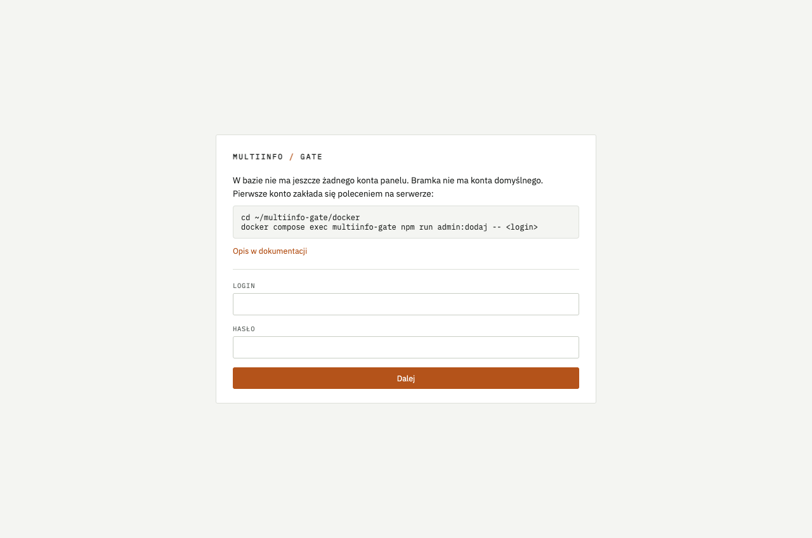
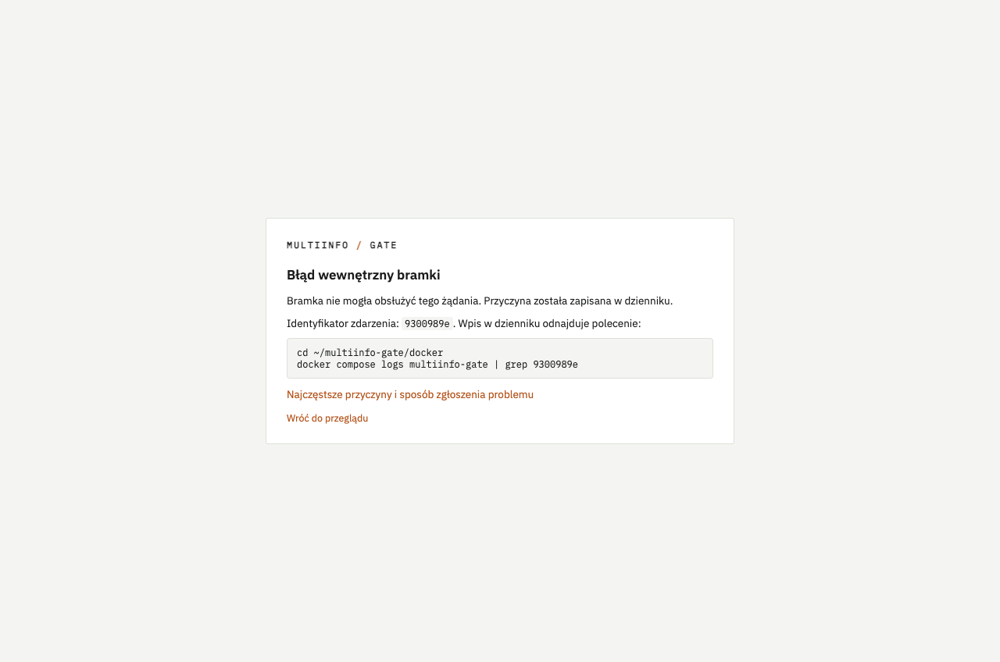
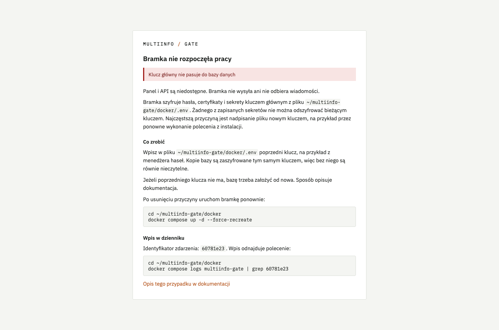

# Rozwiązywanie problemów

Ten dokument opisuje typowe problemy z bramką. Punkty są ułożone według tego, co widać na ekranie.
Każdy punkt podaje objaw, sposób sprawdzenia i naprawę.

Polecenia podano dla obu sposobów instalacji. Polecenia dla Dockera wykonujesz na serwerze,
w katalogu `~/multiinfo-gate/docker`. Polecenia dla kontenera LXC wykonujesz w powłoce kontenera.
Sesję w kontenerze otwiera polecenie `pct enter <NUMER-KONTENERA>` w powłoce hosta Proxmox.

## Panel się nie otwiera {#panel-nie-odpowiada}

Objaw: przeglądarka nie może połączyć się z panelem albo odwrotne proxy zwraca błąd 502.

Sprawdź najpierw drogę do panelu. W Dockerze panel nasłuchuje wyłącznie na adresie lokalnym
serwera, więc bez tunelu SSH adres `http://127.0.0.1:8081` nie prowadzi do panelu. Sposób
zestawienia tunelu opisuje rozdział 4.1 [Uruchomienia](uruchomienie.md). W kontenerze LXC panel
nasłuchuje na adresie kontenera. Dostęp do niego opisuje punkt 9.2 [Uruchomienia](uruchomienie.md).

Następnie sprawdź, czy bramka działa.

Docker:

```bash
docker compose ps
```

Oczekiwany wynik: wiersz `multiinfo-gate` ze stanem `Up`. Stan `Restarting` albo brak wiersza
oznacza, że proces nie działa.

Kontener LXC:

```bash
systemctl status multiinfo-gate
```

Oczekiwany wynik: `active (running)`.

Gdy bramka nie działa, przyczynę pokazuje dziennik:

```bash
docker compose logs --tail 50
journalctl -u multiinfo-gate -n 50 --no-pager
```

Pierwsze polecenie dotyczy Dockera, drugie kontenera LXC. Wpis `address already in use` opisuje
punkt [Zajęty port](#zajety-port). Wpis `bramka.awaria_startu` oznacza, że bramka działa w trybie
awaryjnym. Panel pokazuje wtedy stronę z przyczyną, opisaną w punkcie
[Bramka nie rozpoczęła pracy](#awaria-startu).

## Zajęty port {#zajety-port}

Objaw w Dockerze: `docker compose up -d` kończy się komunikatem `port is already allocated` albo
`address already in use`, a kontener nie startuje. Dziennik bramki jest wtedy pusty. Objaw
w kontenerze LXC: usługa nie startuje, a dziennik zawiera `EADDRINUSE`.

Port 8080 albo 8081 zajmuje inny program. Program, który zajmuje port, wskazuje polecenie:

```bash
sudo ss -ltnp | grep -E ':8080|:8081'
```

W kontenerze LXC pracujesz jako `root`, więc wpisz polecenie bez `sudo`.

Zatrzymaj ten program albo zmień port bramki zmienną `MIG_API_PORT` albo `MIG_ADMIN_PORT`
(rozdział 7.7 [Uruchomienia](uruchomienie.md)). Zajęty port to jedyna awaria startu, przy której
bramka nie pokazuje strony z przyczyną, bo strony nie ma na czym podać.

## Nie znam loginu i hasła do panelu {#pierwsze-konto}

Objaw: ekran logowania odrzuca dane, na przykład `admin` i `admin`.

Bramka nie ma konta domyślnego. Pierwsze konto zakłada się poleceniem na serwerze. Dopóki w bazie
nie ma żadnego konta, ekran logowania pokazuje to polecenie.



Docker:

```bash
docker compose exec multiinfo-gate npm run admin:dodaj -- janek
```

`janek` to login. Podaj własny. Polecenie zapyta o hasło. Szczegóły opisuje rozdział 3.4
[Uruchomienia](uruchomienie.md).

Kontener LXC: instalator zakłada pierwsze konto sam i zapisuje dane logowania w pliku:

```bash
cat /root/multiinfo-gate.creds
```

Gdy baza została założona od nowa, dane z pliku są nieaktualne. Nowe konto zakłada wtedy
polecenie:

```bash
runuser -u multiinfo-gate -- sh -c 'set -a; . /etc/multiinfo-gate/env; set +a; exec /usr/bin/node /opt/multiinfo-gate/dist/cli/admin.js "$1"' sh janek
```

Tym samym poleceniem zakładasz konto, gdy jedyny administrator stracił telefon i kody zapasowe.
Stare konto usuwasz potem w panelu, na ekranie **Użytkownicy**.

## Po zalogowaniu wraca ekran logowania {#logowanie-wraca}

Objaw: po haśle i kodzie panel znów pokazuje ekran logowania. Albo ekran logowania pokazuje
komunikat o pracy bez HTTPS.

Ciasteczko sesji panelu wymaga HTTPS albo adresu lokalnego. Otwórz panel przez tunel SSH pod
adresem `http://127.0.0.1:8081` (rozdział 4.1 [Uruchomienia](uruchomienie.md)) albo przez HTTPS
za odwrotnym proxy. Przeglądarka Safari nie zapisuje tego ciasteczka pod adresem
`http://127.0.0.1`. Przez tunel używaj przeglądarki Chrome, Edge albo Firefox.

## Kod z aplikacji jest odrzucany {#kod-odrzucony}

Objaw: komunikat `Kod jest nieprawidłowy` mimo przepisania kodu z aplikacji.

Kod zależy od czasu. Najczęstszą przyczyną jest różnica zegarów telefonu i serwera. Na telefonie
włącz automatyczne ustawianie czasu. Na serwerze sprawdź synchronizację:

```bash
timedatectl
```

Oczekiwany wynik: wiersz `System clock synchronized: yes`.

Zamiast kodu z aplikacji możesz wpisać kod zapasowy, w to samo pole. Pięć błędnych kodów z rzędu
wymaga ponownego podania hasła. Dziesięć nieudanych prób z jednego adresu blokuje go na 15 minut.
Gdy nie ma ani telefonu, ani kodów zapasowych, załóż nowe konto według punktu
[Nie znam loginu i hasła do panelu](#pierwsze-konto).

## Strona „Błąd wewnętrzny bramki” {#blad-wewnetrzny}

Objaw: zamiast ekranu panelu strona `Błąd wewnętrzny bramki` z identyfikatorem zdarzenia.



Bramka zapisała przyczynę w dzienniku jako zdarzenie `panel.wyjatek` z tym identyfikatorem. Wpis
odnajduje polecenie podane na stronie, na przykład dla identyfikatora `3f9a1c07`:

```bash
docker compose logs multiinfo-gate | grep 3f9a1c07
journalctl -u multiinfo-gate | grep 3f9a1c07
```

Pierwsze polecenie dotyczy Dockera, drugie kontenera LXC. Pole `error` wpisu podaje przyczynę.
Najczęstsze przyczyny:

- `database or disk is full` - brak miejsca na dysku, punkt [Brak miejsca na dysku](#brak-miejsca)
- `Nie udało się odszyfrować sekretu` - część danych w bazie zaszyfrowano innym kluczem głównym, punkt
  [Część danych zaszyfrowana innym kluczem](#klucz-czesciowy)

Inną przyczynę zgłoś według punktu [Jak zgłosić problem](#zgloszenie). Dołącz identyfikator
i wpis z dziennika.

## Część danych zaszyfrowana innym kluczem {#klucz-czesciowy}

Objaw: bramka pracuje, ale niektóre ekrany panelu kończą się stroną `Błąd wewnętrzny bramki`.
Dziennik zawiera wpis `klucz.czesc_nieczytelna` albo `panel.wyjatek` z komunikatem
`Nie udało się odszyfrować sekretu`.

Część sekretów w bazie zaszyfrowano innym kluczem głównym niż bieżący. Pozostała część odczytuje
się poprawnie. Tak się dzieje, gdy po zmianie klucza do bazy wpisano nowe dane, na przykład
założono nowe konto panelu. Pole `groups` wpisu `klucz.czesc_nieczytelna` wymienia rodzaje
nieczytelnych danych.

Nie przywracaj poprzedniego klucza. Dane wpisane po zmianie klucza stałyby się wtedy nieczytelne.
Wpisz ponownie dane z wymienionych grup:

| Grupa | Co zrobić |
|---|---|
| `konta_panelu` | załóż nowe konto panelu według punktu [Nie znam loginu i hasła do panelu](#pierwsze-konto), a stare usuń na ekranie **Użytkownicy** |
| `konta_multiinfo` | na karcie konta Multiinfo wpisz ponownie hasło konta i wgraj ponownie plik `.pfx` w sekcji **Wymiana certyfikatu** |
| `klucze_api` | w edycji klucza na ekranie **Klucze API** ustaw ponownie sekret webhooka i przekaż go aplikacji |
| `integracje` | wpisz ponownie hasła i sekrety w formularzu integracji |
| `smtp` | wpisz ponownie hasło serwera SMTP na ekranie **Powiadomienia** |

## Bramka nie rozpoczęła pracy {#awaria-startu}

Objaw: panel zamiast ekranu logowania pokazuje stronę `Bramka nie rozpoczęła pracy` z przyczyną.



Bramka, która nie może rozpocząć pracy, przechodzi w tryb awaryjny. Nie wysyła ani nie odbiera
wiadomości. Każde wywołanie API dostaje odpowiedź 503 z błędem `unavailable`. Panel na każdym
adresie pokazuje stronę z przyczyną. W dzienniku zostaje wpis `bramka.awaria_startu` z polem
`reason`.

Kontener Dockera w trybie awaryjnym ma stan `unhealthy` w wyniku `docker compose ps`. W wariancie
z Traefikiem (rozdział 6.7 [Uruchomienia](uruchomienie.md)) Traefik pomija taki kontener.
Aplikacje dostają wtedy od Traefika odpowiedź 404 zamiast 503 bramki. Panel przez tunel SSH nadal
pokazuje stronę z przyczyną.

Bramka nie wychodzi z trybu awaryjnego sama. Po usunięciu przyczyny uruchom ją ponownie:

```bash
docker compose up -d --force-recreate
systemctl restart multiinfo-gate
```

Pierwsze polecenie dotyczy Dockera, drugie kontenera LXC. W Dockerze nie wystarcza
`docker compose restart`, ponieważ ponowne uruchomienie zachowuje wartości z pliku `.env` z chwili
utworzenia kontenera. Poprawka w `.env` działa dopiero w nowo utworzonym kontenerze.

Przyczyny opisują punkty niżej. Przyczynę, której strona nie rozpoznała, zgłoś według punktu
[Jak zgłosić problem](#zgloszenie). Dołącz identyfikator ze strony.

### Klucz główny nie pasuje do bazy {#klucz-glowny}

Bramka szyfruje hasła, certyfikaty i sekrety kluczem głównym. Klucz leży w pliku
`~/multiinfo-gate/docker/.env` (Docker) albo `/etc/multiinfo-gate/env` (kontener LXC). Żadnego
z zapisanych sekretów nie można odszyfrować bieżącym kluczem.

Najczęstszą przyczyną jest nadpisanie pliku `.env` nowym kluczem. Dzieje się tak po ponownym
wykonaniu polecenia z rozdziału 3.2 [Uruchomienia](uruchomienie.md). Datę ostatniej zmiany pliku
pokazuje polecenie:

```bash
ls -l --time-style=full-iso .env
```

Wpisz w pliku poprzedni klucz, na przykład z menedżera haseł. Edytor otwiera polecenie
`nano .env`. Wiersz ma postać `MIG_MASTER_KEY=` i 44 znaki. Następnie uruchom bramkę ponownie
według punktu wyżej.

Kopie bazy są zaszyfrowane tym samym kluczem, więc bez niego są równie nieczytelne. Jeżeli poprzedniego
klucza nie ma, bazę trzeba założyć od nowa. Obecną bazę odłóż do katalogu `stara-baza`. Polecenia
niczego nie kasują.

Docker:

```bash
docker compose stop
W=$(docker volume inspect docker_gate-data --format '{{.Mountpoint}}')
sudo sh -c "mkdir -p $W/stara-baza && mv $W/multiinfo-gate.sqlite* $W/stara-baza/"
docker compose up -d
docker compose exec multiinfo-gate npm run admin:dodaj -- janek
```

Kontener LXC:

```bash
systemctl stop multiinfo-gate
mkdir -p /var/lib/multiinfo-gate/stara-baza
mv /var/lib/multiinfo-gate/multiinfo-gate.sqlite* /var/lib/multiinfo-gate/stara-baza/
systemctl start multiinfo-gate
```

W kontenerze LXC nowe konto zakłada polecenie z punktu
[Nie znam loginu i hasła do panelu](#pierwsze-konto). Po zalogowaniu wpisz ponownie konta Multiinfo,
klucze API i integracje. Nowe klucze API przekaż aplikacjom, bo poprzednie przestały działać.
Bieżący klucz z pliku `.env` zapisz w menedżerze haseł.

### Klucz główny w złej postaci {#klucz-nieprawidlowy}

Wartość `MIG_MASTER_KEY` musi zapisywać 32 bajty w kodzie base64, czyli 44 znaki zakończone
znakiem `=`. Bieżąca wartość jest pusta albo obcięta. Zdarza się to najczęściej przy niepełnym
skopiowaniu klucza z menedżera haseł. Wartość pokazuje polecenie `cat .env` w Dockerze albo
`cat /etc/multiinfo-gate/env` w kontenerze LXC.

Wpisz pełny klucz i uruchom bramkę ponownie według punktu wyżej.

### Nie udało się zapisać kopii przed aktualizacją {#kopia-przed-aktualizacja}

Nowe wydanie zmienia schemat bazy. Przed zmianą bramka zapisuje kopię bazy w katalogu `backups`.
Zapis się nie powiódł, dlatego schemat pozostał bez zmian. Najczęstszą przyczyną jest brak
miejsca na dysku. Sprawdzenie i naprawę opisuje punkt [Brak miejsca na dysku](#brak-miejsca).
Po zwolnieniu miejsca uruchom bramkę ponownie.

### Baza z nowszego wydania {#baza-z-nowszego-wydania}

Schemat bazy zmieniło wydanie nowsze niż uruchomione. Dzieje się tak po powrocie do poprzedniej
wersji bez przywrócenia kopii. Bramka nie zmienia takiej bazy.

Uruchom ponownie nowsze wydanie. Albo przywróć kopię `przed-aktualizacja-<WERSJA>.sqlite`
z katalogu `backups` przy zatrzymanej bramce, według punktu 7.4 (Docker) albo 9.4 (kontener LXC)
[Uruchomienia](uruchomienie.md).

### Brak miejsca na dysku {#brak-miejsca}

Wolne miejsce pokazuje polecenie:

```bash
df -h
```

Kolumna `Use%` (albo `Uż%`) przy `/` bliska 100% oznacza brak miejsca. W Dockerze każda aktualizacja
zostawia obraz poprzedniej wersji. Nieużywane obrazy usuwa polecenie:

```bash
docker image prune
```

Polecenie prosi o potwierdzenie. Wpisz `y`. Zajęte miejsce według rodzaju danych pokazuje
`docker system df`.

Bramka sama usuwa kopie nocne starsze niż `MIG_BACKUP_RETENTION_DAYS` dni i zostawia trzy
najnowsze kopie przed aktualizacją. Po zwolnieniu miejsca uruchom bramkę ponownie.

### Brak uprawnień do bazy {#uprawnienia}

Proces bramki nie ma prawa zapisu do pliku bazy albo do katalogu danych. Najczęstszą przyczyną
jest plik przywrócony z kopii z konta `root` bez zmiany właściciela. Właściciela przywraca
polecenie:

```bash
docker compose run --rm --user root multiinfo-gate chown -R node:node /data
chown -R multiinfo-gate:multiinfo-gate /var/lib/multiinfo-gate
```

Pierwsze polecenie dotyczy Dockera, drugie kontenera LXC. Następnie uruchom bramkę ponownie.

### Nieczytelny plik bazy {#uszkodzona-baza}

Plik bazy jest uszkodzony albo nie jest bazą danych bramki. Przywróć najnowszą kopię z katalogu
`backups` według punktu 7.2 (Docker) albo 9.4 (kontener LXC) [Uruchomienia](uruchomienie.md).

### Nieudana aktualizacja schematu {#nieudana-migracja}

Nowe wydanie zmienia schemat bazy. Zmiana została przerwana i wycofana, dlatego baza pozostała
w poprzedniej postaci. Wróć do poprzedniej wersji według punktu
[Po aktualizacji coś nie działa](#po-aktualizacji). Zgłoś problem według punktu
[Jak zgłosić problem](#zgloszenie) i dołącz identyfikator ze strony.

## Po aktualizacji coś nie działa {#po-aktualizacji}

Przy pierwszym starcie nowej wersji bramka sama zapisuje kopię bazy jako
`backups/przed-aktualizacja-<WERSJA>.sqlite`. `<WERSJA>` to numer wersji sprzed aktualizacji.
Bramka zostawia trzy najnowsze takie kopie.

Powrót do poprzedniej wersji to przywrócenie kopii sprzed aktualizacji i uruchomienie poprzedniego
wydania. Oba kroki wykonujesz przy zatrzymanej bramce. Bramka nie może wystartować w nowej wersji
na przywróconej kopii, bo ponownie zmieniłaby jej schemat. Polecenia w tej kolejności podają punkty
7.4 (Docker) i 9.4 (kontener LXC) [Uruchomienia](uruchomienie.md).

Bez przywrócenia kopii poprzednie wydanie może nie rozpoznać schematu bazy. Panel pokaże wtedy
stronę [Baza z nowszego wydania](#baza-z-nowszego-wydania).

## Bramka nie widzi SMS-ów od abonentów {#sms-od-abonentow}

Objaw: SMS wysłany z telefonu na numer usługi nie pojawia się w zakładce **Odebrane**. Dziennik
nie zawiera wpisu `odbior.wiadomosc`.

Najczęstszą przyczyną jest aktywny serwis interaktywny w Multiinfo. Serwis interaktywny
przechwytuje wiadomości od abonentów, zanim trafią do API. Bramka ich wtedy nie otrzymuje.
Sprawdź w panelu Multiinfo, czy dla tej usługi działa serwis interaktywny. Wyłączenie serwisu
przywraca przekazywanie wiadomości do API. Gdy nie masz dostępu do tych ustawień, zwróć się do
administratora Polkomtel.

Wpis `odbior.zatrzymany` w dzienniku oznacza inną przyczynę: Multiinfo odrzuciło zapytanie
o wiadomości. Opis zdarzeń odbioru zawiera rozdział 7.3 [Uruchomienia](uruchomienie.md).

## Wersja Node.js bez poprawek bezpieczeństwa {#wersja-node}

Objaw: przegląd panelu pokazuje czerwony pasek z informacją, że Node.js, na którym działa bramka,
nie zawiera poprawek bezpieczeństwa z października 2026. Dziennik przy starcie zawiera wpis
`node.bez_poprawek` z zainstalowaną i wymaganą wersją.

Wydanie bezpieczeństwa Node.js z 21 października 2026 usuwa między innymi lukę CVE-2026-111497
w dekoderze Brotli. Luka pozwala uruchomić obcy kod w programie, który rozpakowuje spreparowane
dane. Według CISA jest ona aktywnie wykorzystywana. Bramka rozpakowuje dane Brotli w odpowiedziach
serwerów, do których wysyła webhooki i zapytania uzupełniające, dlatego luka dotyczy także jej.
Wymagana jest wersja 22.23.4 lub nowsza, a w liniach 24 i 26 odpowiednio 24.22.1 i 26.12.1.

W Dockerze Node.js jest częścią obrazu bramki. Aktualizacja do najnowszego wydania według
rozdziału [7.4 Uruchomienia](uruchomienie.md#74-aktualizacja) usuwa pasek.

W kontenerze LXC Node.js jest pakietem systemu kontenera. Zaktualizuj go w konsoli kontenera,
a następnie uruchom bramkę ponownie:

```bash
apt update && apt install --only-upgrade nodejs
systemctl restart multiinfo-gate
```

Oczekiwany wynik: polecenie `node -v` zwraca wersję 22.23.4 lub nowszą, a pasek znika
z przeglądu.

## Jak zgłosić problem {#zgloszenie}

Problemy zgłaszasz w serwisie GitHub, w zakładce
[Issues](https://github.com/sqlik/multiinfo-gate/issues) repozytorium bramki. Do zgłoszenia
dołącz:

- numer wersji bramki
- sposób instalacji: Docker albo kontener LXC
- opis kroków, które prowadzą do problemu
- identyfikator zdarzenia ze strony błędu, jeżeli strona go podała
- ostatnie wpisy dziennika, z usuniętymi numerami telefonów (polecenia niżej)
- wynik `df -h`

Numer wersji pokazuje maszt panelu. Gdy panel nie działa, numer podaje polecenie:

```bash
docker compose exec multiinfo-gate node -p "require('/app/package.json').version"
node -p "require('/opt/multiinfo-gate/package.json').version"
```

Pierwsze polecenie dotyczy Dockera, drugie kontenera LXC.

Zgłoszenia w serwisie GitHub są publiczne. Dziennik zawiera numery telefonów abonentów, na
przykład we wpisach `odbior.wiadomosc`. Przed wklejeniem dziennika usuń z niego numery. Poniższe
polecenia wypisują ostatnie 200 wpisów i zastępują każdy ciąg dziewięciu i więcej cyfr znacznikiem
`<numer>`:

```bash
docker compose logs --tail 200 | sed -E 's/[0-9]{9,}/<numer>/g'
journalctl -u multiinfo-gate -n 200 --no-pager | sed -E 's/[0-9]{9,}/<numer>/g'
```

Pierwsze polecenie dotyczy Dockera, drugie kontenera LXC. Przejrzyj wynik przed wklejeniem.
Polecenie nie usuwa danych zapisanych w innej postaci, na przykład adresów e-mail.

Nigdy nie wysyłaj pliku `.env`, klucza głównego, kodów zapasowych, haseł ani plików bazy i kopii.
