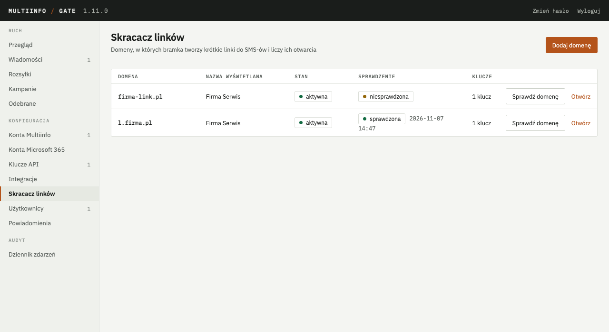
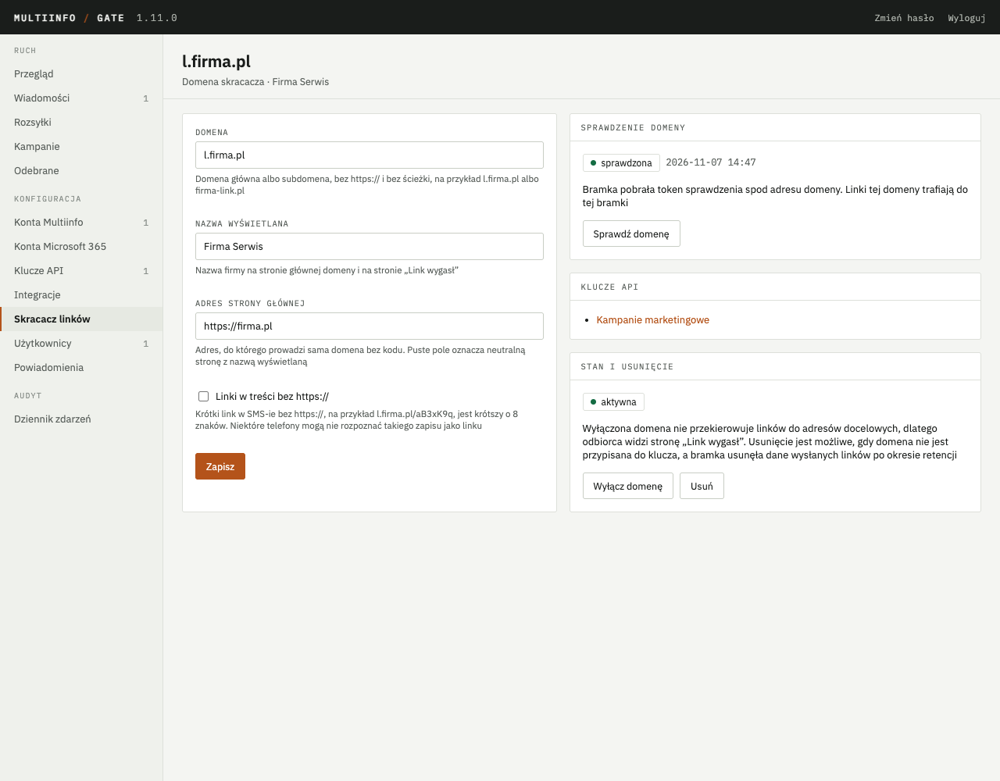
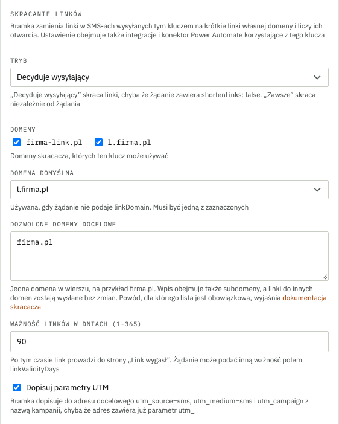
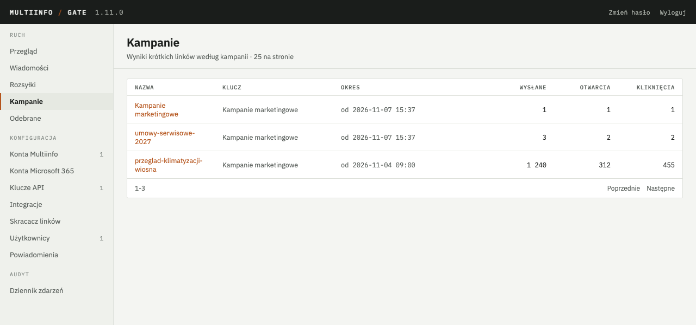
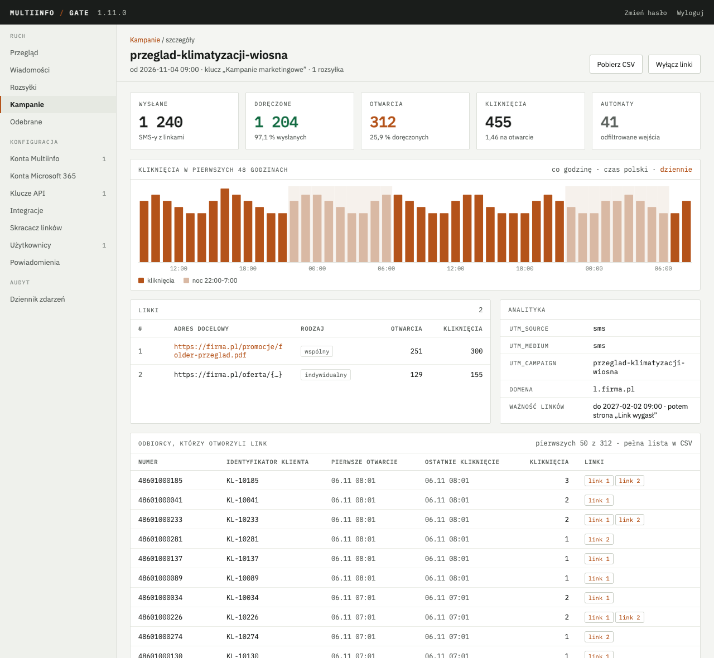
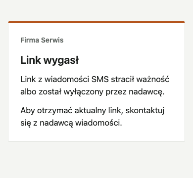

# Skracacz linków i kampanie

Od wersji 1.11 bramka zamienia linki w SMS-ach na krótkie linki własnej domeny firmy i liczy,
ilu odbiorców je otworzyło. Służy do tego wbudowany skracacz linków. Jest przeznaczony dla firm,
które wysyłają przez bramkę kampanie z zewnętrznych narzędzi przez API albo z Power Automate,
a po kampanii chcą znać jej wyniki. Na przykład firma serwisowa przypomina klientom o wiosennym
przeglądzie klimatyzacji, a po kampanii sprawdza, ilu klientów otworzyło link do formularza
zgłoszenia.

Skracacz służy dwóm celom. Pierwszym celem jest krótsza treść. W kodowaniu automatycznym polskie
znaki wymuszają kodowanie UCS-2, w którym jedna część SMS-a mieści 70 znaków, dlatego typowy link
do oferty albo faktury zajmuje całą część. Krótki link w postaci `https://l.firma.pl/aB3xK9q`
zajmuje 26 znaków.
Drugim celem są wyniki kampanii. Każdy odbiorca otrzymuje własny krótki kod, dzięki czemu bramka
liczy otwarcia dokładnie, także przy linku wspólnym dla wszystkich odbiorców. Do adresu
docelowego bramka dopisuje parametry UTM, a ruch z kampanii jest widoczny w narzędziu
analitycznym, na przykład w Google Analytics, Matomo albo Umami.

Artykuł opisuje przygotowanie domeny, ustawienia klucza API, wyniki kampanii, ważność linków
i przechowywanie danych. Wystawienie portu krótkich linków na serwerze pośredniczącym opisuje
rozdział 6 [Uruchomienia](uruchomienie.md). Pola żądań i odpowiedzi opisuje artykuł
[API dla aplikacji](api.md), a pola akcji konektora artykuł [Power Automate](power-automate.md).

Film „Skracacz linków i kampanie” przedstawia przygotowanie domeny, ustawienia klucza API, rozsyłkę
z nazwą kampanii oraz wyniki kampanii w panelu.

<div class="film"><iframe src="https://iframe.mediadelivery.net/embed/802837/973c1d37-af4c-4894-82bb-98ea03a2e232" title="Film „Skracacz linków i kampanie”" loading="lazy" allow="encrypted-media; picture-in-picture" allowfullscreen></iframe></div>

## 1. Przebieg pracy

Pracę ze skracaczem dzielą między siebie dwie role. Administrator bramki przygotowuje domenę
i ustawienia klucza jeden raz. Operator kampanii wysyła SMS-y z pełnymi linkami w treści, a bramka
zamienia je na krótkie linki.

Administrator wykonuje jednorazowo cztery kroki:

1. U dostawcy DNS kieruje domenę skracacza na serwer bramki, według rozdziału 3.
2. Na serwerze pośredniczącym wystawia port krótkich linków pod tą domeną z certyfikatem HTTPS,
   według rozdziału 4.
3. W panelu, w elemencie **Skracacz linków**, dodaje domenę i uruchamia jej sprawdzenie, według
   rozdziału 5.
4. W elemencie **Klucze API** włącza skracanie przy kluczu, którym wysyłane są kampanie, według
   rozdziału 6.

Operator kampanii przy każdej kampanii:

1. Wysyła z zewnętrznego narzędzia albo z przepływu Power Automate SMS-y z pełnymi linkami
   w treści, opcjonalnie z nazwą kampanii.
2. Odczytuje z odpowiedzi API, ile linków bramka skróciła i które pominęła.
3. Ogląda wyniki w panelu w elemencie **Kampanie**, pobiera je przez API albo odbiera
   zdarzenia „link otwarty”.

Odbiorca, który stuknie krótki link w SMS-ie, trafia do bramki. Bramka zapisuje wejście
i kieruje przeglądarkę na adres docelowy z parametrami UTM. Przekierowanie korzysta z kodu
HTTP 302, dlatego przeglądarka nie zapamiętuje adresu docelowego, a każde kolejne wejście również
trafia do bramki i zostaje policzone.

## 2. Wymagania

Skracacz wymaga trzech elementów poza samą bramką:

- domeny albo subdomeny, którą firma przeznacza na krótkie linki, z dostępem do ustawień DNS
- serwera pośredniczącego z HTTPS, który przyjmuje ruch z internetu, czyli Caddy, nginx albo
  Traefika z rozdziału 6 [Uruchomienia](uruchomienie.md)
- otwartych portów 80 i 443 na serwerze pośredniczącym, tak jak w rozdziale 6.3
  [Uruchomienia](uruchomienie.md)

Bramka działająca wyłącznie w sieci firmowej, bez dostępu z internetu, nie może obsługiwać
krótkich linków. Odbiorcy otwierają je na telefonach w sieci komórkowej.

## 3. Domena skracacza

Krótkie linki działają pod domeną firmy. Domeną skracacza może być domena główna, na przykład
`firma-link.pl`, albo subdomena domeny firmy, na przykład `l.firma.pl`. Bramka obsługuje obie
postacie tak samo, a różnią się one tylko rekordem DNS:

| Postać domeny | Przykład | Rekord DNS |
|---|---|---|
| domena główna | `firma-link.pl` | rekord A z publicznym adresem IPv4 serwera, opcjonalnie rekord AAAA z adresem IPv6 |
| subdomena | `l.firma.pl` | rekord CNAME z nazwą serwera albo rekord A z jego adresem |

Rekord dodaje się u dostawcy DNS domeny, zwykle w panelu firmy, w której domena została
zarejestrowana. Zmiana jest widoczna po czasie od kilku minut do godziny. Poprawność rekordu
potwierdza polecenie wykonane na dowolnym komputerze:

```bash
dig +short l.firma.pl
```

Oczekiwany wynik: publiczny adres IP serwera bramki albo nazwa serwera i jego adres.

Zalecana jest osobna domena skracacza, na przykład `firma-link.pl`, zamiast subdomeny domeny,
pod którą działa strona firmy i poczta. Powód wyjaśnia rozdział 7. Krótsza domena skracacza
zapewnia też krótsze linki. Do jednej bramki można podpiąć kilka domen, na przykład osobne domeny dla dwóch
marek firmy.

## 4. Port krótkich linków

Bramka obsługuje krótkie linki na osobnym porcie, domyślnie 8082. Port przyjmuje wyłącznie
wejścia w krótkie linki i sprawdzenia domeny. Nie udostępnia panelu ani API. Serwer
pośredniczący przyjmuje ruch z internetu pod domeną skracacza, obsługuje certyfikat HTTPS
i przekazuje żądania na ten port.

Sposób wystawienia portu zależy od wariantu z rozdziału 6 [Uruchomienia](uruchomienie.md):

| Wariant | Domena skracacza w konfiguracji | Opis |
|---|---|---|
| A: Caddy w kontenerze | bez zmian w konfiguracji, Caddy uzyskuje certyfikat przy pierwszym wejściu na domenę dodaną w panelu | rozdział 6.5 |
| B: nginx na serwerze | blok `server` z domenami skracacza i certyfikat z certbota | rozdział 6.6 |
| C: Traefik | reguła z domenami skracacza w pliku `docker/.env` | rozdział 6.7 |
| Proxmox VE | serwer pośredniczący kierowany na port 8082 kontenera | rozdział 9.7 |

Limit wejść liczony jest dla adresu odbiorcy i wynosi 60 wejść na minutę. Limit chroni przed
odgadywaniem kodów. Wejścia na nieistniejące kody z jednej sieci IPv6 /48 bramka ogranicza
dodatkowo do 600 na minutę, ponieważ operator przydziela abonentowi całą pulę adresów IPv6. Bramka rozpoznaje adres odbiorcy wyłącznie wtedy, gdy ufa serwerowi
pośredniczącemu, czyli gdy jego adres zawiera zmienna `MIG_TRUSTED_PROXIES`. W przeciwnym razie
wszystkie wejścia liczą się jako wejścia z adresu serwera pośredniczącego, a limit obejmuje
wszystkich odbiorców kampanii razem. Przy dużej kampanii część odbiorców zobaczy wtedy stronę
„Zbyt wiele żądań”. Pliki wariantów z Caddy i z nginx w Dockerze ustawiają tę zmienną same.
Wartość dla Traefika i dla kontenera LXC podają rozdziały 6.7 i 9.7 [Uruchomienia](uruchomienie.md),
a sprawdzenie domeny wykrywa jej brak.

Linki bez `https://` w treści, opisane w rozdziale 5.1, telefon otwiera przez HTTP. Serwer
pośredniczący przyjmuje je na porcie 80 i przekierowuje na HTTPS. Gotowe konfiguracje z rozdziału 6
[Uruchomienia](uruchomienie.md) zawierają takie przekierowanie.

## 5. Domena w panelu

Domeny skracacza obejmuje element **Skracacz linków** w grupie „Konfiguracja”. Lista pokazuje
domenę, nazwę wyświetlaną, stan, wynik ostatniego sprawdzenia i liczbę kluczy, które z niej
korzystają.



### 5.1. Dodanie domeny

Celem procedury jest dodanie domeny, pod którą bramka tworzy krótkie linki. Przed jej
rozpoczęciem domena powinna wskazywać serwer bramki zgodnie z rozdziałem 3.

1. W panelu otwórz **Skracacz linków → Dodaj domenę**.
2. Wypełnij pola według tabeli poniżej.
3. Kliknij **Zapisz**.

| Pole | Znaczenie |
|---|---|
| Domena | domena główna albo subdomena, bez `https://` i bez ścieżki, na przykład `l.firma.pl` |
| Nazwa wyświetlana | nazwa firmy na stronie głównej domeny i na stronie „Link wygasł” |
| Adres strony głównej | adres, do którego prowadzi sama domena bez kodu, na przykład `https://firma.pl`; puste pole oznacza neutralną stronę z nazwą wyświetlaną |
| Linki w treści bez https:// | krótki link w SMS-ie w postaci `l.firma.pl/aB3xK9q`, krótszy o 8 znaków; domyślnie wyłączone |

Oczekiwany wynik: panel otwiera stronę domeny z komunikatem „Domena zapisana”. Panel **Stan
i usunięcie** podaje stan „aktywna”, a panel **Sprawdzenie domeny** wyświetla plakietkę
„niesprawdzona”.

Linki bez `https://` oszczędzają 8 znaków w każdym SMS-ie. Niektóre telefony nie rozpoznają
jednak takiego zapisu jako linku, a odbiorca nie może go wtedy stuknąć. Opcja jest przeznaczona
dla firm, które sprawdziły zapis na telefonach swoich odbiorców. Wymaga też otwartego portu 80
na serwerze pośredniczącym.

### 5.2. Sprawdzenie domeny

Sprawdzenie potwierdza za jednym razem rekord DNS, serwer pośredniczący, certyfikat HTTPS
i przypisanie domeny do tej bramki. Bramka pobiera jednorazowy token spod adresu
`https://<domena>/.well-known/multiinfo-gate/<token>`. Żądanie przechodzi tę samą drogę co
wejście odbiorcy SMS-a, dlatego wynik pozytywny oznacza, że linki tej domeny trafiają do tej
bramki.

1. Po zapisie domeny pozostań na jej stronie. Później stronę domeny otwiera przycisk **Otwórz**
   na liście domen.
2. W panelu **Sprawdzenie domeny** kliknij **Sprawdź domenę**.

Ten sam przycisk znajduje się na liście domen.

Oczekiwany wynik: plakietka „sprawdzona” z datą sprawdzenia i informacja, że linki tej domeny
trafiają do tej bramki.



Jeżeli wynik jest inny:

- **Plakietka „sprawdzenie nieudane”.** Panel podaje krok, na którym sprawdzenie się zatrzymało:
  rozwiązanie nazwy, połączenie, certyfikat albo odpowiedź. Przyczyny i rozwiązania dla każdego
  kroku opisuje punkt
  [Sprawdzenie domeny skracacza kończy się błędem](problemy.md#skracacz-sprawdzenie-domeny)
- **Plakietka „sprawdzona z ostrzeżeniem”.** Linki działają, ale bramka nie ufa serwerowi
  pośredniczącemu i nie rozpoznaje adresów odbiorców. Panel podaje wartość zmiennej
  `MIG_TRUSTED_PROXIES`, którą należy ustawić zgodnie z rozdziałem 4

Domena niesprawdzona albo z nieudanym sprawdzeniem może zostać przypisana do klucza i używana.
Sprawdzenie nie blokuje pracy, ponieważ w niektórych sieciach wynik negatywny nie oznacza awarii.
Na przykład w sieci bez pętli zwrotnej NAT serwer nie może połączyć się z własnym adresem
publicznym, choć odbiorcy otwierają linki bez przeszkód. Działanie domeny potwierdza wtedy krótki
link otwarty na telefonie w sieci komórkowej.

### 5.3. Stan i usunięcie domeny

Przycisk **Wyłącz domenę** zatrzymuje wszystkie linki domeny, także w SMS-ach już wysłanych.
Odbiorca widzi wtedy stronę „Link wygasł”. Wysyłka kluczem, którego domena jest wyłączona,
zawiera linki w pełnej postaci, bez skracania. Przycisk **Włącz domenę** przywraca działanie
linków, które nie straciły ważności.

Usunięcie domeny jest możliwe, gdy domena nie jest przypisana do żadnego klucza, a bramka usunęła
dane wysłanych linków po okresie przechowywania z rozdziału 11. Do tego czasu domenę można
wyłączyć.

## 6. Skracanie przy kluczu API

Skracanie włącza się przy kluczu API, którym wysyłane są kampanie. Ustawienie obejmuje każdą
drogę wysyłki tym kluczem: API, integracje, Mail2SMS, SMS do grupy i konektor Power Automate.
SMS-y powiadomień bramki dla administratorów nie są skracane nigdy.

W panelu otwórz **Klucze API**, następnie edycję klucza. Sekcja **Skracanie linków** znajduje się
na końcu formularza. Po wybraniu trybu innego niż „Wyłączone” formularz wyświetla pozostałe pola.



| Pole | Znaczenie |
|---|---|
| Tryb | Wyłączone, Decyduje wysyłający albo Zawsze; nowe klucze i klucze sprzed wersji 1.11 otrzymują tryb Wyłączone |
| Domeny | domeny skracacza, których klucz może używać |
| Domena domyślna | domena używana, gdy żądanie nie wskazuje domeny; puste pole oznacza pierwszą zaznaczoną |
| Dozwolone domeny docelowe | domeny, do których prowadzą skracane linki, jedna w wierszu; lista jest obowiązkowa, a powód wyjaśnia rozdział 7 |
| Ważność linków w dniach | domyślnie 90 dni, zakres 1-365 |
| Dopisuj parametry UTM | dopisywanie parametrów UTM do adresu docelowego, domyślnie włączone; opis w rozdziale 10 |

Zapis z trybem innym niż „Wyłączone” wymaga co najmniej jednej domeny skracacza i co najmniej
jednej dozwolonej domeny docelowej. Każda zmiana ustawień skracania trafia do dziennika zdarzeń
bramki.

### 6.1. Tryby skracania

Tryb klucza decyduje o skracaniu razem z polem `shortenLinks` w żądaniu API albo polem
„Skracanie linków” w akcji Power Automate. Ustawienie klucza ma pierwszeństwo przed wyborem
wysyłającego, a odpowiedź API zgłasza, że zostało zastosowane.

| Tryb klucza | Pole puste | Skracaj | Nie skracaj |
|---|---|---|---|
| Wyłączone | linki bez zmian | linki bez zmian, odpowiedź zgłasza `disabled_by_key` | linki bez zmian |
| Decyduje wysyłający | linki skrócone | linki skrócone | linki bez zmian |
| Zawsze | linki skrócone | linki skrócone | linki skrócone, odpowiedź zgłasza `forced_by_key` |

Tryb „Decyduje wysyłający” pasuje do klucza, którym jedno narzędzie wysyła zarówno kampanie, jak
i wiadomości transakcyjne. Narzędzie wyłącza wtedy skracanie w wiadomościach, w których link ma
pozostać czytelny. Tryb „Zawsze” pasuje do klucza przeznaczonego wyłącznie do kampanii. Integracje,
Mail2SMS i SMS do grupy nie przekazują pola wyboru, dlatego zachowują się jak przy polu pustym.

### 6.2. Linki rozpoznawane w treści

Bramka rozpoznaje w treści adresy rozpoczynające się od `http://` albo `https://`. Adresy bez
schematu, na przykład `www.firma.pl/oferta`, nie są skracane, ponieważ ich rozpoznanie
w zwykłym tekście jest niejednoznaczne. Link, który ma zostać skrócony, należy więc wpisać
w treści z `https://`.

Kropka, przecinek, wykrzyknik, cudzysłów i nawias zamykający bez pary na końcu adresu nie należą
do linku. W treści „Oferta: https://firma.pl/o?id=5.” bramka skraca więc adres bez końcowej kropki,
a kropka pozostaje w treści po krótkim linku. Znaki `<` i `>` nie należą do linku także w środku
tekstu. Odnośnik zapisany przez program pocztowy jako `Protokół przeglądu<https://firma.pl/protokol/12>`
zostaje więc skrócony bez znaku `>`, a znak pozostaje w treści. Polskie znaki w ścieżce adresu
należą do linku.

Bramka skraca każdy rozpoznany link do dozwolonej domeny docelowej, także krótki, ponieważ
skracacz służy również liczeniu otwarć. Adres dłuższy niż 2048 znaków zostaje jednak wysłany bez
zmian, ponieważ bramka zapisuje adres docelowy osobno dla każdego odbiorcy. W jednej treści bramka
skraca najwyżej 10 linków, a kolejne wysyła bez zmian. Odpowiedź API wymienia takie linki
w liście `skipped` z powodem `too_long` albo `too_many`. Krótki link z domeny skracacza tej bramki
nie jest skracany ponownie.

## 7. Obowiązkowa lista domen docelowych {#obowiazkowa-lista-domen-docelowych}

Lista dozwolonych domen docelowych przy kluczu jest obowiązkowa przy włączonym skracaniu. Bramka
skraca wyłącznie linki do domen z tej listy i ich subdomen. Wpis `firma.pl` obejmuje więc
także `oferta.firma.pl`. Link do innej domeny zostaje wysłany bez zmian, a odpowiedź API
wymienia go jako pominięty z powodem `domain_not_allowed`.

Lista chroni reputację domeny skracacza. Domena skracacza jest wspólna dla wszystkich krótkich
linków firmy. Jeżeli przez przejęty klucz API albo błąd integracji wyjdzie choć jeden krótki link
do strony wyłudzającej dane, cała domena skracacza może trafić na listę ostrzeżeń CERT Polska.

[Lista ostrzeżeń przed niebezpiecznymi stronami](https://cert.pl/lista-ostrzezen/) obejmuje
domeny, które służą do wyłudzania danych i pieniędzy. Prowadzi ją CERT Polska, czyli zespół
CSIRT NASK. Operatorzy telekomunikacyjni, w tym Plus, Orange, Play i T-Mobile, blokują swoim
abonentom dostęp do domen z listy na podstawie porozumienia z Prezesem UKE, ministrem cyfryzacji
i NASK z 2020 roku. Podstawę prawną listy i blokady zawiera art. 20
[ustawy o zwalczaniu nadużyć w komunikacji elektronicznej](https://api.sejm.gov.pl/eli/acts/DU/2023/1703/text.html).
Według zaleceń CERT Polska blokada obejmuje także subdomeny wpisanej domeny. Po wpisaniu domeny
skracacza na listę krótkie linki przestają się otwierać u abonentów tych operatorów. Dotyczy to
wszystkich linków firmy, także linków z trwających kampanii.

Ta sama ustawa zobowiązuje operatorów w art. 6 do blokowania SMS-ów zgodnych ze wzorcami
smishingu, które przekazuje im CSIRT NASK. Smishing oznacza SMS-y, których nadawca podszywa się
pod zaufaną instytucję, aby wyłudzić dane albo pieniądze. SMS z linkiem do strony wyłudzającej
dane może stać się podstawą takiego wzorca.

Lista dozwolonych domen docelowych sprawia, że domena skracacza prowadzi wyłącznie do stron
wskazanych świadomie przez administratora. Link do innej strony zostaje wysłany w pełnej
postaci, dlatego odbiorca widzi jego prawdziwy adres, a domena skracacza nie odpowiada za jego
treść. Ta sama lista pozwala zachować czytelne linki. Domena, której linki powinny pozostać
w pełnej postaci, nie trafia na listę.

Osobna domena skracacza, zalecana w rozdziale 3, ogranicza skutki ewentualnego wpisu, ponieważ
oddziela reputację krótkich linków od domeny, pod którą działa strona firmy i poczta. Zakres
wpisu ustala CERT Polska.

Firma, do której należy domena wpisana na listę, może wnieść sprzeciw do Prezesa UKE. Tryb
sprzeciwu opisują art. 21 i 22 ustawy oraz rozdział „Ścieżka odwoławcza” na stronie listy
ostrzeżeń. Przed
złożeniem sprzeciwu należy wyłączyć linki kampanii prowadzące do niewłaściwej strony. Klucz API,
który mógł zostać przejęty, należy odwołać.

## 8. Wysyłka z krótkimi linkami

Operator kampanii wysyła SMS-y z pełnymi linkami w treści. Żądanie API albo akcja Power Automate
mogą zawierać cztery pola opcjonalne:

| Pole API | Pole w Power Automate | Znaczenie |
|---|---|---|
| `shortenLinks` | Skracanie linków | wybór skracania według rozdziału 6.1 |
| `campaign` | Kampania | nazwa kampanii, od 1 do 100 znaków, na przykład `przeglad-klimatyzacji-wiosna` |
| `linkDomain` | Domena skracacza | domena skracacza spośród domen przypisanych do klucza; puste pole oznacza domenę domyślną |
| `linkValidityDays` | Ważność linków (dni) | ważność linków w dniach, od 1 do 365; puste pole oznacza ważność ustawioną przy kluczu |

Domena spoza domen klucza kończy żądanie błędem `400` z kodem `link_domain_not_allowed`.
Pozostałe niezgodności z ustawieniem klucza nie odrzucają żądania, tylko trafiają do bloku
`links` w odpowiedzi. Opis pól i odpowiedzi znajdziesz w artykule [API dla aplikacji](api.md),
w rozdziałach 3 i 5.

Na przykład firma serwisowa wysyła rozsyłkę do 1240 klientów z treścią „Przegląd klimatyzacji
przed sezonem: https://firma.pl/przeglad”. Bramka zamienia link na krótki link w domenie
`l.firma.pl`, z innym kodem dla każdego klienta. Kod ma zawsze 7 znaków, dlatego treść
każdego klienta ma tę samą długość, a liczba części i kodowanie są wspólne dla całej rozsyłki.
Ten sam link wpisany w treści dwa razy otrzymuje dwa różne kody.

Bramka liczy długość treści i liczbę części po skróceniu. Integracja, która przycina treść do
limitu części, nigdy nie ucina krótkiego linku w połowie. Gdy granica limitu wypada w środku
krótkiego linku, bramka usuwa cały link.

Powtórzenie żądania z tym samym nagłówkiem `Idempotency-Key` zwraca te same krótkie linki.
Anulowanie wiadomości wyłącza jej linki. Rozsyłki anulowanej w Multiinfo bramka nie wyłącza
samoczynnie, ponieważ część SMS-ów mogła zostać już wysłana. Jej linki zatrzymuje przycisk
**Wyłącz linki** w kampanii.

Odpowiedź Mail2SMS do nadawcy wiadomości e-mail pokazuje krótki link z kodem zastępczym
`0000000`, na przykład `https://l.firma.pl/0000000`. Ten sam kod pokazuje podgląd przycisku
**Sprawdź szablon** w formularzu Mail2SMS i webhooka oraz przycisku **Sprawdź** w formularzu
SMS-a do grupy. Każdy odbiorca otrzymuje własny kod, a raport do nadawcy nie
zawiera kodów odbiorców, ponieważ wejście nadawcy liczyłoby się jako otwarcie przez odbiorcę.
Link z kodem zastępczym prowadzi do strony „Link wygasł”.

## 9. Kampanie i wyniki

Kampania grupuje wysyłki z krótkimi linkami wysłane jednym kluczem pod jedną nazwą. Nazwę podaje
pole `campaign` w żądaniu albo pole „Kampania” w akcji Power Automate. Bez nazwy bramka nadaje
nazwę domyślną:

| Źródło wysyłki | Nazwa domyślna kampanii |
|---|---|
| rozsyłka z API | identyfikator rozsyłki |
| integracja, w tym Mail2SMS, SMS do grupy i Power Automate | nazwa integracji |
| pojedynczy SMS z API | nazwa klucza |

Do kampanii należą wyłącznie SMS-y z co najmniej jednym skróconym linkiem. Wiadomość
transakcyjna bez linku, wysłana tym samym kluczem, nie trafia do kampanii i nie zawyża liczby
wysłanych.

### 9.1. Lista kampanii

Element **Kampanie** w grupie „Ruch” zawiera listę kampanii od najnowszej. Lista podaje nazwę,
klucz, okres od pierwszej do ostatniej wysyłki oraz liczbę wysłanych SMS-ów, otwarć i kliknięć.



### 9.2. Szczegóły kampanii

Szczegóły kampanii otwiera nazwa na liście. Nagłówek podaje okres, klucz oraz liczbę rozsyłek
i pojedynczych SMS-ów. Pięć kafelków przedstawia wyniki:

| Kafelek | Znaczenie |
|---|---|
| Wysłane | liczba SMS-ów z krótkimi linkami |
| Doręczone | liczba doręczonych SMS-ów według raportów doręczenia i jej udział w wysłanych; bez raportu doręczenia napis „brak raportu” |
| Otwarcia | liczba odbiorców z co najmniej jednym otwarciem krótkiego linku oraz jej udział w doręczonych albo w wysłanych, gdy brak raportu |
| Kliknięcia | liczba wszystkich wejść odbiorców w krótkie linki i średnia liczba kliknięć na jedno otwarcie |
| Automaty | liczba wejść programów, które pobierają link bez udziału odbiorcy, odfiltrowanych z otwarć i kliknięć |



Wykres pokazuje kliknięcia co godzinę przez pierwsze 48 godzin od pierwszej wysyłki, z nocą od
22:00 do 7:00 na tle wyróżnionym. Kampania trwająca dłużej oferuje przełącznik na widok dzienny.

Tabela **Linki** wymienia adresy docelowe z liczbą otwarć i kliknięć. Rodzaj „wspólny” oznacza
adres wysłany na więcej niż jeden numer. Rodzaj „indywidualny” oznacza adres wysłany na jeden
numer, także kilka razy, na przykład w przypomnieniu. Linki indywidualne o wspólnej budowie, na
przykład `https://firma.pl/oferta/1001` i `https://firma.pl/oferta/1002`, tabela łączy w jeden
wiersz `https://firma.pl/oferta/{…}`.

Panel **Analityka** podaje parametry UTM, domenę skracacza i ważność linków. Tabela **Odbiorcy,
którzy otworzyli link** pokazuje 50 odbiorców od najnowszego kliknięcia: numer, identyfikator
klienta z rozsyłki, czas pierwszego otwarcia i ostatniego kliknięcia, liczbę kliknięć oraz
otwarte linki. Pełną listę zawiera plik pobierany przyciskiem **Pobierz CSV**. Separatorem pliku
jest średnik, a wiersz nagłówka zawiera kolumny
`numer;identyfikator_klienta;pierwsze_otwarcie;ostatnie_klikniecie;klikniecia;linki`. Plik
zaczyna się od znacznika BOM, dzięki czemu Excel poprawnie wyświetla polskie znaki. Wartość
zaczynająca się od znaku `=`, `+`, `-` albo `@` otrzymuje apostrof na początku, dlatego arkusz
nie wykona jej jako formuły.

Szczegóły rozsyłki i wiadomości na ekranach **Rozsyłki** i **Wiadomości** zawierają wiersz
„Kampania” z odnośnikiem do szczegółów kampanii. Tabela odbiorców rozsyłki zawiera dodatkowo
kolumnę „Kliknięcia” z liczbą kliknięć każdego odbiorcy.

### 9.3. Doręczenia w kampanii

Kafelek „Doręczone” korzysta z raportów doręczenia. Raport rozsyłki bramka pobiera zaraz po jej
zakończeniu, a dla rozsyłki z krótkimi linkami i raportem doręczenia ponownie po 24 godzinach.
Drugi raport obejmuje
potwierdzenia doręczenia, które operator przekazał później, na przykład od telefonów wyłączonych
w chwili wysyłki. Gdy żadna wysyłka kampanii nie zamawiała raportu doręczenia, kafelek pokazuje
napis „brak raportu”.

### 9.4. Automaty

Część wejść w link nie pochodzi od odbiorcy. Wiadomości Google na Androidzie pobierają podgląd
linku przez serwer Google zaraz po doręczeniu SMS-a. Wiadomości Apple pobierają podgląd po stuknięciu „Stuknij, aby
wczytać podgląd” przy SMS-ie od nieznanego nadawcy. Komunikatory, skanery poczty i programy
zabezpieczające pobierają link w podobny sposób.

Bramka rozpoznaje takie wejście po metodzie `HEAD`, po nagłówku wstępnego pobierania albo po
nagłówku `User-Agent` znanego programu podglądu. Automatem jest też wejście bez nagłówka
`Accept-Language`, ponieważ każda przeglądarka wysyła ten nagłówek, a serwer Google go pomija.
Wejście automatu również otrzymuje przekierowanie, dzięki czemu podgląd linku działa. Nie liczy
się jednak do otwarć ani kliknięć, tylko do kafelka „Automaty”. Bramka nie zapisuje nagłówka
`User-Agent`.

Aplikacja zabezpieczająca na telefonie może otworzyć link w przeglądarce telefonu bez udziału
odbiorcy, na przykład w celu sprawdzenia strony docelowej. Takie wejście nie różni się od
stuknięcia odbiorcy, dlatego bramka liczy je jako otwarcie.

### 9.5. Wyłączenie linków kampanii

Przycisk **Wyłącz linki** w szczegółach kampanii zatrzymuje wszystkie krótkie linki kampanii,
także w SMS-ach już wysłanych. Odbiorca widzi wtedy stronę „Link wygasł”. Przycisk służy do
reakcji na błąd, na przykład na link do niewłaściwej strony albo na kampanię wysłaną przez
przejęty klucz. Wyłączenie wymaga potwierdzenia i trafia do dziennika zdarzeń.

Kolejna wysyłka z tą samą nazwą kampanii po wyłączeniu otrzymuje linki od razu wyłączone,
a odpowiedź API zgłasza `campaign_links_disabled`. Przycisk **Włącz linki** przywraca działanie
wszystkich linków kampanii, które nie straciły ważności. Wejścia w czasie wyłączenia nie liczą się
do wyników.

Odwołanie klucza, zmiana jego ustawień skracania ani odpięcie domeny od klucza nie zatrzymują
linków już wysłanych, ponieważ SMS-y dotarły do odbiorców. Wysłane linki zatrzymuje wyłącznie
przycisk **Wyłącz linki** w kampanii albo wyłączenie domeny skracacza.

### 9.6. Wyniki w API i w webhookach

Aplikacja odczytuje kampanie wywołaniami `GET /v1/campaigns` i `GET /v1/campaigns/{nazwa}`.
Odczyt wiadomości i rozsyłki zawiera blok `links` z kampanią, liczbą otwarć i kliknięć. Zdarzenie
`link.opened` informuje aplikację o pierwszym wejściu odbiorcy w dany link, z pominięciem
automatów. Kolejne kliknięcia tego samego odbiorcy w link do tego samego adresu nie wywołują
zdarzenia.
Zdarzenie trafia na adres webhooka klucza i do integracji wychodzących z wybranym zdarzeniem
„link otwarty”. Opis wywołań i zdarzenia znajdziesz w artykule [API dla aplikacji](api.md),
w rozdziałach 5c i 6.2.

## 10. Parametry UTM i narzędzia analityczne

Przy przekierowaniu bramka dopisuje do adresu docelowego trzy parametry:

| Parametr | Wartość |
|---|---|
| `utm_source` | `sms` |
| `utm_medium` | `sms` |
| `utm_campaign` | nazwa kampanii, także nazwa domyślna |

Odbiorca linku `https://firma.pl/przeglad` w kampanii `przeglad-klimatyzacji-wiosna` trafia więc
na adres
`https://firma.pl/przeglad?utm_source=sms&utm_medium=sms&utm_campaign=przeglad-klimatyzacji-wiosna`.
Google Analytics, Matomo i Umami rozpoznają te parametry samodzielnie i przypisują wizytę do
kampanii bez dodatkowej konfiguracji.

Bramka nie dopisuje parametrów, gdy adres docelowy zawiera już dowolny parametr
`utm_`. Operator ustawił wtedy własne oznaczenie kampanii. Przełącznik **Dopisuj parametry UTM**
przy kluczu wyłącza dopisywanie, na przykład dla podpisanych adresów, które odrzucają dodatkowe
parametry. Bramka nie przekazuje do narzędzia analitycznego numeru ani identyfikatora odbiorcy.

## 11. Ważność linków i przechowywanie danych

Krótki link działa domyślnie 90 dni. Wartość ustawia się przy kluczu, a operator może ją zmienić
w żądaniu albo w akcji Power Automate. Ważność liczy się od terminu rozpoczęcia rozsyłki,
a bez terminu od przyjęcia żądania. Po wygaśnięciu, wyłączeniu albo anulowaniu link prowadzi do
strony „Link wygasł” z nazwą wyświetlaną domeny.



| Dane | Czas przechowywania |
|---|---|
| krótki kod i adres docelowy | do 30 dni po wygaśnięciu linku |
| szczegóły otwarć i kliknięć odbiorców | do 30 dni po wygaśnięciu linku |
| numer, identyfikator klienta i adresy w zapisie dostaw zdarzenia „link otwarty” | do 30 dni po wygaśnięciu linku |
| liczby zbiorcze kampanii: wysłane, doręczone, otwarcia, kliknięcia, automaty, wyniki linków | bez ograniczenia |

Po okresie przechowywania szczegóły kampanii pokazują wyłącznie liczby zbiorcze i informację, że
szczegóły odbiorców zostały usunięte. Kod usunięty z bazy prowadzi do tej samej strony „Link
wygasł”.

Po tym samym okresie tabela **Linki** zastępuje adresy indywidualne wzorcem bez danych odbiorcy.
Wzorzec zawiera domenę i pierwszy człon ścieżki, a resztę adresu zastępuje znakiem `{…}`. Adres
`https://firma.pl/klient/jan-kowalski/przeglad?kod=9` przyjmuje więc postać
`https://firma.pl/klient/{…}?{…}`. Liczby otwarć i kliknięć pozostają bez zmian.

Adres docelowy każdego kodu bramka przechowuje zawsze, także gdy konto Multiinfo nie przechowuje
treści wiadomości. Bez adresu przekierowanie nie mogłoby działać. Link indywidualny może zawierać
dane osobowe, na przykład numer klienta w adresie oferty, dlatego obejmuje go okres
przechowywania z tabeli wyżej. Konto z przechowywaniem treści zapisuje treść wysłaną, czyli
z krótkimi linkami.

Bramka nie zapisuje adresu IP odbiorcy ani nagłówka `User-Agent` jego przeglądarki. Adres IP
służy wyłącznie do limitu wejść i nie trafia do bazy. Wejście w link zapisuje czas i znacznik
automatu, a powiązanie z odbiorcą wynika z jego kodu.

## 12. Strony domeny skracacza

Port krótkich linków odpowiada wyłącznie przekierowaniem albo krótką stroną bez zasobów
zewnętrznych:

| Adres | Odpowiedź |
|---|---|
| krótki link z ważnym kodem | przekierowanie 302 na adres docelowy z parametrami UTM |
| krótki link z kodem wygasłym albo wyłączonym | strona „Link wygasł”, kod HTTP 410 |
| krótki link z kodem nieznanym albo z innej domeny tej bramki | strona „Link wygasł”, kod HTTP 404 |
| sama domena bez kodu | przekierowanie na adres strony głównej albo neutralna strona z nazwą wyświetlaną |
| ponad 60 wejść na minutę z jednego adresu | strona „Zbyt wiele żądań”, kod HTTP 429 |

Kod należy do domeny, w której został utworzony. Kod z domeny `l.firma.pl` otwarty pod inną
domeną skracacza tej samej bramki prowadzi do strony „Link wygasł”. Ta zasada utrudnia mieszanie
marek przy kilku domenach.

Telefon czasem dołącza do krótkiego linku kropkę, wielokropek albo nawias, które w treści SMS-a
kończyły zdanie. Bramka pomija taką interpunkcję na końcu adresu, gdy reszta jest poprawnym kodem,
dlatego adres `https://l.firma.pl/aB3xK9q.` prowadzi do tego samego celu co `https://l.firma.pl/aB3xK9q`.
