# Uruchomienie bramki krok po kroku

Ta instrukcja prowadzi od początku do końca. Zaczyna od przygotowań po stronie Multiinfo.
Potem opisuje instalację bramki na serwerze i pierwszą wysyłkę. Kończy się wystawieniem API pod
własną domeną. Rozdział 4.7 wprowadza integracje z aplikacjami (monitoring, helpdesk,
automatyzacje) i powiadomienia administratora mailem albo SMS-em. Pełny opis przedstawia osobny
rozdział [Integracje z aplikacjami](integracje.md). Rozdział 4.8 opisuje połączenie konta
Microsoft 365, przez które bramka odczytuje skrzynkę i wysyła maile.

Instrukcja zakłada, że potrafisz zalogować się na serwer przez SSH i wkleić polecenie do
terminala. Nic więcej nie jest wymagane. Pozostałe pojęcia (Docker, tunel SSH, odwrotne proxy,
certyfikat HTTPS) są objaśnione w miejscu, w którym się pojawiają.

Konwencje:

- Wartości do podstawienia są w nawiasach ostrych: `<ADRES-SERWERA>`, `<TWOJA-DOMENA>`,
  `<TWOJ-KLUCZ>`. Resztę polecenia wklejasz bez zmian
- Polecenia poprzedzone `sudo` wykonują się z uprawnieniami administratora. System może
  poprosić o hasło użytkownika
- Każdy krok podaje polecenie, oczekiwany wynik i sposób postępowania, gdy wynik jest inny

Czas wykonania: około godziny. Do tego dochodzi oczekiwanie na podpisanie certyfikatu
i uruchomienie nadpisów przez Polkomtel, od kilku godzin do kilku dni.

## 1. Przygotowanie po stronie Multiinfo

Bramka korzysta z konta Multiinfo jak każda inna aplikacja kliencka. Potrzebuje użytkownika API
z certyfikatem i identyfikatora usługi. Opcjonalnie potrzebuje także nadpisów nadawcy. Wszystko
to ustala się w panelu Multiinfo i z opiekunem technicznym Polkomtel, zanim bramka zostanie
zainstalowana. Bez podpisanego certyfikatu nie można sprawdzić połączenia. Obieg certyfikatu
warto więc rozpocząć jako pierwszy.

### 1.1. Użytkownik API

W panelu Multiinfo administrator konta tworzy użytkownika API. Jest to użytkownik osobny od
tych, którzy logują się do panelu. Do bramki trafią jego login i hasło.

Login użytkownika API ma jedno dodatkowe znaczenie. Certyfikat z punktu 1.2 musi mieć w polu
**CN (Common Name) dokładnie ten login**. Multiinfo porównuje oba pola przy każdym połączeniu.
Przy niezgodności odrzuca wysyłkę kodem `-85`. Login warto więc ustalić przed wygenerowaniem
certyfikatu i nie zmieniać go później.

### 1.2. Certyfikat użytkownika API

Multiinfo uwierzytelnia aplikację certyfikatem klienckim, który wystawia Polkomtel. Obieg
wygląda tak:

1. **Pobranie instrukcji.** W panelu bramki, na formularzu dodawania konta Multiinfo, jest
   odnośnik do archiwum ZIP z instrukcjami Polkomtel (adres:
   `https://plk-assets.s3.pl-waw.scw.cloud/certyfikaty-multiinfo.zip`). Archiwum zawiera trzy
   równoważne instrukcje generowania certyfikatu. Wystarczy jedna, dobrana do własnego
   środowiska:
   - `Multiinfo_-_Dokumentacja_Generowanie_certyfikatu_OpenSSL.txt` - z wiersza poleceń
     (Linux, macOS, Windows z zainstalowanym OpenSSL)
   - `Multiinfo_-_Dokumentacja_Generowanie_certyfikatu_Win10.pdf` - narzędziami systemu Windows 10
   - `Multiinfo_-_Dokumentacja_Generowanie_certyfikatu_XCA.pdf` - programem XCA z interfejsem
     graficznym
2. **Wygenerowanie certyfikatu.** Zgodnie z wybraną instrukcją generujesz klucz prywatny
   i certyfikat. W polu CN wpisz login użytkownika API z punktu 1.1. W polu adresu e-mail wpisz
   adres, na który Polkomtel ma odesłać podpisany certyfikat.
3. **Wysłanie do Polkomtel.** Wygenerowany certyfikat wysyłasz pocztą elektroniczną na adres
   podany w instrukcji. Polkomtel podpisuje go swoim urzędem certyfikacji i odsyła na adres
   e-mail wpisany w certyfikacie.
4. **Utworzenie pliku `.p12` / `.pfx`.** Po otrzymaniu podpisanego certyfikatu łączysz go
   z kluczem prywatnym w jeden plik chroniony hasłem. Sposób opisuje dalsza część tej samej
   instrukcji. Instrukcje Polkomtel kończą się plikiem z rozszerzeniem `.p12`. Jest to ten sam
   format co `.pfx` (PKCS#12). Różni się wyłącznie rozszerzeniem, więc żadna konwersja nie jest
   potrzebna. Bramka przyjmuje plik z obydwoma rozszerzeniami. Ten plik i hasło do niego
   wgrywasz do bramki (rozdział 4.2). Bramka odczytuje z pliku podmiot (CN), wystawcę, odcisk
   SHA-1 i daty ważności. Klucz prywatny zapisuje zaszyfrowany.

   Jeżeli z jakiegoś powodu potrzebujesz pliku o rozszerzeniu `.pfx` (bo na przykład wymaga
   tego inne narzędzie), wystarczy zmienić nazwę. Na Linuksie i macOS:

   ```bash
   cp certyfikat.p12 certyfikat.pfx
   ```

   W systemie Windows zmieniasz nazwę pliku w Eksploratorze. Plik po zmianie nazwy otwiera się
   tym samym hasłem.
5. **Wpisanie danych certyfikatu w panelu Multiinfo.** Po wgraniu pliku do bramki zaloguj się
   do panelu Multiinfo. Otwórz edycję użytkownika API i w zakładce **Uwierzytelnianie** wpisz
   trzy wartości odczytane przez bramkę: podmiot (CN), wystawcę i odcisk SHA-1. Data ważności
   uzupełnia się w panelu Multiinfo sama po pierwszym udanym połączeniu.

Do czasu wykonania punktu 5 każde połączenie bramki z Multiinfo kończy się jednym z kodów `-80`
do `-86` (certyfikat nierozpoznany). Bramka reaguje na to wstrzymaniem konta. Rozdział 7
opisuje, co wtedy zrobić.

Certyfikat ma ograniczony okres ważności. Panel bramki ostrzega 30 dni przed jego upływem.
Wymiana przebiega tym samym obiegiem (rozdział 7).

### 1.3. Identyfikator usługi

Każda wysyłka jest przypisana do usługi (`serviceId`). Jest to liczba nadana przez Polkomtel.
Identyfikator usługi odczytasz w panelu Multiinfo albo otrzymasz od opiekuna technicznego
Polkomtel. Jedno konto może mieć kilka usług. Bramka pozwala wpisać wszystkie i ogranicza każdy
klucz API do wybranych. Wysyłka z nieznanym identyfikatorem kończy się kodem `-24`.

### 1.4. Nadpisy nadawcy

Nadpis nadawcy to tekst wyświetlany na telefonie odbiorcy w miejscu numeru, na przykład
`Firma Info`. Nadpis jest opcjonalny. Wiadomość wysłana bez nadpisu ma jako nadawcę numer
przydzielony do konta w Multiinfo, w postaci `486610xxxxx`. Taki numer jest w standardzie
każdego planu Multiinfo, więc jest dostępny od początku. Nadpis to usługa dodatkowa o nazwie
**Dynamiczny Nadpis**. Polkomtel włącza ją na wniosek, opisany niżej. Bramka obsługuje oba
przypadki. Pole `orig` w żądaniu można pominąć, a konto i klucz mogą nie mieć nadpisu
domyślnego. Bramka nie przekazuje wtedy parametru `orig` do Multiinfo.

O nadawcy widocznym na telefonie ostatecznie decyduje konfiguracja użytkownika API po stronie
Multiinfo. Chodzi o zakładkę Nadpisy i pola „Domyślny nadpis” oraz „Wymuś wybrany nadpis”. Ta
konfiguracja ma pierwszeństwo przed parametrem `orig`. Nadawcę zapisanego przez operatora dla
konkretnej wiadomości zwraca `infosms.aspx` (wiersz „nadawca wiadomości”).

Nadpisu nie ustawia bramka ani Polkomtel z własnej inicjatywy. **Wniosek składa klient**,
z konta administratora w panelu Multiinfo, w zakładce przeznaczonej do wniosków o nadpisy.
Wniosków można składać wiele. Polkomtel po otrzymaniu wniosku uruchamia nadpis na koncie klienta
albo odmawia. Do czasu uruchomienia wysyłka z takim nadpisem kończy się kodem `-14`.

Uruchomiony nadpis musi być ponadto przypisany do użytkownika API, z którego korzysta bramka.
Robi się to w panelu Multiinfo, w edycji użytkownika API, w zakładce Nadpisy. Można tam wskazać
listę nadpisów użytkownika albo zaznaczyć opcję „Pozwalaj użytkownikowi na korzystanie ze
wszystkich nadpisów”. Nadpis uruchomiony u klienta, lecz nieprzypisany do użytkownika, Multiinfo
odrzuca kodem `-14` z komunikatem „Nie masz prawa ustawić takiego nadawcy”.

Multiinfo nie udostępnia listy uruchomionych nadpisów przez API. Bramka prowadzi więc własny
słownik nadpisów przy każdym koncie (rozdział 4.4). Wpisuje się do niego wyłącznie nadpisy już
uruchomione przez Polkomtel. Żądanie z nadpisem spoza słownika bramka odrzuca sama, zanim dotrze
do Multiinfo.

### 1.5. Adres API: `api1` czy `api2`

Konta Multiinfo są obsługiwane pod jednym z dwóch adresów: `https://api1.multiinfo.plus.pl/Api61/`
albo `https://api2.multiinfo.plus.pl/Api61/`. Właściwy adres wskazuje umowa albo
opiekun techniczny. Adres wpisujesz w bramce jako adres bazowy konta (rozdział 4.2).

### 1.6. Wiadomości przychodzące

Każde konto Multiinfo ma numer (krótki albo długi), na który abonenci mogą odpisywać. Domyślnie
odebrane SMS-y są widoczne wyłącznie w panelu WWW Multiinfo. Jeżeli aplikacja ma je otrzymywać
przez bramkę, administrator Polkomtel musi ustawić na koncie kierowanie odebranych wiadomości do
API. Może skierować wszystkie wiadomości albo tylko te zaczynające się od określonego prefiksu.
Bez tego ustawienia bramka odpytuje Multiinfo i zawsze otrzymuje pustą odpowiedź. Jak bramka odbiera
i przekazuje wiadomości, opisują punkt 4.5 (włączenie przy kluczu) i punkt 5.5 (pierwsza próba).

Polskie znaki w odebranych wiadomościach zależą od tego, jak telefon nadawcy zakodował SMS-a.
Współczesne telefony przy znakach spoza alfabetu GSM same przełączają się na Unicode (UCS-2).
Treść dociera wtedy bez zmian: „Zażółć” zostaje „Zażółć”. W panelu bramki taka wiadomość ma
schemat kodowania `8`. Tylko przy wymuszonym w telefonie alfabecie GSM (schemat `0`) polskie
znaki są zastępowane łacińskimi odpowiednikami. Wiadomości wieloczęściowe Multiinfo skleja
w jedną.

### 1.7. Co powinno być gotowe przed rozdziałem 2

- login i hasło użytkownika API
- plik `.p12` (albo `.pfx`) z podpisanym certyfikatem i kluczem prywatnym oraz hasło do pliku
- identyfikator usługi (jeden albo kilka)
- lista nadpisów uruchomionych przez Polkomtel, jeżeli mają być używane (bez nadpisu nadawcą
  jest numer przydzielony do konta w Multiinfo)
- adres API (`api1` albo `api2`)
- jeżeli aplikacja ma odbierać SMS-y od abonentów: kierowanie odebranych wiadomości do API
  ustawione na koncie (punkt 1.6)

Dane z zakładki Uwierzytelnianie (punkt 1.2, krok 5) uzupełnisz dopiero po wgraniu pliku `.pfx`
do bramki. To bramka odczytuje i pokazuje potrzebne wartości.

## 2. Serwer

Jeżeli zamiast serwera z Dockerem masz własny Proxmox VE, przejdź do rozdziału 9. Rozdziały 2
i 3 nie mają wtedy zastosowania.

### 2.1. Wymagania

- Ubuntu Server 24.04 LTS. Wystarczy najmniejsza maszyna wirtualna u dowolnego dostawcy
  (1 procesor, 1 GB pamięci, 10 GB dysku). Bramka zużywa około 150 MB pamięci
- Publiczny adres IP i dostęp przez SSH na porcie 22
- Użytkownik systemowy z prawem do `sudo`. U dostawców chmurowych taki użytkownik powstaje
  razem z maszyną
- Dostęp z serwera do internetu, potrzebny do pobrania obrazów Dockera i połączeń z Multiinfo

Logowanie na serwer z własnego komputera:

```bash
ssh <TWOJ-UZYTKOWNIK>@<ADRES-SERWERA>
```

Wszystkie polecenia z rozdziałów 2, 3 i 7 wykonujesz w tej sesji, na serwerze.

### 2.2. Instalacja Dockera

Docker uruchamia bramkę w kontenerze. Kontener to odizolowane środowisko z własną kopią Node.js
i wszystkich bibliotek, niezależne od pakietów zainstalowanych w systemie. Docker Compose to
narzędzie, które na podstawie pliku konfiguracyjnego buduje i uruchamia kontener z właściwymi
portami, katalogiem na dane i zmiennymi środowiskowymi. Ten plik (`docker-compose.yml`) jest
dostarczony z bramką.

Polecenie:

```bash
sudo apt update && sudo apt install -y docker.io docker-compose-v2 git
```

Oczekiwany wynik: instalacja kończy się bez komunikatu o błędzie, a `sudo docker --version`
wypisuje `Docker version 2x.x.x`. Dokładny numer zależy od wersji pakietu w Ubuntu.

Domyślnie polecenia `docker` może wydawać tylko administrator. Aby nie poprzedzać każdego
polecenia słowem `sudo`, dodaj swojego użytkownika do grupy `docker`:

```bash
sudo usermod -aG docker $USER
```

Przynależność do grupy jest odczytywana przy logowaniu. Zmiana zacznie więc działać dopiero
w nowej sesji. Zakończ bieżącą sesję:

```bash
exit
```

Potem zaloguj się ponownie z własnego komputera:

```bash
ssh <TWOJ-UZYTKOWNIK>@<ADRES-SERWERA>
```

Sprawdzenie po ponownym zalogowaniu:

```bash
docker --version
docker compose version
```

Oczekiwany wynik: `Docker version 2x.x.x` oraz `Docker Compose version v2.x.x`, oba bez `sudo`.

Gdy wynik jest inny:

- `permission denied while trying to connect to the Docker daemon socket` - sesja nie została
  zakończona i rozpoczęta na nowo po `usermod`. Wykonaj `exit` i zaloguj się ponownie
- `docker: command not found` - instalacja pakietów nie doszła do końca. Powtórz
  `sudo apt install -y docker.io docker-compose-v2 git` i przeczytaj komunikat błędu.
  Najczęściej brakuje połączenia z internetem albo `apt` jest zablokowany przez inny proces
  aktualizacji, na którego zakończenie należy poczekać

## 3. Instalacja bramki

### 3.1. Pobranie plików

Bramka działa z gotowego obrazu kontenera. Obraz jest publikowany przy każdym wydaniu w GitHub
Container Registry pod adresem `ghcr.io/sqlik/multiinfo-gate`, dla procesorów x86-64 i ARM64.
Z repozytorium potrzebujesz tylko plików uruchomieniowych z katalogu `docker/` i dokumentacji.
Kodu nie trzeba budować.

```bash
sudo apt install -y git
git clone https://github.com/sqlik/multiinfo-gate.git
cd multiinfo-gate/docker
```

Po wykonaniu poleceń pliki leżą w katalogu `~/multiinfo-gate`. Bieżącym katalogiem jest
`~/multiinfo-gate/docker`. Stąd wydaje się wszystkie polecenia `docker compose`.

Kto woli uruchomić obraz zbudowany z lokalnego kodu (na przykład po własnych
zmianach), dopisuje w `docker/.env` wiersz `COMPOSE_FILE=docker-compose.yml:docker-compose.build.yml`.
Zamiast `docker compose up -d` używa potem w dalszych krokach `docker compose up -d --build`.
Budowanie trwa od dwóch do czterech minut.

### 3.2. Klucz główny i plik `.env`

Bramka szyfruje wszystkie sekrety w swojej bazie danych: hasła do Multiinfo, klucze prywatne
certyfikatów, sekrety drugiego składnika, skróty kluczy API. Używa do tego jednego klucza
głównego, którego w bazie nie ma. Wynikają z tego trzy konsekwencje:

- utrata klucza głównego oznacza, że bazy nie można odczytać. Wszystkie konta, certyfikaty
  i klucze API należy wtedy wpisać ponownie
- zmiana klucza głównego przy istniejącej bazie sprawia, że bramka nie rozpoczyna pracy. Panel
  pokazuje wtedy stronę z przyczyną, a API odpowiada kodem 503. Opis zawiera punkt
  [Klucz główny nie pasuje do bazy](problemy.md#klucz-glowny)
- kopia bazy razem z kluczem głównym jest równoważna kopii bez szyfrowania. Klucz przechowuje
  się osobno od kopii, na przykład w menedżerze haseł. Nigdy w repozytorium ani w tym samym
  katalogu

Klucz przekazujesz bramce w pliku `.env` w katalogu `docker/`. Jest to zwykły plik tekstowy
z wpisami `NAZWA=wartość`, po jednym w wierszu. Docker Compose czyta go przy każdym
uruchomieniu. Plik jest wpisany do `.gitignore`, więc nie trafi do repozytorium przy
aktualizacjach.

Polecenia (w katalogu `~/multiinfo-gate/docker`):

```bash
test -e .env && echo "Plik .env już istnieje. Nie nadpisuj go." || echo "MIG_MASTER_KEY=$(openssl rand -base64 32)" > .env
chmod 600 .env
cat .env
```

Pierwsze polecenie sprawdza, czy plik `.env` już istnieje. Gdy pliku nie ma, generuje 32 losowe
bajty, zapisuje je w base64 i tworzy plik. Gdy plik jest, wypisuje ostrzeżenie i niczego nie
zmienia. Istniejący plik zawiera klucz, którym zaszyfrowano bazę. Nadpisanie go nowym kluczem
sprawia, że dane w bazie stają się nieczytelne. Drugie polecenie ogranicza dostęp do pliku do
jego właściciela. Trzecie wypisuje zawartość. To jest moment na skopiowanie klucza do menedżera
haseł.

Oczekiwany wynik `cat .env`: jeden wiersz w postaci `MIG_MASTER_KEY=` i 44 znaki kończące się
znakiem `=`.

Komunikat `Plik .env już istnieje. Nie nadpisuj go.` oznacza, że klucz wygenerowano wcześniej.
Plik zostaje bez zmian, a `cat .env` pokazuje dotychczasowy klucz. Pliku `.env` nie tworzy się
ponownie przy aktualizacjach.

### 3.3. Uruchomienie

```bash
docker compose up -d
```

Polecenie pobiera obraz bramki (około minuty) i uruchamia ją w tle. Bez dodatkowych ustawień
pobiera najnowszy obraz z serii `1`. Wersję można przypiąć zmienną `MIG_WERSJA` w `docker/.env`
(rozdział 7.4). Sprawdzenie:

```bash
curl http://127.0.0.1:8080/healthz
```

Oczekiwany wynik: `{"status":"ok"}`.

Gdy wynik jest inny, przyczynę pokazuje dziennik bramki:

```bash
docker compose logs --tail 50
```

Najczęstsze przyczyny:

- `docker compose up -d` kończy się komunikatem `ustaw MIG_MASTER_KEY` - w pliku `.env` brakuje
  wiersza z kluczem. Wróć do punktu 3.2
- odpowiedź zawiera `"status":"unavailable"` - bramka nie rozpoczęła pracy, na przykład przez
  obcięty klucz w `.env`. Dziennik zawiera wtedy wpis `bramka.awaria_startu` z przyczyną w polu
  `reason`, a panel pokazuje stronę z opisem. Przyczyny opisuje punkt
  [Bramka nie rozpoczęła pracy](problemy.md#awaria-startu)
- `address already in use` - port 8080 albo 8081 zajmuje inny program na serwerze. Zmień
  `MIG_API_PORT` albo `MIG_ADMIN_PORT` w `docker-compose.yml` (tabela zmiennych w rozdziale
  7.7) i pamiętaj o nowym numerze w dalszych krokach
- `curl: (7) Failed to connect` - kontener jeszcze się uruchamia. Powtórz po kilku sekundach

Pozostałe objawy i sposoby naprawy opisuje [Rozwiązywanie problemów](problemy.md).

### 3.4. Pierwsze konto panelu

Konto administratora bramki zakładasz poleceniem wykonanym wewnątrz kontenera:

```bash
docker compose exec multiinfo-gate npm run admin:dodaj -- janek
```

`janek` to login do panelu. Podaj własny. Login ma od 3 do 32 znaków: małe litery, cyfry,
kropka, myślnik, podkreślenie. Polecenie wyświetla monit `Hasło do panelu:` i czeka na wpisanie
hasła (co najmniej dwanaście znaków). Hasło nie jest wyświetlane podczas wpisywania i nie trafia
do historii poleceń.

Oczekiwany wynik: komunikat o utworzeniu konta z informacją, że pierwsze logowanie wymaga
włączenia drugiego składnika.

Bramka nie ma konta domyślnego. Dopóki w bazie nie ma żadnego konta, ekran logowania pokazuje
polecenie zakładające pierwsze konto.

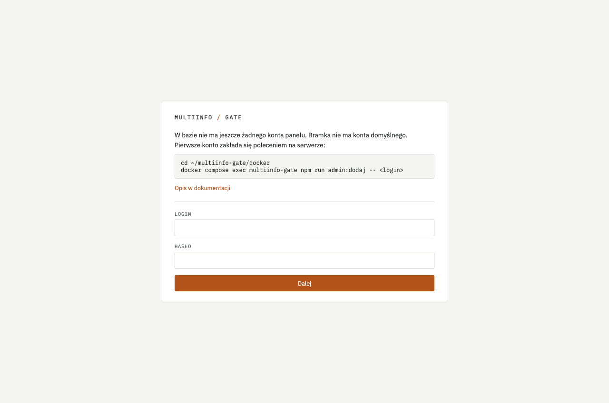

Drugi składnik to jednorazowy sześciocyfrowy kod generowany przez aplikację na telefonie.
Nadaje się Google Authenticator, Microsoft Authenticator, Aegis, 1Password i każda inna
aplikacja zgodna ze standardem TOTP. Kod jest wymagany przy logowaniu obok hasła. Panel wymusza
włączenie drugiego składnika przy pierwszym wejściu. Pokazuje wtedy dziesięć jednorazowych kodów
zapasowych, wyłącznie ten jeden raz. Kody zapasowe zastępują aplikację, gdy telefon jest
niedostępny. Przechowuj je w menedżerze haseł albo w wydruku poza serwerem.

Panel ogranicza próby zgadywania. Pięć błędnych kodów z rzędu unieważnia trwające logowanie: panel
wraca do ekranu hasła i wymaga podania go ponownie. Dziesięć nieudanych prób (hasła albo kodu)
z jednego adresu w ciągu 15 minut blokuje ten adres na 15 minut od ostatniej próby. Panel
odpowiada wtedy komunikatem o zbyt wielu próbach (kod 429), także na poprawne hasło. Obie
sytuacje trafiają do dziennika zdarzeń jako `drugi_skladnik_zablokowany`
i `logowanie_zablokowane`.

## 4. Panel

### 4.1. Dostęp przez tunel SSH

Panel nasłuchuje wyłącznie na adresie lokalnym serwera (`127.0.0.1:8081`). Nie jest osiągalny
z internetu i tak ma pozostać. Dostęp uzyskujesz przez tunel SSH. Tunel to połączenie SSH,
które oprócz zwykłej sesji przekazuje ruch z wybranego portu na Twoim komputerze do wybranego
portu na serwerze. Po zestawieniu tunelu adres `http://127.0.0.1:8081` otwarty w przeglądarce na
Twoim komputerze prowadzi do panelu na serwerze. Cały ruch jest szyfrowany przez SSH.

Polecenie wykonujesz **na własnym komputerze**, w osobnym oknie terminala. Okno ma pozostać
otwarte na czas pracy z panelem:

```bash
ssh -N -L 8081:127.0.0.1:8081 <TWOJ-UZYTKOWNIK>@<ADRES-SERWERA>
```

Opcja `-N` oznacza, że sesja służy tylko do tunelu, bez uruchamiania powłoki. Opcja `-L`
opisuje tunel: port 8081 lokalnie prowadzi do adresu `127.0.0.1` i portu 8081 na serwerze. Po
zestawieniu tunelu polecenie nie wypisuje nic. To stan prawidłowy. Tunel kończysz skrótem Ctrl+C
w tym oknie.

Następnie otwórz w przeglądarce `http://127.0.0.1:8081`. Zaloguj się loginem i hasłem
z rozdziału 3.4. Zeskanuj wyświetlony kod QR aplikacją uwierzytelniającą, wpisz kod z aplikacji
i zapisz kody zapasowe.

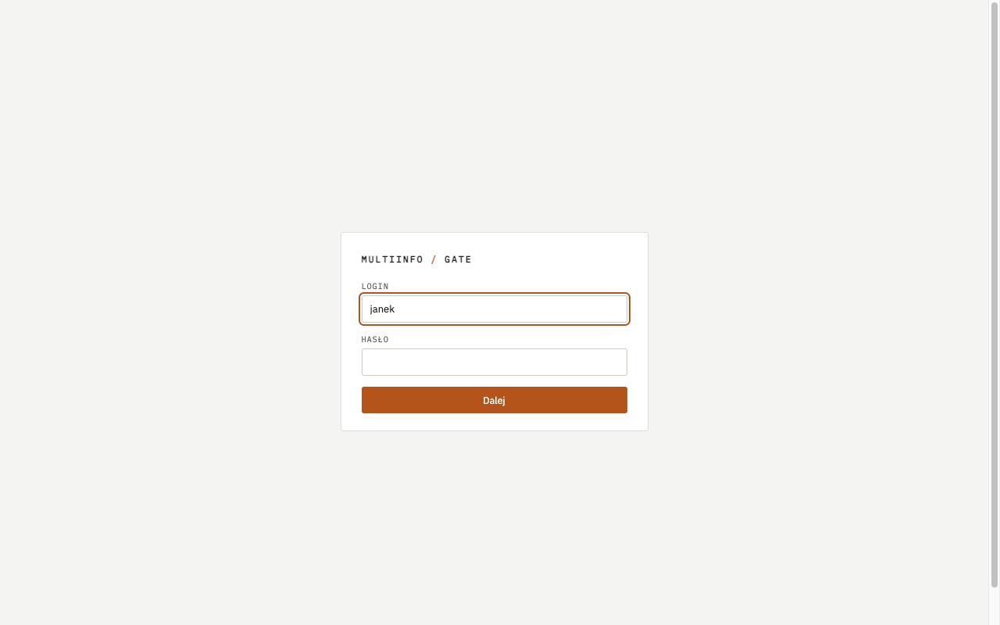

Gdy nie działa:

- przeglądarka zgłasza odmowę połączenia - okno z tunelem zostało zamknięte albo tunel się nie
  zestawił. Uruchom polecenie ponownie i przeczytaj jego komunikat
- `bind [127.0.0.1]:8081: Address already in use` - port 8081 na Twoim komputerze zajmuje inny
  program. Użyj innego portu lokalnego, na przykład `-L 18081:127.0.0.1:8081`. W przeglądarce
  otwórz wtedy `http://127.0.0.1:18081`
- po wpisaniu kodu z aplikacji panel wraca do ekranu hasła z komunikatem „Logowanie trwało zbyt
  długo” - przeglądarka nie zapisała ciasteczka logowania. Ciasteczka panelu mają znacznik
  `Secure`. Przez tunel (`http://127.0.0.1`) honorują go Chrome i Firefox, ale nie Safari.
  Panel przez tunel otwieraj więc w Chrome albo Firefoksie. Pod własną domeną z HTTPS
  (rozdział 6) działa każda przeglądarka

### 4.2. Konto Multiinfo

W panelu otwórz **Konta Multiinfo → Dodaj konto**. Pola formularza:

| Pole | Wartość |
|---|---|
| Nazwa w panelu | dowolna nazwa własna, np. `Firma` |
| Adres bazowy | `https://api2.multiinfo.plus.pl/Api61/` albo z `api1`, zgodnie z punktem 1.5 |
| Login | login użytkownika API (punkt 1.1); musi być zgodny z polem CN certyfikatu |
| Hasło konta Multiinfo | hasło użytkownika API |
| ID usług, jedno w wierszu | identyfikatory usług z punktu 1.3 |
| Domyślny kraj numerów | kod kraju dopisywany do numerów bez prefiksu, dla Polski `48` |
| Przechowywanie treści wiadomości | wyłączone: bramka przechowuje tylko identyfikatory, numery i statusy; włączone: także treść, widoczną w panelu i w API |
| Plik .pfx albo .p12 | plik z punktu 1.2, z dowolnym z tych dwóch rozszerzeń |
| Hasło do pliku .pfx | hasło nadane przy tworzeniu pliku |

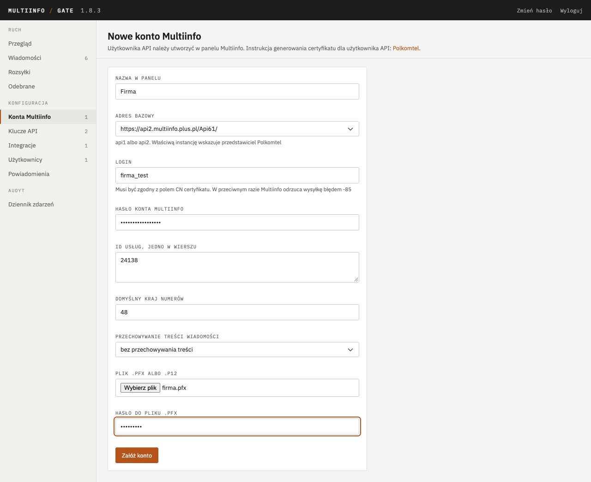

Po zapisaniu bramka otwiera kartę konta z sekcją **Odczytane dane certyfikatu**: podmiot (CN),
wystawca, odcisk SHA-1 i daty ważności. Trzy pierwsze wartości wpisz teraz w panelu Multiinfo,
w edycji użytkownika API, w zakładce Uwierzytelnianie (punkt 1.2, krok 5). Jeżeli CN różni się
od loginu konta, karta pokazuje ostrzeżenie. Oznacza to, że certyfikat został wygenerowany
z innym CN i trzeba go wystawić ponownie.

Konto nie pobiera z Multiinfo listy nadpisów nadawcy, ponieważ Multiinfo takiej listy przez API nie
udostępnia. Nadpisy wpisujesz ręcznie, na liście kont, według punktu 4.4. Komunikat po zapisaniu
konta o tym przypomina.

### 4.3. Sprawdzenie połączenia

Przycisk **Sprawdź połączenie** na karcie konta wysyła do Multiinfo zapytanie testowe
o nieistniejącą wiadomość. Wynik prawidłowy to kod **`-31`**. Znaczy on, że Multiinfo przyjęło
certyfikat i hasło, a odrzuciło jedynie treść zapytania. Inne kody:

| Kod | Znaczenie | Postępowanie |
|---|---|---|
| `-1` | nieprawidłowe hasło użytkownika API | poprawić hasło na karcie konta |
| `-80` | certyfikat nie został przedstawiony | plik `.pfx` nie został wgrany albo jest uszkodzony; wgrać ponownie |
| `-81` do `-84`, `-86` | certyfikat nierozpoznany przez Multiinfo | dane z zakładki Uwierzytelnianie w panelu Multiinfo nie zostały jeszcze wpisane albo różnią się od odczytanych przez bramkę |
| `-85` | CN certyfikatu nie jest zgodne z loginem | wystawić certyfikat z CN równym loginowi |

Sprawdzenie wysyła jeszcze drugie zapytanie, na stronę diagnostyczną Multiinfo `test.aspx`.
Strona odpowiada tym, co serwer Polkomtel odczytał z przedstawionego certyfikatu: podmiotem,
wystawcą i datą ważności. Karta pokazuje te dane pod wynikiem sprawdzenia jako **Certyfikat
widziany przez Multiinfo** i porównuje CN z loginem konta. Różnica między tym, co bramka
odczytała z pliku `.pfx` (punkt 4.2), a tym, co widzi Multiinfo, wskazuje przyczynę kodów `-80`
do `-86` bez zgadywania. Gdy strona odpowiada „Brak certyfikatu”, certyfikat nie dotarł do
serwera. Gdy pokazuje inne CN niż login, plik pochodzi z innego wniosku. Strona nie sprawdza
loginu ani hasła, więc nie zastępuje wyniku `-31`. Jest do niego uzupełnieniem.

Karta konta zachowuje ślad ostatniego sprawdzenia: oba żądania i odpowiedzi, z hasłem
zamaskowanym.

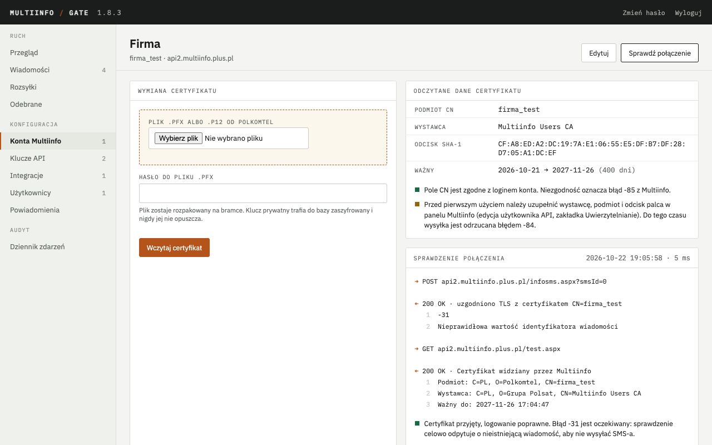

### 4.4. Nadpisy dozwolone dla konta

Listę nadpisów, z których wolno korzystać przy wysyłce z danego konta, prowadzisz w bramce
ręcznie. Multiinfo nie udostępnia przez API listy nadpisów uruchomionych dla
użytkownika API. Bramka nie może więc jej pobrać ani jak sprawdzić, czy podany w żądaniu
nadpis jest uruchomiony. Dowiedziałaby się o tym dopiero z odmowy `-14` przy wysyłce, a wiadomość
byłaby już stracona. Zamiast tego administrator bramki przepisuje do niej nadpisy widoczne
w panelu Multiinfo w edycji użytkownika API, w zakładce Nadpisy (punkt 1.4). Żądanie z nadpisem
spoza tej listy bramka odrzuca kodem `403 orig_not_allowed`, zanim trafi ono do Multiinfo,
z czytelnym komunikatem dla aplikacji.

Na liście kont, pod tabelą kont, przy każdym koncie jest formularz **Nadpisy dozwolone dla
konta, jeden w wierszu** oraz pole wartości domyślnej konta. Wpisuj wyłącznie nadpisy
uruchomione przez Polkomtel i przypisane do tego użytkownika API. Nadpis wpisany na listę, ale
nieuruchomiony przez Polkomtel, przejdzie przez bramkę i zostanie odrzucony przez Multiinfo
kodem `-14`. Wiadomość otrzyma wtedy stan `failed` z tym kodem. Po uruchomieniu kolejnego
nadpisu przez Polkomtel dopisz go tutaj. Inaczej bramka będzie go odrzucać.

Wartość domyślna konta jest używana, gdy żądanie nie podaje pola `orig`, a klucz API nie ma
własnego nadpisu domyślnego (punkt 4.5). Bez wartości domyślnej wiadomość wychodzi z numerem
przydzielonym kontu w Multiinfo jako nadawcą.

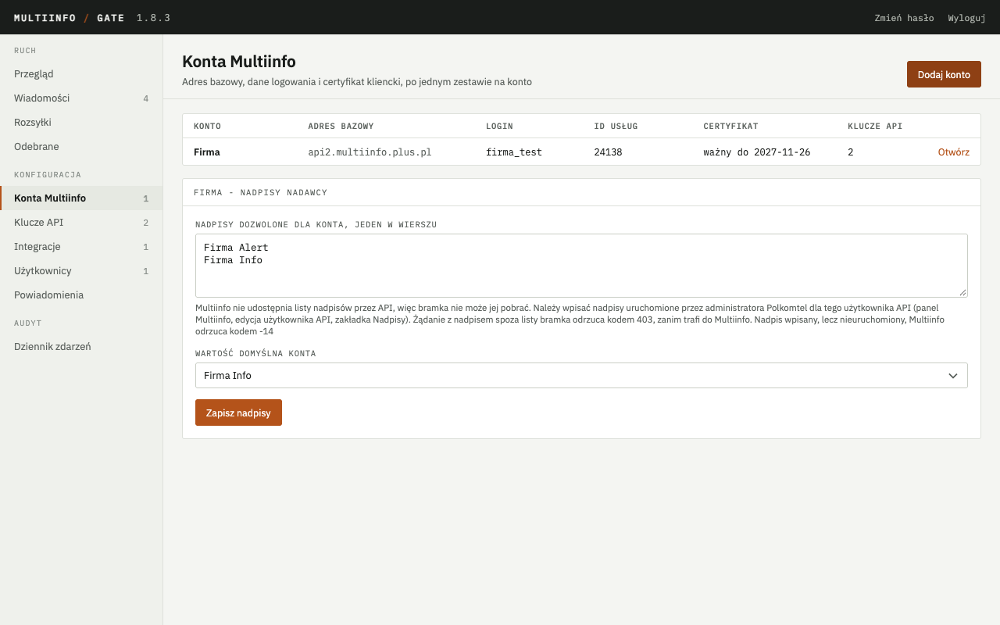

### 4.5. Klucz API

Klucz API identyfikuje aplikację kliencką. Jeden klucz odpowiada jednej aplikacji albo jednemu
kontrahentowi. Dzięki temu limit żądań, odwołanie i dziennik dotyczą jednej aplikacji, a nie
wszystkich.

W panelu otwórz **Klucze API → Wygeneruj klucz**. Formularz pozwala wybrać konto Multiinfo,
nadać nazwę, ograniczyć klucz do wybranych usług i nadpisów, ustawić limit części jednej
wiadomości (1-9), limit żądań na minutę i datę ważności. Pozwala też podać adres webhooka, jeśli
aplikacja ma otrzymywać powiadomienia o doręczeniu (opis w `docs/api.md`, rozdział 6).

Pole **Odbiera wiadomości przychodzące** włącza dla klucza odbiór SMS-ów od abonentów. Bramka
zaczyna wtedy odpytywać Multiinfo o wiadomości z usług klucza i przekazuje każdą powiadomieniem
`message.received` na adres webhooka. Pole wymaga adresu webhooka. Kilka kluczy z dostępem do tej
samej usługi może odbierać naraz. Gdy ostatni odbierający klucz zostanie odwołany, wygaśnie albo
straci zaznaczenie, bramka przestaje odpytywać o tę usługę.

Pole **Tylko integracje** ogranicza klucz do integracji. Klucz z tą opcją nie wysyła SMS-ów przez
`POST /v1/messages` ani `POST /v1/packages`, a takie wywołanie kończy się błędem `403` z kodem
`integrations_only_key`. Opcja jest zalecana dla klucza konektora Power Automate, ponieważ klucz
wklejony w przepływie nie pozwala wtedy ominąć limitu części, ochrony przed burzą ani dziennika
integracji. Lista kluczy oznacza taki klucz plakietką „tylko integracje”. Polecenie sprawdzające
przy nowym kluczu odczytuje wtedy listę integracji zamiast wysyłać SMS.

Stan odbioru widać na karcie konta w sekcji „Odbiór wiadomości”: czy jest aktywny, czas ostatniego
odpytania i ostatniej odebranej wiadomości. Usługa zatrzymana błędem Multiinfo (na przykład
nieaktywna) pokazuje przyczynę. Bramka ponawia odpytanie co 15 minut. Gdy administrator
Polkomtel aktywuje usługę, odbiór wznawia się bez ingerencji. Zapis klucza albo tego konta w panelu
wymusza natychmiastowe odpytanie.

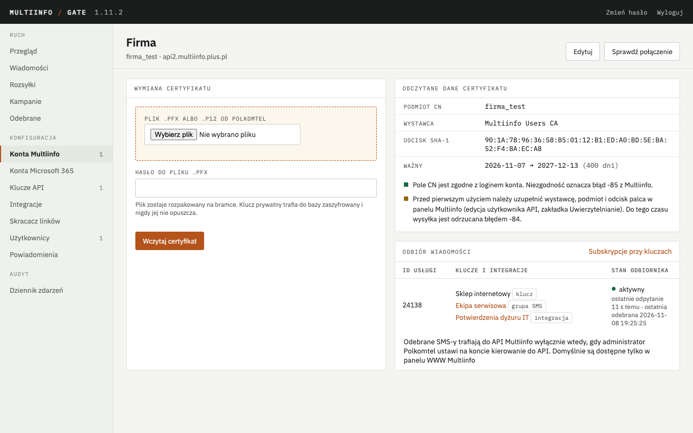

Nad listą kluczy panel prosi raz o **adres, pod którym aplikacje widzą bramkę**. Przy bramce pod
domeną (rozdział 6) jest to `https://<TWOJA-DOMENA>`. Przy kontenerze na Proxmoxie w sieci
firmowej jest to `http://<ADRES-KONTENERA>:8080`. Adres podaje się bez ścieżki na końcu. Z tym
adresem panel pokazuje przy nowym kluczu gotowe polecenie `curl` do wklejenia w terminalu. Przy
integracjach (punkt 4.7) pokazuje pełne adresy wejściowe zamiast samych ścieżek.

Po zapisaniu panel wyświetla jeden raz dwie wartości: **klucz** (`mig_live_...`) oraz **sekret
webhooka**, jeżeli podano adres webhooka. W bazie bramki pozostaje tylko skrót klucza. Panel nie
pokaże tych wartości ponownie. Zapisz je w menedżerze haseł i przekaż osobie odpowiedzialnej
za aplikację kliencką. Utracony klucz zastępuje się nowym: generujesz nowy, przekazujesz
aplikacji, odwołujesz stary. Utracony sekret webhooka wydaje ponownie edycja klucza ze zmianą
adresu webhooka.

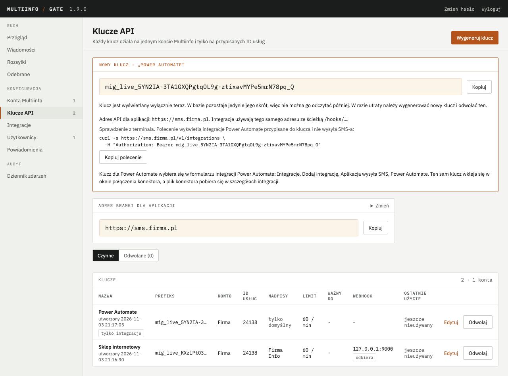

### 4.6. Użytkownicy panelu

Kolejne konta zakłada się na ekranie **Użytkownicy → Dodaj użytkownika**. Formularz przyjmuje
login i hasło startowe. Hasło przekazujesz tej osobie bezpośrednio, ponieważ panel nie wyświetla go
ponownie. Przy pierwszym logowaniu panel wymusza włączenie drugiego składnika, tak jak dla
pierwszego konta.

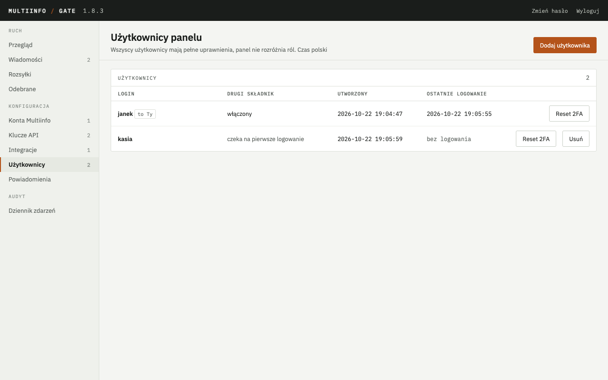

Na liście użytkowników są akcje:

- **Reset 2FA** - usuwa drugi składnik i kody zapasowe danego użytkownika. Przy następnym
  logowaniu panel zażąda ponownego włączenia drugiego składnika. Akcja służy do obsługi utraty telefonu
- **Usuń** - usuwa konto i natychmiast zamyka jego otwarte sesje. Ostatniego konta nie można
  usunąć
- **Zmień hasło** (odnośnik w prawym górnym rogu) - zmiana hasła własnego konta. Po zapisaniu
  pozostałe sesje tego konta zostają zamknięte, bieżąca pozostaje aktywna

Panel nie ma ról. Każdy użytkownik ma pełne uprawnienia. Pierwsze konto zakłada się zawsze
poleceniem z rozdziału 3.4, kolejne z tego ekranu.

### 4.7. Integracje i powiadomienia

Ekran **Integracje** służy aplikacjom, których formatu nie można zmienić. To monitoring
(Uptime Kuma, Grafana, Zabbix), helpdesk (FreeScout, Freshdesk), automatyzacje (n8n, Make,
Zapier) oraz powiadomienia push przez ntfy. Integracja „do SMS” daje aplikacji adres wejściowy
`POST /hooks/<identyfikator>` na porcie API i tłumaczy jej ładunek na SMS według szablonu.
Integracja „z SMS-a” wysyła odebrane SMS-y i statusy na adres aplikacji w jej formacie.
Integracja „Mail2SMS” odczytuje skrzynkę pocztową przez IMAP i zamienia wiadomości od dozwolonych
nadawców na SMS-y. Wymaga wyłącznie połączenia wychodzącego z maszyny bramki do serwera poczty
na porcie 993 (albo 143). W Dockerze ani w Traefiku nie trzeba otwierać żadnego portu. Serwer
poczty w sieci wewnętrznej wymaga `MIG_MAIL_ALLOW_PRIVATE=1` (rozdział 7.7). Do skrzynki
w Microsoft 365 bramka loguje się kontem Microsoft 365 połączonym według punktu 4.8. Integracja
działa w imieniu klucza API z rozdziału 4.5. Załóż go najpierw.

Integracja z Power Automate w kierunku „Aplikacja wysyła SMS” przyjmuje zlecenia wysyłki
z przepływów Microsoft Power Automate. Wymaga bramki dostępnej z internetu pod domeną z HTTPS,
zgodnie z rozdziałem 6. Konektor, jego import i budowę przepływów przedstawia artykuł
[Power Automate](power-automate.md).

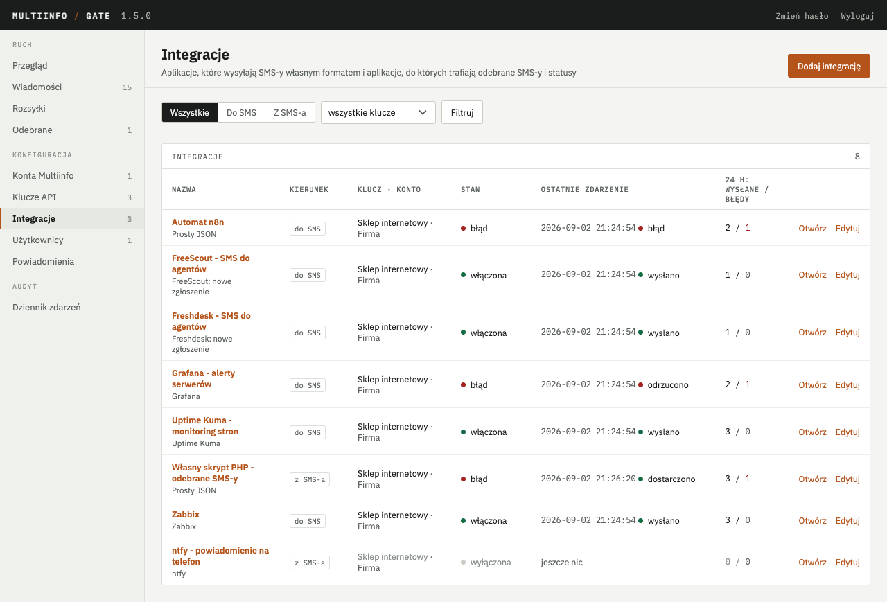

Dodanie integracji to wybór kierunku, wybór gotowego ustawienia (kafelek z nazwą aplikacji)
i formularz w **trybie prostym**. W formularzu podajesz numery telefonów, wybierasz z list
przygotowanych dla tej aplikacji, kiedy wysyłać SMS i jaka ma być jego treść, a hasło generujesz
przyciskiem **Wygeneruj**. Po zapisaniu panel pokazuje pełny adres do wklejenia w aplikacji.
Obok jest zdanie, w którym polu go wkleić, oraz instrukcja krok po kroku. Przełącznik **Zaawansowany** nad
formularzem odsłania pola silnika (ścieżki w ładunku, szablony, reguły) dla zaawansowanych
zastosowań. Ustawienie „Własne” otwiera je natychmiast. Aplikacja w sieci lokalnej jako cel integracji
„z SMS-a” wymaga `MIG_WEBHOOK_ALLOW_PRIVATE=1` w środowisku bramki (rozdział 7.7), tak samo jak
adres webhooka klucza.

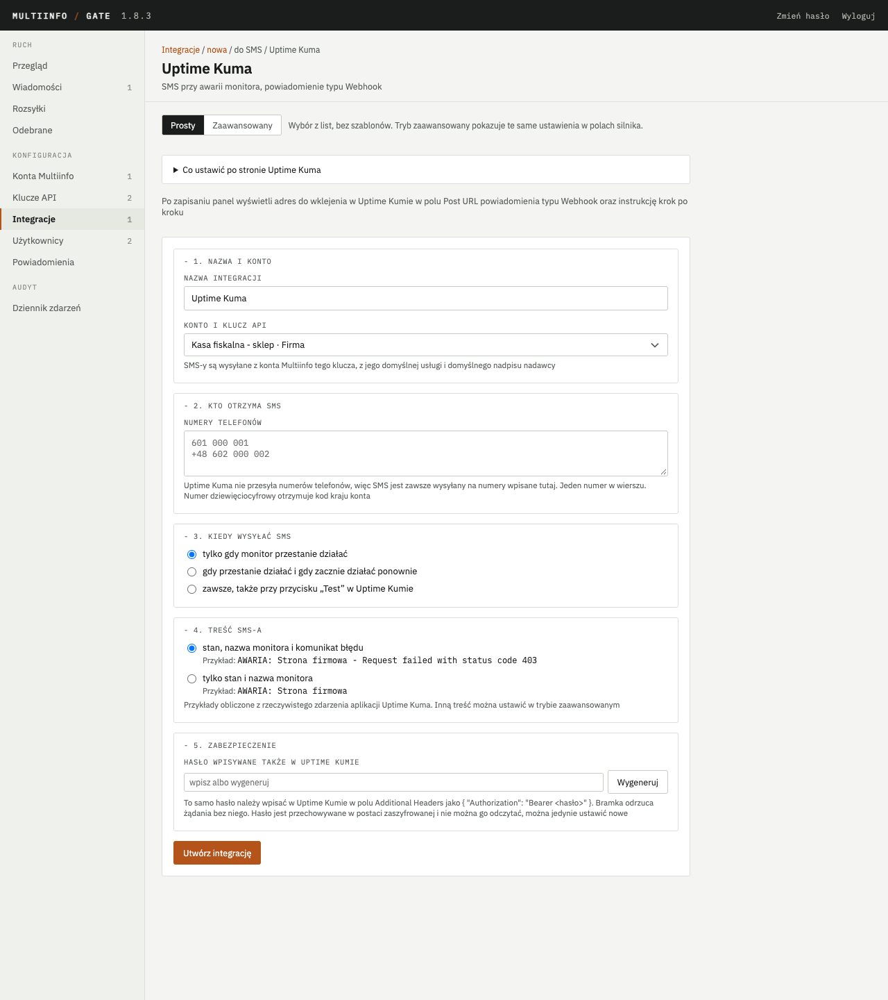

Ekran **Powiadomienia** zawiera trzy zakładki. Zakładka **Konfiguracja** obejmuje ustawienia
serwera SMTP z mailem testowym. Pole **Sposób logowania** określa, czy bramka loguje się do
serwera hasłem, czy przez konto Microsoft 365 z punktu 4.8. Wariant Microsoft 365 jest zalecany
dla firm korzystających z Exchange Online, ponieważ Microsoft wycofuje logowanie hasłem do SMTP.

Zakładka **SMS** włącza kanał SMS, czyli powiadomienia na numery administratorów wysyłane
w imieniu wskazanego klucza API. Kanał działa niezależnie od poczty, dlatego informuje także
o zerwanym koncie Microsoft 365 i o mailu, którego nie udało się wysłać. Zakładka **Reguły**
określa zgłaszane zdarzenia: błędy integracji, przekroczony limit burzy, niedostarczone webhooki,
certyfikat konta na progach dni, konto odrzucające wysyłkę, awarię odbioru, awarię skrzynki,
konto Microsoft 365 wymagające logowania, niewysłany mail z powiadomieniem, nowe wydanie bramki
i podsumowanie dzienne. Każda reguła może dodatkowo wysyłać SMS. Reguły
wymagają skonfigurowanego serwera SMTP albo włączonego kanału SMS. Szczegóły tych ekranów,
gotowe ustawienia aplikacja po aplikacji i język szablonów opisuje rozdział
[Integracje z aplikacjami](integracje.md).

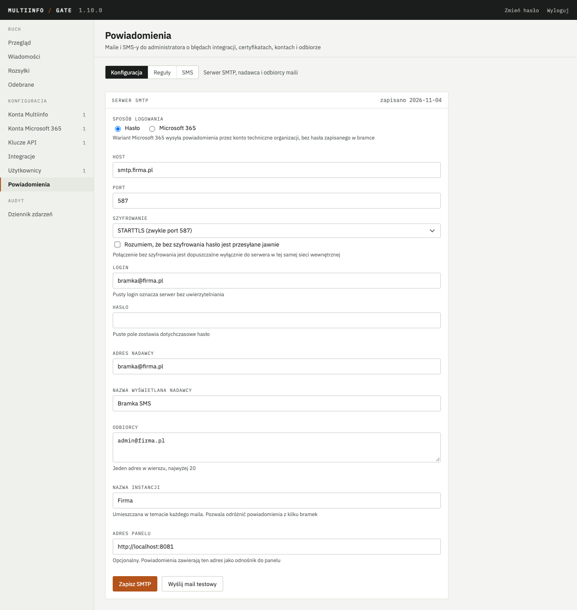

### 4.8. Konto Microsoft 365

Od wersji 1.10 bramka współpracuje z Microsoft 365 przez skrzynkę pocztową przeznaczoną wyłącznie
dla niej, nazywaną dalej skrzynką bramki. Przez tę skrzynkę integracja Mail2SMS odczytuje pocztę
w Exchange Online, a bramka wysyła maile powiadomień i odpowiedzi do nadawców. Microsoft nie
przyjmuje do IMAP hasła skrzynki i wycofuje logowanie hasłem do SMTP. Dlatego skrzynka łączy się
z bramką przez logowanie w przeglądarce, a jej hasło nie trafia do bramki.

Rozdział jest przeznaczony dla administratora bramki, który współpracuje z administratorem
Microsoft 365. Konfiguracja odbywa się wyłącznie w portalach Microsoftu i w panelu bramki, bez
PowerShella. Każda firma rejestruje w swoim katalogu własną aplikację, dlatego bramka nie
korzysta z żadnej usługi pośredniczącej. Skrzynki prywatne Outlook.com nie są obsługiwane.

Przygotowanie obejmuje trzy etapy: skrzynkę bramki w centrum administracyjnym Microsoft 365,
rejestrację aplikacji z przypisaniem skrzynki bramki w centrum administracyjnym Microsoft Entra i
połączenie skrzynki z bramką w panelu. Dwa pierwsze etapy wykonuje administrator Microsoft 365.
Użycie skrzynki w Mail2SMS opisuje rozdział 5.1 [Integracji z
aplikacjami](integracje.md#51-skrzynka), a wysyłkę maili powiadomień rozdział 9.1 tego samego
artykułu.

#### Skrzynka bramki

Skrzynka bramki jest zwykłą skrzynką użytkownika z licencją obejmującą Exchange Online, na przykład
`alarmy@firma.pl`. Skrzynka współdzielona nie wystarcza, ponieważ nie pozwala na logowanie. Bramka
otrzymuje dostęp do każdej skrzynki, do której skrzynka bramki posiada uprawnienia. Dlatego skrzynka
bramki nie powinna posiadać dostępu do innych skrzynek niż odczytywane przez Mail2SMS. Jej
użytkownik nie wymaga żadnej roli administracyjnej. Adres skrzynki bramki powinien należeć do tej
samej domeny co adresy pracowników, którzy piszą do Mail2SMS. Bramka uznaje bowiem pocztę wewnętrzną
bez wyniku SPF i DKIM wyłącznie od nadawców z domeny skrzynki.

1. W centrum administracyjnym Microsoft 365 otwórz **Użytkownicy → Aktywni użytkownicy** i dodaj
   użytkownika z licencją obejmującą skrzynkę Exchange Online.
2. Nadaj użytkownikowi opisową nazwę wyświetlaną, na przykład „Alarmy SMS”. Pod tą nazwą pracownicy
   firmy widzą w Outlooku odpowiedzi i powiadomienia wysłane przez bramkę.
3. Otwórz użytkownika na liście, przejdź na kartę **Poczta** i kliknij **Zarządzaj
   aplikacjami poczty e-mail**.
4. Zaznacz **IMAP** oraz **SMTP z uwierzytelnianiem**, a następnie kliknij **Zapisz zmiany**.

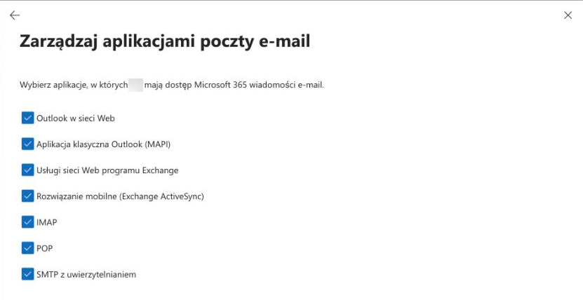

Oczekiwany wynik: centrum administracyjne wyświetla komunikat „Zaktualizowano informacje
Aplikacje poczty e-mail o skrzynce pocztowej”.

Opcja **IMAP** jest potrzebna do odczytu skrzynki w Mail2SMS, a opcja **SMTP z uwierzytelnianiem**
do wysyłki maili przez skrzynkę bramki. Ustawienie SMTP na skrzynce jest nadrzędne wobec
ustawienia organizacji. Dlatego działa także wtedy, gdy organizacja wyłączyła tę opcję dla
pozostałych skrzynek.
Zmiana obu opcji zaczyna obowiązywać po około 30 minutach. Do tego czasu skrzynka może odrzucać
logowanie bramki.

#### Rejestracja aplikacji w Entra ID

Aplikacja zarejestrowana w Entra ID pozwala bramce zalogować się adresem skrzynki bramki i uzyskać
do niej dostęp. Aplikacja działa jako klient publiczny, czyli bez sekretu klienta. Sekret klienta
jest hasłem aplikacji, które wygasa najpóźniej po 24 miesiącach i wymaga odnawiania, dlatego
bramka z niego nie korzysta. Rejestracja wymaga adresu przekierowania, który podaje panel bramki.

1. W panelu bramki otwórz **Konta Microsoft 365 → Dodaj konto**. Skopiuj wartość pola **Adres
   przekierowania** przyciskiem **Kopiuj** i pozostaw formularz otwarty.
2. W centrum administracyjnym Microsoft Entra otwórz **Entra ID → Rejestracje aplikacji** i kliknij
   **Nowa rejestracja**.
3. Wypełnij formularz rejestracji:
    - **Nazwa**: na przykład „Multiinfo Gate”
    - **Obsługiwane typy kont**: **Tylko dla jednej dzierżawy**, czyli wartość domyślna
    - **Identyfikator URI przekierowania**: platforma **Klient publiczny/natywny (mobilne
      i klasyczne)** i adres skopiowany z panelu

    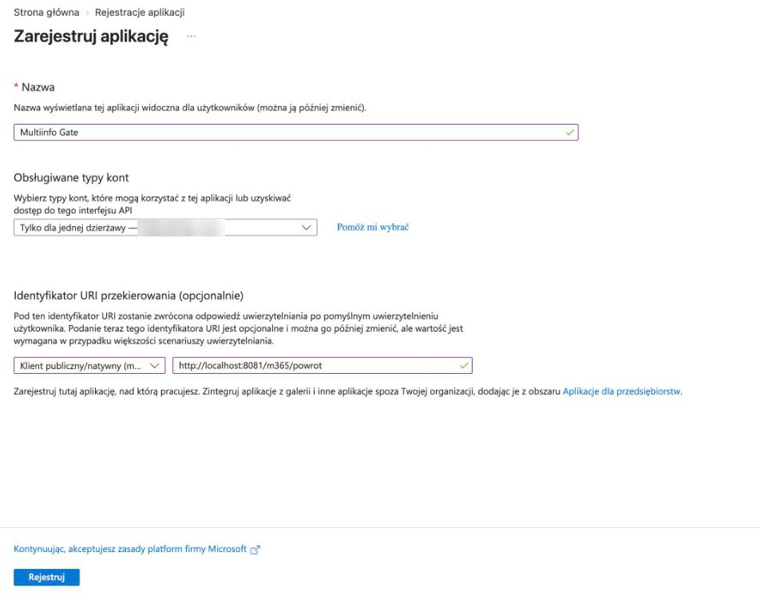

4. Kliknij **Rejestruj**. Jeżeli portal nie otworzy przeglądu nowej aplikacji, znajdziesz ją
   w **Rejestracjach aplikacji** na karcie **Wszystkie aplikacje**.
5. Przejdź do sekcji **Uprawnienia interfejsu API** i kliknij **Dodaj uprawnienie**. Wybierz
   **Microsoft Graph**, a następnie **Uprawnienia delegowane**.
6. Zaznacz sześć uprawnień: `IMAP.AccessAsUser.All`, `SMTP.Send`, `offline_access`, `openid`,
   `email` i `profile`. Zatwierdź wybór przyciskiem **Dodaj uprawnienia**. Następnie usuń
   uprawnienie `User.Read`, które portal dodaje domyślnie. Portal ostrzega wtedy, że zakres jest
   wymagany, ale bramka działa bez niego.
7. Kliknij **Wyraź zgodę administratora dla katalogu** z nazwą organizacji i potwierdź.
8. Przejdź do sekcji **Przegląd** i skopiuj dwie wartości: **Identyfikator aplikacji (klienta)**
   oraz **Identyfikator katalogu (dzierżawy)**.

Oczekiwany wynik: lista uprawnień zawiera sześć wymienionych uprawnień, a kolumna **Stan** przy każdej z nich
podaje „Udzielono dla” z nazwą organizacji.

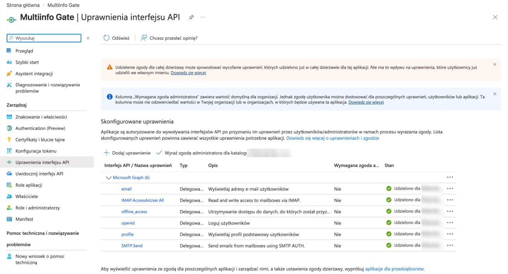

Uprawnienia `IMAP.AccessAsUser.All` i `SMTP.Send` pozwalają odczytywać pocztę i wysyłać maile
w imieniu zalogowanego konta. Uprawnienie `offline_access` pozwala bramce odnawiać logowanie bez
udziału administratora. Uprawnienia `openid`, `email` i `profile` przekazują bramce adres konta.
Zgoda administratora sprawia, że przy logowaniu skrzynki bramki Microsoft nie prosi o zatwierdzenie
uprawnień.

Sekcja **Authentication (Preview)** rejestracji przedstawia wybraną platformę pod nazwą
„Aplikacje mobilne i klasyczne”. W tej sekcji dopiszesz kolejny adres przekierowania, na przykład po zmianie
adresu, pod którym otwierasz panel. Platforma przyjmuje zarówno adres `http://127.0.0.1` z tunelu
SSH, jak i adres `https://` panelu wystawionego pod domeną. W adresie `http://127.0.0.1` Microsoft
nie porównuje numeru portu, dlatego tunel na innym porcie lokalnym nie wymaga zmiany rejestracji.
Adresy `127.0.0.1` i `localhost` są jednak dla Microsoftu różnymi adresami. Rejestracja powinna
zawierać wyłącznie adresy, pod którymi otwierasz panel. Dlatego po wystawieniu panelu pod domeną
usuń adres tunelu, jeżeli z niego nie korzystasz.

#### Przypisanie skrzynki bramki

Zgoda administratora obejmuje wszystkie konta w katalogu. Dlatego bez dodatkowego ustawienia przez
aplikację może zalogować się każde konto organizacji, na przykład własne konto administratora
wybrane omyłkowo przy logowaniu w panelu. Ustawienie „Wymagane jest przypisanie” ogranicza
aplikację do kont przypisanych przez administratora Microsoft 365, czyli do skrzynki bramki.

1. W centrum administracyjnym Microsoft Entra otwórz **Entra ID → Aplikacje dla przedsiębiorstw**
   i wyszukaj aplikację po nazwie nadanej przy rejestracji.
2. Otwórz aplikację i przejdź do sekcji **Właściwości**. Ustaw **Wymagane jest przypisanie?** na
   **Tak** i kliknij **Zapisz**.
3. Przejdź do sekcji **Użytkownicy i grupy** i kliknij **Dodaj użytkownika/grupę**.
4. Kliknij **Niczego nie wybrano**, zaznacz skrzynkę bramki, na przykład „Alarmy SMS”, a następnie
   kliknij **Wybierz** i **Przypisz**.
5. Jeżeli lista zawiera inne konta, zaznacz je i kliknij **Usuń przypisanie**.

Oczekiwany wynik: lista w sekcji **Użytkownicy i grupy** zawiera wyłącznie skrzynkę bramki.
Microsoft odrzuca logowanie każdego innego konta błędem AADSTS50105.

#### Połączenie konta w panelu

1. Wróć do formularza **Nowe konto Microsoft 365** w panelu bramki.
2. Wpisz nazwę konta, na przykład „Dyżur IT”. Pod tą nazwą konto wyświetla się na listach
   panelu.
3. Wklej **Identyfikator katalogu** i **Identyfikator aplikacji** skopiowane w kroku 8
   rejestracji. Zamiast identyfikatora katalogu można podać domenę katalogu, na przykład
   `firma.onmicrosoft.com`.

    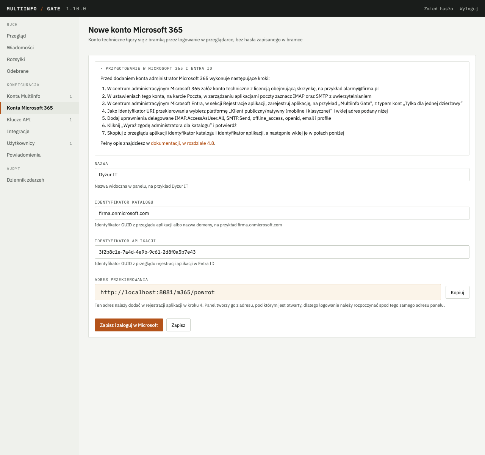

4. Kliknij **Zapisz i zaloguj w Microsoft**. Przeglądarka otworzy stronę logowania Microsoft.
5. Wybierz adres skrzynki bramki, a nie własne konto administratora. Jeżeli adresu nie ma na
   liście, kliknij **Użyj innego konta**.
6. Podaj hasło skrzynki bramki i w razie potrzeby potwierdź logowanie drugim składnikiem.

Oczekiwany wynik: przeglądarka wraca do szczegółów konta w panelu z komunikatem „Połączono jako
alarmy@firma.pl”. Konto otrzymuje stan „Połączone”, a pole **Adres skrzynki** zawiera adres skrzynki
bramki. Microsoft nie wyświetla ekranu zgody, ponieważ zgody udzielił administrator.

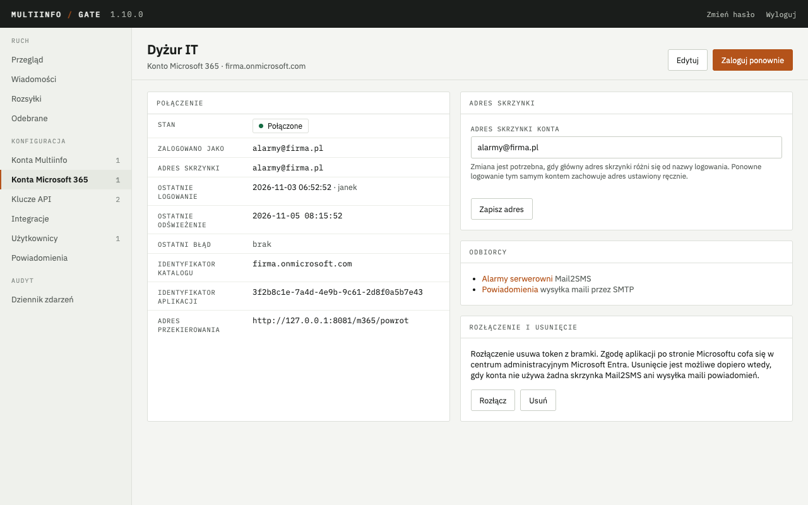

Jeżeli wynik jest inny:

- **Microsoft wyświetla błąd AADSTS50011.** Rejestracja aplikacji nie zawiera adresu
  przekierowania, pod którym otwarto panel. Sposób naprawy opisuje punkt
  [Microsoft odrzuca adres przekierowania](problemy.md#m365-adres-przekierowania)
- **Microsoft wyświetla błąd AADSTS50105.** Wybrane konto nie jest przypisane do aplikacji.
  Zaloguj się adresem skrzynki bramki albo przypisz ją według punktu
  [Przypisanie skrzynki bramki](#przypisanie-skrzynki-bramki)
- **Microsoft wyświetla błąd AADSTS700016.** Identyfikator aplikacji nie odpowiada żadnej
  rejestracji w podanym katalogu. Popraw identyfikatory przyciskiem **Edytuj** w szczegółach konta
- **Microsoft wyświetla błąd AADSTS65001 albo prosi o zgodę na uprawnienia.** Zgoda
  administratora nie obejmuje wszystkich uprawnień. Powtórz krok 7 rejestracji
- **Microsoft wyświetla błąd AADSTS53003.** Zasady dostępu warunkowego blokują logowanie skrzynki
  bramki. Sposób naprawy opisuje punkt
  [Dostęp warunkowy blokuje konto](problemy.md#m365-dostep-warunkowy)
- **Panel wyświetla komunikat „Logowanie wygasło albo zostało już zakończone”.** Od rozpoczęcia
  logowania minęło ponad 10 minut albo w tym czasie bramka została uruchomiona ponownie. Kliknij
  **Zaloguj w Microsoft** albo **Zaloguj ponownie** w szczegółach konta
- **Panel wyświetla komunikat o innym katalogu.** Logowanie odbyło się kontem z innej
  organizacji. Zaloguj się adresem skrzynki bramki z katalogu podanego w ustawieniach konta

#### Stany konta

| Stan | Znaczenie | Skutek dla skrzynek i maili |
|---|---|---|
| Niezalogowane | konto zapisane bez logowania albo rozłączone | skrzynki nie są sprawdzane, maile nie są wysyłane |
| Połączone | logowanie działa | normalna praca |
| Wymaga logowania | Microsoft unieważnił logowanie, na przykład po zmianie hasła konta | skrzynki czekają na ponowne logowanie, maile nie są wysyłane, administrator otrzymuje powiadomienie |
| Błąd połączenia | chwilowy błąd sieci albo usługi Microsoftu | bramka ponawia próbę przy następnym użyciu konta |

Lista kont podaje adres skrzynki, stan, czas ostatniego odświeżenia logowania i odbiorców konta.
Odbiorcami są skrzynki Mail2SMS oraz wysyłka maili powiadomień. Szczegóły konta przedstawiają
dodatkowo osobę i czas logowania oraz ostatni błąd z kodem AADSTS i podpowiedzią.

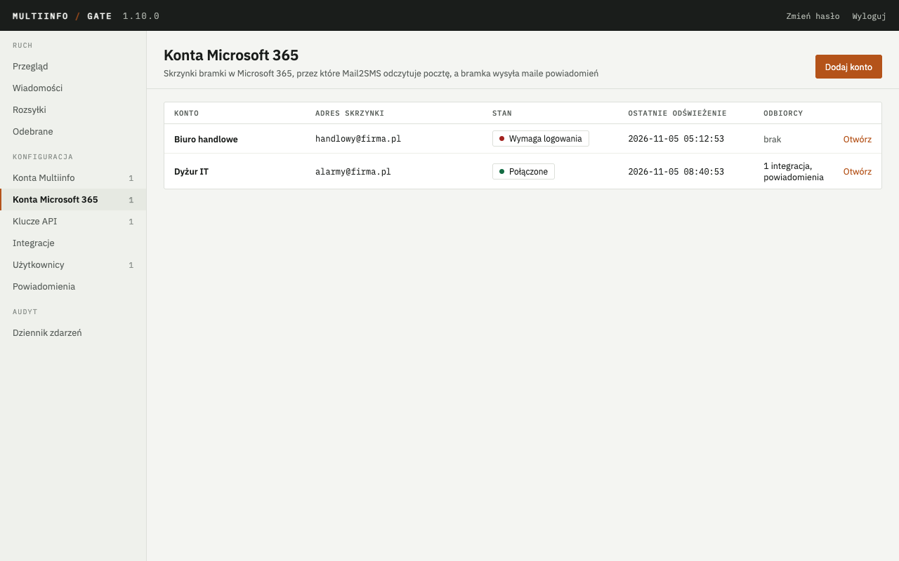

Bramka odczytuje adres skrzynki z danych logowania. Jeżeli główny adres skrzynki różni się od
nazwy logowania, zmień go w szczegółach konta, w panelu **Adres skrzynki**. Ponowne logowanie tym
samym kontem zachowuje adres wpisany ręcznie. Logowanie innym kontem zastępuje go adresem nowego
konta, a panel informuje o tej zmianie.

#### Ponowne logowanie i odcięcie dostępu

Microsoft unieważnia logowanie bramki po zmianie albo resecie hasła skrzynki bramki, po
odwołaniu sesji w Entra ID i po cofnięciu zgody. Logowanie nieużywane przez 90 dni również
wygasa, dlatego bramka co tydzień odświeża logowanie konta, z którego w tym czasie nie
korzystała. Po unieważnieniu logowania konto przechodzi w stan „Wymaga logowania”. Przegląd
panelu wyświetla pasek z nazwą konta i przyciskiem **Zaloguj ponownie**, a menu pokazuje liczbę takich kont przy pozycji **Konta Microsoft 365**. Po ponownym
logowaniu skrzynki wznawiają pracę przy najbliższym sprawdzeniu.

Reguła **Konto Microsoft 365 wymaga logowania** powiadamia administratora mailem i SMS-em. Gdy
przez to konto wychodzą maile powiadomień, bramka wysyła wyłącznie SMS, ponieważ mail nie
zostałby wysłany. Kanał SMS opisuje rozdział 9.5
[Integracji z aplikacjami](integracje.md#95-powiadomienia-sms).

Odwołanie sesji albo zmiana hasła nie zatrzymuje bramki natychmiast. Bramka korzysta jeszcze
z bieżącego tokenu dostępu, który Microsoft wydaje na około godzinę. Natychmiastowe
odcięcie zapewnia przycisk **Rozłącz** w szczegółach konta. Rozłączenie usuwa token z bramki
i ustawia stan „Niezalogowane”. Zgodę aplikacji po stronie Microsoftu cofa się w centrum
administracyjnym Microsoft Entra.

Usunięcie konta jest możliwe dopiero wtedy, gdy nie korzysta z niego żadna skrzynka Mail2SMS ani
wysyłka maili powiadomień. W przeciwnym razie panel podaje listę tych odbiorców. Dodanie,
logowanie, rozłączenie i usunięcie konta trafiają do dziennika zdarzeń panelu.

#### Bezpieczeństwo i sieć

Po zalogowaniu Microsoft przekazuje bramce dwa tokeny, czyli cyfrowe przepustki zamiast hasła.
Token dostępu otwiera skrzynkę i serwer SMTP przez około godzinę. Token odświeżania pozwala bramce
pobierać kolejne tokeny dostępu bez udziału administratora.

Bramka nie przechowuje hasła skrzynki bramki. W bazie zapisuje wyłącznie token odświeżania
zaszyfrowany kluczem głównym, a token dostępu pozostaje w pamięci procesu. Żaden token nie trafia
do dziennika ani do powiadomień. Kopia bazy zawiera token w postaci zaszyfrowanej, dlatego konto
działa po przywróceniu kopii tylko z tym samym kluczem głównym.

Połączenia z Microsoftem są wychodzące. Bramka łączy się wyłącznie z `login.microsoftonline.com`
na porcie 443, z `outlook.office365.com` na porcie 993 i z `smtp.office365.com` na porcie 587.
Zapora na serwerze albo w sieci firmowej musi przepuszczać ten ruch. Docker ani Traefik nie
wymagają otwarcia żadnego portu.


## 5. Pierwsza wysyłka

### 5.1. Tunel do API

Do czasu wystawienia API pod domeną (rozdział 6) port 8080 jest dostępny tylko z serwera. Do
testu z własnego komputera służy tunel jak w rozdziale 4.1, tylko dla portu 8080. Możesz też
dodać drugą opcję `-L` do istniejącego tunelu:

```bash
ssh -N -L 8080:127.0.0.1:8080 <TWOJ-UZYTKOWNIK>@<ADRES-SERWERA>
```

Po zestawieniu tunelu polecenie nic nie wypisuje. Okno zostaje otwarte na czas testów.
Sprawdzenie: `curl http://127.0.0.1:8080/healthz` na własnym komputerze odpowiada
`{"status":"ok"}`.

W kontenerze LXC z rozdziału 9 to polecenie nie zadziała, bo w kontenerze nie ma serwera SSH.
Tam API jest dostępne wprost z sieci albo tunelem przez hosta Proxmox. Polecenia są w punkcie
9.3.

### 5.2. Wysłanie wiadomości

Polecenie wykonujesz na własnym komputerze. `<TWOJ-KLUCZ>` to klucz z rozdziału 4.5. Numer
zastąp własnym numerem testowym:

```bash
curl -s http://127.0.0.1:8080/v1/messages \
  -H "Authorization: Bearer <TWOJ-KLUCZ>" \
  -H "Content-Type: application/json" \
  -d '{"to":"48601000001","text":"Test bramki"}'
```

Oczekiwany wynik:

```json
{"id":"msg_3f9c2a7b1e4d8c6a5b2f","status":"queued","encoding":"gsm","parts":1,"characters":12,"slots":12,"slotsRemaining":148}
```

Status `queued` oznacza przyjęcie do kolejki. Wysyłka następuje w tle, w ciągu sekundy.

### 5.3. Odczyt stanu

```bash
curl -s http://127.0.0.1:8080/v1/messages/<ID> -H "Authorization: Bearer <TWOJ-KLUCZ>"
```

`<ID>` to wartość `id` z poprzedniej odpowiedzi. Oczekiwany wynik: po kilku sekundach
`"status":"sent"`, po kilkunastu `"status":"delivered"` i wiadomość na telefonie. Ten sam stan
pokazuje panel na ekranie **Wiadomości**.

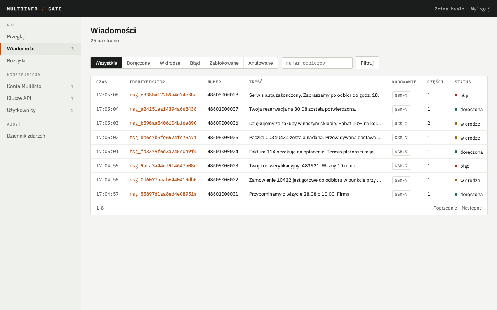

Szczegóły wiadomości (odnośnik w kolumnie identyfikatora) pokazują podgląd segmentów, przebieg
z czasami kolejnych zdarzeń oraz ślad protokołu. Ślad to pełne żądanie do Multiinfo
z zamaskowanym hasłem i odpowiedź linia po linii. Wiadomość zlecona przez integrację ma wiersz
z nazwą integracji, a wiadomość z Mail2SMS dodatkowo wiersz „E-mail nadawcy” z adresem,
z którego przyszła wiadomość e-mail.

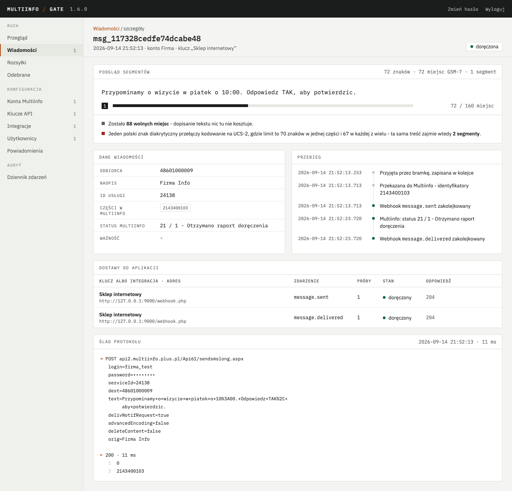

Gdy stan to `failed`, odpowiedź zawiera pola `providerCode` i `error` z powodem:

| `providerCode` | Znaczenie | Postępowanie |
|---|---|---|
| `-14` | nadpis nieuruchomiony przez Polkomtel | użyć nadpisu uruchomionego (punkt 1.4) albo pominąć pole `orig` |
| `-24` | nieznany identyfikator usługi | poprawić identyfikator na karcie konta |
| `-80` do `-86` | certyfikat odrzucony | konto zostało wstrzymane; postępowanie w rozdziale 7.5 |

Odpowiedź `401` na samo żądanie oznacza błędny albo odwołany klucz. Odpowiedź
`403 orig_not_allowed` oznacza nadpis spoza słownika konta albo spoza uprawnień klucza.

### 5.4. Wysyłka z przykładowej aplikacji

Repozytorium zawiera w katalogu `examples/php/` przykładową aplikację w PHP. Ma stronę
z formularzem pojedynczej wiadomości i rozsyłki, listę wysyłek oraz odbiornik webhooków. Służy
jako narzędzie testowe i jako wzorzec kodu do przeniesienia do własnej aplikacji. Instrukcja
uruchomienia jest w `examples/php/README.md`.

### 5.5. Pierwsza wiadomość przychodząca

Po ustawieniu kierowania do API w Multiinfo (punkt 1.6) i zaznaczeniu odbioru przy kluczu
(punkt 4.5) wyślij z telefonu SMS-a na numer usługi. W ciągu kilku sekund wiadomość pojawi się
w panelu w zakładce **Odebrane** (ekran poniżej), a aplikacja otrzyma powiadomienie
`message.received`. Szczegóły wiadomości pokazują, do których kluczy zostało wysłane powiadomienie
i z jakim skutkiem.

Jeżeli lista pozostaje pusta, sprawdź na karcie konta sekcję „Odbiór wiadomości”. Stan
„nieaktywny” oznacza brak odbierającego klucza. Stan „zatrzymany” podaje kod błędu Multiinfo.
Stan „aktywny” z bieżącym czasem pytania oznacza, że bramka odpytuje, ale Multiinfo nie zwraca wiadomości.
Wtedy wiadomości prawdopodobnie trafiają do panelu WWW Multiinfo zamiast do API.

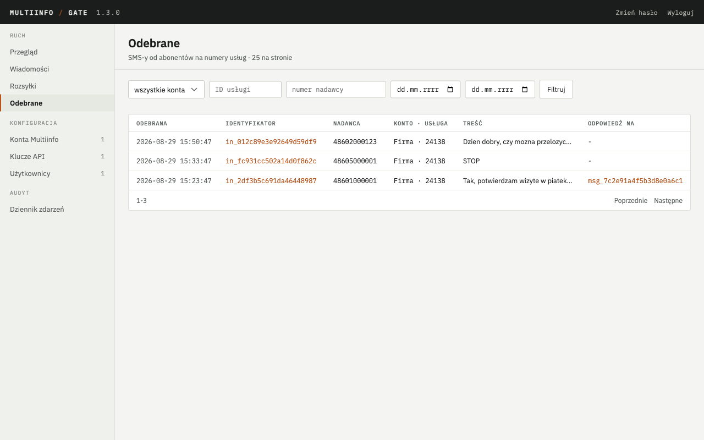

Szczegóły odebranej wiadomości (odnośnik w kolumnie identyfikatora) pokazują dane z Multiinfo:
numer nadawcy, numer usługi, identyfikator w Multiinfo, protokół. Pokazuje też ostatnią
wiadomość wysłaną do nadawcy w ciągu 48 godzin. To podpowiedź kontekstu, ponieważ Multiinfo nie przekazuje informacji,
na którą wiadomość abonent odpowiada. Dalej są odpowiedzi wysłane w wątku oraz ślad dostaw do aplikacji:
który klucz otrzymał powiadomienie, ile było prób i jaka była odpowiedź aplikacji.

Dostawę nieudaną (aplikacja odpowiedziała `4xx` albo wyczerpała ponowienia) można ponowić
przyciskiem „Ponów” w tym samym wierszu. Wraca ona do kolejki jak nowa, z podpisem bieżącym
sekretem klucza. Ten sam przycisk jest w szczególe wiadomości wysłanej, w sekcji „Dostawy do
aplikacji”. Wyjątkiem jest konto bez przechowywania treści. Po zakończeniu dostawy bramka nie ma
już treści SMS-a, więc zamiast przycisku jest podpis, a aplikacja pobiera wiadomość przez
`GET /v1/inbound`.

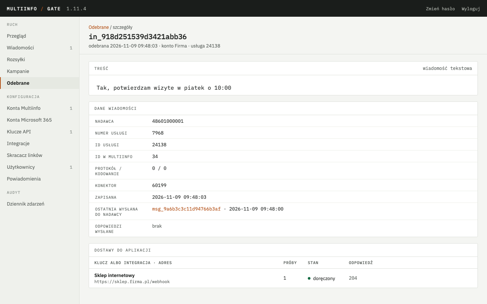

Odpowiedź na odebraną wiadomość wysyła się zwykłym `POST /v1/messages` z polem `inReplyTo`
(`docs/api.md`, rozdział 5a.3). Przykładowa aplikacja ma do tego formularz w sekcji „Odebrane
SMS-y”. Wysłana w ten sposób wiadomość ma w panelu wiersz „Odpowiedź na” z odnośnikiem do
odebranej.

## 6. Wystawienie API pod własną domeną

Ten rozdział dotyczy sytuacji, w której aplikacja kliencka działa poza serwerem bramki. Może to
być agencja obsługująca wysyłki albo system hostowany u innego dostawcy. Aplikacja otrzymuje klucz
API i łączy się z bramką przez internet. Panel pozostaje dostępny wyłącznie przez tunel SSH. Na
zewnątrz wystawia się tylko API.

### 6.1. Pojęcia

**Odwrotne proxy** to serwer WWW ustawiony przed bramką. Przyjmuje połączenia z internetu na
portach 80 (HTTP) i 443 (HTTPS), obsługuje szyfrowanie i przekazuje żądania do bramki na port
8080. Port 8080 pozostaje niedostępny z zewnątrz. Bramka nie musi znać domeny ani obsługiwać
certyfikatów HTTPS.

**HTTPS** szyfruje ruch między aplikacją a serwerem. Bez niego klucz API byłby przesyłany
otwartym tekstem. Do HTTPS potrzebny jest certyfikat wystawiony dla domeny. **Let's Encrypt** to
urząd certyfikacji, który wydaje takie certyfikaty bezpłatnie i automatycznie. Warunek jest
jeden: domena wskazuje na serwer, a port 80 jest otwarty. W ten sposób Let's Encrypt sprawdza,
że serwer należy do wnioskującego. Wszystkie opisane niżej warianty odnawiają certyfikat
samoczynnie.

### 6.2. Domena

U dostawcy domeny (w panelu, w którym domena została zarejestrowana) dodaj rekord typu `A` dla
wybranej nazwy, na przykład `sms.twojafirma.pl`. Rekord ma wskazywać na publiczny adres IP
serwera. Zmiana jest widoczna po czasie od kilku minut do godziny. Sprawdzenie, z dowolnego
komputera:

```bash
dig +short <TWOJA-DOMENA>
```

Oczekiwany wynik: adres IP serwera. Brak wyniku oznacza, że rekord jeszcze się nie
rozpropagował albo został wpisany pod inną nazwą.

### 6.3. Zapora

Do serwera muszą docierać połączenia na porty 80 i 443. U dostawców chmurowych porty otwiera
się w regułach sieciowych maszyny wirtualnej. W Azure jest to „Network security group” i reguła
przychodząca dla portów 80 i 443, protokół TCP, dowolne źródło. U innych dostawców szukaj pod
nazwami „firewall” albo „security group”. Jeżeli na serwerze działa dodatkowo zapora `ufw`:

```bash
sudo ufw allow 80,443/tcp
```

Portów 8080 i 8081 nie otwieraj. Mają pozostać dostępne wyłącznie z samego serwera.

### 6.4. Wybór wariantu

Poniżej trzy równoważne sposoby. Wariant A jest właściwy, gdy na serwerze nie działa inny
serwer WWW. Wariant B jest dla tych, którzy mają już nginx albo go znają. Wariant C jest dla
serwera, który obsługuje już inne kontenery przez Traefik. Wykonaj jeden z nich.

### 6.5. Wariant A: Caddy w kontenerze

Caddy to serwer WWW, który samodzielnie uzyskuje i odnawia certyfikat Let's Encrypt.
Repozytorium zawiera plik `docker/docker-compose.caddy.yml`, który uruchamia Caddy jako drugi
kontener obok bramki, oraz `docker/Caddyfile` z jego konfiguracją. Jedyną wartością do podania
jest domena.

W pliku `docker/.env` (rozdział 3.2) dopisz dwa wiersze:

```
COMPOSE_FILE=docker-compose.yml:docker-compose.caddy.yml
MIG_DOMENA=<TWOJA-DOMENA>
```

Wiersz `COMPOSE_FILE` sprawia, że każde polecenie `docker compose` uwzględnia od tej pory także
plik Caddy. Nie trzeba podawać go za każdym razem opcją `-f`. Jeżeli wiersz `COMPOSE_FILE` już
istnieje (budowanie ze źródeł z rozdziału 3.1), dopisz plik Caddy do niego po dwukropku, zamiast
dodawać drugi wiersz. Następnie, w katalogu `~/multiinfo-gate/docker`:

```bash
docker compose up -d
```

Caddy uzyskuje certyfikat w ciągu około minuty. Sprawdzenie z dowolnego komputera:

```bash
curl https://<TWOJA-DOMENA>/healthz
```

Oczekiwany wynik: `{"status":"ok"}`.

Gdy nie działa, przyczynę wskazuje dziennik Caddy:

```bash
docker compose logs caddy --tail 30
```

Typowe przyczyny: domena nie wskazuje jeszcze na serwer (sprawdź `dig` z rozdziału 6.2), port
80 jest zamknięty w zaporze (Let's Encrypt nie może potwierdzić domeny), literówka
w `MIG_DOMENA`.

Adres klienta w dzienniku integracji wymaga jeszcze jednego kroku. Caddy dopisuje nagłówek
`X-Forwarded-For`, ale bramka ufa mu tylko od adresów z `MIG_TRUSTED_PROXIES`. Kontener
Caddy ma adres z sieci Dockera. W `docker/.env` dopisz więc `MIG_TRUSTED_PROXIES=172.16.0.0/12`
(zakres, z którego Docker przydziela adresy swoim sieciom) i wykonaj `docker compose up -d`.
Bez tego dziennik integracji pokazuje adres Caddy zamiast adresu aplikacji, a lista dozwolonych
źródeł odrzuca wszystkie żądania.

### 6.6. Wariant B: nginx na serwerze

W tym wariancie nginx zainstalowany bezpośrednio w systemie przekazuje ruch do bramki.
Certyfikat uzyskuje i odnawia program certbot. Repozytorium zawiera gotowy plik konfiguracji
nginx.

Polecenia wykonujesz na serwerze. W dwóch ostatnich zastąp `twoja.domena.pl` własną domeną:

```bash
sudo apt install -y nginx python3-certbot-nginx
sudo cp ~/multiinfo-gate/docker/nginx/multiinfo-gate.conf /etc/nginx/sites-available/multiinfo-gate
sudo sed -i 's/<TWOJA-DOMENA>/twoja.domena.pl/' /etc/nginx/sites-available/multiinfo-gate
sudo ln -s /etc/nginx/sites-available/multiinfo-gate /etc/nginx/sites-enabled/
sudo nginx -t && sudo systemctl reload nginx
sudo certbot --nginx -d twoja.domena.pl
```

Polecenia wykonują kolejno: instalują nginx i certbota, kopiują plik konfiguracji, wpisują domenę
w miejsce `<TWOJA-DOMENA>`, włączają konfigurację, sprawdzają składnię (`nginx -t`)
i przeładowują nginx, uzyskują certyfikat. Certbot pyta o adres e-mail (na powiadomienia
o wygasaniu certyfikatu) i o zgodę na warunki usługi. Potem sam dopisuje obsługę HTTPS do pliku
konfiguracji i rejestruje zadanie odnawiania.

Oczekiwany wynik: `nginx -t` wypisuje `syntax is ok` oraz `test is successful`. Certbot kończy
komunikatem `Successfully deployed certificate` albo równoważnym. Sprawdzenie jak w wariancie A:
`curl https://<TWOJA-DOMENA>/healthz` odpowiada `{"status":"ok"}`.

Gdy nie działa: `nginx -t` wskazuje wiersz z błędem składni. Odpowiedź `502 Bad Gateway`
oznacza, że bramka nie działa (sprawdź `docker compose ps` w katalogu `docker/`). Komunikat
certbota `Challenge failed` oznacza, że domena nie wskazuje na serwer albo port 80 jest
zamknięty.

Adres klienta w dzienniku integracji: konfiguracja przekazuje `X-Forwarded-For`, a nginx łączy
się z bramką z adresu `127.0.0.1`. W `docker/.env` dopisz więc `MIG_TRUSTED_PROXIES=127.0.0.1`
i wykonaj `docker compose up -d`.

### 6.7. Wariant C: Traefik już działający na serwerze

Traefik to odwrotne proxy dla kontenerów. Obserwuje Dockera i buduje trasy z etykiet (`labels`)
na kontenerach. Sam uzyskuje certyfikaty Let's Encrypt. Ten wariant zakłada, że Traefik jest już
uruchomiony na serwerze i obsługuje inne usługi. Repozytorium nie zawiera jego instalacji.
Zawiera tylko plik `docker/docker-compose.traefik.yml`, który podłącza bramkę do sieci Traefika
i opisuje ją etykietami.

Z konfiguracji Traefika potrzebne są trzy nazwy. Administrator zna je z jego uruchomienia:

| Wartość | Gdzie w konfiguracji Traefika | Domyślnie w bramce |
|---|---|---|
| sieć Dockera, w której Traefik szuka kontenerów | `--providers.docker.network` albo sekcja `networks` jego pliku Compose | `traefik` |
| punkt wejścia HTTPS | `--entrypoints.<nazwa>.address=:443` | `websecure` |
| resolver certyfikatów | `--certificatesresolvers.<nazwa>.acme...` | `letsencrypt` |

Gdy nazwy zgadzają się z domyślnymi, w `docker/.env` wystarczą dwa wiersze:

```
COMPOSE_FILE=docker-compose.yml:docker-compose.traefik.yml
MIG_DOMENA=<TWOJA-DOMENA>
```

Gdy się różnią, dopisz `MIG_TRAEFIK_SIEC`, `MIG_TRAEFIK_WEJSCIE` i `MIG_TRAEFIK_RESOLVER`
z właściwymi nazwami (tabela w rozdziale 7.7). Istniejący wiersz `COMPOSE_FILE` uzupełniasz jak
w wariancie A. Następnie, w katalogu `~/multiinfo-gate/docker`:

```bash
docker compose up -d
```

Traefik wykrywa kontener w ciągu kilku sekund i uzyskuje certyfikat w ciągu około minuty.
Sprawdzenie jak w wariancie A: `curl https://<TWOJA-DOMENA>/healthz` odpowiada
`{"status":"ok"}`.

Gdy nie działa:

- `network <nazwa> declared as external, but could not be found` przy `docker compose up` -
  nieprawidłowa nazwa sieci w `MIG_TRAEFIK_SIEC`. Listę sieci daje `docker network ls`
- `404 page not found` z Traefika - trasa nie powstała. Najczęściej przez nieprawidłowy punkt wejścia albo
  domenę, którą Traefik obsługuje już dla innego kontenera
- ostrzeżenie o certyfikacie w przeglądarce (certyfikat `TRAEFIK DEFAULT CERT`) - nieprawidłowa nazwa
  resolvera albo port 80 zamknięty
- `404 page not found` z Traefika, a `docker compose ps` pokazuje bramkę w stanie `unhealthy` -
  bramka nie rozpoczęła pracy i działa w trybie awaryjnym. Traefik pomija kontenery w tym stanie,
  dlatego aplikacje dostają 404 zamiast odpowiedzi 503 bramki. Przyczynę pokazuje panel przez
  tunel SSH. Opis zawiera punkt [Bramka nie rozpoczęła pracy](problemy.md#awaria-startu)

W każdym z tych przypadków przyczynę podaje dziennik Traefika:
`docker logs <kontener-traefika> --tail 30`. Porty `127.0.0.1:8080` i `:8081`
z `docker-compose.yml` pozostają na pętli zwrotnej hosta. Traefik łączy się z bramką przez
wspólną sieć, nie przez nie.

Sieć Traefika jest wspólna dla wszystkich obsługiwanych przez niego kontenerów. Dlatego w tym
wariancie panel nasłuchuje wyłącznie na interfejsie sieci własnej bramki (`MIG_ADMIN_HOST=eth0`
w pliku Traefika). Z sieci Traefika osiągalne jest tylko API na porcie 8080, a port panelu 8081
odmawia połączeń. Dostęp do panelu przez tunel SSH (rozdział 4.1) działa bez zmian, bo mapowanie
`127.0.0.1:8081` prowadzi do sieci własnej. Sprawdzenie z kontenera Traefika:
`docker exec <kontener-traefika> wget -qO- http://multiinfo-gate:8081/healthz` ma zakończyć się
błędem `Connection refused`. To samo z portem `8080` ma odpowiedzieć `{"status":"ok"}`.

Adres klienta w dzienniku integracji: Traefik dopisuje `X-Forwarded-For` i łączy się z bramką
z adresu w swojej sieci Dockera. W `docker/.env` dopisz więc `MIG_TRUSTED_PROXIES=172.16.0.0/12`
(albo dokładny zakres sieci Traefika z `docker network inspect <NAZWA-SIECI>`) i wykonaj
`docker compose up -d`.

### 6.8. Przekazanie dostępu aplikacji zewnętrznej

Aplikacja (albo obsługująca ją agencja) potrzebuje:

- adresu API: `https://<TWOJA-DOMENA>`
- własnego klucza API (rozdział 4.5), osobnego dla każdej aplikacji
- dokumentacji `docs/api.md` i, w razie potrzeby, przykładu `examples/php/`

Czego nie udostępniaj: dostępu do panelu (port 8081), portu 8080, konta w panelu bramki.

Limit żądań na minutę ustawiony przy kluczu zabezpiecza przed błędem w cudzej aplikacji, na
przykład wysyłką w pętli. Odwołanie klucza w panelu blokuje aplikację natychmiast, bez restartu
bramki. Limity klucza bramka liczy na klucz, nie na adres nadawcy, więc proxy nie wpływa na ich
działanie. Adres klienta z nagłówka `X-Forwarded-For` bramka przyjmuje wyłącznie od proxy
wymienionych w `MIG_TRUSTED_PROXIES` (uwagi przy wariantach wyżej i rozdział 7.7). Ma to
znaczenie dla listy dozwolonych źródeł i dziennika integracji (rozdział 3.2 w [Integracjach
z aplikacjami](integracje.md)).

## 7. Utrzymanie

### 7.1. Kopie bazy

Bramka wykonuje kopię bazy raz na dobę, po godzinie 02:00 UTC, do katalogu `backups/` na
wolumenie z danymi. Usuwa kopie starsze niż `MIG_BACKUP_RETENTION_DAYS` dni (domyślnie 14).
Kopia jest zaszyfrowana kluczem głównym i bez niego bezużyteczna.

```bash
docker compose exec multiinfo-gate ls -la /data/backups
docker volume inspect docker_gate-data --format '{{.Mountpoint}}'
```

Pierwsze polecenie wypisuje listę kopii: kopie nocne `multiinfo-gate-RRRR-MM-DD.sqlite` i kopie
sprzed aktualizacji `przed-aktualizacja-<WERSJA>.sqlite` (punkt 7.4). Drugie
wypisuje katalog na serwerze, w którym leży wolumin z bazą i kopiami. Zwykle jest to
`/var/lib/docker/volumes/docker_gate-data/_data`.

Kopie poza serwer wykonuj z katalogu `backups/`, nie z działającego pliku bazy. Skopiowanie
`multiinfo-gate.sqlite` w trakcie pracy bramki może dać niespójny plik. Klucz główny przechowuj
oddzielnie od kopii.

### 7.2. Przywrócenie kopii

```bash
docker compose stop
sudo cp <SCIEZKA-WOLUMENU>/backups/multiinfo-gate-RRRR-MM-DD.sqlite <SCIEZKA-WOLUMENU>/multiinfo-gate.sqlite
sudo rm -f <SCIEZKA-WOLUMENU>/multiinfo-gate.sqlite-wal <SCIEZKA-WOLUMENU>/multiinfo-gate.sqlite-shm
docker compose start
```

`<SCIEZKA-WOLUMENU>` to wynik `docker volume inspect` z punktu 7.1. Pliki `-wal` i `-shm` to
dziennik transakcji SQLite należący do poprzedniej bazy. Po zastąpieniu pliku muszą zostać usunięte.
Kopię sprzed aktualizacji przywraca się tak samo. W drugim poleceniu zamiast
`multiinfo-gate-RRRR-MM-DD.sqlite` podaj jej nazwę, na przykład `przed-aktualizacja-1.8.6.sqlite`.

### 7.3. Dziennik

```bash
docker compose logs -f
```

Polecenie wyświetla dziennik na bieżąco. Ctrl+C kończy podgląd. Każdy wpis to jeden wiersz JSON
z polami `at` (czas UTC), `level`, `msg` (nazwa zdarzenia) i identyfikatorami. Dziennik nie
zawiera treści wiadomości, haseł ani pełnych kluczy. Zdarzenia warte uwagi:

| Zdarzenie | Znaczenie |
|---|---|
| `wysylka.przyjeta`, `wysylka.odrzucona` | Multiinfo przyjęło albo odrzuciło wiadomość |
| `wysylka.blad_przejsciowy` | błąd sieci albo Multiinfo; bramka ponowi |
| `konto.wstrzymane` | Multiinfo odrzuciło certyfikat; patrz 7.5 |
| `status.ostateczny` | wiadomość doręczona albo niedoręczona |
| `webhook.dostarczony`, `webhook.nieudany` | wynik dostawy zdarzenia do aplikacji |
| `webhook.odmowa_sieci_wewnetrznej` | adres webhooka wskazuje sieć wewnętrzną, a `MIG_WEBHOOK_ALLOW_PRIVATE` nie jest ustawione; dostawa porzucona |
| `status.porzucony` | Multiinfo nie podało stanu ostatecznego przez siedem dni od przekazania; wiadomość zakończona jako `expired` |
| `rozsylka.zakonczona`, `rozsylka.nieudana` | zakończenie rozsyłki |
| `odbior.start`, `odbior.stop` | bramka zaczęła albo przestała pytać Multiinfo o wiadomości z usługi (zmiana subskrypcji przy kluczach) |
| `odbior.wiadomosc`, `odbior.duplikat` | odebrano wiadomość od abonenta; duplikat to ta sama wiadomość wydana przez Multiinfo ponownie, pominięta |
| `odbior.blad` | błąd sieci albo Multiinfo przy pytaniu o wiadomości; bramka ponowi z rosnącym odstępem |
| `odbior.zatrzymany`, `odbior.nadal_zatrzymany` | Multiinfo odrzuciło zapytanie kodem `-23` albo `-24` (usługa nieznana albo nieaktywna); bramka ponawia co kwadrans (kolejne odmowy jako `nadal_zatrzymany` na poziomie `info`) i od razu po zapisie klucza albo tego konta w panelu |
| `odbior.potwierdzenie_nieudane`, `odbior.wyjatek` | wiadomość zapisana, ale nie potwierdzona w Multiinfo (wróci i zostanie pominięta jako duplikat) albo błąd wewnętrzny przy odbiorze (wiadomość wróci z Multiinfo po kilku minutach; bramka pyta dalej z rosnącym odstępem) |
| `odbior.data_nieczytelna` | Multiinfo podało datę odbioru w nieoczekiwanej postaci; wiadomość jest zapisana z czasem zapisu w bramce zamiast czasu odbioru |
| `kopia.zapisana`, `kopia.blad` | wynik nocnej kopii; brak `kopia.zapisana` przez dwie doby oznacza, że proces nie działa albo nie ma prawa zapisu do wolumenu |
| `worker.wyjatek`, `api.wyjatek` | błąd wewnętrzny; treść wpisu jest materiałem do zgłoszenia. Zadanie workera wraca z rosnącym odstępem (od minuty do pół godziny) |
| `panel.wyjatek` | błąd wewnętrzny panelu; pole `id` to identyfikator zdarzenia ze strony błędu w przeglądarce. Opis w punkcie [Błąd wewnętrzny bramki](problemy.md#blad-wewnetrzny) |
| `bramka.awaria_startu` | bramka nie rozpoczęła pracy i działa w trybie awaryjnym; pole `reason` podaje przyczynę, pole `id` identyfikator ze strony w panelu. Opis w punkcie [Bramka nie rozpoczęła pracy](problemy.md#awaria-startu) |
| `kopia.przed_aktualizacja`, `kopia.przed_aktualizacja_blad` | wynik kopii zapisywanej przy pierwszym starcie nowej wersji (punkt 7.4); nieudana kopia bez zmiany schematu nie zatrzymuje bramki |
| `klucz.czesc_nieczytelna` | część sekretów w bazie zaszyfrowano innym kluczem głównym; pole `groups` wymienia ich rodzaje. Bramka pracuje, ale tych danych nie odczyta. Opis w punkcie [Część danych zaszyfrowana innym kluczem](problemy.md#klucz-czesciowy) |
| `kopia.retencja_blad` | bramka nie usunęła najstarszych kopii przed aktualizacją, na przykład z braku prawa zapisu do katalogu `backups/`; bramka pracuje dalej |
| `worker.zadanie_porzucone` | ósmy z rzędu błąd wewnętrzny tego samego zadania; wysyłka kończy wiadomość stanem `failed`, odpytywanie zostawia w przebiegu wpis o przerwaniu |

### 7.4. Aktualizacja

Wydania są numerowane według schematu `1.2.3`. Pierwsza liczba zmienia się przy zmianach
niezgodnych wstecz, druga przy nowych możliwościach, trzecia przy poprawkach. Numer bieżącej
wersji pokazuje maszt panelu. W wierszu poleceń numer podaje polecenie
`docker compose exec multiinfo-gate grep '"version"' package.json` wykonane w katalogu
`~/multiinfo-gate/docker`. Odpowiedź `/healthz` na porcie panelu zawiera numer wersji wyłącznie
przy zapytaniach z adresu pętli zwrotnej oraz przy zapytaniach HTTPS od odwrotnego proxy wpisanego
w `MIG_TRUSTED_PROXIES`. Zapytanie z innego adresu otrzymuje sam stan. Listę wydań z opisem zmian
znajdziesz pod adresem `https://github.com/sqlik/multiinfo-gate/releases`.

O nowym wydaniu bramka informuje sama. Raz na dobę odpytuje serwis GitHub o najnowsze wydanie
i porównuje je z zainstalowanym. Gdy jest nowsze, na ekranie przeglądu pojawia się pasek
z numerem, datą, odnośnikiem „Co nowego” i odnośnikami do instrukcji aktualizacji. W maszcie,
obok bieżącego numeru, widać wtedy znacznik nowego wydania na każdym ekranie. Przycisk
**Przypomnij przy następnym wydaniu** ukrywa pasek dla tego numeru. Wraca on dopiero przy
kolejnym wydaniu. Administrator otrzymuje też mail, jeden na wydanie, według reguły „Nowe wydanie
bramki” na ekranie Powiadomienia (rozdział 9.2 w [Integracjach z aplikacjami](integracje.md)).
Bez ustawionego SMTP zostaje sam pasek.

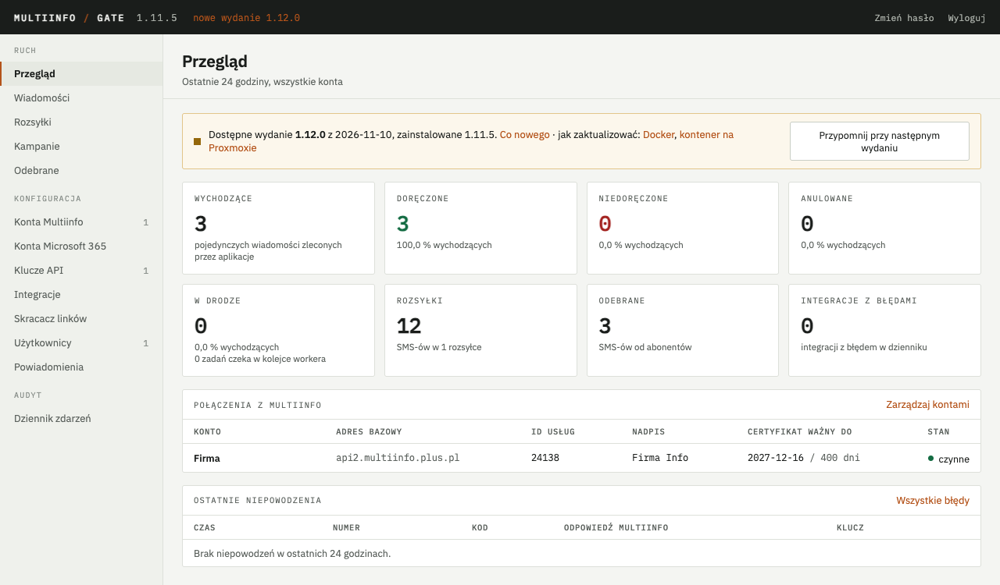

Do serwisu GitHub wysyłane jest wyłącznie to jedno zapytanie, bez żadnych danych o instalacji. Bramka
sprawdza tylko wydania stabilne. Brak dostępu do internetu nie jest błędem: bramka próbuje
ponownie po godzinie, a w dzienniku zostaje wpis na poziomie `info`. Sprawdzanie wyłącza
zmienna `MIG_UPDATE_CHECK=0` w `docker/.env` (rozdział 7.7), na przykład w sieci bez dostępu
do internetu.

Obraz jest oznaczony trzema tagami: `1.2.3` (dokładnie ta wersja), `1.2` (najnowsza poprawka
tej serii) i `1` (najnowsze wydanie zgodne wstecz). Zmienna `MIG_WERSJA` w `docker/.env` wybiera,
który z nich śledzi bramka. Domyślnie jest to `1`, czyli każda aktualizacja w obrębie pierwszej
liczby.

Kopię bazy przed aktualizacją bramka zapisuje sama. Przy pierwszym starcie nowej wersji, zanim
cokolwiek zmieni w bazie, zapisuje plik `backups/przed-aktualizacja-<WERSJA>.sqlite`. `<WERSJA>` to
numer sprzed aktualizacji. Bramka zostawia trzy najnowsze takie kopie. Migracje schematu bazy
uruchamiają się po zapisaniu kopii. Gdy zapis kopii się nie powiedzie, a nowa wersja zmienia
schemat, bramka nie zmienia bazy i pokazuje przyczynę w panelu.

```bash
cd ~/multiinfo-gate/docker
git -C ~/multiinfo-gate pull
docker compose pull
docker compose up -d
```

Polecenia wykonują kolejno: przejście do katalogu z plikami Compose, pobranie nowych plików
uruchomieniowych i dokumentacji, pobranie nowego obrazu, uruchomienie. Oczekiwany wynik:
`curl http://127.0.0.1:8080/healthz` odpowiada `{"status":"ok"}`, a polecenie
`docker compose exec multiinfo-gate grep '"version"' package.json` pokazuje nowy numer.

Kopię sprawdza polecenie `docker compose exec multiinfo-gate ls /data/backups`. Oczekiwany wynik
zawiera plik `przed-aktualizacja-<WERSJA>.sqlite` z numerem poprzedniej wersji. Przy aktualizacji
z wydania starszego niż 1.8.7 kopia nosi nazwę `przed-aktualizacja-do-1.8.7.sqlite`. Starsze
wydania nie zapisywały w bazie swojego numeru.

Plik `.env` przy aktualizacji zostaje bez zmian. Nie twórz go ponownie. Nowy klucz główny sprawia,
że dane w bazie stają się nieczytelne (punkt 3.2).

!!! warning "Powrót do poprzedniej wersji"
    Powrót do poprzedniej wersji wymaga przywrócenia kopii sprzed aktualizacji. Nowa wersja mogła
    zmienić schemat bazy, a starsza takiego schematu nie odczyta.

Powrót do poprzedniej wersji wykonujesz przy zatrzymanej bramce, w katalogu
`~/multiinfo-gate/docker`. Kolejność kroków ma znaczenie. Nowa wersja uruchomiona na przywróconej
kopii ponownie zmieniłaby jej schemat. Najpierw zatrzymaj bramkę i otwórz plik `.env`:

```bash
docker compose stop
nano .env
```

Wpisz w pliku wiersz `MIG_WERSJA=<POPRZEDNIA-WERSJA>`, na przykład `MIG_WERSJA=1.8.6`. Zapisz plik.
Następnie przywróć kopię i uruchom poprzednią wersję:

```bash
W=$(docker volume inspect docker_gate-data --format '{{.Mountpoint}}')
sudo cp $W/backups/przed-aktualizacja-<POPRZEDNIA-WERSJA>.sqlite $W/multiinfo-gate.sqlite
sudo rm -f $W/multiinfo-gate.sqlite-wal $W/multiinfo-gate.sqlite-shm
docker compose up -d
```

Ostatnie polecenie tworzy kontener z obrazu poprzedniej wersji i uruchamia go na przywróconej
kopii. Oczekiwany wynik: `docker compose exec multiinfo-gate grep '"version"' package.json`
pokazuje poprzedni numer.

Przy budowaniu ze źródeł (`docker-compose.build.yml`) zamiast `docker compose pull` wykonujesz
`docker compose up -d --build`. Przy powrocie zamiast zmiany `MIG_WERSJA` wykonaj
`git -C ~/multiinfo-gate checkout v<POPRZEDNIA-WERSJA>`, a na końcu `docker compose up -d --build`.
Typowe problemy po aktualizacji opisuje punkt
[Po aktualizacji coś nie działa](problemy.md#po-aktualizacji).

### 7.5. Certyfikat Multiinfo

Panel ostrzega na ekranie przeglądu 30 dni przed upływem ważności certyfikatu konta. Wymiana
przebiega obiegiem z punktu 1.2. Generujesz nowy certyfikat według instrukcji Polkomtel, z tym
samym CN. Wysyłasz go do podpisu i tworzysz plik `.p12`/`.pfx`. Wgrywasz go na karcie konta
w sekcji **Wymiana certyfikatu**. Wpisujesz nowe dane w zakładce Uwierzytelnianie w panelu
Multiinfo. Na koniec sprawdzasz połączenie.

Gdy Multiinfo odrzuci certyfikat (kody `-80` do `-86`), bramka **wstrzymuje konto**. Wiadomości
pozostają w kolejce i nie są ponawiane w pętli. Ekran przeglądu i karta konta pokazują powód.
Wstrzymanie znosi wgranie nowego pliku `.pfx`. Znosi je także udane sprawdzenie połączenia
z karty konta, po uzupełnieniu danych po stronie Multiinfo. Wysyłka z kolejki wznawia się w ciągu minuty.

### 7.6. Klucze API

Klucz, który wyciekł albo przestał być potrzebny, odwołujesz na ekranie **Klucze API**
przyciskiem **Odwołaj**. Działa to natychmiast. Wymiana klucza wygląda tak: generujesz nowy,
przekazujesz aplikacji, odwołujesz stary. Odwołane klucze pozostają widoczne w zakładce
**Odwołane** ze względu na dziennik i historię wiadomości.

### 7.7. Zmienne środowiskowe

Zmienne ustawia się w `docker/.env` (klucz główny, domena) albo w sekcji `environment` pliku
`docker/docker-compose.yml` (pozostałe):

| Zmienna | Domyślnie | Znaczenie |
|---|---|---|
| `MIG_MASTER_KEY` | - | Klucz główny, 32 bajty w base64, wymagany |
| `MIG_API_PORT` | `8080` | Port publicznego API |
| `MIG_ADMIN_PORT` | `8081` | Port panelu |
| `MIG_API_HOST` | `0.0.0.0` | Adres nasłuchu API |
| `MIG_ADMIN_HOST` | `127.0.0.1` | Adres nasłuchu panelu, poza kontenerem zostaw domyślny; nazwa interfejsu (np. `eth0`) oznacza jego adres IPv4 |
| `MIG_DATA_DIR` | `/data` | Katalog bazy, raportów i kopii |
| `MIG_LOG_LEVEL` | `info` | Jeden z `silent`, `error`, `warn`, `info`, `debug` |
| `MIG_BACKUP_RETENTION_DAYS` | `14` | Ile dni trzymać kopie bazy |
| `MIG_WEBHOOK_ALLOW_PRIVATE` | `0` | `1` pozwala na adresy webhooków w sieci wewnętrznej (pętla zwrotna, `10/8`, `172.16/12`, `192.168/16`, sieć kontenerów); domyślnie bramka wysyła żądania wyłącznie na adresy publiczne i takie tylko przyjmuje w panelu. Potrzebne, gdy aplikacja odbierająca webhooki działa na tym samym serwerze, np. przykład PHP z rozdziału 5 |
| `MIG_MAIL_ALLOW_PRIVATE` | `0` | `1` pozwala na serwer IMAP w sieci wewnętrznej (pętla zwrotna, `10/8`, `172.16/12`, `192.168/16`, sieć kontenerów). Zmienna osobna od `MIG_WEBHOOK_ALLOW_PRIVATE`, ponieważ serwer poczty w sieci firmowej to częstszy przypadek niż aplikacja odbierająca webhooki |
| `MIG_INBOUND_TIMEOUT_MS` | `10000` | Ile milisekund Multiinfo może wstrzymywać odpowiedź na zapytanie o wiadomości przychodzące (1-60000). Przy wartości domyślnej odbiór trwa zwykle poniżej sekundy, najwyżej ok. 10 s, kosztem sześciu pytań na minutę na usługę. Maksimum `60000` (long polling z dokumentacji Multiinfo) zmniejsza liczbę pytań, ale wiadomość, która nadejdzie między dwoma pytaniami, czeka do końca następnego - opóźnienie odbioru sięga wtedy minuty. Mała wartość razem z `MIG_INBOUND_IDLE_MS` daje odpytywanie okresowe |
| `MIG_INBOUND_IDLE_MS` | `0` | Przerwa po pustej odpowiedzi, zanim bramka wyśle kolejne zapytanie, `0` oznacza zapytanie natychmiastowe |
| `MIG_TRUSTED_PROXIES` | - | Adresy odwrotnych proxy (IP albo zakresy CIDR po przecinku), od których API ufa nagłówkowi `X-Forwarded-For`; bez listy adresem źródłowym żądania jest adres gniazda, czyli za proxy adres proxy. Ustawiana w `docker/.env`: `172.16.0.0/12` dla Caddy i Traefika w Dockerze, `127.0.0.1` dla nginx na serwerze (rozdział 6). Potrzebna, gdy integracje korzystają z listy dozwolonych źródeł albo dziennik powinien pokazywać adres klienta (rozdział 3.2 w [Integracje z aplikacjami](integracje.md)). Proxy z tej listy przekazujące żądanie HTTPS otrzymuje też szczegóły `/healthz` panelu (punkt 7.4) |
| `MIG_UPDATE_CHECK` | `1` | Raz na dobę sprawdzać w serwisie GitHub, czy jest nowsze wydanie, i pokazywać je na przeglądzie (rozdział 7.4); `0` wyłącza, np. w sieci bez dostępu do internetu |
| `MIG_WERSJA` | `1` | Tag obrazu do pobrania: `1`, `1.1` albo `1.1.0` (rozdział 7.4) |
| `MIG_DOMENA` | - | Domena bramki dla wariantu Caddy i Traefik |
| `COMPOSE_FILE` | - | Dodatkowe pliki Compose oddzielone dwukropkiem: `docker-compose.caddy.yml` włącza Caddy, `docker-compose.traefik.yml` Traefik, `docker-compose.build.yml` budowanie ze źródeł; zawsze po `docker-compose.yml` |
| `MIG_TRAEFIK_SIEC` | `traefik` | Wariant Traefik: sieć Dockera, w której Traefik szuka kontenerów |
| `MIG_TRAEFIK_WEJSCIE` | `websecure` | Wariant Traefik: punkt wejścia HTTPS |
| `MIG_TRAEFIK_RESOLVER` | `letsencrypt` | Wariant Traefik: nazwa resolvera certyfikatów |

## 8. Lista kontrolna po wdrożeniu

Do sprawdzenia na docelowym serwerze, na koncie produkcyjnym i numerze testowym:

- [ ] `https://<TWOJA-DOMENA>/healthz` odpowiada `{"status":"ok"}`, a `http://<ADRES-SERWERA>:8080` i `:8081` z zewnątrz nie odpowiadają
- [ ] Sprawdzenie połączenia na karcie konta daje `-31`
- [ ] Wiadomość testowa bez polskich znaków dociera, w panelu ma stan `delivered`
- [ ] Wiadomość z polskimi znakami dociera z poprawnymi znakami
- [ ] Wiadomość z nadpisem dociera z tym nadpisem jako nadawcą
- [ ] Rozsyłka na dwa numery testowe dociera, raport CSV pobiera się z panelu
- [ ] Webhook `message.delivered` dociera do przykładowej aplikacji z poprawnym podpisem
- [ ] SMS wysłany z telefonu na numer usługi jest w zakładce Odebrane, a przykładowa aplikacja otrzymała `message.received`
- [ ] Odwołany klucz otrzymuje `401`
- [ ] Konto panelu ma drugi składnik, kody zapasowe są przechowywane poza serwerem
- [ ] Drugi użytkownik panelu zalogował się hasłem startowym i włączył drugi składnik
- [ ] Po nocy w `backups/` leży plik z datą

## 9. Proxmox VE

Jeżeli masz własny serwer z Proxmox VE, możesz uruchomić bramkę w kontenerze LXC zamiast na
maszynie wirtualnej z Dockerem. Ten rozdział zastępuje rozdziały 2 i 3 oraz punkty 7.1 do 7.4.
Rozdziały 1 (przygotowania po stronie Multiinfo), 4 (panel) i 8 (lista kontrolna) obowiązują bez
zmian. W rozdziale 5 (pierwsza wysyłka) zamiast punktu 5.1 obowiązuje punkt 9.3, bo w kontenerze
nie ma SSH i droga do API jest inna. Rozdział 6 dotyczy serwera, który wystawia API bramki na
świat. W sieci firmowej jest to zwykle istniejące odwrotne proxy albo osobny kontener z nginx
według punktu 6.6.

Do wyboru są dwa warianty. Pierwszy to kontener bez Dockera, tworzony jednym skryptem (punkt
9.1). Drugi to kontener z Dockerem, w którym bramka działa dokładnie tak jak na serwerze
z rozdziału 3 (punkt 9.5).

### 9.1. Kontener LXC skryptem

Skrypt `proxmox/ct/multiinfogate.sh` z repozytorium bramki jest napisany w formacie skryptów
[community-scripts](https://github.com/community-scripts/ProxmoxVE) i korzysta z ich silnika
kreatora. Leży jednak w repozytorium bramki i nie wymaga niczego z ich katalogu. Skrypt wykonuje
kolejno: pobiera szablon Debiana 13, tworzy nieuprzywilejowany kontener (1 rdzeń, 1 GB pamięci,
4 GB dysku, adres z DHCP), instaluje najnowsze wydanie Node.js 22, pobiera źródła najnowszego wydania bramki
z GitHuba i buduje je, tworzy konto systemowe `multiinfo-gate`, generuje klucz główny,
rejestruje usługę systemd i zakłada pierwsze konto panelu. Dockera w kontenerze nie ma.

Polecenie wykonujesz w powłoce hosta Proxmox jako `root`. W interfejsie Proxmox jest to węzeł →
**Shell**. Można też połączyć się przez SSH na adres hosta:

```bash
bash -c "$(curl -fsSL https://raw.githubusercontent.com/sqlik/multiinfo-gate/main/proxmox/ct/multiinfogate.sh)"
```

Kreator pyta, czy użyć ustawień domyślnych, czy zaawansowanych (nazwa kontenera, adres IP,
mostek sieciowy, rozmiar dysku, hasło `root`). Przy pierwszym uruchomieniu dowolnego skryptu
w tym formacie silnik pyta też o zgodę na wysyłanie anonimowych statystyk do community-scripts.
Odpowiedź jest zapisywana na hoście i dotyczy skryptów z ich katalogu. Skrypt bramki statystyk
nie wysyła niezależnie od odpowiedzi. Instalacja trwa od trzech do pięciu minut. Większość tego
czasu zajmuje pobranie zależności i budowa.

Oczekiwany wynik: komunikat `Zakończono pomyślnie`, numer kontenera oraz dwa adresy, panel na
porcie 8081 i API na porcie 8080, pod adresem, który kontener otrzymał z DHCP.

Instalacja bez pytań, na przykład w skrypcie automatyzującym, przyjmuje ustawienia w zmiennych
przed poleceniem:

```bash
var_admin_user=janek var_admin_pass='<HASLO-CO-NAJMNIEJ-12-ZNAKOW>' var_ram=2048 \
  bash -c "$(curl -fsSL https://raw.githubusercontent.com/sqlik/multiinfo-gate/main/proxmox/ct/multiinfogate.sh)"
```

`var_admin_user` i `var_admin_pass` ustalają login i hasło pierwszego konta panelu (zasady jak
w punkcie 3.4). Bez nich login to `admin`, a hasło losuje instalator. `var_cpu`, `var_ram`
(w MB) i `var_disk` (w GB) zmieniają zasoby kontenera. Pozostałe zmienne silnika opisuje
dokumentacja community-scripts.

Gdy nie działa:

- kreator kończy się komunikatem o braku szablonu albo błędem pobierania - host Proxmox nie ma
  dostępu do internetu albo do repozytorium szablonów. Sprawdzeniem jest `pveam update`
  w powłoce hosta
- instalacja przerywa się na budowaniu bramki - dziennik instalacji wskazany w komunikacie
  pokazuje ostatnie wiersze. Najczęściej brakuje pamięci (przy ponownym uruchomieniu podaj
  `var_ram=2048`) albo GitHub odmówił kolejnego pobrania z tego adresu (limit zapytań bez
  logowania; odczekaj godzinę)
- `Bramka nie odpowiada na /healthz` - usługa nie wystartowała. Przyczynę pokazuje
  `pct exec <NUMER-KONTENERA> -- journalctl -u multiinfo-gate -n 20`
- `Please run this script as root` mimo `sudo` - silnik wymaga sesji `root`, nie polecenia
  poprzedzonego `sudo`. Najpierw `sudo -i`, potem polecenie kreatora
- `/etc/pve/storage.cfg does not exist` - Proxmox zainstalowany na gotowym Debianie nie tworzy
  tego pliku, dopóki konfiguracja magazynu nie zostanie zapisana. Naprawia to jednorazowe
  `pvesm set local --content vztmpl,rootdir,images,iso,backup,snippets` w powłoce hosta

### 9.2. Konto panelu i dostęp

Login i hasło pierwszego konta leżą w kontenerze w pliku dostępnym tylko dla `root`:

```bash
pct exec <NUMER-KONTENERA> -- cat /root/multiinfo-gate.creds
```

`<NUMER-KONTENERA>` to numer wypisany przez kreator. Widać go też na liście w interfejsie
Proxmox. Po zalogowaniu i włączeniu drugiego składnika plik można usunąć.

Panel nasłuchuje na adresie kontenera (`MIG_ADMIN_HOST=eth0`), a nie tylko na pętli zwrotnej
jak w rozdziale 4. Powód: w kontenerze LXC nie ma domyślnie serwera SSH, przez który można byłoby
zestawić tunel z punktu 4.1. Nie oznacza to logowania zwykłym HTTP z sieci. Panel wymaga HTTPS
albo adresu lokalnego. Pod `http://<ADRES-KONTENERA>:8081` pokazuje ekran logowania z tą
informacją, a próbę zalogowania odrzuca. Do panelu prowadzą dwie drogi:

- **Tunel SSH przez hosta Proxmox.** Polecenie wykonujesz na własnym komputerze, w osobnym
  oknie terminala, które zostaje otwarte na czas pracy:

  ```bash
  ssh -N -L 8081:<ADRES-KONTENERA>:8081 root@<ADRES-HOSTA-PROXMOX>
  ```

  `<ADRES-KONTENERA>` to adres wypisany przez kreator (na przykład `10.10.10.159`).
  `<ADRES-HOSTA-PROXMOX>` to adres, pod którym host jest dostępny przez SSH. Następnie otwórz
  w przeglądarce `http://127.0.0.1:8081` i postępuj jak w punkcie 4.1: logowanie danymi z pliku
  wyżej, kod QR, kody zapasowe. Tunel prowadzi do adresu kontenera, ale przeglądarka widzi adres
  lokalny. Panelowi to wystarcza
- **Odwrotne proxy z HTTPS w sieci firmowej.** Jeżeli w sieci działa już nginx, Caddy albo
  Traefik z certyfikatem, może kierować `https://panel.<TWOJA-DOMENA>` na
  `http://<ADRES-KONTENERA>:8081` z nagłówkiem `X-Forwarded-Proto: https`. Przykładowe
  konfiguracje z rozdziału 6 robią to samo dla API. Panel jest wtedy dostępny z każdego
  komputera w sieci, nadal za hasłem i drugim składnikiem

Bez logowania z sieci widać jedynie ekran logowania i `http://<ADRES-KONTENERA>:8081/healthz`
z samym polem `status`. Szczegóły, czyli wersję, kolejkę i konta Multiinfo z dniami do końca
certyfikatu, panel podaje wyłącznie zapytaniom z adresu pętli zwrotnej, na którym w kontenerze
LXC nie nasłuchuje. Otrzymuje je także odwrotne proxy, które przekazuje żądanie HTTPS, a jego adres
znajduje się w `MIG_TRUSTED_PROXIES`. Numer wersji podaje maszt panelu.

Gdy nawet ekran logowania w sieci jest niepożądany, na przykład w sieci z obcymi urządzeniami,
wpisz w pliku `/etc/multiinfo-gate/env` wiersz `MIG_ADMIN_HOST=127.0.0.1` i wykonaj
`systemctl restart multiinfo-gate`. Do panelu wchodzisz
wtedy tunelem do samego kontenera według punktu 4.1. Wymaga to włączenia w nim serwera SSH:
`systemctl enable --now ssh` i hasło `root` ustawione poleceniem `passwd`, albo dostęp SSH
z ustawień zaawansowanych kreatora.

Dalej obowiązuje rozdział 4 od punktu 4.2: konto Multiinfo, sprawdzenie połączenia, klucz API.

### 9.3. Tunel do API i pierwsza wysyłka

Punkt 5.1 zakłada serwer z SSH, na którym port 8080 słucha tylko na pętli zwrotnej. W kontenerze
z punktu 9.1 jest inaczej. Serwera SSH nie ma, a API słucha na adresie kontenera
(`MIG_API_HOST=0.0.0.0` w `/etc/multiinfo-gate/env`), tak samo jak panel. Do API prowadzą więc
dwie drogi. Wybór zależy od tego, gdzie znajduje się komputer, z którego wykonujesz test:

- **Komputer w tej samej sieci co kontener** (na przykład Proxmox w biurze, test z biurowego
  laptopa). API jest dostępne bez tunelu, wprost pod adresem kontenera. Sprawdzenie:

  ```bash
  curl http://<ADRES-KONTENERA>:8080/healthz
  ```

  Oczekiwany wynik: `{"status":"ok"}`. W poleceniach z punktów 5.2 i 5.3 wpisuj wtedy
  `http://<ADRES-KONTENERA>:8080` zamiast `http://127.0.0.1:8080`
- **Komputer poza siecią kontenera** (Proxmox w innej lokalizacji, dostęp tylko przez SSH do
  hosta). Potrzebny jest tunel przez hosta Proxmox, jak dla panelu w punkcie 9.2, tylko dla
  portu 8080. Polecenie wykonujesz na własnym komputerze, w osobnym oknie terminala, które
  zostaje otwarte na czas testów:

  ```bash
  ssh -N -L 8080:<ADRES-KONTENERA>:8080 root@<ADRES-HOSTA-PROXMOX>
  ```

  Opcja `-N` oznacza sesję bez powłoki, służącą tylko do tunelu. Opcja
  `-L 8080:<ADRES-KONTENERA>:8080` opisuje tunel: port 8080 na własnym komputerze prowadzi do
  adresu kontenera i portu 8080, przez hosta, do którego prowadzi SSH. Po zestawieniu tunelu
  polecenie nic nie wypisuje. To stan prawidłowy. Sprawdzenie w drugim oknie terminala:
  `curl http://127.0.0.1:8080/healthz` odpowiada `{"status":"ok"}`. Polecenia z punktów 5.2
  i 5.3 działają wtedy bez zmian, z adresem `http://127.0.0.1:8080`. Tunel kończysz skrótem
  Ctrl+C w jego oknie

Panel i API można prowadzić jednym tunelem, dwiema opcjami `-L` w jednym poleceniu:

```bash
ssh -N -L 8081:<ADRES-KONTENERA>:8081 -L 8080:<ADRES-KONTENERA>:8080 root@<ADRES-HOSTA-PROXMOX>
```

Dalej obowiązują punkty 5.2 do 5.5: wysłanie wiadomości, odczyt stanu, przykładowa aplikacja,
pierwsza wiadomość przychodząca.

Gdy nie działa:

- `curl` na własnym komputerze zgłasza `Connection refused` pod `127.0.0.1:8080` - okno
  z tunelem zostało zamknięte albo tunel nie został zestawiony. Wykonaj ponownie polecenie
  `ssh` i przeczytaj jego komunikaty
- `ssh` wypisuje `bind: Address already in use` - port 8080 na własnym komputerze zajmuje inny
  program, często inna instancja bramki albo poprzedni tunel. Rozwiązaniem jest inny port lokalny,
  na przykład `-L 18080:<ADRES-KONTENERA>:8080`. W poleceniach wpisujesz wtedy
  `http://127.0.0.1:18080`
- `curl` zgłasza `Connection refused` pod adresem kontenera (wprost albo przez tunel, w którym
  polecenie `ssh` nie zgłasza błędu) - usługa w kontenerze nie działa. Przyczynę pokazuje
  `pct exec <NUMER-KONTENERA> -- journalctl -u multiinfo-gate -n 20` w powłoce hosta
- odpowiedź `401` z `error.code` `missing_api_key` albo `invalid_api_key` - tunel i API
  działają, a problem jest w nagłówku `Authorization`. Sprawdź, czy klucz z punktu 4.5 został
  skopiowany w całości

API pod adresem kontenera jest dostępne w sieci bez HTTPS. Klucz API jest w niej przesyłany jawnym
tekstem. Do testów w zaufanej sieci firmowej to wystarcza. Aplikacjom, zwłaszcza spoza tej
sieci, API udostępnia się przez odwrotne proxy z HTTPS według rozdziału 6, kierowane na
`http://<ADRES-KONTENERA>:8080`.

### 9.4. Utrzymanie w kontenerze

Polecenia wykonujesz w kontenerze. `pct enter <NUMER-KONTENERA>` w powłoce hosta otwiera w nim
sesję `root`. Wyjście: `exit`.

| Co | Gdzie |
|---|---|
| Kod bramki (podmieniany przy aktualizacji) | `/opt/multiinfo-gate` |
| Konfiguracja, w tym klucz główny | `/etc/multiinfo-gate/env` |
| Baza danych, raporty i kopie | `/var/lib/multiinfo-gate`, kopie w `backups/` |
| Dane pierwszego konta panelu | `/root/multiinfo-gate.creds` |
| Usługa | `systemctl status multiinfo-gate`, `systemctl restart multiinfo-gate` |
| Dziennik | `journalctl -u multiinfo-gate -f` (opis zdarzeń w punkcie 7.3) |

Plik `/etc/multiinfo-gate/env` zastępuje `docker/.env` i sekcję `environment` z rozdziału 7.7.
Zmiana zmiennej wymaga `systemctl restart multiinfo-gate`. Klucz główny z tego pliku skopiuj od
razu do menedżera haseł, z powodów opisanych w punkcie 3.2.

Kopie bazy powstają jak w punkcie 7.1, w `/var/lib/multiinfo-gate/backups`. Przywrócenie kopii:

```bash
systemctl stop multiinfo-gate
cd /var/lib/multiinfo-gate
install -o multiinfo-gate -g multiinfo-gate -m 640 backups/multiinfo-gate-RRRR-MM-DD.sqlite multiinfo-gate.sqlite
rm -f multiinfo-gate.sqlite-wal multiinfo-gate.sqlite-shm
systemctl start multiinfo-gate
```

`install` kopiuje plik i nadaje mu właściciela usługi. Pliki `-wal` i `-shm` należą do
poprzedniej bazy i muszą zniknąć, jak w punkcie 7.2.

O nowym wydaniu bramka informuje tak samo jak w Dockerze (punkt 7.4): paskiem na ekranie
przeglądu, znacznikiem w maszcie i mailem według reguły „Nowe wydanie bramki”. Sprawdzanie
wyłącza wpis `MIG_UPDATE_CHECK=0` w `/etc/multiinfo-gate/env` i `systemctl restart multiinfo-gate`.

Aktualizacja do najnowszego wydania to jedno polecenie w kontenerze:

```bash
update
```

Polecenie sprawdza w serwisie GitHub, czy jest nowsze wydanie. Jeżeli jest, zatrzymuje usługę,
zapisuje kopię bazy jako `backups/przed-aktualizacja-<WERSJA>.sqlite`, pobiera i buduje nowe
wydanie, po czym uruchamia usługę. Bramka zostawia trzy najnowsze kopie przed aktualizacją. Migracje bazy wykonują się same przy starcie. Oczekiwany
wynik: `Zaktualizowano do wydania <WERSJA>`, a po zalogowaniu maszt panelu pokazuje nowy numer.
Panel w kontenerze nasłuchuje na adresie kontenera, nie na `127.0.0.1`, więc `curl` z punktu 7.4
tu nie zadziała. Gdy nowszego wydania nie ma, polecenie kończy się komunikatem o braku
aktualizacji.

Może się zdarzyć, że po aktualizacji usługa nie startuje, a `journalctl -u multiinfo-gate -n 30`
pokazuje błąd `Could not locate the bindings file` z listą ścieżek `better_sqlite3.node`.
Oznacza to, że npm w wersji 12 albo nowszej zablokował skrypt instalacyjny biblioteki
`better-sqlite3` i jej część natywna nie została zbudowana. Wydania od 1.4.1 wyrażają zgodę na
ten skrypt polem `allowScripts` w `package.json`. Przy aktualizacji na starsze wydanie naprawa
polega na zbudowaniu biblioteki wprost z jej katalogu (polecenie `npm run` nie podlega blokadzie)
i ponownym starcie usługi:

```bash
cd /opt/multiinfo-gate/node_modules/better-sqlite3
npm run install
systemctl restart multiinfo-gate
```

Powrót do poprzedniego wydania po nieudanej aktualizacji to przywrócenie kopii
`przed-aktualizacja-<WERSJA>.sqlite` i ręczne pobranie tamtego wydania. Usługa startuje dopiero na
końcu, już z poprzednim wydaniem. Nowe wydanie uruchomione na przywróconej kopii ponownie
zmieniłoby jej schemat.

```bash
systemctl stop multiinfo-gate
cd /var/lib/multiinfo-gate
install -o multiinfo-gate -g multiinfo-gate -m 640 backups/przed-aktualizacja-<WERSJA>.sqlite multiinfo-gate.sqlite
rm -f multiinfo-gate.sqlite-wal multiinfo-gate.sqlite-shm
rm -rf /opt/multiinfo-gate && mkdir /opt/multiinfo-gate
curl -fsSL https://github.com/sqlik/multiinfo-gate/archive/refs/tags/v<WERSJA>.tar.gz | tar -xz --strip-components=1 -C /opt/multiinfo-gate
cd /opt/multiinfo-gate && echo "allow-scripts=better-sqlite3" > .npmrc
npm ci --no-audit --no-fund && npm run build && npm prune --omit=dev
rm -f ~/.multiinfo-gate
systemctl start multiinfo-gate
```

`<WERSJA>` to numer sprzed aktualizacji, na przykład `1.1.2`. Wpis w `.npmrc` wyraża zgodę na
skrypt instalacyjny `better-sqlite3` w wydaniach sprzed 1.4.1, które nie mają pola
`allowScripts`. Nowszy npm bez tej zgody utworzyłby instalację bez części natywnej.
W nowszych wydaniach wpis niczemu nie szkodzi. Usunięcie pliku `~/.multiinfo-gate` sprawia, że
kolejne `update` znów zaproponuje najnowsze wydanie.

Typowe problemy po aktualizacji opisuje punkt
[Po aktualizacji coś nie działa](problemy.md#po-aktualizacji).

### 9.5. Kontener z Dockerem

Jeżeli w kontenerze ma działać dokładnie ten układ, który opisują rozdziały 3 i 7: obraz
z GHCR, `docker compose`, warianty Caddy i Traefik. Wtedy utwórz kontener LXC z Dockerem
skryptem z katalogu community-scripts, w powłoce hosta Proxmox:

```bash
bash -c "$(curl -fsSL https://raw.githubusercontent.com/community-scripts/ProxmoxVE/main/ct/docker.sh)"
```

Skrypt tworzy kontener Debiana z zainstalowanym Dockerem. W kreatorze warto podnieść dysk do
8 GB. Dalej, już w kontenerze (`pct enter <NUMER-KONTENERA>`), obowiązuje rozdział 3 od punktu
3.1. Pomijasz `sudo`, ponieważ sesja jest sesją `root`, oraz punkt 2.2, bo Docker już jest. Panel
jest wtedy dostępny wyłącznie przez tunel SSH do kontenera, jak w punkcie 4.1.

### 9.6. Integracje: skąd aplikacja wywołuje kontener

Integracje z rozdziału [Integracje z aplikacjami](integracje.md) dają aplikacjom adres
`POST /hooks/<identyfikator>` na porcie API. Panel pokazuje samą ścieżkę. W kontenerze z tego
rozdziału API słucha na adresie kontenera, więc pełny adres zależy od tego, gdzie działa
aplikacja:

- **Aplikacja w tej samej sieci co kontener** (Uptime Kuma, Zabbix, Grafana, FreeScout
  w firmie). Adres to `http://<ADRES-KONTENERA>:8080/hooks/<identyfikator>`, bez tunelu i bez
  proxy, jak w punkcie 9.3. Warunek: kontener ma adres z sieci firmowej, czyli mostek `vmbr0`
  hosta jest spięty z kartą sieciową, a nie z prywatną siecią NAT. Sprawdzenie z komputera, na
  którym działa aplikacja: `curl http://<ADRES-KONTENERA>:8080/healthz` odpowiada
  `{"status":"ok"}`
- **Aplikacja w internecie** (Grafana Cloud, Freshdesk, FreeScout u hostingodawcy, Zapier,
  Make). Kontener nie ma publicznego adresu, więc aplikacja nie nawiąże z nim połączenia. Potrzebne jest
  odwrotne proxy z HTTPS pod publiczną domeną, tak jak w rozdziale 6, tylko kierowane na
  `http://<ADRES-KONTENERA>:8080`. Może to być nginx z wariantu B na hoście Proxmox albo na
  innym serwerze w sieci, z otwartymi portami 80 i 443 i rekordem `A` domeny wskazującym na ten
  serwer. W konfiguracji nginx zamiast `proxy_pass http://127.0.0.1:8080` wpisujesz adres
  kontenera. W `/etc/multiinfo-gate/env` kontenera wpisujesz
  `MIG_TRUSTED_PROXIES=<ADRES-SERWERA-Z-NGINX>` i wykonujesz `systemctl restart multiinfo-gate`,
  żeby dziennik integracji pokazywał adres aplikacji
- **Host Proxmox w chmurze z siecią NAT** (kontener z adresem w rodzaju `10.10.10.x`, widoczny
  tylko z hosta). To szczególny przypadek poprzedniego. Proxy musi działać na samym hoście, bo
  tylko on widzi kontener. Porty 80 i 443 otwiera się w regułach sieciowych maszyny (w Azure
  „Network security group”). Do testów bez domeny wystarcza tunel SSH z punktu 9.3 i wywołanie
  adresu wejściowego z własnego komputera przez `http://127.0.0.1:8080`

W drugą stronę, gdy to bramka wywołuje aplikację (integracja „z SMS-a” albo webhook klucza), adres
aplikacji w sieci firmowej wymaga `MIG_WEBHOOK_ALLOW_PRIVATE=1` w `/etc/multiinfo-gate/env`
i `systemctl restart multiinfo-gate`. Bez tego panel odrzuca taki adres przy zapisie. Serwer
poczty Mail2SMS w sieci firmowej wymaga analogicznie `MIG_MAIL_ALLOW_PRIVATE=1` w tym samym
pliku (docs/integracje.md, rozdział 5.1).
